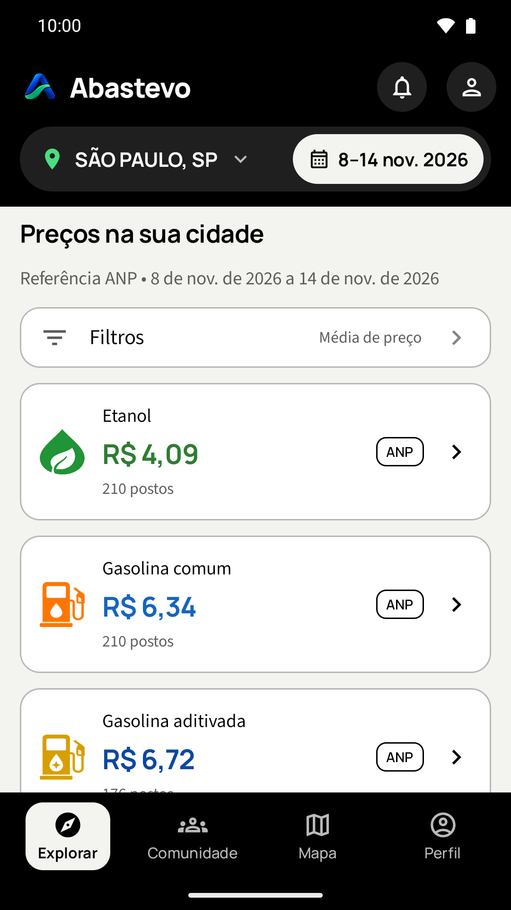
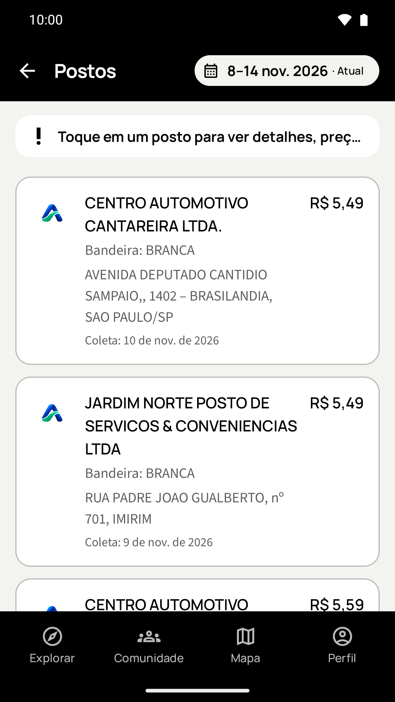
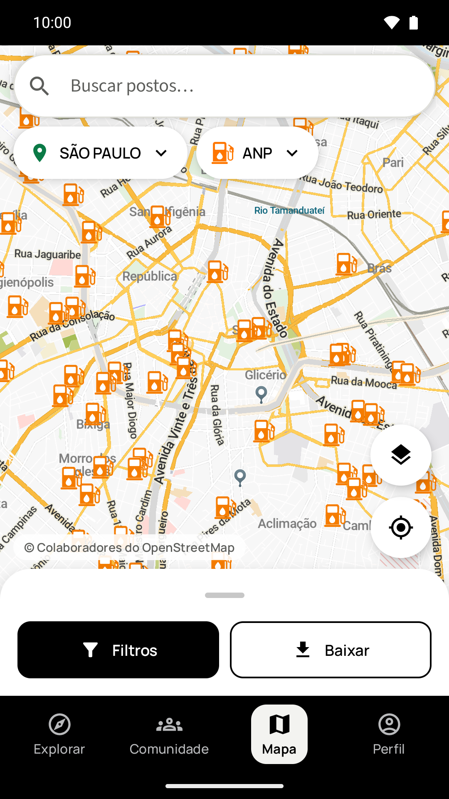
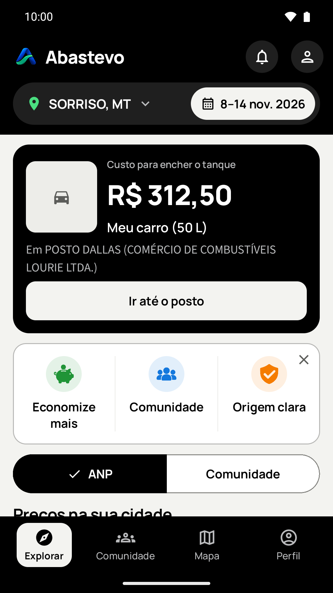
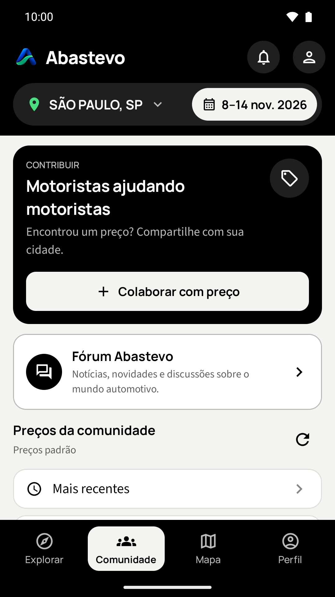
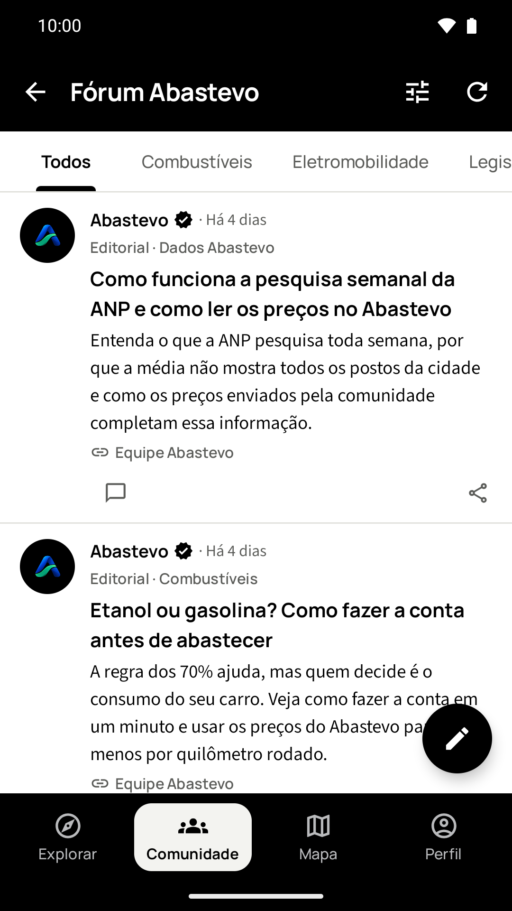
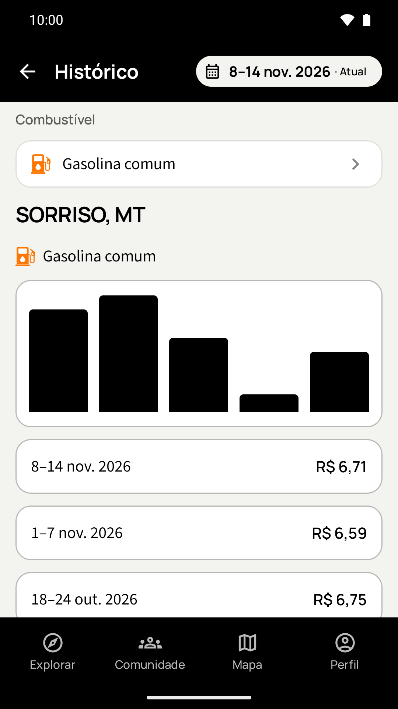
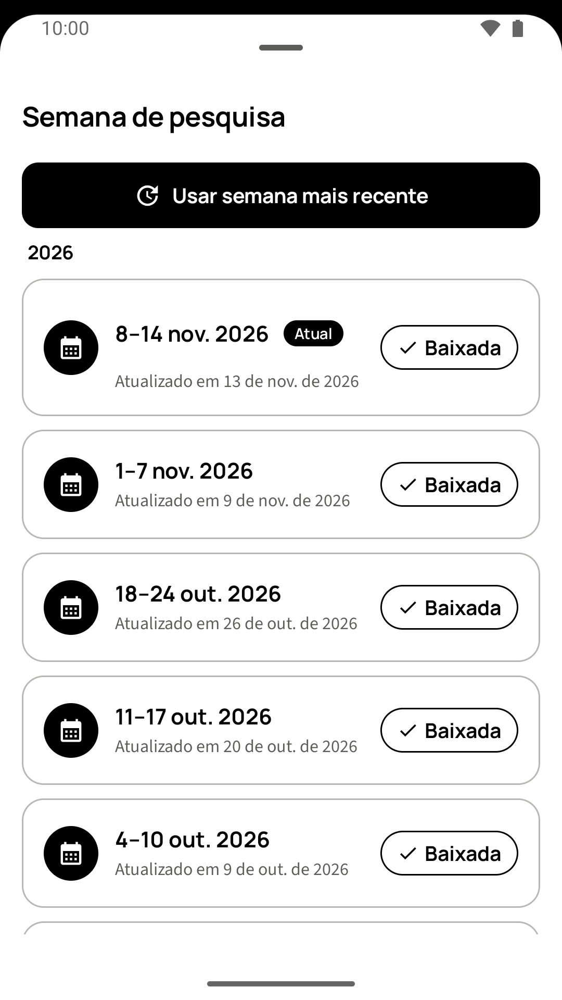
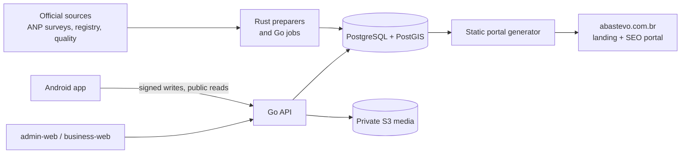

# Abastevo

Fuel prices for every Brazilian city, from the official ANP survey and from
the driver community. Android app, public website at
[abastevo.com.br](https://abastevo.com.br), offline maps and a forum.

<p align="center">
  
  
  
  
</p>
<p align="center">
  
  
  
  
</p>

## Features

- **Official prices:** weekly ANP averages per municipality for gasoline,
  ethanol, diesel, CNG and LPG, always labelled with the survey week.
- **Stations:** price, brand and address per station, cheapest first, with
  route to the station.
- **Map:** stations and EV charging points; regional maps can be downloaded
  for offline use.
- **Your vehicles:** cost to fill the tank for up to three vehicles, price-drop
  notifications and week-by-week history.
- **Offline:** survey weeks and maps stay on the device.
- **Community:** share the price you saw at the pump (optional photo), rate
  stations, comment, and read guides and discussions in the forum. Browsing
  needs no account; participating needs only a username. Community data is
  always shown apart from official data.
- **Abastevo Empresas:** private fleet, fueling, expense and trip management
  for companies (under construction).

Abastevo is independent and not affiliated with ANP or any government body.

## Architecture



- **Android** (`app`, `application`, `domain`, `data`, `maps/engine`): Kotlin,
  Jetpack Compose, Room, Hilt, WorkManager, native CoMaps-derived map engine.
- **Backend** (`backend`): Go modular monolith (chi, pgx, sqlc, slog) with
  PostgreSQL/PostGIS, private S3 media and background jobs.
- **Web** (`landing`, `admin-web`, `business-web`): TypeScript static builds.
- **Infrastructure** (`infra`): k3s on a VPS behind Caddy and Cloudflare; a
  deploy agent applies signed releases built from `main`.

More in [docs/architecture/](docs/architecture/) and the agent guide in
[AGENTS.md](AGENTS.md).

## Getting started

```bash
./gradlew test                                  # Android unit tests
./gradlew :app:assembleDebug                    # debug APK
cd backend && go test ./...                     # backend unit tests
bash scripts/check-backend-fast.sh              # backend fast gate (format, vet, staticcheck, sqlc)
cd landing && npm ci && npm test && npm run build
make quick-verify                               # the change-aware gate CI runs
```

Backend integration tests need a disposable PostGIS; see
[backend/README.md](backend/README.md). Local Android setup, signing and the
map engine are covered in [docs/android/](docs/android/).

## Documentation

- [docs/README.md](docs/README.md): documentation index.
- [AGENTS.md](AGENTS.md): how to work in this repository (humans and agents).
- [ROADMAP.md](ROADMAP.md): what is planned and not done yet.
- [CONTRIBUTING.md](CONTRIBUTING.md): contribution workflow.

## Status

- The backend, website and portal run in staging at
  [abastevo.com.br](https://abastevo.com.br), deployed automatically from `main`.
- Signed Android builds are published as GitHub prereleases; the Google Play
  submission is being prepared ([store readiness](docs/store/play-readiness.md)).
- iOS is archived.

## License and attribution

Material the owner can license is under the
[Abastevo Visible Attribution License 1.0](LICENSE). Third-party use, including
commercial use, must keep a readable credit visible during normal use:
**Abastevo** with a link to this repository and **Alexandre Zanata
(@AlexandreZanata)** with a link to the creator, plus LICENSE and the
third-party notices. Original MIT notices are kept in [LICENSES/](LICENSES/);
third-party components are listed in [THIRD_PARTY_NOTICES.md](THIRD_PARTY_NOTICES.md).

Fuel price data is published by [ANP](https://www.gov.br/anp) as open
government data. Abastevo started from
[brazil-fuel-prices-app](https://github.com/AlexandreZanata/brazil-fuel-prices-app).
