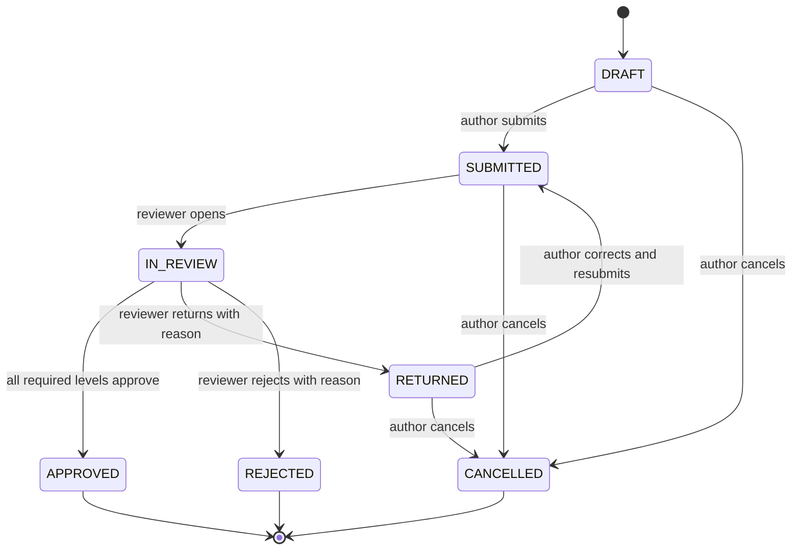

# Shared business rules

Status: **PLANNED**, 2026-11-10. These rules apply to every enterprise module. A module specification references them by identifier and never restates or weakens them. Module-specific rules live in section 4 of each file in `modules/`; an index of all rules is generated at the end of this file.

Where a rule repeats an existing project rule, the existing identifier is cited and the existing rule remains the authority for the community product.

## 1. Tenancy and ownership — `BR-TEN`

- **BR-TEN-001 — One organization per record.** Every enterprise record belongs to exactly one organization. A record without an organization, or with two, cannot exist.
- **BR-TEN-002 — No access by coincidence.** Sharing a CNPJ root, partners, an e-mail domain, a plate, a registration number or knowing an organization's code grants nothing. Only an active membership with a role assignment grants access.
- **BR-TEN-003 — The server resolves the organization.** The organization of a request comes from the authenticated account's memberships. An organization identifier sent by the client only selects among the caller's own memberships; it is never proof of authorization.
- **BR-TEN-004 — The organization of an operation is fixed at creation.** A record created on a device carries the organization that was active when it was created. Switching context, logging out or logging in as someone else never moves it. A record created in the wrong organization is voided there and recreated in the right one by someone authorized in both steps.
- **BR-TEN-005 — Cross-organization references are explicit.** A record may reference (a) public catalog entities such as a station, a fuel product or a municipality, which gives no ownership and no access; or (b) another organization's data under an explicit contract (agreement transaction, group consolidation) limited to the fields that contract lists.
- **BR-TEN-006 — Another organization's resource does not exist.** A request for a resource of another organization is answered as not found, with no data and no hint in the error.
- **BR-TEN-007 — Isolation covers every surface.** The organization boundary is enforced in database queries, API responses, caches, background jobs, search, stored files and their access links, exports, notifications, logs and metric labels.
- **BR-TEN-008 — Platform operators have no default reading right.** Abastevo staff read organization content only inside an approved, time-boxed, audited support session ([modules/back-office](modules/back-office.md)).
- **BR-TEN-009 — People leave, records stay.** Ending a membership or deleting a personal account never deletes records owned by the organization. Personal data inside those records follows the retention schedule in [11-privacy-security](11-privacy-security.md).
- **BR-TEN-010 — The public product stays tenant-free.** Public reads remain anonymous and the community model is unchanged. Tenancy applies only to enterprise-private data.

## 2. Source separation and neutrality — `BR-SRC`

- **BR-SRC-001 — Four price sources, never merged.** An official ANP price, a community price, a station-announced price and a negotiated price are stored and shown separately, each with source, time, product, unit and payment condition. None overwrites or averages with another.
- **BR-SRC-002 — Payment neutrality.** No plan, subscription, agreement, advertisement or organization status changes trust, confidence, consensus, moderation outcomes, review visibility or organic ordering (existing B-BR-009, ADR-012, ADR-023 decision 7).
- **BR-SRC-003 — Private records do not become public by themselves.** A fueling, expense or document never becomes a community contribution automatically. Publication is a separate explicit flow with an allowed field list ([modules/subscriptions](modules/subscriptions.md), UC-PUB).
- **BR-SRC-004 — Private records do not change the public catalog.** Enterprise records may reference catalog entities but never create or alter them. A supplier that is not in the catalog is recorded as an organization supplier, not as a new public station.
- **BR-SRC-005 — Private data stays out of market products.** Organization records, documents, contracts, tracks and employee data are excluded from Data products and public aggregates by default. Inclusion needs an explicit documented decision per dataset, opt-in by the organization and an aggregation threshold.

## 3. Honest status — `BR-TRUTH`

- **BR-TRUTH-001 — A status says what was checked.** Status words have the fixed meanings in [03-glossary](03-glossary.md) §9. Independent checks (received, extracted, structure checked, conferred, reconciled, consulted) are shown separately and never collapsed into one "validated" flag.
- **BR-TRUTH-002 — Reading is not authenticating.** Extracted text, a file hash, a well-formed access key or a well-formed XML do not prove that a fiscal document is authorized or not cancelled.
- **BR-TRUTH-003 — Unknown is not zero.** When inputs are missing, the result is `INSUFFICIENT_DATA` with a reason. No default number is shown.
- **BR-TRUTH-004 — Derived numbers show their basis.** Every indicator shows its method version, period, inputs and source. A recalculation creates a new revision and marks the previous one superseded.
- **BR-TRUTH-005 — Findings ask for review.** A finding or alert describes a difference and its evidence. It never states fraud, loss or savings that could be realised.
- **BR-TRUTH-006 — Age is visible.** Positions, prices and sync states show when they were collected. Data older than its freshness limit is labelled stale and is never presented as current.

## 4. Exact values — `BR-MONEY`

These rules adopt the existing exact-value conventions (B-BR-PR14, B-BR-DRV-02, [PREMIUM_FINANCIAL_METHOD](../product/PREMIUM_FINANCIAL_METHOD.md)) so that personal and organization figures are computed the same way.

- **BR-MONEY-001 — Amounts are integer centavos of BRL.** The amount actually paid is authoritative.
- **BR-MONEY-002 — Quantities are integers in the smallest unit.** Liquids in millilitres, gas in milli-cubic-metres, electricity in watt-hours, distance in metres, time and hour meters in seconds.
- **BR-MONEY-003 — Unit prices are integer milli-BRL per unit.** When a source document states more decimals, the original decimal text is stored beside the milli-BRL value and is never rounded silently.
- **BR-MONEY-004 — The paid total is never recomputed.** Quantity times unit price is a consistency check, not a replacement for the paid total.
- **BR-MONEY-005 — Arithmetic consistency.** `expected_cents = round_half_up(quantity_milli × unit_price_milli / 10 000)`. With `gross_cents = paid_cents + discount_cents`, the record is consistent when `|gross_cents − expected_cents| ≤ 1`. Outside that tolerance the record gets the warning `ARITHMETIC_MISMATCH`; it is not rejected.
- **BR-MONEY-006 — Required and derived fields.** A fueling needs the paid total and the quantity to be submitted. The unit price is optional; when absent it is shown as `paid_cents ÷ quantity` and labelled derived.
- **BR-MONEY-007 — Allocations preserve the whole.** Parts of an amount always sum exactly to the amount. Each part is floored to the centavo; the remaining centavos go one by one to the parts with the largest fractional remainder, ties to the lowest line order.
- **BR-MONEY-008 — Ratios come from sums.** Consumption and cost ratios divide compatible totals using exact rational intermediates. Averages of per-record ratios are never used. Rounding is half-up and happens only at display.
- **BR-MONEY-009 — Incompatible units are never added.** Litres, cubic metres and kilowatt-hours are never summed, and products of different energy types never share one efficiency figure.
- **BR-MONEY-010 — Bounds.** Negative, overflowing or non-canonical values are rejected. Ceilings follow financial-v1: total 10¹² centavos, quantity 10⁹ milli-units, odometer 10¹² metres, unit price 10⁶ milli-BRL.
- **BR-MONEY-011 — One oracle for two languages.** Go and Kotlin implementations pass the same golden vectors (existing `contracts/testdata/premium/`, extended under a proposed `contracts/testdata/enterprise/`).

Worked example for BR-MONEY-005. 150.000 L at R$ 6.490 per litre: `150 000 × 6 490 / 10 000 = 97 350` centavos, R$ 973.50. A receipt showing R$ 973.50 paid and no discount is consistent. A receipt showing R$ 968.50 paid and R$ 5.00 discount is consistent (`96 850 + 500 = 97 350`). A receipt showing R$ 970.00 paid and no discount differs by 350 centavos and gets `ARITHMETIC_MISMATCH`.

Worked example for BR-MONEY-007. R$ 100.00 split in three equal parts: floors are 3 333, 3 333, 3 333 (sum 9 999); one centavo remains; all remainders tie, so line 1 receives it: 3 334, 3 333, 3 333.

## 5. Time — `BR-TIME`

- **BR-TIME-001 — Instants in UTC, with context.** Every instant is stored in UTC together with the IANA time zone used at entry and the device's UTC offset.
- **BR-TIME-002 — Two times per operation.** `occurred_at` is declared by the device; `received_at` is set by the server. Both are kept.
- **BR-TIME-003 — Server time decides authorization.** Membership, plan state and period locks are evaluated at `received_at`. A device time alone never proves that an action was authorized earlier ([10-offline-sync](10-offline-sync.md) BR-OFFL).
- **BR-TIME-004 — Reporting day.** A record belongs to the local calendar day of its `occurred_at` in the time zone of its operating unit, or of the organization when it has no unit. A trip belongs to the day it started. Periods are half-open: start included, end excluded.
- **BR-TIME-005 — Running time uses a monotonic clock.** The duration of an activity in progress on a device is measured with the monotonic clock and a boot identity. A wall-clock change, reboot or missing checkpoint creates a flagged gap for review, never an invented duration (existing B-BR-DRV-07).
- **BR-TIME-006 — Clock skew is reported, not hidden.** At each sync the server estimates the device clock skew. When it exceeds the organization limit (default 5 minutes) the batch's operations are flagged `CLOCK_SKEW` and their times are reviewed; times are never rewritten silently.

## 6. Audit — `BR-AUD`

- **BR-AUD-001 — Every change is recorded.** Each creation, change and decision on an organization record writes one audit event with organization, actor, action, target, time and, when the action requires it, a reason.
- **BR-AUD-002 — Append-only.** Audit events are never updated or deleted by a product flow. Retention follows [11-privacy-security](11-privacy-security.md).
- **BR-AUD-003 — Sensitive reads are recorded.** Opening a document's content, reading a location, running an export and every support-session access write an audit event.
- **BR-AUD-004 — No content in the trail.** Audit events hold references and bounded reasons. They hold no document content, coordinates, credentials or secrets.
- **BR-AUD-005 — Acting for someone is visible.** An action under a delegation records the actor and the delegation.
- **BR-AUD-006 — Who can read it.** Organization roles with `audit.event.read` read events within their scope. Platform operators read them only inside a support session.

## 7. Review lifecycle — `BR-REV`

Trips, fuelings, expenses, work orders and similar submitted records share one review lifecycle. Module rules add what is specific.

- **BR-REV-001 — Three independent states.** Review state, operational state and sync state are separate fields. A trip can be finished on the device, not yet received by the server and not yet approved.
- **BR-REV-002 — Submission exists on the server.** A record becomes `SUBMITTED` when the server accepts the submitting operation. Offline, the app shows "ready to send".
- **BR-REV-003 — No self-approval.** The reviewer is never the record's author nor the employee who benefits from it (for example the one to be reimbursed), whatever roles that person holds.
- **BR-REV-004 — Permission is checked at decision time.** The reviewer needs the review permission on the record's scope when the server receives the decision.
- **BR-REV-005 — A return says what to fix.** `RETURNED` needs a reason. The author's correction creates a new revision and keeps the previous one.
- **BR-REV-006 — A rejection is final.** `REJECTED` needs a reason, is terminal and removes the record from costs and indicators. The author may create a new record.
- **BR-REV-007 — Decisions target a revision.** A decision names the revision it judged. A decision on a stale revision fails with a conflict and changes nothing.
- **BR-REV-008 — All required levels.** When the approval policy asks for several levels, the record is `APPROVED` only after every required level approved ([modules/expenses-finance](modules/expenses-finance.md) BR-APPR).
- **BR-REV-009 — What counts.** Costs and indicators use approved records by default. Views that include submitted records say "includes pending" on the figure.

## 8. Amendments — `BR-AMD`

- **BR-AMD-001 — Approved records do not change in place.** A change to an approved record is an amendment: a new revision with author, time and reason, linked to the previous revision, which is kept.
- **BR-AMD-002 — Amendments are reviewed.** An amendment follows the same approval policy. Until it is approved, the previous approved revision stays in effect.
- **BR-AMD-003 — Void, never delete.** An approved record can be voided with a reason by an authorized role. It leaves costs and indicators from then on; its history remains.
- **BR-AMD-004 — Locked periods.** A record whose reporting day is in a locked period can be amended or voided only after an authorized reopening with a reason. Otherwise the correction is posted as an adjustment in the open period, linked to the original.
- **BR-AMD-005 — Derived data follows.** Intervals, indicators, budget consumption and findings that used the record are recalculated, and the recalculation is identifiable by revision.
- **BR-AMD-006 — Before approval it is an edit.** Changes in `DRAFT` or `RETURNED` are ordinary edits with revision history.

## 9. Rule index

The index below is generated from the rule definitions in this file, in [07-permissions](07-permissions.md), [10-offline-sync](10-offline-sync.md), [11-privacy-security](11-privacy-security.md) and `modules/*.md`. Do not edit it by hand ([00-conventions](00-conventions.md) §7).

<!-- RULE-INDEX:BEGIN -->
| Rule | Name | Defined in |
|---|---|---|
| BR-AGREE-001 | Narrow bilateral sharing | [modules/station-commerce.md](modules/station-commerce.md) |
| BR-AGREE-002 | Once-only redemption | [modules/station-commerce.md](modules/station-commerce.md) |
| BR-AMD-001 | Approved records do not change in place | [04-business-rules.md](04-business-rules.md) |
| BR-AMD-002 | Amendments are reviewed | [04-business-rules.md](04-business-rules.md) |
| BR-AMD-003 | Void, never delete | [04-business-rules.md](04-business-rules.md) |
| BR-AMD-004 | Locked periods | [04-business-rules.md](04-business-rules.md) |
| BR-AMD-005 | Derived data follows | [04-business-rules.md](04-business-rules.md) |
| BR-AMD-006 | Before approval it is an edit | [04-business-rules.md](04-business-rules.md) |
| BR-APPR-001 | Current revision and independent decision | [modules/expenses-finance.md](modules/expenses-finance.md) |
| BR-AUD-001 | Every change is recorded | [04-business-rules.md](04-business-rules.md) |
| BR-AUD-002 | Append-only | [04-business-rules.md](04-business-rules.md) |
| BR-AUD-003 | Sensitive reads are recorded | [04-business-rules.md](04-business-rules.md) |
| BR-AUD-004 | No content in the trail | [04-business-rules.md](04-business-rules.md) |
| BR-AUD-005 | Acting for someone is visible | [04-business-rules.md](04-business-rules.md) |
| BR-AUD-006 | Who can read it | [04-business-rules.md](04-business-rules.md) |
| BR-AUTH-001 | Four conditions | [07-permissions.md](07-permissions.md) |
| BR-AUTH-002 | Client identifiers are not proof | [07-permissions.md](07-permissions.md) |
| BR-AUTH-003 | Permissions add up; restrictions do not disappear | [07-permissions.md](07-permissions.md) |
| BR-AUTH-004 | Scope coverage | [07-permissions.md](07-permissions.md) |
| BR-AUTH-005 | Historical scope | [07-permissions.md](07-permissions.md) |
| BR-AUTH-006 | Last organization owner | [07-permissions.md](07-permissions.md) |
| BR-AUTH-007 | No escalation | [07-permissions.md](07-permissions.md) |
| BR-AUTH-008 | Delegation is bounded | [07-permissions.md](07-permissions.md) |
| BR-AUTH-009 | Plans do not grant roles | [07-permissions.md](07-permissions.md) |
| BR-AUTH-010 | Sensitive actions need fresh authentication | [07-permissions.md](07-permissions.md) |
| BR-AUTH-011 | Location and document content are separate permissions | [07-permissions.md](07-permissions.md) |
| BR-AUTH-012 | Context is explicit | [07-permissions.md](07-permissions.md) |
| BR-AUTH-013 | Denials reveal nothing | [07-permissions.md](07-permissions.md) |
| BR-AUTH-014 | Changes take effect at once | [07-permissions.md](07-permissions.md) |
| BR-AUTH-015 | Station roles need a live authority | [07-permissions.md](07-permissions.md) |
| BR-BACK-001 | Explicit consumer power | [modules/back-office.md](modules/back-office.md) |
| BR-BACK-002 | Approved support window | [modules/back-office.md](modules/back-office.md) |
| BR-BACK-003 | Audited sensitive reads | [modules/back-office.md](modules/back-office.md) |
| BR-BACK-004 | Separate decisions | [modules/back-office.md](modules/back-office.md) |
| BR-BUDG-001 | Atomic remaining capacity | [modules/expenses-finance.md](modules/expenses-finance.md) |
| BR-CHECK-001 | Templates are versioned | [modules/maintenance.md](modules/maintenance.md) |
| BR-CHECK-002 | Applicable template | [modules/maintenance.md](modules/maintenance.md) |
| BR-CHECK-003 | Three answers | [modules/maintenance.md](modules/maintenance.md) |
| BR-CHECK-004 | The outcome is computed, not chosen | [modules/maintenance.md](modules/maintenance.md) |
| BR-CHECK-005 | Critical-item policy | [modules/maintenance.md](modules/maintenance.md) |
| BR-CHECK-006 | Decided on the device from the cached policy | [modules/maintenance.md](modules/maintenance.md) |
| BR-CHECK-007 | Rechecked on the server | [modules/maintenance.md](modules/maintenance.md) |
| BR-CHECK-008 | A disagreement discards nothing | [modules/maintenance.md](modules/maintenance.md) |
| BR-CHECK-009 | Each issue is a damage | [modules/maintenance.md](modules/maintenance.md) |
| BR-CHECK-010 | A block belongs to the asset | [modules/maintenance.md](modules/maintenance.md) |
| BR-CHECK-011 | Release is explicit and made by someone else | [modules/maintenance.md](modules/maintenance.md) |
| BR-CHECK-012 | A run is evidence of one moment | [modules/maintenance.md](modules/maintenance.md) |
| BR-CHECK-013 | A return run never holds a trip open | [modules/maintenance.md](modules/maintenance.md) |
| BR-CHECK-014 | Reports never wait | [modules/maintenance.md](modules/maintenance.md) |
| BR-CHECK-015 | Descriptions are bounded and guided | [modules/maintenance.md](modules/maintenance.md) |
| BR-CHECK-016 | Photos are organization documents | [modules/maintenance.md](modules/maintenance.md) |
| BR-CHECK-017 | Treatment ends in a recorded outcome | [modules/maintenance.md](modules/maintenance.md) |
| BR-CHECK-018 | An incident carries no cost | [modules/maintenance.md](modules/maintenance.md) |
| BR-CLAIM-001 | Existing rules are the base | [modules/station-claims.md](modules/station-claims.md) |
| BR-CLAIM-002 | Five records, never inferred | [modules/station-claims.md](modules/station-claims.md) |
| BR-CLAIM-003 | A claim targets an existing station | [modules/station-claims.md](modules/station-claims.md) |
| BR-CLAIM-004 | Knowledge and payment prove nothing | [modules/station-claims.md](modules/station-claims.md) |
| BR-CLAIM-005 | Verified legal entity first | [modules/station-claims.md](modules/station-claims.md) |
| BR-CLAIM-006 | Bound to the requesting member | [modules/station-claims.md](modules/station-claims.md) |
| BR-CLAIM-007 | One open claim per holder and station | [modules/station-claims.md](modules/station-claims.md) |
| BR-CLAIM-008 | Open-claim limits | [modules/station-claims.md](modules/station-claims.md) |
| BR-CLAIM-009 | One live holder per station | [modules/station-claims.md](modules/station-claims.md) |
| BR-CLAIM-010 | Proportional evidence | [modules/station-claims.md](modules/station-claims.md) |
| BR-CLAIM-011 | Supporting sources are not authority | [modules/station-claims.md](modules/station-claims.md) |
| BR-CLAIM-012 | Evidence stays private | [modules/station-claims.md](modules/station-claims.md) |
| BR-CLAIM-013 | Human decision | [modules/station-claims.md](modules/station-claims.md) |
| BR-CLAIM-014 | Reviewer independence | [modules/station-claims.md](modules/station-claims.md) |
| BR-CLAIM-015 | Atomic approval | [modules/station-claims.md](modules/station-claims.md) |
| BR-CLAIM-016 | Concurrent claims | [modules/station-claims.md](modules/station-claims.md) |
| BR-CLAIM-017 | Information requests | [modules/station-claims.md](modules/station-claims.md) |
| BR-CLAIM-018 | Denial has a reason and one appeal | [modules/station-claims.md](modules/station-claims.md) |
| BR-CLAIM-019 | A contest transfers nothing by itself | [modules/station-claims.md](modules/station-claims.md) |
| BR-CLAIM-020 | Suspension is a reasoned decision | [modules/station-claims.md](modules/station-claims.md) |
| BR-CLAIM-021 | Applicability is checked at every use | [modules/station-claims.md](modules/station-claims.md) |
| BR-CLAIM-022 | Every authority has a validity | [modules/station-claims.md](modules/station-claims.md) |
| BR-CLAIM-023 | Revalidation is a new decision | [modules/station-claims.md](modules/station-claims.md) |
| BR-CLAIM-024 | Revoked and expired are final | [modules/station-claims.md](modules/station-claims.md) |
| BR-CLAIM-025 | No transfer by a click | [modules/station-claims.md](modules/station-claims.md) |
| BR-CLAIM-026 | The commercial cycle is separate | [modules/station-claims.md](modules/station-claims.md) |
| BR-CLAIM-027 | The public-record cycle is separate | [modules/station-claims.md](modules/station-claims.md) |
| BR-CLAIM-028 | Station permissions come only from station roles | [modules/station-claims.md](modules/station-claims.md) |
| BR-CLAIM-029 | The team is inside the organization | [modules/station-claims.md](modules/station-claims.md) |
| BR-CLAIM-030 | Delegations are bounded | [modules/station-claims.md](modules/station-claims.md) |
| BR-CLAIM-031 | Last station administrator | [modules/station-claims.md](modules/station-claims.md) |
| BR-CLAIM-032 | Departure keeps the authority | [modules/station-claims.md](modules/station-claims.md) |
| BR-CLAIM-033 | Networks are claimed station by station | [modules/station-claims.md](modules/station-claims.md) |
| BR-CLAIM-034 | Badge meaning | [modules/station-claims.md](modules/station-claims.md) |
| BR-CLAIM-035 | Catalog corrections go through catalog governance | [modules/station-claims.md](modules/station-claims.md) |
| BR-CLAIM-036 | Retention follows the freeze | [modules/station-claims.md](modules/station-claims.md) |
| BR-CLAIM-037 | Contained until the override | [modules/station-claims.md](modules/station-claims.md) |
| BR-CLAIM-038 | Every transition is audited | [modules/station-claims.md](modules/station-claims.md) |
| BR-DATA-001 | Recorded admission | [modules/data.md](modules/data.md) |
| BR-DATA-002 | Exclude private inputs | [modules/data.md](modules/data.md) |
| BR-DATA-003 | Reproducible basis | [modules/data.md](modules/data.md) |
| BR-DATA-004 | Current key scope | [modules/data.md](modules/data.md) |
| BR-DOC-001 | Independent checks | [modules/documents.md](modules/documents.md) |
| BR-DOC-002 | Scoped evidence | [modules/documents.md](modules/documents.md) |
| BR-DOC-003 | Exact allocation | [modules/documents.md](modules/documents.md) |
| BR-DOC-004 | Reviewed retention | [modules/documents.md](modules/documents.md) |
| BR-EXP-001 | One origin, one cost | [modules/expenses-finance.md](modules/expenses-finance.md) |
| BR-EXP-002 | Review basis | [modules/expenses-finance.md](modules/expenses-finance.md) |
| BR-FIN-001 | Settlement is distinct | [modules/expenses-finance.md](modules/expenses-finance.md) |
| BR-FIND-001 | A finding describes a difference | [modules/intelligence.md](modules/intelligence.md) |
| BR-FIND-002 | Evidence is attached | [modules/intelligence.md](modules/intelligence.md) |
| BR-FIND-003 | Types come from the catalog | [modules/intelligence.md](modules/intelligence.md) |
| BR-FIND-004 | One open finding per subject | [modules/intelligence.md](modules/intelligence.md) |
| BR-FIND-005 | Every finding has a responsible person | [modules/intelligence.md](modules/intelligence.md) |
| BR-FIND-006 | A decision needs a justification | [modules/intelligence.md](modules/intelligence.md) |
| BR-FIND-007 | Nobody decides on their own record | [modules/intelligence.md](modules/intelligence.md) |
| BR-FIND-008 | A finding changes nothing by itself | [modules/intelligence.md](modules/intelligence.md) |
| BR-FIND-009 | Severity orders the review | [modules/intelligence.md](modules/intelligence.md) |
| BR-FIND-010 | Thresholds are bounded configuration | [modules/intelligence.md](modules/intelligence.md) |
| BR-FIND-011 | Reprocessing is identifiable | [modules/intelligence.md](modules/intelligence.md) |
| BR-FIND-012 | Detection waits for accepted records | [modules/intelligence.md](modules/intelligence.md) |
| BR-FLEET-001 | Separate from personal vehicles | [modules/fleet.md](modules/fleet.md) |
| BR-FLEET-002 | Three kinds | [modules/fleet.md](modules/fleet.md) |
| BR-FLEET-003 | Identifiers unique inside the organization | [modules/fleet.md](modules/fleet.md) |
| BR-FLEET-004 | Minimum data to activate | [modules/fleet.md](modules/fleet.md) |
| BR-FLEET-005 | Tanks state capacity and accepted products | [modules/fleet.md](modules/fleet.md) |
| BR-FLEET-006 | Expected consumption is a reference | [modules/fleet.md](modules/fleet.md) |
| BR-FLEET-007 | Only data with a purpose | [modules/fleet.md](modules/fleet.md) |
| BR-FLEET-008 | Lifecycle moves by command | [modules/fleet.md](modules/fleet.md) |
| BR-FLEET-009 | Disposal keeps history | [modules/fleet.md](modules/fleet.md) |
| BR-FLEET-010 | Open work blocks removal from service | [modules/fleet.md](modules/fleet.md) |
| BR-FLEET-011 | Only drafts are discarded | [modules/fleet.md](modules/fleet.md) |
| BR-FLEET-012 | Tenure is a history of periods | [modules/fleet.md](modules/fleet.md) |
| BR-FLEET-013 | Assets held from others have a counterpart | [modules/fleet.md](modules/fleet.md) |
| BR-FLEET-014 | Lending out is a block | [modules/fleet.md](modules/fleet.md) |
| BR-FLEET-015 | One unit at a time | [modules/fleet.md](modules/fleet.md) |
| BR-FLEET-016 | History does not follow the asset | [modules/fleet.md](modules/fleet.md) |
| BR-FLEET-017 | Transfers state an effective instant | [modules/fleet.md](modules/fleet.md) |
| BR-FLEET-018 | Assignment kinds | [modules/fleet.md](modules/fleet.md) |
| BR-FLEET-019 | Assignment periods | [modules/fleet.md](modules/fleet.md) |
| BR-FLEET-020 | One primary at a time | [modules/fleet.md](modules/fleet.md) |
| BR-FLEET-021 | A substitute does not remove the primary | [modules/fleet.md](modules/fleet.md) |
| BR-FLEET-022 | Who can be assigned | [modules/fleet.md](modules/fleet.md) |
| BR-FLEET-023 | Assignments end with the person or the asset | [modules/fleet.md](modules/fleet.md) |
| BR-FLEET-024 | Assignment is not exclusive use | [modules/fleet.md](modules/fleet.md) |
| BR-FLEET-025 | Availability is derived | [modules/fleet.md](modules/fleet.md) |
| BR-FLEET-026 | One active trip per asset | [modules/fleet.md](modules/fleet.md) |
| BR-FLEET-027 | Incompatible field operations are held | [modules/fleet.md](modules/fleet.md) |
| BR-FLEET-028 | Online commands are refused, not held | [modules/fleet.md](modules/fleet.md) |
| BR-FLEET-029 | Confirmed reservations do not overlap | [modules/fleet.md](modules/fleet.md) |
| BR-FLEET-030 | Reservation outcomes follow the clock | [modules/fleet.md](modules/fleet.md) |
| BR-FLEET-031 | A reservation holds the asset against others only | [modules/fleet.md](modules/fleet.md) |
| BR-FLEET-032 | Blocks state a reason and a period | [modules/fleet.md](modules/fleet.md) |
| BR-FLEET-033 | Implements attach to one powered asset | [modules/fleet.md](modules/fleet.md) |
| BR-FLEET-034 | Suppliers are private to the organization | [modules/fleet.md](modules/fleet.md) |
| BR-FLEET-035 | Supplier identification is optional and checked | [modules/fleet.md](modules/fleet.md) |
| BR-FLEET-036 | The asset record links documents; it does not hold them | [modules/fleet.md](modules/fleet.md) |
| BR-FUEL-001 | One supply, one fueling | [modules/fuelings.md](modules/fuelings.md) |
| BR-FUEL-002 | Required to submit | [modules/fuelings.md](modules/fuelings.md) |
| BR-FUEL-003 | The product fixes the unit | [modules/fuelings.md](modules/fuelings.md) |
| BR-FUEL-004 | Additives are not fuel | [modules/fuelings.md](modules/fuelings.md) |
| BR-FUEL-005 | Quantities do not mix | [modules/fuelings.md](modules/fuelings.md) |
| BR-FUEL-006 | Fill level is declared | [modules/fuelings.md](modules/fuelings.md) |
| BR-FUEL-007 | The reading is evidence in the fleet module | [modules/fuelings.md](modules/fuelings.md) |
| BR-FUEL-008 | Amounts | [modules/fuelings.md](modules/fuelings.md) |
| BR-FUEL-009 | Payer and payment method | [modules/fuelings.md](modules/fuelings.md) |
| BR-FUEL-010 | One cost | [modules/fuelings.md](modules/fuelings.md) |
| BR-FUEL-011 | Three independent supplier roles | [modules/fuelings.md](modules/fuelings.md) |
| BR-FUEL-012 | The public station link is optional | [modules/fuelings.md](modules/fuelings.md) |
| BR-FUEL-013 | No public station is created | [modules/fuelings.md](modules/fuelings.md) |
| BR-FUEL-014 | No device coordinates | [modules/fuelings.md](modules/fuelings.md) |
| BR-FUEL-015 | Capacity tolerance | [modules/fuelings.md](modules/fuelings.md) |
| BR-FUEL-016 | Product compatibility | [modules/fuelings.md](modules/fuelings.md) |
| BR-FUEL-017 | Warnings inform, people decide | [modules/fuelings.md](modules/fuelings.md) |
| BR-FUEL-018 | A resend is not a duplicate | [modules/fuelings.md](modules/fuelings.md) |
| BR-FUEL-019 | Suspected duplicates are flagged, never merged | [modules/fuelings.md](modules/fuelings.md) |
| BR-FUEL-020 | A person decides a suspicion | [modules/fuelings.md](modules/fuelings.md) |
| BR-FUEL-021 | Review lifecycle | [modules/fuelings.md](modules/fuelings.md) |
| BR-FUEL-022 | Retroactive entry | [modules/fuelings.md](modules/fuelings.md) |
| BR-FUEL-023 | Approved history is preserved | [modules/fuelings.md](modules/fuelings.md) |
| BR-FUEL-024 | Personal ledger stays personal | [modules/fuelings.md](modules/fuelings.md) |
| BR-FUEL-025 | Full-to-full only | [modules/fuelings.md](modules/fuelings.md) |
| BR-FUEL-026 | Anchor | [modules/fuelings.md](modules/fuelings.md) |
| BR-FUEL-027 | What an interval sums | [modules/fuelings.md](modules/fuelings.md) |
| BR-FUEL-028 | Every fueling in the span needs a valid reading | [modules/fuelings.md](modules/fuelings.md) |
| BR-FUEL-029 | Everything in the span must count | [modules/fuelings.md](modules/fuelings.md) |
| BR-FUEL-030 | One product per interval | [modules/fuelings.md](modules/fuelings.md) |
| BR-FUEL-031 | No naive division | [modules/fuelings.md](modules/fuelings.md) |
| BR-FUEL-032 | Ratios from sums | [modules/fuelings.md](modules/fuelings.md) |
| BR-FUEL-033 | Recalculation creates revisions | [modules/fuelings.md](modules/fuelings.md) |
| BR-FUEL-034 | Figures show their basis | [modules/fuelings.md](modules/fuelings.md) |
| BR-FUEL-035 | Shared usage | [modules/fuelings.md](modules/fuelings.md) |
| BR-FUEL-036 | Tank group anchors | [modules/fuelings.md](modules/fuelings.md) |
| BR-FUEL-037 | Trip allocation is an attribution | [modules/fuelings.md](modules/fuelings.md) |
| BR-FUEL-038 | Purchased is not consumed | [modules/fuelings.md](modules/fuelings.md) |
| BR-FUEL-039 | The price reference is stored once | [modules/fuelings.md](modules/fuelings.md) |
| BR-GPS-001 | Trip-bound collection | [modules/gps-navigation.md](modules/gps-navigation.md) |
| BR-GPS-002 | Explicit start from the visible trip screen | [modules/gps-navigation.md](modules/gps-navigation.md) |
| BR-GPS-003 | No background-location permission | [modules/gps-navigation.md](modules/gps-navigation.md) |
| BR-GPS-004 | Visible indicator | [modules/gps-navigation.md](modules/gps-navigation.md) |
| BR-GPS-005 | The trip never depends on location | [modules/gps-navigation.md](modules/gps-navigation.md) |
| BR-GPS-006 | Capability and policy | [modules/gps-navigation.md](modules/gps-navigation.md) |
| BR-GPS-007 | Precision is detected | [modules/gps-navigation.md](modules/gps-navigation.md) |
| BR-GPS-008 | One session per trip | [modules/gps-navigation.md](modules/gps-navigation.md) |
| BR-GPS-009 | Pause suspends | [modules/gps-navigation.md](modules/gps-navigation.md) |
| BR-GPS-010 | End ends | [modules/gps-navigation.md](modules/gps-navigation.md) |
| BR-GPS-011 | No silent resume | [modules/gps-navigation.md](modules/gps-navigation.md) |
| BR-GPS-012 | Durable checkpoint | [modules/gps-navigation.md](modules/gps-navigation.md) |
| BR-GPS-013 | One listener, safe stop | [modules/gps-navigation.md](modules/gps-navigation.md) |
| BR-GPS-014 | Owner binding | [modules/gps-navigation.md](modules/gps-navigation.md) |
| BR-GPS-015 | Watchdog | [modules/gps-navigation.md](modules/gps-navigation.md) |
| BR-GPS-016 | Long stationary guard | [modules/gps-navigation.md](modules/gps-navigation.md) |
| BR-GPS-017 | Fix quality filter | [modules/gps-navigation.md](modules/gps-navigation.md) |
| BR-GPS-018 | Adaptive sampling | [modules/gps-navigation.md](modules/gps-navigation.md) |
| BR-GPS-019 | Battery economy | [modules/gps-navigation.md](modules/gps-navigation.md) |
| BR-GPS-020 | Durable buffer and batches | [modules/gps-navigation.md](modules/gps-navigation.md) |
| BR-GPS-021 | Idempotent batch intake | [modules/gps-navigation.md](modules/gps-navigation.md) |
| BR-GPS-022 | Session bounds on the server | [modules/gps-navigation.md](modules/gps-navigation.md) |
| BR-GPS-023 | Raw fixes are the source of truth | [modules/gps-navigation.md](modules/gps-navigation.md) |
| BR-GPS-024 | Gaps are data | [modules/gps-navigation.md](modules/gps-navigation.md) |
| BR-GPS-025 | GPS distance | [modules/gps-navigation.md](modules/gps-navigation.md) |
| BR-GPS-026 | Coverage and track quality | [modules/gps-navigation.md](modules/gps-navigation.md) |
| BR-GPS-027 | Four distances stay apart | [modules/gps-navigation.md](modules/gps-navigation.md) |
| BR-GPS-028 | Distance basis | [modules/gps-navigation.md](modules/gps-navigation.md) |
| BR-GPS-029 | Divergence signal | [modules/gps-navigation.md](modules/gps-navigation.md) |
| BR-GPS-030 | Live position is the newest accepted fix | [modules/gps-navigation.md](modules/gps-navigation.md) |
| BR-GPS-031 | Freshness is derived at read time | [modules/gps-navigation.md](modules/gps-navigation.md) |
| BR-GPS-032 | An old position is never shown as current | [modules/gps-navigation.md](modules/gps-navigation.md) |
| BR-GPS-033 | Location reads are permissioned and audited | [modules/gps-navigation.md](modules/gps-navigation.md) |
| BR-GPS-034 | Employee transparency | [modules/gps-navigation.md](modules/gps-navigation.md) |
| BR-GPS-035 | Retention | [modules/gps-navigation.md](modules/gps-navigation.md) |
| BR-GPS-036 | Trimming | [modules/gps-navigation.md](modules/gps-navigation.md) |
| BR-GPS-037 | Geofences are evaluated on the server | [modules/gps-navigation.md](modules/gps-navigation.md) |
| BR-GPS-038 | Alerts state facts | [modules/gps-navigation.md](modules/gps-navigation.md) |
| BR-GPS-039 | No location in logs | [modules/gps-navigation.md](modules/gps-navigation.md) |
| BR-GPS-040 | Phone tracking is labelled | [modules/gps-navigation.md](modules/gps-navigation.md) |
| BR-IDN-001 | Accounts belong to people | [modules/identity.md](modules/identity.md) |
| BR-IDN-002 | The employee record belongs to the organization | [modules/identity.md](modules/identity.md) |
| BR-IDN-003 | Login and driving are optional | [modules/identity.md](modules/identity.md) |
| BR-IDN-004 | One live membership | [modules/identity.md](modules/identity.md) |
| BR-IDN-005 | Membership is the only door | [modules/identity.md](modules/identity.md) |
| BR-IDN-006 | Minimal employee data | [modules/identity.md](modules/identity.md) |
| BR-IDN-007 | Role, credential and device stay apart | [modules/identity.md](modules/identity.md) |
| BR-IDN-008 | Secrets are shown once and stored hashed | [modules/identity.md](modules/identity.md) |
| BR-IDN-009 | Single use | [modules/identity.md](modules/identity.md) |
| BR-IDN-010 | Expiry | [modules/identity.md](modules/identity.md) |
| BR-IDN-011 | Attempt limit and lockout | [modules/identity.md](modules/identity.md) |
| BR-IDN-012 | Uniform failure | [modules/identity.md](modules/identity.md) |
| BR-IDN-013 | Reissue replaces | [modules/identity.md](modules/identity.md) |
| BR-IDN-014 | The issuer delivers | [modules/identity.md](modules/identity.md) |
| BR-IDN-015 | Roles are checked twice | [modules/identity.md](modules/identity.md) |
| BR-IDN-016 | Privileged invitations need confirmation | [modules/identity.md](modules/identity.md) |
| BR-IDN-017 | Acceptance is informed and refusable | [modules/identity.md](modules/identity.md) |
| BR-IDN-018 | Tokens die with their context | [modules/identity.md](modules/identity.md) |
| BR-IDN-019 | Two models, one at a time | [modules/identity.md](modules/identity.md) |
| BR-IDN-020 | No shared or manager-known secret | [modules/identity.md](modules/identity.md) |
| BR-IDN-021 | A managed account is bound to its organization | [modules/identity.md](modules/identity.md) |
| BR-IDN-022 | Managed access is one app on one device | [modules/identity.md](modules/identity.md) |
| BR-IDN-023 | The local lock is not a credential | [modules/identity.md](modules/identity.md) |
| BR-IDN-024 | Recovery never reuses a secret | [modules/identity.md](modules/identity.md) |
| BR-IDN-025 | Corporate administration stops at the organization's edge | [modules/identity.md](modules/identity.md) |
| BR-IDN-026 | Suspension stops access at once | [modules/identity.md](modules/identity.md) |
| BR-IDN-027 | Offboarding ends permissions and nothing else | [modules/identity.md](modules/identity.md) |
| BR-IDN-028 | Offboarding hands work over | [modules/identity.md](modules/identity.md) |
| BR-IDN-029 | Late records get a decision | [modules/identity.md](modules/identity.md) |
| BR-IDN-030 | The last owner is protected | [modules/identity.md](modules/identity.md) |
| BR-IDN-031 | Members can leave | [modules/identity.md](modules/identity.md) |
| BR-IDN-032 | Rehire is a new period on the same record | [modules/identity.md](modules/identity.md) |
| BR-IDN-033 | Memberships are independent | [modules/identity.md](modules/identity.md) |
| BR-IDN-034 | Duplicates are flagged, never merged automatically | [modules/identity.md](modules/identity.md) |
| BR-IDN-035 | Merge keeps history | [modules/identity.md](modules/identity.md) |
| BR-IDN-036 | Employee state drives access | [modules/identity.md](modules/identity.md) |
| BR-IDN-037 | Each device is enrolled per membership | [modules/identity.md](modules/identity.md) |
| BR-IDN-038 | Revocation is immediate and has a class | [modules/identity.md](modules/identity.md) |
| BR-IDN-039 | Managers see enrolments, not accounts | [modules/identity.md](modules/identity.md) |
| BR-IDN-040 | The driver profile is minimal and optional | [modules/identity.md](modules/identity.md) |
| BR-IDN-041 | Eligibility is computed, not stored | [modules/identity.md](modules/identity.md) |
| BR-IDN-042 | Account deletion ends memberships and keeps organization records | [modules/identity.md](modules/identity.md) |
| BR-IDN-043 | The person is told first | [modules/identity.md](modules/identity.md) |
| BR-IDN-044 | A managed account ends with its membership | [modules/identity.md](modules/identity.md) |
| BR-IMPORT-001 | Preview precedes apply | [modules/imports-notifications-integrations.md](modules/imports-notifications-integrations.md) |
| BR-INTEG-001 | Reviewed boundary | [modules/imports-notifications-integrations.md](modules/imports-notifications-integrations.md) |
| BR-INTEG-002 | No secret payloads | [modules/imports-notifications-integrations.md](modules/imports-notifications-integrations.md) |
| BR-KPI-001 | Figures come from the registry | [modules/intelligence.md](modules/intelligence.md) |
| BR-KPI-002 | Approved by default | [modules/intelligence.md](modules/intelligence.md) |
| BR-KPI-003 | Insufficient data is a result | [modules/intelligence.md](modules/intelligence.md) |
| BR-KPI-004 | Ratios divide sums | [modules/intelligence.md](modules/intelligence.md) |
| BR-KPI-005 | Numerator and denominator match | [modules/intelligence.md](modules/intelligence.md) |
| BR-KPI-006 | Incompatible units stay apart | [modules/intelligence.md](modules/intelligence.md) |
| BR-KPI-007 | The basis is shown | [modules/intelligence.md](modules/intelligence.md) |
| BR-KPI-008 | A recalculation is a new revision | [modules/intelligence.md](modules/intelligence.md) |
| BR-KPI-009 | Period attribution | [modules/intelligence.md](modules/intelligence.md) |
| BR-KPI-010 | Dimensions use the record's own values | [modules/intelligence.md](modules/intelligence.md) |
| BR-KPI-011 | Scope filters the data | [modules/intelligence.md](modules/intelligence.md) |
| BR-KPI-012 | A price comparison needs a comparable reference | [modules/intelligence.md](modules/intelligence.md) |
| BR-KPI-013 | The reference and the method are preserved | [modules/intelligence.md](modules/intelligence.md) |
| BR-KPI-014 | A difference is not a loss | [modules/intelligence.md](modules/intelligence.md) |
| BR-KPI-015 | Rounding only at display | [modules/intelligence.md](modules/intelligence.md) |
| BR-KPI-016 | Sample size is visible | [modules/intelligence.md](modules/intelligence.md) |
| BR-MAINT-001 | Three triggers, whichever comes first | [modules/maintenance.md](modules/maintenance.md) |
| BR-MAINT-002 | A trigger needs its meter | [modules/maintenance.md](modules/maintenance.md) |
| BR-MAINT-003 | Usage comes from the meter history | [modules/maintenance.md](modules/maintenance.md) |
| BR-MAINT-004 | The occurrence state is computed | [modules/maintenance.md](modules/maintenance.md) |
| BR-MAINT-005 | Time triggers use local calendar days | [modules/maintenance.md](modules/maintenance.md) |
| BR-MAINT-006 | One open occurrence per plan | [modules/maintenance.md](modules/maintenance.md) |
| BR-MAINT-007 | Recomputed when readings change | [modules/maintenance.md](modules/maintenance.md) |
| BR-MAINT-008 | A correction moves states both ways | [modules/maintenance.md](modules/maintenance.md) |
| BR-MAINT-009 | Unknown usage is not zero | [modules/maintenance.md](modules/maintenance.md) |
| BR-MAINT-010 | Completion closes the occurrence | [modules/maintenance.md](modules/maintenance.md) |
| BR-MAINT-011 | Skipping is explicit | [modules/maintenance.md](modules/maintenance.md) |
| BR-MAINT-012 | A projection is an estimate | [modules/maintenance.md](modules/maintenance.md) |
| BR-MAINT-013 | Overdue alerts; it blocks only by choice | [modules/maintenance.md](modules/maintenance.md) |
| BR-MAINT-014 | Anyone who uses the asset can ask | [modules/maintenance.md](modules/maintenance.md) |
| BR-MAINT-015 | Origins are linked, not copied | [modules/maintenance.md](modules/maintenance.md) |
| BR-MAINT-016 | One work order per open defect | [modules/maintenance.md](modules/maintenance.md) |
| BR-MAINT-017 | The term is reserved | [modules/maintenance.md](modules/maintenance.md) |
| BR-MAINT-018 | Identity | [modules/maintenance.md](modules/maintenance.md) |
| BR-MAINT-019 | Supplier or in-house | [modules/maintenance.md](modules/maintenance.md) |
| BR-MAINT-020 | Lines are parts and services with exact values | [modules/maintenance.md](modules/maintenance.md) |
| BR-MAINT-021 | Quotes are kept | [modules/maintenance.md](modules/maintenance.md) |
| BR-MAINT-022 | Approval runs on the shared engine | [modules/maintenance.md](modules/maintenance.md) |
| BR-MAINT-023 | Direct approval below a limit | [modules/maintenance.md](modules/maintenance.md) |
| BR-MAINT-024 | No execution without approval | [modules/maintenance.md](modules/maintenance.md) |
| BR-MAINT-025 | Emergency repairs are recorded after the fact | [modules/maintenance.md](modules/maintenance.md) |
| BR-MAINT-026 | Completion and closing need evidence | [modules/maintenance.md](modules/maintenance.md) |
| BR-MAINT-027 | Overruns are approved | [modules/maintenance.md](modules/maintenance.md) |
| BR-MAINT-028 | The cost is posted exactly once | [modules/maintenance.md](modules/maintenance.md) |
| BR-MAINT-029 | No cost before closing | [modules/maintenance.md](modules/maintenance.md) |
| BR-MAINT-030 | The cost day | [modules/maintenance.md](modules/maintenance.md) |
| BR-MAINT-031 | After closing, corrections are amendments | [modules/maintenance.md](modules/maintenance.md) |
| BR-MAINT-032 | In maintenance means unavailable | [modules/maintenance.md](modules/maintenance.md) |
| BR-MAINT-033 | When a hold starts | [modules/maintenance.md](modules/maintenance.md) |
| BR-MAINT-034 | Return to operation is explicit | [modules/maintenance.md](modules/maintenance.md) |
| BR-MAINT-035 | Unavailable time is measured | [modules/maintenance.md](modules/maintenance.md) |
| BR-MAINT-036 | Field facts on a held asset are kept | [modules/maintenance.md](modules/maintenance.md) |
| BR-MAINT-037 | Scheduling shows commitments | [modules/maintenance.md](modules/maintenance.md) |
| BR-MAINT-038 | Expiries use the occurrence vocabulary | [modules/maintenance.md](modules/maintenance.md) |
| BR-MAINT-039 | The organization chooses what to track | [modules/maintenance.md](modules/maintenance.md) |
| BR-MAINT-040 | Licence expiry control is optional and off by default | [modules/maintenance.md](modules/maintenance.md) |
| BR-MAINT-041 | Insurance is a tracked expiry with a policy | [modules/maintenance.md](modules/maintenance.md) |
| BR-MAINT-042 | Money and people stay where they belong | [modules/maintenance.md](modules/maintenance.md) |
| BR-MAINT-043 | Components are tracked by identifier | [modules/maintenance.md](modules/maintenance.md) |
| BR-MAINT-044 | Component usage follows the asset | [modules/maintenance.md](modules/maintenance.md) |
| BR-MAINT-045 | Parts stock counts each part once | [modules/maintenance.md](modules/maintenance.md) |
| BR-MAINT-046 | Evolutions are capabilities | [modules/maintenance.md](modules/maintenance.md) |
| BR-METER-001 | Readings are evidence | [modules/fleet.md](modules/fleet.md) |
| BR-METER-002 | What a reading carries | [modules/fleet.md](modules/fleet.md) |
| BR-METER-003 | Origin and method | [modules/fleet.md](modules/fleet.md) |
| BR-METER-004 | Units and entry | [modules/fleet.md](modules/fleet.md) |
| BR-METER-005 | One meter of each kind in service | [modules/fleet.md](modules/fleet.md) |
| BR-METER-006 | The current value is a projection | [modules/fleet.md](modules/fleet.md) |
| BR-METER-007 | Segments carry the count | [modules/fleet.md](modules/fleet.md) |
| BR-METER-008 | Order follows the observation instant | [modules/fleet.md](modules/fleet.md) |
| BR-METER-009 | Values never decrease inside a segment | [modules/fleet.md](modules/fleet.md) |
| BR-METER-010 | Plausible rate | [modules/fleet.md](modules/fleet.md) |
| BR-METER-011 | Suspect readings wait | [modules/fleet.md](modules/fleet.md) |
| BR-METER-012 | Monotonicity cannot be overridden | [modules/fleet.md](modules/fleet.md) |
| BR-METER-013 | Correction is supersession | [modules/fleet.md](modules/fleet.md) |
| BR-METER-014 | Void without replacement | [modules/fleet.md](modules/fleet.md) |
| BR-METER-015 | Who corrects | [modules/fleet.md](modules/fleet.md) |
| BR-METER-016 | Derived data follows | [modules/fleet.md](modules/fleet.md) |
| BR-METER-017 | Retroactive readings | [modules/fleet.md](modules/fleet.md) |
| BR-METER-018 | Replacement | [modules/fleet.md](modules/fleet.md) |
| BR-METER-019 | Reset | [modules/fleet.md](modules/fleet.md) |
| BR-METER-020 | Rollover is confirmed by a person | [modules/fleet.md](modules/fleet.md) |
| BR-METER-021 | Kilometres and hours are separate series | [modules/fleet.md](modules/fleet.md) |
| BR-METER-022 | No invented readings | [modules/fleet.md](modules/fleet.md) |
| BR-METER-023 | Bounds | [modules/fleet.md](modules/fleet.md) |
| BR-METER-024 | Equal readings are not duplicates | [modules/fleet.md](modules/fleet.md) |
| BR-METER-025 | Photo of the meter | [modules/fleet.md](modules/fleet.md) |
| BR-METER-026 | History stays visible | [modules/fleet.md](modules/fleet.md) |
| BR-MONEY-001 | Amounts are integer centavos of BRL | [04-business-rules.md](04-business-rules.md) |
| BR-MONEY-002 | Quantities are integers in the smallest unit | [04-business-rules.md](04-business-rules.md) |
| BR-MONEY-003 | Unit prices are integer milli-BRL per unit | [04-business-rules.md](04-business-rules.md) |
| BR-MONEY-004 | The paid total is never recomputed | [04-business-rules.md](04-business-rules.md) |
| BR-MONEY-005 | Arithmetic consistency | [04-business-rules.md](04-business-rules.md) |
| BR-MONEY-006 | Required and derived fields | [04-business-rules.md](04-business-rules.md) |
| BR-MONEY-007 | Allocations preserve the whole | [04-business-rules.md](04-business-rules.md) |
| BR-MONEY-008 | Ratios come from sums | [04-business-rules.md](04-business-rules.md) |
| BR-MONEY-009 | Incompatible units are never added | [04-business-rules.md](04-business-rules.md) |
| BR-MONEY-010 | Bounds | [04-business-rules.md](04-business-rules.md) |
| BR-MONEY-011 | One oracle for two languages | [04-business-rules.md](04-business-rules.md) |
| BR-NOTIF-001 | Current scoped recipient | [modules/imports-notifications-integrations.md](modules/imports-notifications-integrations.md) |
| BR-OFFL-001 | Local identifiers are final | [10-offline-sync.md](10-offline-sync.md) |
| BR-OFFL-002 | The queue is durable | [10-offline-sync.md](10-offline-sync.md) |
| BR-OFFL-003 | Organization context is sealed | [10-offline-sync.md](10-offline-sync.md) |
| BR-OFFL-004 | Exactly one acknowledgement | [10-offline-sync.md](10-offline-sync.md) |
| BR-OFFL-005 | Delivery is at least once; effects are once | [10-offline-sync.md](10-offline-sync.md) |
| BR-OFFL-006 | Facts are kept; authority is decided | [10-offline-sync.md](10-offline-sync.md) |
| BR-OFFL-007 | Order follows dependencies | [10-offline-sync.md](10-offline-sync.md) |
| BR-OFFL-008 | Two times, one authority | [10-offline-sync.md](10-offline-sync.md) |
| BR-OFFL-009 | Device time is evidence, not proof | [10-offline-sync.md](10-offline-sync.md) |
| BR-OFFL-010 | Four visible states | [10-offline-sync.md](10-offline-sync.md) |
| BR-OFFL-011 | Intake after access ends | [10-offline-sync.md](10-offline-sync.md) |
| BR-OFFL-012 | Revocation reasons differ | [10-offline-sync.md](10-offline-sync.md) |
| BR-OFFL-013 | No silent loss on the device | [10-offline-sync.md](10-offline-sync.md) |
| BR-OFFL-014 | No remote-wipe promise | [10-offline-sync.md](10-offline-sync.md) |
| BR-OFFL-015 | Attachments follow their operation | [10-offline-sync.md](10-offline-sync.md) |
| BR-OFFL-016 | Reference data shows its age | [10-offline-sync.md](10-offline-sync.md) |
| BR-OFFL-017 | Online-only actions say so | [10-offline-sync.md](10-offline-sync.md) |
| BR-OFFL-018 | Limits | [10-offline-sync.md](10-offline-sync.md) |
| BR-ORG-001 | The organization is the boundary | [modules/organizations.md](modules/organizations.md) |
| BR-ORG-002 | A CNPJ, a unit and an organization are three things | [modules/organizations.md](modules/organizations.md) |
| BR-ORG-003 | Structure never grants access | [modules/organizations.md](modules/organizations.md) |
| BR-ORG-004 | Customer kind is descriptive | [modules/organizations.md](modules/organizations.md) |
| BR-ORG-005 | Names prove nothing | [modules/organizations.md](modules/organizations.md) |
| BR-ORG-006 | At least one unit | [modules/organizations.md](modules/organizations.md) |
| BR-ORG-007 | Names and codes are unique inside the organization | [modules/organizations.md](modules/organizations.md) |
| BR-ORG-008 | Archive, never delete | [modules/organizations.md](modules/organizations.md) |
| BR-ORG-009 | Archiving needs an empty present | [modules/organizations.md](modules/organizations.md) |
| BR-ORG-010 | Each unit has a time zone | [modules/organizations.md](modules/organizations.md) |
| BR-ORG-011 | Team membership is not access | [modules/organizations.md](modules/organizations.md) |
| BR-ORG-012 | History survives structure changes | [modules/organizations.md](modules/organizations.md) |
| BR-ORG-013 | Two kinds of legal entity | [modules/organizations.md](modules/organizations.md) |
| BR-ORG-014 | A CNPJ is validated text | [modules/organizations.md](modules/organizations.md) |
| BR-ORG-015 | "0001" proves nothing | [modules/organizations.md](modules/organizations.md) |
| BR-ORG-016 | Declared is not verified | [modules/organizations.md](modules/organizations.md) |
| BR-ORG-017 | Declaring is not exclusive and leaks nothing | [modules/organizations.md](modules/organizations.md) |
| BR-ORG-018 | Verification says what was checked | [modules/organizations.md](modules/organizations.md) |
| BR-ORG-019 | Verification gates named features only | [modules/organizations.md](modules/organizations.md) |
| BR-ORG-020 | A CPF is personal data | [modules/organizations.md](modules/organizations.md) |
| BR-ORG-021 | Consolidation needs two consents | [modules/organizations.md](modules/organizations.md) |
| BR-ORG-022 | Consolidation is read-only and field-limited | [modules/organizations.md](modules/organizations.md) |
| BR-ORG-023 | Either side ends it at once | [modules/organizations.md](modules/organizations.md) |
| BR-ORG-024 | Consolidated figures name their source | [modules/organizations.md](modules/organizations.md) |
| BR-ORG-025 | Creation makes an owner | [modules/organizations.md](modules/organizations.md) |
| BR-ORG-026 | Owners can recover their own access | [modules/organizations.md](modules/organizations.md) |
| BR-ORG-027 | Activation checklist | [modules/organizations.md](modules/organizations.md) |
| BR-ORG-028 | Abandoned setups are closed | [modules/organizations.md](modules/organizations.md) |
| BR-ORG-029 | Suspension is a platform action with a reason | [modules/organizations.md](modules/organizations.md) |
| BR-ORG-030 | Suspension blocks new work, not reading | [modules/organizations.md](modules/organizations.md) |
| BR-ORG-031 | Suspension never strands field work | [modules/organizations.md](modules/organizations.md) |
| BR-ORG-032 | Access-reducing actions always work | [modules/organizations.md](modules/organizations.md) |
| BR-ORG-033 | Archiving is read-only by choice | [modules/organizations.md](modules/organizations.md) |
| BR-ORG-034 | Ownership transfer needs two people | [modules/organizations.md](modules/organizations.md) |
| BR-ORG-035 | An ownerless organization is recovered by evidence, not by claim | [modules/organizations.md](modules/organizations.md) |
| BR-ORG-036 | Closure is announced, exportable and final | [modules/organizations.md](modules/organizations.md) |
| BR-ORG-037 | Closed is terminal | [modules/organizations.md](modules/organizations.md) |
| BR-ORG-038 | Settings are versioned | [modules/organizations.md](modules/organizations.md) |
| BR-ORG-039 | Units of measure are display only | [modules/organizations.md](modules/organizations.md) |
| BR-ORG-040 | Policy defaults start safe | [modules/organizations.md](modules/organizations.md) |
| BR-ORG-041 | Substitutes route work; they gain no right | [modules/organizations.md](modules/organizations.md) |
| BR-PRIV-001 | Isolation is layered | [11-privacy-security.md](11-privacy-security.md) |
| BR-PRIV-002 | Every surface is tested with two organizations | [11-privacy-security.md](11-privacy-security.md) |
| BR-PRIV-003 | Caches and jobs carry the organization | [11-privacy-security.md](11-privacy-security.md) |
| BR-PRIV-004 | Files are private and links are short | [11-privacy-security.md](11-privacy-security.md) |
| BR-PRIV-005 | Collect for a stated purpose | [11-privacy-security.md](11-privacy-security.md) |
| BR-PRIV-006 | No personal trips | [11-privacy-security.md](11-privacy-security.md) |
| BR-PRIV-007 | Free text is bounded and guided | [11-privacy-security.md](11-privacy-security.md) |
| BR-PRIV-008 | Logs carry identifiers, not content | [11-privacy-security.md](11-privacy-security.md) |
| BR-PRIV-009 | Every category has a period | [11-privacy-security.md](11-privacy-security.md) |
| BR-PRIV-010 | Retention never becomes "keep forever" | [11-privacy-security.md](11-privacy-security.md) |
| BR-PRIV-011 | Restores respect deletion | [11-privacy-security.md](11-privacy-security.md) |
| BR-PRIV-012 | Closing an organization | [11-privacy-security.md](11-privacy-security.md) |
| BR-PRIV-013 | The organization answers for its employees' data | [11-privacy-security.md](11-privacy-security.md) |
| BR-PRIV-014 | Personal account deletion does not erase organization records | [11-privacy-security.md](11-privacy-security.md) |
| BR-PRIV-015 | Employees can see what is collected | [11-privacy-security.md](11-privacy-security.md) |
| BR-PRIV-016 | Local data is protected and partitioned | [11-privacy-security.md](11-privacy-security.md) |
| BR-PRIV-017 | Logout and shared devices | [11-privacy-security.md](11-privacy-security.md) |
| BR-PRIV-018 | Lost devices | [11-privacy-security.md](11-privacy-security.md) |
| BR-PRIV-019 | App lock for corporate access | [11-privacy-security.md](11-privacy-security.md) |
| BR-PRIV-020 | Uploads are bounded and inspected | [11-privacy-security.md](11-privacy-security.md) |
| BR-PRIV-021 | Support access is exceptional | [11-privacy-security.md](11-privacy-security.md) |
| BR-PUB-001 | Private/public separation | [modules/subscriptions.md](modules/subscriptions.md) |
| BR-REV-001 | Three independent states | [04-business-rules.md](04-business-rules.md) |
| BR-REV-002 | Submission exists on the server | [04-business-rules.md](04-business-rules.md) |
| BR-REV-003 | No self-approval | [04-business-rules.md](04-business-rules.md) |
| BR-REV-004 | Permission is checked at decision time | [04-business-rules.md](04-business-rules.md) |
| BR-REV-005 | A return says what to fix | [04-business-rules.md](04-business-rules.md) |
| BR-REV-006 | A rejection is final | [04-business-rules.md](04-business-rules.md) |
| BR-REV-007 | Decisions target a revision | [04-business-rules.md](04-business-rules.md) |
| BR-REV-008 | All required levels | [04-business-rules.md](04-business-rules.md) |
| BR-REV-009 | What counts | [04-business-rules.md](04-business-rules.md) |
| BR-ROUTE-001 | One plan, one owner | [modules/gps-navigation.md](modules/gps-navigation.md) |
| BR-ROUTE-002 | Ordered points within the engine bound | [modules/gps-navigation.md](modules/gps-navigation.md) |
| BR-ROUTE-003 | Where points come from | [modules/gps-navigation.md](modules/gps-navigation.md) |
| BR-ROUTE-004 | Planned distance has a source | [modules/gps-navigation.md](modules/gps-navigation.md) |
| BR-ROUTE-005 | Engine estimates are attributed | [modules/gps-navigation.md](modules/gps-navigation.md) |
| BR-ROUTE-006 | Plans are revisioned | [modules/gps-navigation.md](modules/gps-navigation.md) |
| BR-ROUTE-007 | Assignment through the mission or trip | [modules/gps-navigation.md](modules/gps-navigation.md) |
| BR-ROUTE-008 | Planned and actual stay apart | [modules/gps-navigation.md](modules/gps-navigation.md) |
| BR-ROUTE-009 | Routes are computed on the device | [modules/gps-navigation.md](modules/gps-navigation.md) |
| BR-ROUTE-010 | Engine profile honesty | [modules/gps-navigation.md](modules/gps-navigation.md) |
| BR-ROUTE-011 | Navigation phase 1 | [modules/gps-navigation.md](modules/gps-navigation.md) |
| BR-ROUTE-012 | No external hand-off | [modules/gps-navigation.md](modules/gps-navigation.md) |
| BR-ROUTE-013 | Trip-aware navigation | [modules/gps-navigation.md](modules/gps-navigation.md) |
| BR-ROUTE-014 | Coordinated consumers | [modules/gps-navigation.md](modules/gps-navigation.md) |
| BR-ROUTE-015 | Guidance alone sends nothing | [modules/gps-navigation.md](modules/gps-navigation.md) |
| BR-ROUTE-016 | Recalculation is recorded, not judged | [modules/gps-navigation.md](modules/gps-navigation.md) |
| BR-ROUTE-017 | Degraded and offline behaviour | [modules/gps-navigation.md](modules/gps-navigation.md) |
| BR-ROUTE-018 | Driving mode | [modules/gps-navigation.md](modules/gps-navigation.md) |
| BR-ROUTE-019 | Quick actions are completed at a stop | [modules/gps-navigation.md](modules/gps-navigation.md) |
| BR-ROUTE-020 | Suggestions compare only comparable references | [modules/gps-navigation.md](modules/gps-navigation.md) |
| BR-ROUTE-021 | Detour cost shows its inputs | [modules/gps-navigation.md](modules/gps-navigation.md) |
| BR-ROUTE-022 | Suggestions are neutral | [modules/gps-navigation.md](modules/gps-navigation.md) |
| BR-ROUTE-023 | Attribution and tile hosting | [modules/gps-navigation.md](modules/gps-navigation.md) |
| BR-ROUTE-024 | Providers behind ports | [modules/gps-navigation.md](modules/gps-navigation.md) |
| BR-RPT-001 | Every export is a job | [modules/intelligence.md](modules/intelligence.md) |
| BR-RPT-002 | An export repeats the screen's authorization | [modules/intelligence.md](modules/intelligence.md) |
| BR-RPT-003 | Sensitive columns need their own permission | [modules/intelligence.md](modules/intelligence.md) |
| BR-RPT-004 | Files are private and expire | [modules/intelligence.md](modules/intelligence.md) |
| BR-RPT-005 | Every export is audited | [modules/intelligence.md](modules/intelligence.md) |
| BR-RPT-006 | Cells cannot become formulas | [modules/intelligence.md](modules/intelligence.md) |
| BR-RPT-007 | An export states its basis | [modules/intelligence.md](modules/intelligence.md) |
| BR-RPT-008 | Machine formats carry exact values | [modules/intelligence.md](modules/intelligence.md) |
| BR-RPT-009 | Limits fail loudly | [modules/intelligence.md](modules/intelligence.md) |
| BR-RPT-010 | Content is deterministic | [modules/intelligence.md](modules/intelligence.md) |
| BR-RPT-011 | A new file-format dependency is a decision | [modules/intelligence.md](modules/intelligence.md) |
| BR-RPT-012 | The full export is complete and restricted | [modules/intelligence.md](modules/intelligence.md) |
| BR-RPT-013 | The audit viewer reads and never edits | [modules/intelligence.md](modules/intelligence.md) |
| BR-RPT-014 | A schedule runs with each recipient's rights | [modules/intelligence.md](modules/intelligence.md) |
| BR-RPT-015 | A logbook report says what it is not | [modules/intelligence.md](modules/intelligence.md) |
| BR-SRC-001 | Four price sources, never merged | [04-business-rules.md](04-business-rules.md) |
| BR-SRC-002 | Payment neutrality | [04-business-rules.md](04-business-rules.md) |
| BR-SRC-003 | Private records do not become public by themselves | [04-business-rules.md](04-business-rules.md) |
| BR-SRC-004 | Private records do not change the public catalog | [04-business-rules.md](04-business-rules.md) |
| BR-SRC-005 | Private data stays out of market products | [04-business-rules.md](04-business-rules.md) |
| BR-STN-001 | Separate commercial source | [modules/station-commerce.md](modules/station-commerce.md) |
| BR-STN-002 | Neutrality | [modules/station-commerce.md](modules/station-commerce.md) |
| BR-STOCK-001 | Exact compatible stock | [modules/fuel-stock.md](modules/fuel-stock.md) |
| BR-STOCK-002 | Moving average | [modules/fuel-stock.md](modules/fuel-stock.md) |
| BR-STOCK-003 | One consumption cost | [modules/fuel-stock.md](modules/fuel-stock.md) |
| BR-STOCK-004 | Audited reconciliation | [modules/fuel-stock.md](modules/fuel-stock.md) |
| BR-SUBS-001 | Plan grants no role | [modules/subscriptions.md](modules/subscriptions.md) |
| BR-SUBS-002 | Confirmed source | [modules/subscriptions.md](modules/subscriptions.md) |
| BR-SUBS-003 | Retained history | [modules/subscriptions.md](modules/subscriptions.md) |
| BR-TEN-001 | One organization per record | [04-business-rules.md](04-business-rules.md) |
| BR-TEN-002 | No access by coincidence | [04-business-rules.md](04-business-rules.md) |
| BR-TEN-003 | The server resolves the organization | [04-business-rules.md](04-business-rules.md) |
| BR-TEN-004 | The organization of an operation is fixed at creation | [04-business-rules.md](04-business-rules.md) |
| BR-TEN-005 | Cross-organization references are explicit | [04-business-rules.md](04-business-rules.md) |
| BR-TEN-006 | Another organization's resource does not exist | [04-business-rules.md](04-business-rules.md) |
| BR-TEN-007 | Isolation covers every surface | [04-business-rules.md](04-business-rules.md) |
| BR-TEN-008 | Platform operators have no default reading right | [04-business-rules.md](04-business-rules.md) |
| BR-TEN-009 | People leave, records stay | [04-business-rules.md](04-business-rules.md) |
| BR-TEN-010 | The public product stays tenant-free | [04-business-rules.md](04-business-rules.md) |
| BR-TIME-001 | Instants in UTC, with context | [04-business-rules.md](04-business-rules.md) |
| BR-TIME-002 | Two times per operation | [04-business-rules.md](04-business-rules.md) |
| BR-TIME-003 | Server time decides authorization | [04-business-rules.md](04-business-rules.md) |
| BR-TIME-004 | Reporting day | [04-business-rules.md](04-business-rules.md) |
| BR-TIME-005 | Running time uses a monotonic clock | [04-business-rules.md](04-business-rules.md) |
| BR-TIME-006 | Clock skew is reported, not hidden | [04-business-rules.md](04-business-rules.md) |
| BR-TRIP-001 | Scoped execution | [modules/trips.md](modules/trips.md) |
| BR-TRIP-002 | One active asset use | [modules/trips.md](modules/trips.md) |
| BR-TRIP-003 | Evidence survives closure | [modules/trips.md](modules/trips.md) |
| BR-TRIP-004 | Operational time | [modules/trips.md](modules/trips.md) |
| BR-TRUTH-001 | A status says what was checked | [04-business-rules.md](04-business-rules.md) |
| BR-TRUTH-002 | Reading is not authenticating | [04-business-rules.md](04-business-rules.md) |
| BR-TRUTH-003 | Unknown is not zero | [04-business-rules.md](04-business-rules.md) |
| BR-TRUTH-004 | Derived numbers show their basis | [04-business-rules.md](04-business-rules.md) |
| BR-TRUTH-005 | Findings ask for review | [04-business-rules.md](04-business-rules.md) |
| BR-TRUTH-006 | Age is visible | [04-business-rules.md](04-business-rules.md) |
<!-- RULE-INDEX:END -->
