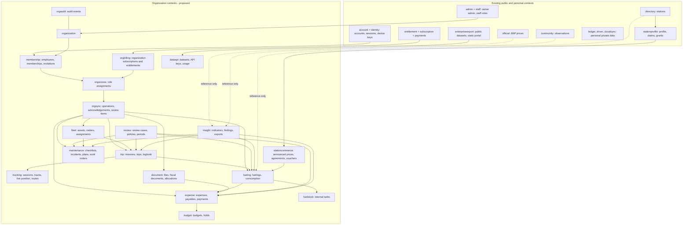
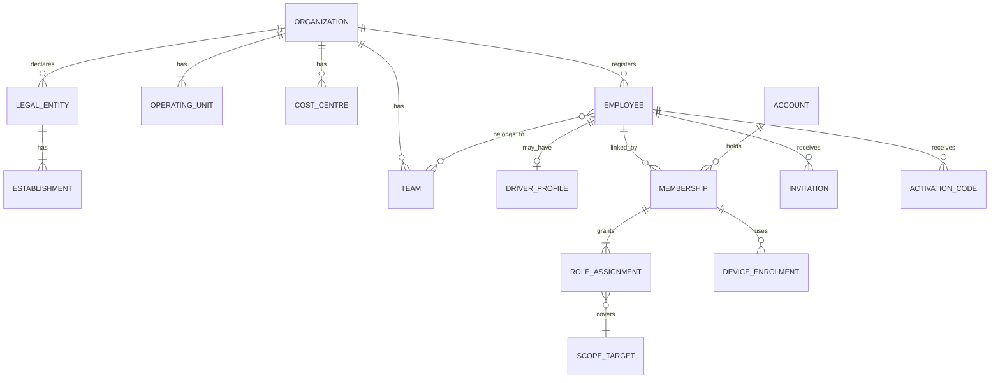
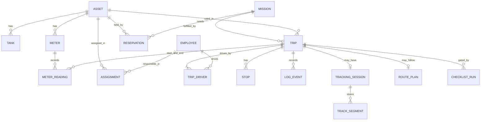
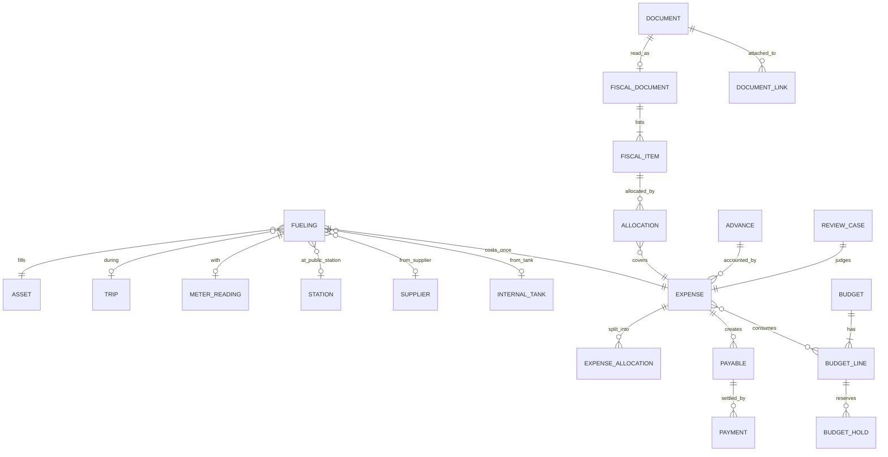
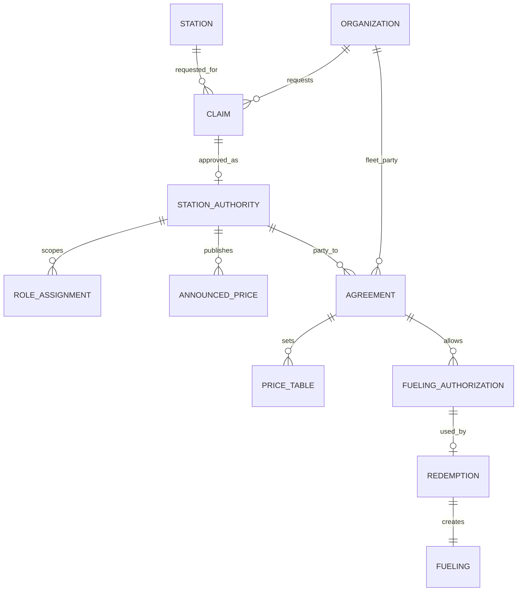

# Domain model and data ownership

Status: **PLANNED**, 2026-11-10. This file gives the map of contexts, who owns each aggregate, the main relations and the constraints that protect the rules. Attribute-level detail lives in section 3 of each module file. Module and table names are `PROPOSED` and follow the conventions found in the repository (one lowercase word per backend module, `domain` / `application` / `adapters` inside it, one sqlc package per module); final names are frozen by the first persistence task of each module.

## 1. Three kinds of data

| Kind | Examples | Owner | Who may read |
|---|---|---|---|
| **Public catalog and public facts** | Stations, official prices, community prices, fuel products, municipalities, announced prices, representation badge | The platform's existing public modules (`directory`, `official`, `community`, `stationprofile`) | Anyone, as today |
| **Personal private data** | Personal vehicles, personal ledger, driver-suite shifts, saved personal trips, Premium data | One account (existing cloud protocol) | That account |
| **Organization private data** | Employees, assets, trips, tracks, fuelings, documents, expenses, budgets, agreements, API keys | One organization | Members of that organization, by role and scope |

Rules that connect them:

- Organization data may **reference** public catalog entities by identifier. The reference gives no ownership and changes nothing in the catalog (BR-SRC-004).
- Personal data and organization data never move into each other automatically (BR-SRC-003, [modules/subscriptions](modules/subscriptions.md) BR-PUB).
- Two organizations share data only under an explicit contract, limited to listed fields (BR-TEN-005): an agreement transaction ([modules/station-commerce](modules/station-commerce.md)) or a consolidation grant ([modules/organizations](modules/organizations.md)).

## 2. Context map

Arrows mean "is used by". Dotted arrows are read-only references to public data. No organization context writes to an existing public or personal context.

## 3. Aggregates and owners

| Context (module code) | Aggregate root | Contains | Data owner | References |
|---|---|---|---|---|
| organization (ORG) | Organization | Settings, policies, state | The organization itself | — |
| organization (ORG) | Legal entity | Establishments, verification | Organization | — |
| organization (ORG) | Operating unit; Team; Cost centre | — | Organization | Establishment (optional) |
| organization (ORG) | Consolidation grant | Parties, scope, period | Both organizations | Organization × 2 |
| membership (IDN) | Employee | Driver profile, contact, registration number | Organization | Unit, team |
| membership (IDN) | Membership | Periods, state | Organization | Account (existing), employee |
| membership (IDN) | Invitation; Activation code | Token hash, expiry | Organization | Employee |
| membership (IDN) | Device enrolment | Device reference, key binding, state | Organization (for managed devices) | Existing device reference |
| orgaccess (AUTH) | Role assignment | Scope, period, delegation | Organization | Membership, scope target |
| orgsync (OFFL) | Operation and acknowledgement | Payload digest, result | Organization | Membership, device |
| orgsync (OFFL) | Review item | Reason, resolution | Organization | Operation |
| fleet (FLEET) | Asset | Tanks, tenure periods, unit and cost-centre history | Organization | Unit, cost centre |
| fleet (METER) | Meter | Readings (append-only) | Organization | Asset |
| fleet (FLEET) | Assignment; Reservation; Block | Periods | Organization | Asset, employee, mission |
| fleet (FLEET) | Supplier | Identification, kinds | Organization | Station (optional reference) |
| trip (TRIP) | Mission | Planned stops, assignees | Organization | Unit, cost centre, employees |
| trip (TRIP) | Trip | Driver segments, stops, legs, logbook events, closing | Organization | Asset, mission (optional), unit and cost centre (snapshot) |
| tracking (GPS) | Tracking session | Track segments, gaps, quality | Organization | Trip, device |
| tracking (GPS) | Live position | Last fix per trip in progress | Organization | Trip |
| tracking (GPS) | Geofence | Geometry, rules | Organization | Unit |
| tracking (ROUTE) | Route plan | Destinations, planned distance, source | Organization | Mission or trip |
| fueling (FUEL) | Fueling | Product, quantity, amounts, fill level, supplier roles | Organization | Asset, tank, employee, trip (optional), meter reading, station (optional reference), supplier, internal tank, authorization |
| fueling (FUEL) | Consumption interval (derived) | Anchors, fuel sum, distance | Organization | Fuelings, readings |
| document (DOC) | Document | File, hash, statuses, extraction | Organization | — |
| document (DOC) | Fiscal document | Access key, issuer, items, totals | Organization | Document |
| document (DOC) | Document link; Allocation | Target, amount | Organization | Document or fiscal item; fueling, expense, work order, trip, asset, employee |
| review (APPR) | Review case | Revisions judged, steps, decisions | Organization | Any reviewable record |
| review (APPR) | Approval policy; Period | Thresholds, levels; lock state | Organization | Scope targets |
| expense (EXP) | Expense | Category, amounts, origin, allocations | Organization | Fueling or work order (origin), asset, trip, cost centre, employee |
| expense (FIN) | Payable; Payment; Advance | Creditor, settlement | Organization | Expenses, employee, supplier |
| budget (BUDG) | Budget | Lines, holds, consumption | Organization | Scope targets |
| maintenance (CHECK) | Checklist template; Checklist run | Items, answers, photos | Organization | Asset, trip |
| maintenance (CHECK) | Incident; Damage | Description, evidence, treatment | Organization | Asset, trip, employee |
| maintenance (MAINT) | Maintenance plan | Triggers, occurrences | Organization | Asset, meter |
| maintenance (MAINT) | Work order | Lines (parts, services), quote, dates | Organization | Asset, supplier, incident |
| maintenance (MAINT) | Compliance item | Document kind, expiry | Organization | Asset or employee, document |
| fuelstock (STOCK) | Internal tank | Movements, measurements, average cost | Organization | Unit, product |
| insight (KPI) | Indicator snapshot (derived) | Value, basis, revision | Organization | Source records |
| insight (FIND) | Finding | Type, evidence, outcome | Organization | Source records |
| insight (RPT) | Export job | Parameters, file, expiry | Organization | Requester |
| stationprofile (CLAIM, existing + extension) | Claim; Station authority; Contest case | Proofs, decisions, scopes | Claimant organization or account; decisions by the platform | Station, operator revision |
| stationcommerce (STN) | Announced price; Promotion | Conditions, validity, author | Station organization | Station, authority |
| stationcommerce (AGREE) | Agreement | Parties, price table, validity | Both organizations, each sees the shared part | Fleet organization, station authority |
| stationcommerce (AGREE) | Fueling authorization; Redemption | Limits, code hash, result | Authorization: fleet organization. Redemption: shared transaction | Agreement, asset, employee |
| orgbilling (SUBS) | Organization subscription | Plan, state, period, limits | Platform (commercial record) about the organization | Organization, payment provider records |
| dataapi (DATA) | API key; Usage record | Hash, scopes, counters | Organization | — |
| dataapi (DATA) | Dataset definition | Origin, coverage, method, version | Platform | Public sources |
| orgaudit (AUD) | Audit event | Actor, action, target, reason | Organization | Any record |
| admin/staff (BACK, existing + extension) | Support session | Approval, period, accesses | Platform and the organization | Organization |

## 4. Main relations

### 4.1 Organization, people and access

Cardinalities that matter: an account may hold memberships in several organizations; an employee record has at most one membership that is not `ENDED` at any time; an employee may have none (register only); a membership always has at least one role assignment while `ACTIVE`.

### 4.2 Fleet and operations

A trip has exactly one main asset; implements attached to it are listed on the trip. A trip stores the unit and cost centre it belonged to when it started (BR-AUTH-005).

### 4.3 Fuel, documents and money

The three supplier references of a fueling are independent and optional: where it happened (station or supplier or internal tank), who issued the document (on the fiscal document), and who holds the contract (agreement).

### 4.4 Stations and agreements

## 5. Constraints that enforce the rules

Stated as intent; each becomes a database constraint or a transactional check in the task that creates the table.

| Rule | Constraint |
|---|---|
| BR-TEN-001 | Every organization table has `org_id NOT NULL`. Child rows reference parents with a composite key `(org_id, parent_id)`, so a row cannot point to another organization's parent. |
| BR-TEN-007 | Row-level security policy on organization tables keyed to a per-transaction organization setting, as defence in depth behind scoped queries (decision EDR-005 in [16-decisions](16-decisions.md)). |
| One live membership | At most one membership not `ENDED` per (organization, account) and per (organization, employee). |
| Employee register | Registration number unique per organization when present. |
| Asset identification | Plate and fleet number each unique per organization among assets that are not `ARCHIVED`. |
| Non-overlapping periods | Assignments of kind primary, tenure periods, unit allocations, role assignments and reservations use exclusion constraints on (key, period). |
| One active trip per asset | Partial unique index on (organization, asset) for trips `IN_PROGRESS` or `PAUSED`. Conflicting operations go to review, not to an error ([10-offline-sync](10-offline-sync.md)). |
| Readings are evidence | Meter readings are insert-only; a correction is a new row that supersedes another; the asset's "current value" is a projection. |
| One cost per fueling | Unique (organization, fueling) on expenses whose origin is a fueling. |
| No double counting | Sum of allocations of a fiscal item ≤ the item total; sum of allocations of a document ≤ the document total; enforced in the allocating transaction with a lock on the document. |
| One fiscal document per key | Unique (organization, access key). Content hash indexed per organization to find the same file uploaded twice. |
| Idempotent intake | Unique (organization, operation identifier) on acknowledgements. |
| Approval integrity | A decision row names the revision it judged; unique (review case, level, revision). |
| Budgets | Holds and consumption update a budget line under a row lock; `limit ≥ 0`; available is computed, never stored as truth. |
| Period lock | Unique (organization, period key); writes that fall in a locked period are diverted to review. |
| Single-use voucher | Unique redemption per authorization; code stored only as a hash; attempt counter with lock. |
| Billing events | Unique (provider, provider event identifier), as the existing payment intake already does. |
| API keys | Only a hash of the key is stored; unique key prefix per organization. |
| Audit | Audit table is insert-only for the application role. |

Value types follow BR-MONEY: `BIGINT` centavos, milli-units, metres and seconds; `TIMESTAMPTZ` instants plus an IANA zone text; enumerations as `TEXT` with `CHECK` (repository convention; a new value is a new migration that widens the check).

Indexes are added for measured queries only. The expected first ones: lists by (organization, unit, reporting day, id) with keyset pagination; review queues by (organization, state, created); readings by (organization, meter, read instant); track segments by (organization, trip, sequence); acknowledgements by (organization, device, received).

## 6. History and time

| Need | How it is kept |
|---|---|
| Who was responsible for an asset at a past moment | Assignment periods; a trip also stores its drivers as segments |
| Which unit and cost centre a cost belonged to | Snapshot on the record at creation, plus allocation rows |
| What a record looked like when it was approved | Revisions; the review case names the revision judged |
| What a meter said over time | Append-only readings with supersession links |
| What price reference an analysis used | A stored reference snapshot with source, place, period, conditions and method version |
| Which plan and limits applied | Subscription state history with effective dates |
| Who had which access | Role assignment periods and membership periods, never deleted |

Changing the current driver, unit or cost centre of an asset never rewrites past trips, fuelings or expenses.
