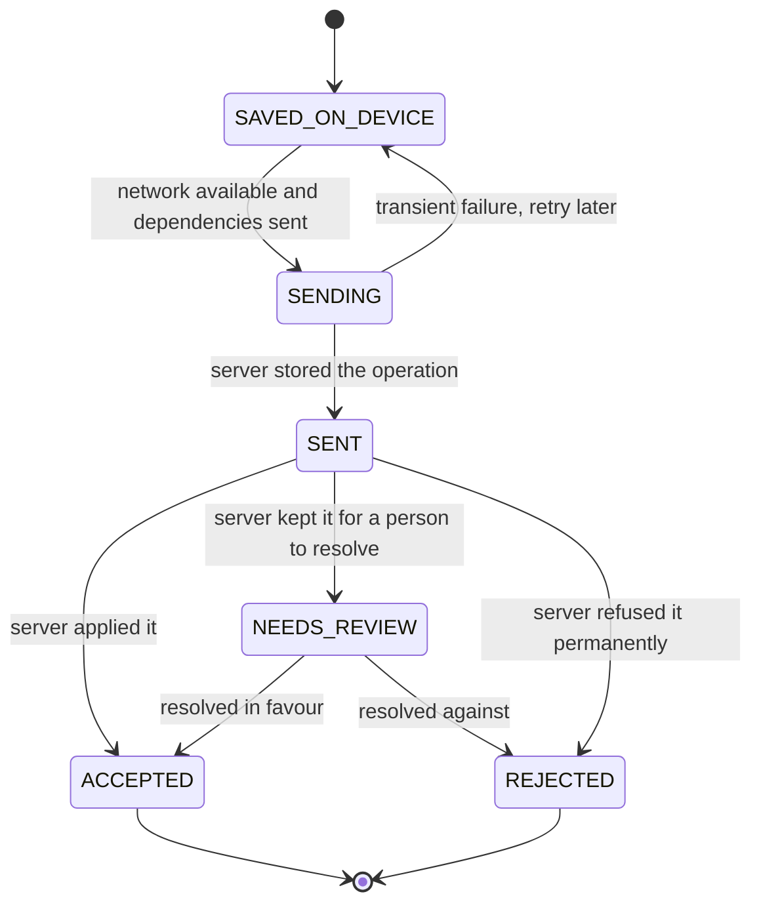

# State model

Status: **PLANNED**, 2026-11-10. This file fixes the state names used across the suite and the rule that keeps different kinds of state apart. Transition tables (actor, validation, effects, reversal) live in section 6 of the owning module; this file is the canonical list of names. A module may not rename a state or add one without updating this catalog.

## 1. Three kinds of state that never share a field

A record that an employee creates in the field has up to three independent states.

| Kind | Question it answers | Decided by | Shared definition |
|---|---|---|---|
| **Operational state** | What is happening in the real world? | The people doing the work | Per entity, §3 |
| **Sync state** | Where is this record between the device and the organization? | Device and server | §2, [10-offline-sync](10-offline-sync.md) |
| **Review state** | Has the organization accepted this record administratively? | Reviewers | [04-business-rules](04-business-rules.md) §7 (BR-REV) |

They combine freely. Example for one trip:

| Moment | Operational | Sync | Review |
|---|---|---|---|
| Driver finishes the trip with no signal | `COMPLETED` | `SAVED_ON_DEVICE` | `DRAFT` |
| Phone reaches the network | `COMPLETED` | `SENT`, then `ACCEPTED` | `SUBMITTED` |
| Supervisor asks for the missing toll receipt | `COMPLETED` | `ACCEPTED` | `RETURNED` |
| Driver adds the receipt offline | `COMPLETED` | `SAVED_ON_DEVICE` (new operation) | `RETURNED` |
| Server receives it; supervisor approves | `COMPLETED` | `ACCEPTED` | `APPROVED` |

A screen never shows one of these as if it were another: "finished" is not "received", and "received" is not "approved".

## 2. Sync state

Device side, per operation:

| State | Interface text (pt-BR) | Meaning |
|---|---|---|
| `SAVED_ON_DEVICE` | Salvo no aparelho | Durable on the phone only. |
| `SENDING` | Enviando | A delivery attempt is running. Shown as "Salvo no aparelho" with a progress hint. |
| `SENT` | Enviado | The server stored the operation and will answer. |
| `ACCEPTED` | Aceito pela empresa | Applied to the organization's records. Not the same as approved. |
| `NEEDS_REVIEW` | Precisa de revisão | Kept by the server; a person must resolve it. |
| `REJECTED` | Não aceito | Refused permanently, with a reason. Stays visible on the device until the user dismisses it. |

Server intake result per operation: `ACCEPTED`, `ACCEPTED_FOR_REVIEW`, `REJECTED` (permanent, with an error code), `RETRY` (transient; the device keeps `SAVED_ON_DEVICE`).

## 3. Catalog of state machines

Every state name below is canonical. "Kind" is O (operational), S (sync), R (review), L (lifecycle of a configuration or right).

| Entity | Kind | States | Owner |
|---|---|---|---|
| Organization | L | `PENDING_SETUP`, `ACTIVE`, `SUSPENDED`, `ARCHIVED`, `CLOSED` | [organizations](modules/organizations.md) |
| Legal entity | L | `DECLARED`, `VERIFICATION_REQUESTED`, `VERIFIED`, `REFUSED`, `LAPSED`, `REVOKED` | [organizations](modules/organizations.md) |
| Operating unit, team, cost centre | L | `ACTIVE`, `ARCHIVED` | [organizations](modules/organizations.md) |
| Consolidation grant (group) | L | `PROPOSED`, `ACTIVE`, `ENDED`, `DECLINED` | [organizations](modules/organizations.md) |
| Employee record | L | `ACTIVE`, `INACTIVE`, `TERMINATED` | [identity](modules/identity.md) |
| Membership | L | `INVITED`, `ACTIVE`, `SUSPENDED`, `ENDED` | [identity](modules/identity.md) |
| Invitation | L | `PENDING`, `ACCEPTED`, `DECLINED`, `EXPIRED`, `REVOKED`, `SUPERSEDED` | [identity](modules/identity.md) |
| Activation code | L | `ISSUED`, `USED`, `EXPIRED`, `REVOKED`, `LOCKED` | [identity](modules/identity.md) |
| Device | L | `ENROLLED`, `REVOKED` | [identity](modules/identity.md) |
| Role assignment | L | `SCHEDULED`, `ACTIVE`, `ENDED` (derived: `INEFFECTIVE`) | [07-permissions](07-permissions.md) |
| Asset lifecycle | L | `DRAFT`, `ACTIVE`, `INACTIVE`, `DISPOSED`, `ARCHIVED` | [fleet](modules/fleet.md) |
| Asset availability (derived) | O | `AVAILABLE`, `RESERVED`, `IN_USE`, `IN_MAINTENANCE`, `BLOCKED`, `UNAVAILABLE` | [fleet](modules/fleet.md) |
| Asset assignment | L | `SCHEDULED`, `ACTIVE`, `ENDED` | [fleet](modules/fleet.md) |
| Reservation | O | `REQUESTED`, `CONFIRMED`, `FULFILLED`, `CANCELLED`, `NO_SHOW`, `EXPIRED` | [fleet](modules/fleet.md) |
| Meter reading | L | `VALID`, `SUSPECT`, `VOIDED` | [fleet](modules/fleet.md) |
| Mission | O | `DRAFT`, `PLANNED`, `ASSIGNED`, `ACCEPTED`, `DECLINED`, `IN_PROGRESS`, `COMPLETED`, `CANCELLED` | [trips](modules/trips.md) |
| Trip | O | `PLANNED`, `ASSIGNED`, `ACCEPTED`, `IN_PROGRESS`, `PAUSED`, `COMPLETED`, `CANCELLED` | [trips](modules/trips.md) |
| Trip | R | BR-REV states, plus `VOIDED` | [trips](modules/trips.md) |
| Checklist run | O | `IN_PROGRESS`, `COMPLETED_OK`, `COMPLETED_WITH_ISSUES`, `BLOCKING` | [maintenance](modules/maintenance.md) |
| Incident and damage | O | `REPORTED`, `ACKNOWLEDGED`, `IN_TREATMENT`, `RESOLVED`, `DISMISSED` | [maintenance](modules/maintenance.md) |
| Tracking session | O | `NOT_STARTED`, `RECORDING`, `SUSPENDED`, `INTERRUPTED`, `ENDED` | [gps-navigation](modules/gps-navigation.md) |
| Track quality | L | `PRECISE`, `APPROXIMATE`, `INSUFFICIENT` | [gps-navigation](modules/gps-navigation.md) |
| Live position freshness (derived) | O | `CURRENT`, `STALE`, `NO_SIGNAL` | [gps-navigation](modules/gps-navigation.md) |
| Operation | S | §2 | [10-offline-sync](10-offline-sync.md) |
| Fueling | R | BR-REV states, plus `VOIDED` | [fuelings](modules/fuelings.md) |
| Consumption interval (derived) | L | `COMPUTED`, `INSUFFICIENT_DATA`, `SUPERSEDED` | [fuelings](modules/fuelings.md) |
| Document: storage | L | `UPLOADING`, `RECEIVED`, `STORED`, `QUARANTINED`, `FAILED`, `REPLACED`, `DELETED` | [documents](modules/documents.md) |
| Document: extraction | L | `NONE`, `PENDING`, `DONE`, `FAILED` | [documents](modules/documents.md) |
| Document: structure | L | `NOT_APPLICABLE`, `UNCHECKED`, `STRUCTURE_OK`, `STRUCTURE_INVALID` | [documents](modules/documents.md) |
| Document: conference | R | `UNCONFERRED`, `CONFERRED_OK`, `DIVERGENT`, `ILLEGIBLE` | [documents](modules/documents.md) |
| Document: reconciliation | L | `UNALLOCATED`, `PARTIALLY_ALLOCATED`, `RECONCILED`, `OVER_ALLOCATED` | [documents](modules/documents.md) |
| Document: fiscal consultation | L | `NOT_CONSULTED`, `AUTHORIZED_AS_OF`, `CANCELLED_AS_OF`, `UNAVAILABLE` | [documents](modules/documents.md) |
| Expense | R | BR-REV states, plus `VOIDED` | [expenses-finance](modules/expenses-finance.md) |
| Approval step | R | `PENDING`, `APPROVED`, `RETURNED`, `REJECTED`, `SKIPPED` | [expenses-finance](modules/expenses-finance.md) |
| Payable | L | `OPEN`, `PARTIALLY_SETTLED`, `SETTLED`, `CANCELLED` | [expenses-finance](modules/expenses-finance.md) |
| Advance | L | `REQUESTED`, `APPROVED`, `PAID`, `PARTIALLY_ACCOUNTED`, `ACCOUNTED`, `REJECTED`, `CANCELLED` | [expenses-finance](modules/expenses-finance.md) |
| Budget hold | L | `ACTIVE`, `CONSUMED`, `RELEASED`, `EXPIRED` | [expenses-finance](modules/expenses-finance.md) |
| Period | L | `OPEN`, `LOCKED`, `REOPENED` | [expenses-finance](modules/expenses-finance.md) |
| Work order | O | `DRAFT`, `REQUESTED`, `QUOTED`, `APPROVED`, `SCHEDULED`, `IN_EXECUTION`, `COMPLETED`, `CLOSED`, `REJECTED`, `CANCELLED` | [maintenance](modules/maintenance.md) |
| Maintenance plan occurrence | O | `UPCOMING`, `DUE`, `OVERDUE`, `DONE`, `SKIPPED` | [maintenance](modules/maintenance.md) |
| Stock measurement reconciliation | L | `OPEN`, `EXPLAINED`, `ADJUSTED` | [fuel-stock](modules/fuel-stock.md) |
| Finding | R | `OPEN`, `IN_REVIEW`, `CONFIRMED`, `JUSTIFIED`, `FALSE_POSITIVE`, `DISMISSED`, `SUPERSEDED` | [intelligence](modules/intelligence.md) |
| Export job | L | `QUEUED`, `RUNNING`, `READY`, `EXPIRED`, `FAILED` | [intelligence](modules/intelligence.md) |
| Import batch | L | `UPLOADED`, `PARSED`, `MAPPED`, `VALIDATED`, `CONFIRMED`, `APPLYING`, `APPLIED`, `APPLIED_WITH_ERRORS`, `FAILED`, `CANCELLED`, `REVERTED` | [imports-notifications-integrations](modules/imports-notifications-integrations.md) |
| Notification | L | `PENDING`, `DELIVERED`, `FAILED`, `SUPPRESSED` | [imports-notifications-integrations](modules/imports-notifications-integrations.md) |
| Integration connection | L | `CONFIGURED`, `ACTIVE`, `DEGRADED`, `DISABLED` | [imports-notifications-integrations](modules/imports-notifications-integrations.md) |
| Station claim | R | `DRAFT`, `AWAITING_PROOF`, `CHECKING`, `NEEDS_INFORMATION`, `IN_REVIEW`, `APPROVED`, `DENIED`, `CANCELLED`, `EXPIRED` (existing, wire-frozen) | [station-claims](modules/station-claims.md) |
| Station authority | L | `ACTIVE`, `SUSPENDED`, `REVOKED`, `EXPIRED` (existing grant states) | [station-claims](modules/station-claims.md) |
| Contest case | R | `OPEN`, `UNDER_REVIEW`, `UPHELD`, `DISMISSED` | [station-claims](modules/station-claims.md) |
| Announced price | L | `ACTIVE`, `EXPIRED`, `WITHDRAWN`, `SUPERSEDED` | [station-commerce](modules/station-commerce.md) |
| Promotion | L | `SCHEDULED`, `ACTIVE`, `ENDED`, `WITHDRAWN` | [station-commerce](modules/station-commerce.md) |
| Agreement | L | `PROPOSED`, `ACTIVE`, `SUSPENDED`, `ENDED`, `DECLINED`, `EXPIRED` | [station-commerce](modules/station-commerce.md) |
| Fueling authorization (voucher) | O | `ISSUED`, `REDEEMED`, `EXPIRED`, `CANCELLED`, `LOCKED` | [station-commerce](modules/station-commerce.md) |
| Subscription | L | `TRIALING`, `ACTIVE`, `PAST_DUE`, `SUSPENDED`, `CANCELLING`, `CANCELLED` | [subscriptions](modules/subscriptions.md) |
| API key | L | `ACTIVE`, `ROTATING`, `REVOKED`, `EXPIRED` | [data](modules/data.md) |
| Support session | L | `REQUESTED`, `APPROVED`, `ACTIVE`, `ENDED`, `DENIED`, `EXPIRED` | [back-office](modules/back-office.md) |

Mapping of the request's station-claim vocabulary to the frozen states: rascunho = `DRAFT`; enviado = `AWAITING_PROOF` or `CHECKING`; em análise = `IN_REVIEW`; pendente de informação = `NEEDS_INFORMATION`; aprovado = `APPROVED`; rejeitado = `DENIED`; expirado = `EXPIRED` (claim) or `EXPIRED` (authority); suspenso and revogado = `SUSPENDED` and `REVOKED` of the station authority; contestado = an open contest case linked to the authority or claim. Claims keep the existing wire-frozen names (STATION_PROFILE_CONTRACT_FREEZE) so that one coherent model exists.

## 4. Rules for every state machine

1. **States are closed lists.** An unknown state received from a newer server is shown as "unknown — update the app", never mapped to a known one (existing B-BR-P16 practice).
2. **Transitions are commands.** Each transition has an actor, a permission, a validation and an audit event (BR-AUD-001). There is no free "set state".
3. **Terminal states stay terminal.** A new attempt is a new record linked to the old one (a new claim, a new invitation, a new trip).
4. **Reversal is explicit.** Where a transition can be undone, the module names the inverse command. Where it cannot, the correction is an amendment or a void (BR-AMD).
5. **Derived states are computed, not stored as truth.** Availability, freshness and `INEFFECTIVE` are evaluated when read; a cached copy is a projection that can be rebuilt.
6. **Time-driven transitions run on the server.** Expiry is also checked at read time, so that a stopped job cannot leave an expired code, price or position looking valid.
7. **Concurrent transitions resolve to one outcome.** Every transition names the expected current state or revision; the loser receives `CONFLICT` and nothing changes.
