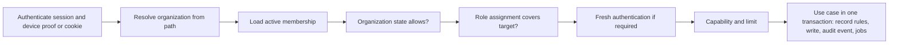

# Architecture

Status: **F1 IN_PROGRESS**, 2026-11-11. Written after the business rules, as the request requires. It reuses the architecture found in the repository ([01-diagnosis](01-diagnosis.md)) and adds only what the rules need. The organization value contract in EMP-PLAT-001 and the database foundation in EMP-PLAT-002 are implemented locally. Remaining architecture and contract examples describe their owning planned tasks. Module code `PLAT` covers the platform foundations (tasks `EMP-PLAT-001…016` in [backlog/ep01-platform](backlog/ep01-platform.md)).

## 1. Principles

1. **One backend.** The Go modular monolith, PostgreSQL/PostGIS, the PostgreSQL job queue, private object storage and Caddy stay as they are (EDR-003). API and worker remain two roles of one module.
2. **New modules, existing shape.** Each organization context is a module under `backend/internal/modules/` with `domain`, `application` and `adapters`, its own sqlc package and its own migrations. Collaboration between modules goes through narrow ports wired in the composition roots.
3. **The organization is in every call.** No organization function exists without an organization scope argument (BR-TEN-003).
4. **Rules in the domain, authority on the server.** Clients shape the interface; the server decides.
5. **Add nothing by habit.** A new dependency, service or provider needs a measured reason and a recorded decision (CX-10).

## 2. Modules and names

Proposed backend modules (names are confirmed by the first task of each; existing modules are marked):

| Module | Code | Owns | Uses (through ports) |
|---|---|---|---|
| `organization` (proposed) | ORG | Organization, legal entities, units, teams, cost centres, groups, settings | `account` (existing) |
| `membership` (proposed) | IDN | Employees, memberships, invitations, activation codes, device enrolment | `account`, `identity`, `cloudsync` device references (existing) |
| `orgaccess` (proposed) | AUTH | Role catalog, role assignments, the authorization service | `membership`, `organization`, `orgbilling` |
| `orgaudit` (proposed) | AUD | Organization audit events | — |
| `orgsync` (proposed) | OFFL | Operation intake, acknowledgements, review items, reference feed | `orgaccess`; handlers registered by each module |
| `fleet` (proposed) | FLEET, METER | Assets, tanks, meters, readings, assignments, reservations, suppliers | `organization`, `membership` |
| `trip` (proposed) | TRIP | Missions, trips, stops, logbook | `fleet`, `review` |
| `tracking` (proposed) | GPS, ROUTE | Tracking sessions, track segments, live position, geofences, route plans | `trip` |
| `fueling` (proposed) | FUEL | Fuelings, consumption intervals, price reference snapshots | `fleet`, `metrics` (existing engine), `directory`/`official`/`community` (read) |
| `document` (proposed) | DOC | Documents, extractions, fiscal documents, links, allocations | storage port; `kernel` CNPJ type (existing) |
| `review` (proposed) | APPR | Review cases, approval policies, periods | `orgaccess` |
| `expense` (proposed) | EXP, FIN | Expenses, allocations, payables, payments, advances | `review`, `fueling`, `document` |
| `budget` (proposed) | BUDG | Budgets, lines, holds | `expense` |
| `maintenance` (proposed) | MAINT, CHECK | Checklists, incidents, plans, work orders, compliance items | `fleet`, `review`, `expense` |
| `fuelstock` (proposed) | STOCK | Internal tanks and movements | `fueling`, `expense` |
| `insight` (proposed) | KPI, FIND, RPT | Indicator read models, findings, export jobs | read ports of the above |
| `stationprofile` (existing, extended) | CLAIM | Claims, proofs, decisions, station authority, contest cases | `directory`, `organization` |
| `stationcommerce` (proposed) | STN, AGREE | Announced prices, promotions, interaction metrics, agreements, authorizations | `stationprofile`, `fueling`, `budget` |
| `orgbilling` (proposed) | SUBS | Organization plans, subscriptions, entitlements, usage | `entitlement`, `subscription`, `payments` (existing) |
| `dataapi` (proposed) | DATA | Dataset definitions, API keys, usage | `enterpriseexport` (existing) |
| `orgimport`, `orgnotify`, `integration` (proposed) | IMPORT, NOTIF, INTEG | Import batches; notifications; connections | the modules they feed |
| `admin`, `staff` (existing, extended) | BACK | Review queues, support sessions | `stationprofile`, `organization` |

Registering a new backend module touches these places, found in the current tree:

1. Migration files in `backend/db/migrations/` (append-only; keep `schema_min_supported` for additive changes).
2. A stanza in `backend/sqlc.yaml` listing only the module's own migrations, and the committed `backend/db/queries/<module>/` package (CI checks the generated diff).
3. Composition in `backend/cmd/api/main.go`.
4. Job handlers and schedules in `backend/cmd/worker/main.go`, and `backend/cmd/worker/dispatchers.go` when a dedicated slot is needed.
5. Operator commands in `backend/cmd/ops/main.go`, when any.
6. Flags in `backend/internal/platform/config/config.go`.
7. Routes in `contracts/openapi/v1.yaml` with contract vectors under `contracts/testdata/`.
8. `scripts/check-manifest.txt` when the package joins the quick gate.
9. The account-deletion trigger pattern (see §5).
10. Caddy configuration when something is served to browsers.

### 2.1 Private organization repository contract

EMP-PLAT-001 implements `kernel.OrgID` and `kernel.OrgScope` in the
[shared kernel](../../backend/internal/modules/kernel/org_scope.go).
`OrgID` parses a non-nil, dashed UUID and stores its lowercase canonical
form. `NewOrgScope` requires a valid ID. The application resolves current
actor, membership, role and capability before constructing the scope.
Each adapter calls `scope.Validate()` before private data access.
[Product contract](../product/ABASTEVO_EMPRESAS_CONTRACT.md)

Every private organization repository method accepts `kernel.OrgScope`
explicitly beside `context.Context`. A module port follows this template,
using its own `RecordID` and aggregate types.

```go
type Repository interface {
    Load(ctx context.Context, scope kernel.OrgScope, id RecordID) (Record, error)
    Save(ctx context.Context, scope kernel.OrgScope, record Record) error
}
```

The application creates a separate scope value when the selected
organization changes. Adapters bind every lookup, mutation, join and
foreign reference to the supplied organization. The context carries
cancellation and deadlines. The explicit argument carries organization
selection. Current actor authority is checked at the application boundary.

Before registering an organization-private module, complete this checklist
in its owning task.

- Define explicit scope on private read, write, list and cross-module ports,
  and reject a zero scope before invoking storage.
- Bind primary and foreign record references to the organization. Include
  scoped predicates and composite constraints in the sqlc/migration task.
- Use transaction-local database scope and an application role subject to
  row-level policies. EMP-PLAT-002 proves pool reuse and foreign-scope
  rejection with real PostGIS.
- Carry organization identity through jobs, caches, private files, search
  projections and exports. Resolve current authority at each entry point.
- Register only the required composition, routes, jobs and configuration
  from the list above. Preserve public catalog and personal port contracts.
- Exercise absent scope, foreign organization and foreign reference cases
  through the adapter and normal application entry points before acceptance.

[EMP-PLAT-001 local evidence](evidence/f1-plat001-tenancy-kernel.md)

Android (proposed packages, inside the existing modules and package root `com.anpfuel`):

| Module | Addition |
|---|---|
| `:domain` | `com.anpfuel.domain.enterprise.*` — pure models and rules, shared vectors |
| `:application` | `com.anpfuel.application.enterprise.*` — use cases and ports |
| `:data` | `com.anpfuel.data.enterprise.*` — Room entities, operation queue, HTTP clients, workers |
| `:app` | `com.anpfuel.app.ui.enterprise.*` — enterprise mode screens; a tracking service beside the existing location services |
| `:maps:engine` | No change; used through the existing `MapEngine` port |

Approved Android partition (EMP-GOV-008): enterprise data and queued
operations carry `(owner_account, origin, org_id)`. Local storage protects
the partition with Keystore-backed keys and excludes it from backup and
device transfer. Implementation must cover journals, caches and temporary
attachments. [Decision record](evidence/f0-m0-decisions.md#android-local-protection)

Approved company panel (EMP-GOV-003, EDR-019): a static framework-free
TypeScript `business-web/` build served by Caddy at `/empresas/` on the
configured API origin. Its session, build and middleware are separate
from `admin-web/`. A future station portal remains subject to its
separate gate. [Decision record](evidence/f0-m0-decisions.md#company-web-surface)

## 3. Request context and authentication

| Client | Authentication | Notes |
|---|---|---|
| Android, enterprise mode | Existing account session (`family_id`, `access_token` in the JSON body) plus the existing signed-request device proof | Same convention as ledger and driver routes. A managed account authenticates the same way after activation. |
| Business web | Cookie session for the account: HttpOnly, Secure, `SameSite=Strict`, `__Host-` prefix, CSRF token header, exact origin check, idle and absolute timeouts | Modelled on the admin session of ADR-023; it is a different cookie, table and middleware from the admin session. |
| Data API | Organization API key in the `Authorization` header; only a hash is stored | Separate route group; no session. |
| Back office | Existing admin session; staff-role endpoints enforce their role with their own tests | ADR-023. |

Every organization request passes one pipeline, implemented once and used by all modules:



The steps and their errors are the table in [07-permissions](07-permissions.md) §10. The resolved context (`organization`, `membership`, `device`, effective assignments) is passed explicitly to the use case; no use case reads identity from global state.

## 4. API conventions

- **Paths:** `/v1/orgs/{org_id}/<module>/…`. Routes that are not inside an organization (create an organization, list my memberships, accept an invitation, activate managed access) live under `/v1/org-access/…`. Station portal routes are organization routes scoped by station: `/v1/orgs/{org_id}/stations/{station_id}/…`.
- **Methods:** following the existing convention, commands and private reads are `POST` with a JSON body, because the app's session travels in the body. Responses are `no-store`.
- **Commands:** a command body carries `operation_id` (UUID), the target identifier, the expected revision when it changes something, and the payload. The same identifier with the same payload returns the first result; with a different payload it returns `OPERATION_ID_REUSED`. Field operations from the app go through the batch intake of [10-offline-sync](10-offline-sync.md); panel commands call the module route directly and use the same handlers.
- **Reads:** keyset pagination with the existing HMAC-sealed cursors, default 20 and maximum 100 items; the cursor is bound to the organization, the member and the filters and expires in 15 minutes.
- **Errors:** the existing envelope `{"error":{"code","message","trace_id","details":[{"field","code"}]}}`. Codes are listed in §6.
- **Versioning:** `/v1` with additive changes only. Each operation type carries a schema version; an unknown version is refused with `MALFORMED`, never guessed. Unknown enum values from a newer server are shown as unknown by older clients ([08-state-model](08-state-model.md) §4).
- **Contract:** every route is added to `contracts/openapi/v1.yaml` with golden vectors. A new test compares registered organization routes with the contract (no such test exists today).
- **Rate limits:** the existing limiter with per-account, per-device and per-organization subjects. The quota table accepts only three operation names today, so organization limits use the `write` operation with their own subjects, as the forum does, unless a migration widens the check.

Example (documentation only) — create an organization:

```http
POST /v1/org-access/organizations
{"family_id":"…","access_token":"…","operation_id":"5c1e…","name":"Transportes Exemplo","time_zone":"America/Sao_Paulo","first_unit":{"name":"Matriz"}}

201 {"organization":{"id":"7b0e…","name":"Transportes Exemplo","state":"PENDING_SETUP","revision":1},
     "membership":{"id":"2f4b…","state":"ACTIVE","roles":[{"role":"OWNER","scope":"ORG"}]}}
```

Example — a review decision from the panel:

```http
POST /v1/orgs/7b0e…/review/cases/91aa…/decide
X-CSRF: …
{"operation_id":"d0c2…","revision":3,"decision":"RETURNED","reason":"Falta o comprovante do pedágio"}

200 {"case":{"id":"91aa…","state":"RETURNED","revision":4}}
409 {"error":{"code":"CONFLICT","message":"The record changed since you opened it","trace_id":"…"}}
403 {"error":{"code":"SELF_APPROVAL","message":"You cannot decide on your own record","trace_id":"…"}}
```

## 5. Persistence and transactions

- **Schema rules:** [06-domain-model](06-domain-model.md) §5. UUID keys generated by the creator (device or server); `TEXT` + `CHECK` enumerations; `TIMESTAMPTZ`; integer money and quantities (BR-MONEY).
- **Migrations:** append-only and additive, compatible with the previous image; the minimum-supported floor is not raised by this suite's additions, so a rollback to the previous image stays possible (existing zero-downtime practice).
- **Account deletion:** existing private modules erase their rows when an account is deleted. Organization modules must not. Their trigger ends the account's memberships and replaces the account link with a tombstone; organization records stay (BR-TEN-009, BR-PRIV-014).
- **Transactions:** one use case, one short transaction: record rules, writes, the audit event and the required jobs commit together. No external call is made while holding a lock. Aggregate roots are locked with `SELECT … FOR UPDATE`; periods use exclusion constraints; "one active trip per asset" is a partial unique index whose violation is turned into a review item, not an error.
- **Row-level security:** organization tables get forced policies that compare `org_id` with a transaction-local setting. Routine API and worker logins own no RLS tables and cannot assume privileged roles. Migration authority is separate. This is a second layer behind scoped queries (EDR-005).
- **Idempotency:** acknowledgements are unique per (organization, operation); panel commands share the same table.
- **Read models:** lists and indicators that need joins across modules are projections owned by one module and rebuilt from facts; they are never the source of truth.

### 5.1 Implemented organization database foundation

Private adapters call [database.WithOrgTx](../../backend/internal/platform/database/org_scope.go)
with an explicit `kernel.OrgScope` and perform all work through its
`pgx.Tx` callback. The helper validates scope before pool access, refuses
unsafe runtime roles, and parameterizes `set_config('anpfuel.org_id', $1, true)`.
The pgx transaction helper commits successful work and rolls back failures.
Cancellation releases or discards the connection before reuse.

The role check rejects a changed effective role, a login that can assume
superuser, BYPASSRLS or CREATEROLE privileges, and membership in an RLS
table's owner role. Use a dedicated runtime login with schema USAGE and
only the required table DML grants. The migrator owns the schema and tables.

The [executable migration template](../../backend/db/templates/organization_private.sql)
defines organization-first primary and unique keys, a composite foreign
reference and its index, and ENABLE/FORCE RLS with both USING and WITH CHECK.
Missing or empty scope matches no rows. Malformed settings fail UUID
validation. Each owning task copies and renames the template in a new
numbered migration and adds its FK to the organization root introduced by
EMP-ORG-002. The template stays outside the applied migration chain.

The integration-only [orgtest fixture](../../backend/internal/platform/orgtest/fixture.go)
creates a fresh fully migrated PostGIS database and a separate ordinary
login. It loads the shared two-organization fixture and cleans up only its
own database and role. Adapter tests grant that login access only to their
owned tables. The harness requires an explicit disposable test DSN.
[Isolation and migration evidence](evidence/f1-plat002-database-isolation.md)

## 6. Error codes

Shared codes; modules add their own in section 10 of their file.

| Code | HTTP | Meaning |
|---|---|---|
| `UNAUTHENTICATED` | 401 | No valid session or proof |
| `NOT_FOUND` | 404 | No such resource for this caller (also used for other organizations) |
| `FORBIDDEN` | 403 | Member lacks the named permission |
| `MEMBERSHIP_SUSPENDED`, `MEMBERSHIP_ENDED` | 403 | Access suspended or ended |
| `ORG_SUSPENDED`, `ORG_ARCHIVED` | 403 | Organization state forbids the action |
| `FRESH_AUTH_REQUIRED` | 401 | Sensitive action needs a recent authentication |
| `ENTITLEMENT_REQUIRED`, `LIMIT_REACHED` | 403 | Plan does not include the capability, or a limit is reached |
| `VALIDATION_FAILED` | 422 | Field errors in `details` |
| `CONFLICT` | 409 | Stale revision or concurrent change |
| `OPERATION_ID_REUSED` | 409 | Same operation identifier with a different payload |
| `SELF_APPROVAL`, `PERIOD_LOCKED`, `LAST_OWNER` | 409 | Record rules |
| `MALFORMED` | 400 | Unknown schema or unparsable body |
| `RATE_LIMITED` | 429 | Limiter refused |
| `UNAVAILABLE` | 503 | Dependency down; retry later |

Sync-only codes are in [10-offline-sync](10-offline-sync.md) §10.2.

## 7. Events and jobs

- A domain event is a fact written in the same transaction as the change. A required follow-up is a row in the existing `job_queue`, enqueued in that transaction with a de-duplication key. An in-process notification alone never carries a required effect (existing rule in `TARGET_ARCHITECTURE.md`).
- Delivery is at least once. Handlers are safe to re-run and key their effect on the event identifier. Nothing here promises exactly-once delivery.
- Jobs that touch one organization carry its identifier and load data only through scoped queries (BR-PRIV-003).
- The queue retries after a fixed minute and moves a job to dead after its attempts; a dead organization job raises an operator alert and appears in the back office. Long or heavy jobs (exports, track processing, imports) get a dedicated serial dispatcher so they cannot starve short ones.
- Event names follow `<module>.<entity>.<past-tense>` and are listed in section 9 of each module.

## 8. Keeping the panel current

| Screen | Mechanism | Interval | Why |
|---|---|---|---|
| Live operations map | Polling a compact "positions since revision" read | 15 s | Tracks arrive in batches every 30 to 60 s; a push channel would show nothing sooner |
| Review and approval queues | Polling a count and first page | 60 s | Decisions are not time-critical to the second |
| Lists and details | On open and on user refresh | — | — |
| Exports | Polling the job state while the dialog is open | 5 s | Short-lived |

Every polled read returns a revision; an unchanged revision returns an empty body. Server-sent events are reconsidered only when measurements show polling load or latency is a problem (EDR-026).

## 9. Storage and capacity

Storage layout (proposed prefixes in the existing private bucket):

| Content | Location | Access |
|---|---|---|
| Documents | `org/<org_id>/doc/<document_id>/<sha256>` | API capability, 5 minutes, bound to member and document, audited |
| Exports and reports | `org/<org_id>/export/<job_id>` | Same, bound to the requester, expires with the job |
| Import files | `org/<org_id>/import/<batch_id>` | Server only |
| Track fixes | PostgreSQL, one row per uploaded batch | Through `gps.track.read` |
| Panel map tiles | Public, static, project-hosted tile archive | Anonymous; contains no organization data |

Capacity scenarios. **All figures are hypotheses** for sizing discussions; they are not measurements and not commitments. Unit prices are Cloudflare R2 public prices read on 2026-11-10 (USD 0.015 per GB-month standard storage, egress free).

Inputs assumed per active vehicle: 22 working days a month; 6 hours of movement a day; one fix every 10 seconds while moving; 2 trips and 2 receipts per working day; average receipt 400 KB.

| Quantity | Per vehicle | 100 vehicles | 1 000 vehicles | 10 000 vehicles |
|---|---|---|---|---|
| Fixes per day (6 h × 360 per hour) | 2 160 | 216 000 | 2.16 M | 21.6 M |
| Fixes per month | 47 520 | 4.75 M | 47.5 M | 475 M |
| Track storage per month, batch rows at about 25 bytes per fix | 1.2 MB | 119 MB | 1.2 GB | 11.9 GB |
| Track storage held with 90-day retention | 3.6 MB | 356 MB | 3.6 GB | 35.6 GB |
| Same with one indexed row per fix at about 175 bytes (rejected design) | 25 MB | 2.5 GB | 25 GB | 250 GB |
| Mobile upload per month at about 40 bytes per fix compressed | 1.9 MB | — | — | — |
| Track batches per second at peak, all vehicles moving, one batch per 60 s | — | 1.7 | 16.7 | 167 |
| Receipts per month | 44 | 4 400 | 44 000 | 440 000 |
| Document storage per month | 17.6 MB | 1.76 GB | 17.6 GB | 176 GB |
| Document storage after 5 years of retention | 1.06 GB | 106 GB | 1.06 TB | 10.6 TB |
| Document storage cost per month at steady state | USD 0.016 | USD 1.58 | USD 15.84 | USD 158 |
| Operational rows (trips, events, readings, fuelings) per year | about 3 MB | 0.3 GB | 3 GB | 30 GB |

Worked check: 2 160 fixes × 22 days = 47 520; × 25 bytes = 1 188 000 bytes ≈ 1.2 MB. 44 receipts × 400 KB = 17.6 MB a month; × 60 months = 1 056 MB ≈ 1.06 GB; × USD 0.015 = USD 0.0158 a month.

What the table says:

- Storage cost is small next to a per-vehicle price in the tens of reais; it is not the constraint.
- The first constraint is **write rate from tracking**. The existing acceptance workload is 5 writes per second. With one batch per 60 seconds that corresponds to about 300 vehicles moving at once. Before that point the batch interval is raised to 120 seconds (halving the rate) and the intake path is measured.
- Batch storage keeps tracking inside the existing database for thousands of vehicles; one row per fix would not.

Signals that justify the next infrastructure step (measured, sustained):

| Signal | Threshold (hypothesis) | Step |
|---|---|---|
| CPU above 70 % or memory above 75 % | Existing triggers in `INFRASTRUCTURE_PLAN.md` | Scale the host; then a dedicated database |
| Operation intake p95 latency | Above 500 ms | Tune batch interval and indexes; dedicated dispatcher |
| Track table size | Above 20 GB | Monthly partitions and partition drop for retention |
| Queue delay for exports or track processing | Above 5 minutes | Dedicated worker role |
| Panel polling share of requests | Above half of API load | Server-sent events for the live map |

## 10. Activation, flags and rollback

- **Global flags** (existing mechanism, `ANPFUEL_*` environment variables): one per new surface, default off, exactly like `ANPFUEL_DRIVER_ENABLED` and `ANPFUEL_FORUM_ENABLED`.
- **Per-organization capability flags** (new, EMP-PLAT-005): a table that enables each capability for an organization. During pilots an operator sets them; later the subscription sets them (EMP-SUBS-003). A capability turned off hides the feature and refuses new writes; existing data stays readable and exportable.
- **Rollout order:** flag on in a test environment → one internal organization → named pilot organizations → general.
- **Rollback:** turn the flag off. Data is never deleted by a rollback. Because migrations are additive, the previous image can run against the newer schema.
- **Recovery:** a restore replays the deletion ledger before serving (BR-PRIV-011); queued operations on devices are resent and answered from the acknowledgement table, so a server restore to an earlier point reprocesses them once.

## 11. Observability

Per-route counters and latency for the organization API; counts of operations by result and code; review-queue size and age; attachment failures; job failures by kind; tracking batch rate. Labels use bounded values only (route, result, code), never organization or person identifiers (BR-PRIV-008). Alerts reuse the existing evaluator (`ops monitoring eval`).

## 12. Integrations at a glance

Each is optional, behind a port, with a manual fallback. Details and adoption criteria are in [modules/imports-notifications-integrations](modules/imports-notifications-integrations.md).

| Capability | Fallback that always works | Port |
|---|---|---|
| Receipt extraction | Manual entry | On-device extractor; optional server extractor |
| Fiscal consultation | Human check on the tax authority's page; stored "as of" status | Fiscal document retrieval with the organization's own certificate |
| Routing on the server | Route computed on the device | Routing adapter slot |
| Panel map | List views | Web map component |
| E-mail and push | In-app inbox and local notifications | Delivery channel |
| Payment of plans | Administrative activation, invoice outside the system | Existing provider adapters |
| Accounting systems | CSV export | Export layouts, then connectors |
| Telematics hardware | Phone tracking | Ingestion port |
| Fuel cards | Manual statement import | Statement import |

## 13. Acceptance for the platform foundations

1. A module created with the registration checklist in §2 passes the quick gate and the isolation harness with no module-specific exception.
2. Every organization route appears in the OpenAPI contract and the route-versus-contract test fails when one is missing.
3. The authorization pipeline is the only path to a use case: a test fails when a route is registered outside it.
4. Row-level security denies a query that omits the organization filter in an integration test.
5. Deleting an account ends its memberships and leaves organization records intact.
6. Turning a capability flag off refuses new writes and keeps reads and exports.
