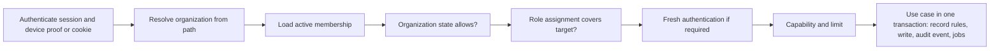

# Architecture

Status: **F1 IN_PROGRESS**, 2026-11-11. Written after the business rules, as the request requires. It reuses the architecture found in the repository ([01-diagnosis](01-diagnosis.md)) and adds only what the rules need. The organization scope, database, audit, HTTP, capability, private storage, company session, static shell and exact-value foundations in EMP-PLAT-001 through EMP-PLAT-009 are implemented locally. Remaining architecture and contract examples describe their owning planned tasks. Module code `PLAT` covers the platform foundations (tasks `EMP-PLAT-001…016` in [backlog/ep01-platform](backlog/ep01-platform.md)).

## 1. Principles

1. **One backend.** The Go modular monolith, PostgreSQL/PostGIS, the PostgreSQL job queue, private object storage and Caddy stay as they are (EDR-003). API and worker remain two roles of one module.
2. **New modules, existing shape.** Each organization context is a module under `backend/internal/modules/` with `domain`, `application` and `adapters`, its own sqlc package and its own migrations. Collaboration between modules goes through narrow ports wired in the composition roots.
3. **The organization is in every call.** No organization function exists without an organization scope argument (BR-TEN-003).
4. **Rules in the domain, authority on the server.** Clients shape the interface; the server decides.
5. **Add nothing by habit.** A new dependency, service or provider needs a measured reason and a recorded decision (CX-10).

## 2. Modules and names

Proposed backend modules (names are confirmed by the first task of each; existing modules are marked):

| Module | Code | Owns | Uses (through ports) |
|---|---|---|---|
| `organization` (proposed) | ORG | Organization, legal entities, units, teams, cost centres, groups, settings | `account` (existing) |
| `membership` (proposed) | IDN | Employees, memberships, invitations, activation codes, device enrolment | `account`, `identity`, `cloudsync` device references (existing) |
| `orgaccess` (proposed) | AUTH | Role catalog, role assignments, the authorization service | `membership`, `organization`, `orgbilling` |
| `companysession` (LOCAL_DONE) | PLAT | Company account cookie, CSRF, expiry and revocation | Existing `account` proof/hash/token primitives; current account/family authority |
| `orgvalue` (LOCAL_DONE, domain only) | PLAT | Exact reconciliation and ordered allocation | Existing pure metrics/kernel bounds; shared Go/Kotlin vectors; no private repository or authority |
| `orgaudit` (LOCAL_DONE) | AUD | Organization audit events | `kernel`, scoped transaction helper |
| `orgevent` (LOCAL_DONE, foundation) | PLAT | Transactional follow-up intents and consumer receipts | `orgaudit` application runner; scoped transactions; existing PostgreSQL job queue and dispatcher; source-owned catalogs/effects |
| `orgcapability` (LOCAL_DONE) | PLAT | Registered organization capability state and audited activation | `orgaudit` application port, `kernel`, scoped transaction helper; AUTH authority port |
| `orgmedia` (LOCAL_DONE) | PLAT | Bounded private originals and member-bound access | Existing S3/HMAC/JPEG primitives; `orgaudit` application port; AUTH/DOC authority and metadata ports |
| `orgsync` (proposed) | OFFL | Operation intake, acknowledgements, review items, reference feed | `orgaccess`; handlers registered by each module |
| `fleet` (proposed) | FLEET, METER | Assets, tanks, meters, readings, assignments, reservations, suppliers | `organization`, `membership` |
| `trip` (proposed) | TRIP | Missions, trips, stops, logbook | `fleet`, `review` |
| `tracking` (proposed) | GPS, ROUTE | Tracking sessions, track segments, live position, geofences, route plans | `trip` |
| `fueling` (proposed) | FUEL | Fuelings, consumption intervals, price reference snapshots | `fleet`, `metrics` (existing engine), `directory`/`official`/`community` (read) |
| `document` (proposed) | DOC | Documents, extractions, fiscal documents, links, allocations | storage port; `kernel` CNPJ type (existing) |
| `review` (proposed) | APPR | Review cases, approval policies, periods | `orgaccess` |
| `expense` (proposed) | EXP, FIN | Expenses, allocations, payables, payments, advances | `review`, `fueling`, `document` |
| `budget` (proposed) | BUDG | Budgets, lines, holds | `expense` |
| `maintenance` (proposed) | MAINT, CHECK | Checklists, incidents, plans, work orders, compliance items | `fleet`, `review`, `expense` |
| `fuelstock` (proposed) | STOCK | Internal tanks and movements | `fueling`, `expense` |
| `insight` (proposed) | KPI, FIND, RPT | Indicator read models, findings, export jobs | read ports of the above |
| `stationprofile` (existing, extended) | CLAIM | Claims, proofs, decisions, station authority, contest cases | `directory`, `organization` |
| `stationcommerce` (proposed) | STN, AGREE | Announced prices, promotions, interaction metrics, agreements, authorizations | `stationprofile`, `fueling`, `budget` |
| `orgbilling` (proposed) | SUBS | Organization plans, subscriptions, entitlements, usage | `entitlement`, `subscription`, `payments` (existing) |
| `dataapi` (proposed) | DATA | Dataset definitions, API keys, usage | `enterpriseexport` (existing) |
| `orgimport`, `orgnotify`, `integration` (proposed) | IMPORT, NOTIF, INTEG | Import batches; notifications; connections | the modules they feed |
| `admin`, `staff` (existing, extended) | BACK | Review queues, support sessions | `stationprofile`, `organization` |

Registering a new backend module touches these places, found in the current tree:

1. Migration files in `backend/db/migrations/` (append-only; keep `schema_min_supported` for additive changes).
2. A stanza in `backend/sqlc.yaml` listing only the module's own migrations, and the committed `backend/db/queries/<module>/` package (CI checks the generated diff).
3. Composition in `backend/cmd/api/main.go`.
4. Job handlers and schedules in `backend/cmd/worker/main.go`, and `backend/cmd/worker/dispatchers.go` when a dedicated slot is needed.
5. Operator commands in `backend/cmd/ops/main.go`, when any.
6. Flags in `backend/internal/platform/config/config.go`.
7. Routes in `contracts/openapi/v1.yaml` with contract vectors under `contracts/testdata/`.
8. `scripts/check-manifest.txt` when the package joins the quick gate.
9. The account-deletion trigger pattern (see §5).
10. Caddy configuration when something is served to browsers.

### 2.1 Private organization repository contract

EMP-PLAT-001 implements `kernel.OrgID` and `kernel.OrgScope` in the
[shared kernel](../../backend/internal/modules/kernel/org_scope.go).
`OrgID` parses a non-nil, dashed UUID and stores its lowercase canonical
form. `NewOrgScope` requires a valid ID. The application resolves current
actor, membership, role and capability before constructing the scope.
Each adapter calls `scope.Validate()` before private data access.
[Product contract](../product/ABASTEVO_EMPRESAS_CONTRACT.md)

Every private organization repository method accepts `kernel.OrgScope`
explicitly beside `context.Context`. A module port follows this template,
using its own `RecordID` and aggregate types.

```go
type Repository interface {
    Load(ctx context.Context, scope kernel.OrgScope, id RecordID) (Record, error)
    Save(ctx context.Context, scope kernel.OrgScope, record Record) error
}
```

The application creates a separate scope value when the selected
organization changes. Adapters bind every lookup, mutation, join and
foreign reference to the supplied organization. The context carries
cancellation and deadlines. The explicit argument carries organization
selection. Current actor authority is checked at the application boundary.

Before registering an organization-private module, complete this checklist
in its owning task.

- Define explicit scope on private read, write, list and cross-module ports,
  and reject a zero scope before invoking storage.
- Bind primary and foreign record references to the organization. Include
  scoped predicates and composite constraints in the sqlc/migration task.
- Use transaction-local database scope and an application role subject to
  row-level policies. EMP-PLAT-002 proves pool reuse and foreign-scope
  rejection with real PostGIS.
- Carry organization identity through jobs, caches, private files, search
  projections and exports. Resolve current authority at each entry point.
- Register only the required composition, routes, jobs and configuration
  from the list above. Preserve public catalog and personal port contracts.
- Exercise absent scope, foreign organization and foreign reference cases
  through the adapter and normal application entry points before acceptance.

[EMP-PLAT-001 local evidence](evidence/f1-plat001-tenancy-kernel.md)

Android (proposed packages, inside the existing modules and package root `com.anpfuel`):

| Module | Addition |
|---|---|
| `:domain` | `com.anpfuel.domain.enterprise.*` — pure models and rules, shared vectors |
| `:application` | `com.anpfuel.application.enterprise.*` — use cases and ports |
| `:data` | `com.anpfuel.data.enterprise.*` — Room entities, operation queue, HTTP clients, workers |
| `:app` | `com.anpfuel.app.ui.enterprise.*` — enterprise mode screens; a tracking service beside the existing location services |
| `:maps:engine` | No change; used through the existing `MapEngine` port |

Approved Android partition (EMP-GOV-008): enterprise data and queued
operations carry `(owner_account, origin, org_id)`. Local storage protects
the partition with Keystore-backed keys and excludes it from backup and
device transfer. Implementation must cover journals, caches and temporary
attachments. [Decision record](evidence/f0-m0-decisions.md#android-local-protection)

Approved company panel (EMP-GOV-003, EDR-019): a static framework-free
TypeScript `business-web/` build served by Caddy at `/empresas/` on the
configured API origin. Its session, build and middleware are separate
from `admin-web/`. A future station portal remains subject to its
separate gate. [Decision record](evidence/f0-m0-decisions.md#company-web-surface)

### 2.1 Implemented Android partition foundation

EMP-PLAT-011 adds EnterprisePartition in :domain, explicit persistence ports
and EnterpriseLocalContext in :application, and a separate EnterpriseDatabase
schema/Room adapter plus EnterpriseModule in :data. Existing modules and
com.anpfuel are preserved; no enterprise screen or feature worker is mounted.

The partition is immutable (canonical non-nil UUID account/organization and
canonical HTTPS origin). Default port 443, host case and a root trailing slash
converge; different server/port, account or organization stay separate. Private
reference/value types redact their string forms and copy opaque envelope bytes.

Every record/pending-row key and query includes account, origin and
organization. EnterpriseDatabase v1 owns only its two new tables and is
separate from AnpFuelDatabase v37. No personal migration, import or fallback
is added. Pending insert/replay is a Room transaction: identical operation
ID/target/envelope converges, changed target/envelope is refused and held
work is not replaced. Full offline operation schemas, ordering, dependency
resolution, acknowledgements and dispatch remain with SYNC.

EnterpriseLocalContext starts locked after process creation. A bound handle
captures its partition/generation. Context changes and local calls share one
mutex; even selecting the same partition again invalidates old handles.
Each call checks current account identity and the shared API origin before
use and before returning data. Foreign inputs/results are refused. A queued
operation retains its stored creation partition; handles cannot retag it to
the currently selected organization. Storage errors are static and cancellation
propagates. This is a local ownership boundary, not membership authorization.

Hilt reuses AuthFlow and the named apiOrigin configuration; Active and
NeedsRefresh are local owner hints, never network permission. The production
persistence binding is UnavailableEnterprisePersistence. No DB builder is
registered: the plain Room adapter is for synthetic foundation validation.
EMP-PRIV-003 must select/prove encryption covering metadata, DB/journals,
files/caches, keys, logout/revocation and backup before replacing that binding.
Existing backup rules exclude databases; this is not device protection proof.

See [adapter contract and commands](../../data/src/main/kotlin/com/anpfuel/data/enterprise/README.md)
and [local evidence](evidence/f1-plat011-android-foundation.md). Host SQLite
persistence/SQL evidence is separate from deferred native Room/Keystore tests.

## 3. Request context and authentication

| Client | Authentication | Notes |
|---|---|---|
| Android, enterprise mode | Existing account session (`family_id`, `access_token` in the JSON body) plus the existing signed-request device proof | Same convention as ledger and driver routes. A managed account authenticates the same way after activation. |
| Business web | Cookie session for the account: HttpOnly, Secure, `SameSite=Strict`, `__Host-` prefix, CSRF token header, exact origin check, idle and absolute timeouts | Modelled on the admin session of ADR-023; it is a different cookie, table and middleware from the admin session. |
| Data API | Organization API key in the `Authorization` header; only a hash is stored | Separate route group; no session. |
| Back office | Existing admin session; staff-role endpoints enforce their role with their own tests | ADR-023. |

Every organization request passes one pipeline, implemented once and used by all modules:



The steps and their errors are the table in [07-permissions](07-permissions.md) §10. The resolved context (`organization`, `membership`, `device`, effective assignments) is passed explicitly to the use case; no use case reads identity from global state.

### 3.1 Implemented company account session

EMP-PLAT-007 adds the `companysession` module and the three production POSTs
`/v1/org-access/session/login`, `/read` and `/logout`. They mount only when
`ANPFUEL_ENTERPRISE_ENABLED=true`, against the configured canonical HTTPS
origin. Login exchanges existing fresh `family_id` / `access_token` proof;
read/logout use an empty JSON object, the dedicated cookie and `X-CSRF`.
The session identifies an account. AUTH still owns organization membership,
permissions and role resolution; EMP-PLAT-008 owns the `/empresas/` shell.

The host-only `__Host-empresas-session` cookie is Secure, HttpOnly,
SameSite=Strict and Path=/ with no Domain. Each request requires one exact
Origin and Host. Ambiguous cookies/headers, cross-site fetch metadata,
signed/bearer channel mixing, query parameters and noncanonical JSON fail
closed. The body is capped at 16 KiB; HTTP reads have a 15-second deadline
and service operations have a ten-second context. Private responses use
no-store without ETags. No admin middleware or CIDR policy is relaxed.

Only the company lookup digest and separately salted cookie/CSRF verifiers
persist in additive migration `000167`; raw account proof is not retained.
The composite account/family foreign key prevents reassignment to another
account. Issuance locks the active account and current family hash/expiry
snapshot, so account refresh or revocation cannot authorize stale proof.
Company access rechecks active account and live family every time, but does
not depend on the source access token remaining valid after issuance.

Idle expiry is exactly 30 minutes and absolute expiry at most eight hours,
also bounded by the source family's lifetime. Freshness is less than 15
minutes from the account access proof's issuance time. Activity extends
only idle time. Re-login requires fresh current proof and atomically
rotates the presented same-account cookie/CSRF; failure preserves the old
session. Company logout revokes only its company session. Account-wide
revocation invalidates company access, while admin logout stays independent.

Organization handlers wire both `WebSession` (verify without renewal) and
`WebSessionConfirm` (recheck cookie, CSRF and declared freshness after current
scope/permission resolution). Missing confirmation refuses registration.
Denied scope/freshness never renews idle time. The independent middleware
has its own context key and refuses non-organization route namespaces.

Account locking enforces the existing ten-session admission precedent on
this separate plane, pruning invalid rows before counting. The existing
privacy-retention worker removes expired/revoked sessions in bounded
batches even while the enterprise surface is off. Account/family deletion
cascades to company credentials. The compatibility floor remains `000132`;
rollback uses the previous binary with the additive table preserved.
[Local evidence](evidence/f1-plat007-company-web-session.md).

### 3.2 Implemented company web shell

EMP-PLAT-008 adds the independent framework-free TypeScript business-web/
build, mounted by the staging static tier at /empresas/. Its entry/login
and canonical organization deep links share a guarded shell. Unknown
routes/assets remain 404. The existing staging release workflow includes
the build under empresas/ in the signed landing bundle; it does not enable
the enterprise API switch. The Kubernetes ConfigMap mirrors Caddy exactly.

The account-key form uses existing account login and immediately exchanges
fresh proof through EMP-PLAT-007. Only company CSRF/account/expiry stay in
memory. Reload and restored pages require login. Private transport is
same-origin, no-store, bounded and refuses redirects. Expiry, logout,
changed-account or session refusal clears private state. The browser's
local timers send no authentication-refresh heartbeat.

MembershipSource is an explicit current-authority port. The production
composition reports unavailable until AUTH/IDN supplies the server-backed
adapter; it does not guess endpoints or render synthetic organizations.
A selected route/ID must occur in that account's current snapshot and then
pass current authorization for the same organization/member before render.
Every switch aborts prior work and clears state; a generation guard rejects
late responses. The native labeled selector, keyboard operation, status
announcements, empty/denied/loading states and desktop/mobile layouts are
covered by actual Chromium acceptance with synthetic authority ports.

The build reads existing landing tokens/fonts/brand assets, verifies font
provenance and preserves OFL notices. Runtime dependencies are absent.
TypeScript reuses the existing reviewed admin pin and lock graph. Content
hashes include rewritten module imports. Dist checks reject leaked sources,
unmounted resources, missing imports, hash drift, remote execution and
budget violations. Quick verification also follows landing asset changes.
Company HTML/error pages are no-store/noETag with no-referrer, noindex and
strict CSP; conditional HTML requests cannot return stale 304 responses.
Static asset caching stays independent from private API responses.
[Integration contract](../../business-web/README.md) and
[local evidence](evidence/f1-plat008-business-web-shell.md).

### 3.3 Implemented scoped rate admission

EMP-PLAT-014 makes WriteAdmission mandatory for a shared gateway write
route. Registration validates a matching source policy. The gateway invokes
it only after current authority and web freshness, before module work.
Unresolved/foreign/revoked authority consumes no target quota. Reads keep
their existing edge/admission policy; account session lifecycle precedes
organization selection and retains its own admission.

orgquota composes identity Limiter.CheckTx over the existing quota table's
write operation. One ordinary-role WithOrgTx transaction consumes organization,
account and device counters, in that order. Any quota denial or transaction
failure rolls back the entire admission. A later business-rule refusal
does not refund an admitted request; rate admission is not a business write
transaction or plan/record quota. Cancellation prevents module dispatch,
without promising refund after an already committed admission.

Definitions are immutable copied source configuration: class, permissions,
three explicit budgets and measured-limit rationale. No business routes
are mounted yet, so this task selects no production classes or numeric
default. Each owning feature must measure/register its class before rollout.
Test policies are synthetic acceptance vectors. Missing configuration fails
registration; missing/unavailable storage, invalid principal or unsafe
runtime role fails closed.

Private HMAC subjects include class/axis/organization, adding account/device
only where applicable. Organization/account limits survive Android key
rotation. Web has a stable per-account web bucket, not a claimed hardware ID.
Different organizations/classes have disjoint subjects. No raw IDs, IP,
cookie generation or private payload enters storage/response/telemetry.

The inherited limiter has fixed, not sliding, windows. Configured windows
are whole seconds and at most the existing 24-hour quota-window bound.
The existing expired-window Cleanup API is reused and tested; no active caller
was found, so verified cleanup scheduling is an activation prerequisite,
not a current retention guarantee. Replicas require the same policies,
clock discipline and stable privacy key. Class/window/key changes need a
reviewed rollout across live windows. No migration, new limiter service or
global product cap is added. Exhaustion uses RATE_LIMITED/429 and a positive
rounded-up Retry-After; failures use the existing private unavailable error.
See [local evidence](evidence/f1-plat014-scoped-rate-admission.md).

### 3.4 Implemented operation-time kernel

EMP-PLAT-015 supplies Go orgtime/domain and Kotlin EnterpriseTime in the
existing domain module. The shared bounded RFC3339 parser normalizes UTC
and rejects invalid dates, unknown offsets, leap seconds and precision/range
overflow. Capture retains occurred_at, trusted received_at, entry IANA zone
and declared device offset independently, including offset/zone mismatch.
The operating context supplies organization and optional unit zones. A
supplied invalid unit fails instead of falling back. The snapshot records
reporting day, selected zone and unit/organization provenance; persistence
owners must keep these together and never recalculate history after a zone
change. Trip callers pass the start instant. Periods are half-open.

AuthorityAt selects received_at, not occurred_at; the owning server obtains
receipt time from its clock and still resolves current membership, plan and
locks. Domain values alone prove no authority. Clock assessment uses a
separate sync device sample and its server receipt sample, not an old
operation timestamp. It retains signed seconds plus nonnegative nanoseconds,
flags absolute skew strictly above the configured limit (default 300s), and
rewrites no timestamp. This one-way estimate can include transit delay;
owning offline tasks apply the flag/review to the batch.

The same 93 synthetic vectors run in Go and Kotlin JVM. Standard-library
IANA providers are used (Go includes a bundled fallback); no third-party
dependency or replacement date model. Persisted day/zone snapshots preserve
historical attribution across rule updates. This is scoped vector parity,
not certification of every runtime tzdb version. No active route, sync,
membership, trip, report or database migration is introduced. Android device
tzdb and composed feature acceptance remain owed.
[Local evidence](evidence/f1-plat015-operation-time.md).

## 4. API conventions

- **Paths:** `/v1/orgs/{org_id}/<module>/…`. Routes that are not inside an organization (create an organization, list my memberships, accept an invitation, activate managed access) live under `/v1/org-access/…`. Station portal routes are organization routes scoped by station: `/v1/orgs/{org_id}/stations/{station_id}/…`.
- **Methods:** following the existing convention, commands and private reads are `POST` with a JSON body, because the app's session travels in the body. Responses are `no-store`.
- **Commands:** a command body carries `operation_id` (UUID), the target identifier, the expected revision when it changes something, and the payload. The same identifier with the same payload returns the first result; with a different payload it returns `OPERATION_ID_REUSED`. Field operations from the app go through the batch intake of [10-offline-sync](10-offline-sync.md); panel commands call the module route directly and use the same handlers.
- **Reads:** keyset pagination with the existing HMAC-sealed cursors, default 20 and maximum 100 items; the cursor is bound to the organization, the member and the filters and expires in 15 minutes.
- **Errors:** the existing envelope `{"error":{"code","message","trace_id","details":[{"field","code"}]}}`. Codes are listed in §6.
- **Versioning:** `/v1` with additive changes only. Each operation type carries a schema version; an unknown version is refused with `MALFORMED`, never guessed. Unknown enum values from a newer server are shown as unknown by older clients ([08-state-model](08-state-model.md) §4).
- **Contract:** every route is added to `contracts/openapi/v1.yaml` with golden vectors. EMP-PLAT-004 supplies the shared schemas, actual-chi-registration validator and drift regressions. Feature operations are added by their owning tasks.
- **Rate limits:** the existing limiter with per-account, per-device and per-organization subjects. The quota table accepts only three operation names today, so organization limits use the `write` operation with their own subjects, as the forum does, unless a migration widens the check.

Example (documentation only) — create an organization:

```http
POST /v1/org-access/organizations
{"family_id":"…","access_token":"…","operation_id":"5c1e…","name":"Transportes Exemplo","time_zone":"America/Sao_Paulo","first_unit":{"name":"Matriz"}}

201 {"organization":{"id":"7b0e…","name":"Transportes Exemplo","state":"PENDING_SETUP","revision":1},
     "membership":{"id":"2f4b…","state":"ACTIVE","roles":[{"role":"OWNER","scope":"ORG"}]}}
```

Example — a review decision from the panel:

```http
POST /v1/orgs/7b0e…/review/cases/91aa…/decide
X-CSRF: …
{"operation_id":"d0c2…","revision":3,"decision":"RETURNED","reason":"Falta o comprovante do pedágio"}

200 {"case":{"id":"91aa…","state":"RETURNED","revision":4}}
409 {"error":{"code":"CONFLICT","message":"The record changed since you opened it","trace_id":"…"}}
403 {"error":{"code":"SELF_APPROVAL","message":"You cannot decide on your own record","trace_id":"…"}}
```

### 4.1 Implemented HTTP boundary

[orgapi](../../backend/internal/platform/orgapi/gateway.go) registers typed
POST handlers under `/v1/orgs/{org_id}/`. Request DTOs embed `Session`,
`Command` or `Page` by value and declare the module's full JSON fields.
The entry rejects unknown/duplicate fields, noncanonical top-level names,
reserved null scalars, wrong content types, query parameters and bodies
over 64 KiB. Commands require `schema_version: 1`, a canonical non-nil
`operation_id` and a positive `revision` when the route declares it.

The gateway restores the exact validated body bytes before invoking the
existing account session and owner-bound signed-device adapters. Company
web uses the implemented EMP-PLAT-007 session ports with exact Origin/Host,
dedicated cookie/CSRF verification and post-scope freshness confirmation. Partial
credentials and signature headers cannot fall back to the web channel.

The resolver port rechecks current membership, organization state,
covering permission, required fresh authentication and capability. Its
resolved organization and account must match the path and authenticated
actor. Module callbacks receive this explicit principal. Concrete
membership policy remains with the AUTH tasks.

Callbacks return a JSON result or a registered error. The entry emits
no-store responses without ETags. The production router also uses the
safe private error envelope for unmatched organization paths, unsupported
methods and private handler panics. `/v1/org-access/` remains the namespace
for account-scoped operations added by their owning tasks.

The cursor wrapper reuses `httpapi.Seal/Open` and binds origin,
organization, account, membership, route and canonical validated filters
through an unambiguous JSON-framed filter hash. Pages use 20/100 bounds.
Expiry is enforced at the exact 15-minute deadline. Module controllers
normalize page fields and compute canonical business-command digests
without transport credentials. Device proof still covers the complete
transmitted request.

[ValidateOrganizationRoutes](../../backend/internal/platform/apicontract/organization.go)
checks actual chi paths/methods, guarded entry descriptors, authority
metadata, request bodies, path scope, success/error responses and private
cache policy in both directions. Module composition tests call this gate
with their registered router and the canonical OpenAPI document. Planted
test operations prove missing/extra/unguarded route and policy drift
rejection. The foundation publishes conventions and schemas.
Its business operation set is empty.
[Local API evidence](evidence/f1-plat004-organization-api.md)

### 4.2 Implemented exact-value foundation

EMP-PLAT-009 adds pure orgvalue/domain helpers and Kotlin EnterpriseValues
inside the existing domain module/package root. They retain financial-v1
integer centavos, milli-litres/milli-cubic-metres, milli-BRL and canonical
L/M3 units. Go reuses metrics/kernel bounds; Kotlin reuses PremiumBounds,
PremiumUnit and PortableMoney price bounds. Existing personal/driver rules
are unchanged. No new currency or floating-point representation is added.

Canonical integer parsers refuse signs, padding, fraction/exponent notation,
Unicode digits, overflow and out-of-bound values. Nullable facts remain
unknown. Reconciliation computes half-up(quantity * price / 10000), compares
paid plus discount with one-centavo tolerance and preserves paid even when
it emits ARITHMETIC_MISMATCH. A missing recorded price returns an exact
rational derived price, separately labelled from recorded authority.
Original source-price text is returned unchanged; source extraction and
normalization remain with DOC/FUEL, and are not silently implemented here.

Allocation uses exact widened products and weight sums, floors each share
and assigns residual centavos by largest remainder, then explicit lowest
line order. Output is canonical by order, preserves the source total and
never mutates inputs. Missing source/weight or zero basis is unknown;
a known zero source with positive basis yields known zeros. The existing
1,000-item budget bounds processing. This is distinct from the personal
driver allocator's ID-based tie rule, which remains unchanged.

All 112 rows in the shared enterprise exact-values-v1.psv oracle execute
without language-specific skips. Deterministic invariants additionally
cover large intermediates, reordered lines, input preservation, processing
bounds and unknown-versus-zero. These scalar value operations carry no
organization authority and perform no I/O; owning private use cases still
resolve OrgScope and apply permission/revision/audit policies.
[Oracle contract](../../contracts/testdata/enterprise/README.md) and
[local evidence](evidence/f1-plat009-exact-values.md).

## 5. Persistence and transactions

- **Schema rules:** [06-domain-model](06-domain-model.md) §5. UUID keys generated by the creator (device or server); `TEXT` + `CHECK` enumerations; `TIMESTAMPTZ`; integer money and quantities (BR-MONEY).
- **Migrations:** append-only and additive, compatible with the previous image; the minimum-supported floor is not raised by this suite's additions, so a rollback to the previous image stays possible (existing zero-downtime practice).
- **Account deletion:** existing private modules erase their rows when an account is deleted. Organization modules must not. Their trigger ends the account's memberships and replaces the account link with a tombstone; organization records stay (BR-TEN-009, BR-PRIV-014).
- **Transactions:** one use case, one short transaction: record rules, writes, the audit event and the required jobs commit together. No external call is made while holding a lock. Aggregate roots are locked with `SELECT … FOR UPDATE`; periods use exclusion constraints; "one active trip per asset" is a partial unique index whose violation is turned into a review item, not an error.
- **Row-level security:** organization tables get forced policies that compare `org_id` with a transaction-local setting. Routine API and worker logins own no RLS tables and cannot assume privileged roles. Migration authority is separate. This is a second layer behind scoped queries (EDR-005).
- **Idempotency:** acknowledgements are unique per (organization, operation); panel commands share the same table.
- **Read models:** lists and indicators that need joins across modules are projections owned by one module and rebuilt from facts; they are never the source of truth.

### 5.1 Implemented organization database foundation

Private adapters call [database.WithOrgTx](../../backend/internal/platform/database/org_scope.go)
with an explicit `kernel.OrgScope` and perform all work through its
`pgx.Tx` callback. The helper validates scope before pool access, refuses
unsafe runtime roles, and parameterizes `set_config('anpfuel.org_id', $1, true)`.
The pgx transaction helper commits successful work and rolls back failures.
Cancellation releases or discards the connection before reuse.

The role check rejects a changed effective role, a login that can assume
superuser, BYPASSRLS or CREATEROLE privileges, and membership in an RLS
table's owner role. Use a dedicated runtime login with schema USAGE and
only the required table DML grants. The migrator owns the schema and tables.

The [executable migration template](../../backend/db/templates/organization_private.sql)
defines organization-first primary and unique keys, a composite foreign
reference and its index, and ENABLE/FORCE RLS with both USING and WITH CHECK.
Missing or empty scope matches no rows. Malformed settings fail UUID
validation. Each owning task copies and renames the template in a new
numbered migration and adds its FK to the organization root introduced by
EMP-ORG-002. The template stays outside the applied migration chain.

The integration-only [orgtest fixture](../../backend/internal/platform/orgtest/fixture.go)
creates a fresh fully migrated PostGIS database and a separate ordinary
login. It loads the shared two-organization fixture and cleans up only its
own database and role. Adapter tests grant that login access only to their
owned tables. The harness requires an explicit disposable test DSN.
[Isolation and migration evidence](evidence/f1-plat002-database-isolation.md)

### 5.2 Organization audit runner

EMP-PLAT-003 implements [orgaudit](../../backend/internal/modules/orgaudit/adapters/store.go).
Feature commands resolve current write authority and call the
`application.Runner` port with explicit scope, verified actor account,
optional delegation, target references and the digest of the complete
canonical command. Source-owned action definitions register target type,
allowed reason codes and whether a reason is required. Human explanations
remain in the referenced business record.

`RecordChange` reserves an event under `(org_id, operation_id)` before the
business callback. The event and callback share `database.WithOrgTx`.
The callback performs every write on the supplied transaction and leaves
commit/rollback to the runner. A matching replay skips the callback.
Changed digest or metadata returns `ErrReused`. Business, audit and deferred
commit failures roll back both the change and event.

[Migration 000165](../../backend/db/migrations/000165_org_audit_events.sql)
adds organization-scoped keys, forced RLS, a keyset index and statement
triggers blocking UPDATE, DELETE and TRUNCATE. The runtime role receives
SELECT and INSERT only. Root and membership schemas are introduced by their
own tasks. EMP-ORG-002 adds the root reference in a new migration.
Actor references remain historical through offboarding.

Reads enter through `application.Service.List`. An injected authorizer
must check current `audit.event.read` authority covering the whole
organization or approved live support access for the actor and organization.
Missing authority fails closed before storage. Partial scopes need a future
filtered read contract. Pages use a default of 20, maximum 100, and
`(recorded_at, operation_id)` keysets. API cursor sealing and route composition
belong to EMP-PLAT-004 and the owning API tasks.
[Local audit evidence](evidence/f1-plat003-organization-audit.md)

## 6. Error codes

Shared codes; modules add their own in section 10 of their file.

| Code | HTTP | Meaning |
|---|---|---|
| `UNAUTHENTICATED` | 401 | No valid session or proof |
| `NOT_FOUND` | 404 | No such resource for this caller (also used for other organizations) |
| `FORBIDDEN` | 403 | Member lacks the named permission |
| `MEMBERSHIP_SUSPENDED`, `MEMBERSHIP_ENDED` | 403 | Access suspended or ended |
| `ORG_SUSPENDED`, `ORG_ARCHIVED` | 403 | Organization state forbids the action |
| `FRESH_AUTH_REQUIRED` | 401 | Sensitive action needs a recent authentication |
| `ENTITLEMENT_REQUIRED`, `LIMIT_REACHED` | 403 | Plan does not include the capability, or a limit is reached |
| `VALIDATION_FAILED` | 422 | Field errors in `details` |
| `CONFLICT` | 409 | Stale revision or concurrent change |
| `OPERATION_ID_REUSED` | 409 | Same operation identifier with a different payload |
| `SELF_APPROVAL`, `PERIOD_LOCKED`, `LAST_OWNER` | 409 | Record rules |
| `MALFORMED` | 400 | Unknown schema or unparsable body |
| `RATE_LIMITED` | 429 | Limiter refused |
| `UNAVAILABLE` | 503 | Dependency down; retry later |

Sync-only codes are in [10-offline-sync](10-offline-sync.md) §10.2.

## 7. Events and jobs

- A domain event is a fact written in the same transaction as the change. A required follow-up is a row in the existing `job_queue`, enqueued in that transaction with a de-duplication key. An in-process notification alone never carries a required effect (existing rule in `TARGET_ARCHITECTURE.md`).
- Delivery is at least once. Handlers are safe to re-run and key their effect on the event identifier. Nothing here promises exactly-once delivery.
- Jobs that touch one organization carry its identifier and load data only through scoped queries (BR-PRIV-003).
- The queue retries after a fixed minute and moves a job to dead after its attempts; a dead organization job raises an operator alert and appears in the back office. Long or heavy jobs (exports, track processing, imports) get a dedicated serial dispatcher so they cannot starve short ones.
- Event names follow `<module>.<entity>.<past-tense>` and are listed in section 9 of each module.

### 7.1 Implemented transactional event foundation

EMP-PLAT-010 implements [orgevent](../../backend/internal/modules/orgevent/application/service.go).
Its default-off producer borrows the existing audit transaction. Source-owned
catalogs define event names, target types and consumers; the caller resolves
current authority and supplies only record references and a positive revision.
The audit operation is the event identity. The digest binds the original
command, organization, event metadata and sorted consumer set. An identical
command replay skips both the source callback and fan-out; changed intent
cannot reuse an operation or adopt a pre-existing queue dedupe row.

Migration [000168](../../backend/db/migrations/000168_org_event_deliveries.sql)
adds append-only forced-RLS org_event_intents and org_event_receipts.
Intent references the original organization audit and exact job ID.
The existing queue carries a flat version-1 reference-only envelope with
org/event/target IDs, registered codes and revision, never private content,
credentials, coordinates or free text. Intent and all consumer jobs commit
with the audited source change. No job or activation is seeded.

NewHandler requires every catalog consumer's database effect and returns the
existing jobs.Handler interface. The owning module registers it in the current
Dispatcher. Under the original WithOrgTx scope it locks the claimed queue row
and verifies token, worker, live expiry, kind, payload, dedupe and five-claim
budget against stored values. It verifies intent provenance against the audit,
then commits its effect and receipt under (org_id,event_id,consumer).
Expiry is checked again after the callback and after a lock wait. Failure,
cancellation, expiry or failed commit rolls back effect and receipt.
Acknowledgement remains outside this transaction; a committed receipt makes
acknowledgement-loss redelivery a no-op. Queue row locking prevents a competing
claim from superseding an effect still in flight. Error surfaces are static.

Effects use only the supplied transaction and recheck the state/authority
required by their owning use case. No network/provider operation runs while
these locks are held. The existing Dispatcher retains fixed-minute failure
retry, dead state and explicit reasoned replay. Claims after five lost leases
are parked without another effect. Dead-job alerts, operator authorization/
audit entry points, external-delivery adapters and receipt-retention decisions
remain with their planned owners. No retention/purge policy is invented here;
receipts must survive every supported replay window.

Real PostGIS tests exercise actual publication, queue claims and Dispatcher.
No business catalog, concrete effect or production worker registration is
activated by this foundation. Ordinary runtime login/grants and backup-role
review remain required before activation. See
[local evidence](evidence/f1-plat010-transactional-events.md).

## 8. Keeping the panel current

| Screen | Mechanism | Interval | Why |
|---|---|---|---|
| Live operations map | Polling a compact "positions since revision" read | 15 s | Tracks arrive in batches every 30 to 60 s; a push channel would show nothing sooner |
| Review and approval queues | Polling a count and first page | 60 s | Decisions are not time-critical to the second |
| Lists and details | On open and on user refresh | — | — |
| Exports | Polling the job state while the dialog is open | 5 s | Short-lived |

Every polled read returns a revision; an unchanged revision returns an empty body. Server-sent events are reconsidered only when measurements show polling load or latency is a problem (EDR-026).

## 9. Storage and capacity

Storage layout (proposed prefixes in the existing private bucket):

| Content | Location | Access |
|---|---|---|
| Documents | `org/<org_id>/doc/<document_id>/<sha256>` | API capability, 5 minutes, bound to member and document, audited |
| Exports and reports | `org/<org_id>/export/<job_id>` | Same, bound to the requester, expires with the job |
| Import files | `org/<org_id>/import/<batch_id>` | Server only |
| Track fixes | PostgreSQL, one row per uploaded batch | Through `gps.track.read` |
| Panel map tiles | Public, static, project-hosted tile archive | Anonymous; contains no organization data |

### 9.1 Private document storage foundation

EMP-PLAT-006 implements `orgmedia` with explicit organization/member scope.
Its authority port resolves the current session, membership, exact upload or
content permission and server-owned synthetic document declaration. The
separate access check includes revocation of the individual grant. An ID,
token, metadata-only permission or private link grants no content authority.
AUTH and EMP-DOC-002 own the concrete provider and document schema.

The service defaults off and requires configured authority, storage, content
inspection, token and audit ports. Composition supplies the existing enterprise
switch and server UUID generator. A transfer has four concurrent slots and a
20-second context; the future HTTP owner also sets its request read deadline,
as the current community ingress does. The service reads at most declared
bytes plus one, checks exact length/digest, requires detected type to match
the server declaration and refuses an inspector that changes the original.
Inspection also runs before delivery. Outages remain transient failures,
distinct from unsupported content.

Default budgets are image 5 MiB, PDF 10 MiB and XML 1 MiB. The configured
synthetic C1 adapter reuses strict JPEG structure/dimension validation and
full decode, without sanitizing or re-encoding the original. PNG, PDF and XML
are refused by that inspector. Their reviewed format/active-content inspectors
and safety-job state remain in EMP-DOC-014; a declared MIME or READY flag
alone never enables an unconfigured format.

The S3 adapter derives `org/<org_id>/doc/<document_id>/<sha256>` from validated
server metadata. It reuses the existing SigV4 core and redirect-refusing
bounded transport. A server-only PUT helper leaves community client policies
unchanged. `If-None-Match: *` prevents replacement, and every successful/reused
PUT is followed by a bounded digest/length-checked GET. Provider substitution,
partial transfer and unavailable storage never confirm a ready document.
HTTPS is mandatory except an explicit loopback-only fixture option. No ACL or
public URL is emitted; original lifecycle/deletion follows the document task.

The API capability reuses `httpapi.Seal/Open` with a separate binding domain.
It binds canonical HTTPS origin, organization, account/member and exact
document revision, digest, type and length. A signed inner deadline rejects
at five minutes even though the shared cursor envelope lasts longer.
Malformed, foreign, changed, revoked and expired grants fail closed.
Current authority, grant revocation and expiry are checked again after
storage/audit and before bytes leave the service; cancellation also refuses.

Issuance and each actual redemption commit a bounded audit event first.
The server generates a fresh request UUID for every content access; an audit
replay/collision or outage yields no token/content. Events contain references
and a canonical digest, never a token, storage URL or document fragment.
Sensitive results, token/storage handles and storage configuration redact
default formatting and structured slog output.

Owning POST controllers keep tokens in the authenticated request body, use the
existing organization error envelope and call `WriteContent` only with the
audited service result. It sets no-store, no ETag, nosniff, exact type/length
and a fixed attachment filename. This foundation mounts no business route or
new service and introduces no document migration or dependency.
[Implementation and isolated PostGIS/S3 evidence](evidence/f1-plat006-private-document-storage.md).

Capacity scenarios. **All figures are hypotheses** for sizing discussions; they are not measurements and not commitments. Unit prices are Cloudflare R2 public prices read on 2026-11-10 (USD 0.015 per GB-month standard storage, egress free).

Inputs assumed per active vehicle: 22 working days a month; 6 hours of movement a day; one fix every 10 seconds while moving; 2 trips and 2 receipts per working day; average receipt 400 KB.

| Quantity | Per vehicle | 100 vehicles | 1 000 vehicles | 10 000 vehicles |
|---|---|---|---|---|
| Fixes per day (6 h × 360 per hour) | 2 160 | 216 000 | 2.16 M | 21.6 M |
| Fixes per month | 47 520 | 4.75 M | 47.5 M | 475 M |
| Track storage per month, batch rows at about 25 bytes per fix | 1.2 MB | 119 MB | 1.2 GB | 11.9 GB |
| Track storage held with 90-day retention | 3.6 MB | 356 MB | 3.6 GB | 35.6 GB |
| Same with one indexed row per fix at about 175 bytes (rejected design) | 25 MB | 2.5 GB | 25 GB | 250 GB |
| Mobile upload per month at about 40 bytes per fix compressed | 1.9 MB | — | — | — |
| Track batches per second at peak, all vehicles moving, one batch per 60 s | — | 1.7 | 16.7 | 167 |
| Receipts per month | 44 | 4 400 | 44 000 | 440 000 |
| Document storage per month | 17.6 MB | 1.76 GB | 17.6 GB | 176 GB |
| Document storage after 5 years of retention | 1.06 GB | 112 GB | 1.06 TB | 10.6 TB |
| Document storage cost per month at steady state | USD 0.016 | USD 1.58 | USD 15.84 | USD 158 |
| Operational rows (trips, events, readings, fuelings) per year | about 3 MB | 0.3 GB | 3 GB | 30 GB |

Worked check: 2 160 fixes × 22 days = 47 520; × 25 bytes = 1 188 000 bytes ≈ 1.2 MB. 44 receipts × 400 KB = 17.6 MB a month; × 60 months = 1 056 MB ≈ 1.06 GB; × USD 0.015 = USD 0.0158 a month.

What the table says:

- Storage cost is small next to a per-vehicle price in the tens of reais; it is not the constraint.
- The first constraint is **write rate from tracking**. The existing acceptance workload is 5 writes per second. With one batch per 60 seconds that corresponds to about 300 vehicles moving at once. Before that point the batch interval is raised to 120 seconds (halving the rate) and the intake path is measured.
- Batch storage keeps tracking inside the existing database for thousands of vehicles; one row per fix would not.

Signals that justify the next infrastructure step (measured, sustained):

| Signal | Threshold (hypothesis) | Step |
|---|---|---|
| CPU above 70 % or memory above 75 % | Existing triggers in `INFRASTRUCTURE_PLAN.md` | Scale the host; then a dedicated database |
| Operation intake p95 latency | Above 500 ms | Tune batch interval and indexes; dedicated dispatcher |
| Track table size | Above 20 GB | Monthly partitions and partition drop for retention |
| Queue delay for exports or track processing | Above 5 minutes | Dedicated worker role |
| Panel polling share of requests | Above half of API load | Server-sent events for the live map |

## 10. Activation, flags and rollback

- **Global flags** (existing mechanism, `ANPFUEL_*` environment variables): one per new surface, default off, exactly like `ANPFUEL_DRIVER_ENABLED` and `ANPFUEL_FORUM_ENABLED`.
- **Per-organization capability flags** (new, EMP-PLAT-005): a table that enables each capability for an organization. During pilots an operator sets them; later the subscription sets them (EMP-SUBS-003). A capability turned off hides the feature and refuses new writes; existing data stays readable and exportable.
- **Rollout order:** flag on in a test environment → one internal organization → named pilot organizations → general.
- **Rollback:** turn the flag off. Data is never deleted by a rollback. Because migrations are additive, the previous image can run against the newer schema.
- **Recovery:** a restore replays the deletion ledger before serving (BR-PRIV-011); queued operations on devices are resent and answered from the acknowledgement table, so a server restore to an earlier point reprocesses them once.

### 10.1 Implemented capability foundation

EMP-PLAT-005 implements `orgcapability` and additive migration
`000166_org_capabilities.sql` above the reviewed audit migration `000165`.
The migration seeds no grants, flags or organization activation and retains
the `000132` compatibility floor. Root organization references follow in
EMP-ORG-002. The table has an organization/capability composite key, forced
read/write RLS, default-false state, a positive revision and database time.

`ANPFUEL_ENTERPRISE_ENABLED` is a startup boolean, default false, in the
existing Config loader. Composition passes `Config.EnterpriseEnabled` to
`orgapi.Gateway.Enabled` and `orgcapability.Service.Enabled`. An unset gateway
switch returns the private NOT_FOUND envelope before authentication or
dispatch. A configuration change requires the existing process rollout;
per-organization state is read from PostgreSQL on each operation, without
trusting a client's earlier state. No organization feature route is mounted
by this foundation.

The immutable source-owned capability catalog rejects unknown codes.
`Service` checks its explicit current-authority port on every state read,
operation and operator change. Missing authority denies; account tier and
payment are not inputs. Read/export permission remains independent of a
capability being enabled. AUTH owns the concrete membership/operator resolver.
Operator provisioning (`Service.Set`) works while the product surface is
globally off, under a separate current Manage decision; it adds no HTTP or
operator CLI entry point.

An operator change carries an operation ID and expected revision, zero for
the absent state. Its server-generated canonical digest binds version,
organization, operation, code, desired state and expected revision. The
existing audit runner commits the state and one `capability.enabled` or
`capability.disabled` event together, with actor/delegation references and
the registered `operator.request` reason. Matching retries skip mutation;
changed input/actor and stale revisions fail without another event.

`Service.Run` holds a shared capability-row lock for the entire write
transaction; absent/off rows stop before the callback. Read/export callbacks
keep current-authority checks without a capability requirement. An audited
feature command checks current authority before its existing audit runner
(including replay), then calls `Service.GuardWrite` inside that runner's
scoped transaction before its business SQL. GuardWrite rechecks current
authority and holds the same row lock. Never nest transaction-opening
runners. A disable waits for earlier accepted writes; a later write observes
the committed off state. Failures roll back both audit and capability state.

Module controllers map `ErrSurfaceDisabled` to NOT_FOUND,
`ErrEntitlementRequired` to ENTITLEMENT_REQUIRED, `ErrConflict` to CONFLICT,
`ErrReused` to OPERATION_ID_REUSED and unavailable storage to UNAVAILABLE.
AUTH retains its ordered authority errors. Offline intake/review (BR-OFFL-006),
app/panel refresh, billing changes and live activation retain their owning
tasks. The gate performs no payload discard or deletion.
[Implementation and PostGIS evidence](evidence/f1-plat005-capability-flags.md).

## 11. Observability

Per-route counters and latency for the organization API; counts of operations by result and code; review-queue size and age; attachment failures; job failures by kind; tracking batch rate. Labels use bounded values only (route, result, code), never organization or person identifiers (BR-PRIV-008). Alerts reuse the existing evaluator (`ops monitoring eval`).

### 11.1 Implemented private telemetry

EMP-PLAT-013 adds organization request totals and elapsed-second counters
through the existing registry/private listener. Labels are source route
template (or unmatched), fixed success/refused/unavailable result and an
allowlisted orgapi code (or OK/REFUSED). No body, header, raw URL, private
identifier or provider error supplies a label. WriteError records its
already-normalized code in request-local state; observations do not parse
responses or alter authorization/audit decisions.

The HTTP factory establishes private context before access/recovery/module
execution. Transport assigns fresh private correlation instead of accepting
client-supplied trace content. Generic private logging drops arbitrary
messages/fields and inherited bound-route/client/job metadata. Only fixed
event codes and server trace survive; transport access records separately
use the matched template, bounded method, actual committed status and
elapsed time. Default fmt/slog formatting of shared credentials, commands,
actors, memberships, principals, pages and gateway configuration is redacted.
Embedding the session/command propagates that safe default to module DTOs.
Explicit new DTO/log sinks still require their owning privacy tests.

The API wires one orgapi.Observe middleware inside existing recovery. A panic
records one unavailable result, then the existing recoverer emits the private
error; its value never enters telemetry. Wrappers preserve first status,
implicit writes, flush and response-controller access. The common request
method vocabulary also bounds the existing global HTTP metrics.

The existing series cap/drop counter and private exposition remain in force.
No public metric route, provider, dependency, schema or feature activation is
added. Request seconds are cumulative, not a histogram. Feature-specific
review/attachment/tracking measures and live alert thresholds above remain
with their owning modules. The canonical edge already removes request and
response-header objects from access/runtime logs; this task does not change
or certify live proxy configuration. See
[local evidence](evidence/f1-plat013-private-telemetry.md).

## 12. Integrations at a glance

Each is optional, behind a port, with a manual fallback. Details and adoption criteria are in [modules/imports-notifications-integrations](modules/imports-notifications-integrations.md).

| Capability | Fallback that always works | Port |
|---|---|---|
| Receipt extraction | Manual entry | On-device extractor; optional server extractor |
| Fiscal consultation | Human check on the tax authority's page; stored "as of" status | Fiscal document retrieval with the organization's own certificate |
| Routing on the server | Route computed on the device | Routing adapter slot |
| Panel map | List views | Web map component |
| E-mail and push | In-app inbox and local notifications | Delivery channel |
| Payment of plans | Administrative activation, invoice outside the system | Existing provider adapters |
| Accounting systems | CSV export | Export layouts, then connectors |
| Telematics hardware | Phone tracking | Ingestion port |
| Fuel cards | Manual statement import | Statement import |

## 13. Acceptance for the platform foundations

1. A module created with the registration checklist in §2 passes the quick gate and the isolation harness with no module-specific exception.
2. Every organization route appears in the OpenAPI contract and the route-versus-contract test fails when one is missing.
3. The authorization pipeline is the only path to a use case: a test fails when a route is registered outside it.
4. Row-level security denies a query that omits the organization filter in an integration test.
5. Deleting an account ends its memberships and leaves organization records intact.
6. Turning a capability flag off refuses new writes and keeps reads and exports.
