# App experience: enterprise mode

Status: **PLANNED**, 2026-11-10. This file designs the information architecture, the shared screen states, the flows and the visual rules of enterprise mode in the Android app. It is the home of what every app screen shares ([00-conventions](00-conventions.md) §4). Individual screens are specified in section 11 of each module file and indexed in §7. The web surfaces are in [13-ux-web](13-ux-web.md).

Evidence. The app today is the personal product only. Its shell is four tabs, Explorar | Comunidade | Mapa | Perfil (`app/src/main/kotlin/com/anpfuel/app/navigation/AbastevoBottomBar.kt`, `TabNavigation.kt`, `AnpNavGraph.kt`), `IMPLEMENTED`. The visual identity is described in `docs/mobile/DESIGN_SYSTEM.md` and `docs/mobile/UI_CONTAINER_GUIDELINES.md` and lives in `app/src/main/kotlin/com/anpfuel/app/ui/theme/` and `ui/designsystem/`, `IMPLEMENTED`; rendered light, dark and 200 % font checks are recorded there as `VISUAL_VALIDATION_PENDING`. Pieces this design reuses exist: the header (`ui/header/AbastevoHeader.kt`), the state components (`ui/components/LoadingState.kt`, `EmptyState.kt`, `ErrorState.kt`, `Skeleton.kt`, `SyncStatusBanner.kt`, `SourceTimeBadge.kt`), the map, route sheet and turn-by-turn guidance (`ui/map/MapScreen.kt`, `NativeRouteSheet.kt`, `GuidanceControls.kt`, `GuidanceService.kt`, `MapDownloadsScreen.kt`), camera capture (`capture/CaptureScreen.kt`), the personal ledger screens (`ui/ledger/LedgerEntriesScreen.kt`, `ui/sync/LedgerSyncScreen.kt`) and the semantics helpers (`ui/accessibility/AccessibilitySemantics.kt`). No enterprise mode, context switcher, organization header or organization queue exists; everything below is `PROPOSED`, in a package `com.anpfuel.app.ui.enterprise` (proposed, [09-architecture](09-architecture.md) §2).

## 1. Principles

1. **The four tabs stay.** Enterprise mode is a separate experience entered from the app. It is not a fifth tab and it does not change Explorar, Comunidade, Mapa or Perfil.
2. **The organization is always named.** Every enterprise screen shows which organization is active, and only the user changes it (BR-AUTH-012).
3. **One visual identity.** Enterprise mode uses the existing tokens, fonts, components and container defaults. It adds no colour. The green accent keeps its meaning and is never the fill of a primary button nor the colour of a price or an amount.
4. **The role shapes the screen; the server decides.** Home blocks and actions come from the member's cached permissions ([07-permissions](07-permissions.md) §8). Hiding an action is a convenience, never the control (BR-AUTH-002).
5. **Plain language.** Labels use the interface words of [03-glossary](03-glossary.md). No identifier, error code or protocol word appears on a screen; a reason is a sentence that says what happened and what to do.
6. **The field has no signal.** A field action is saved on the device first and always shows where it is (BR-OFFL-010). An action that needs the server says so before the user tries it (BR-OFFL-017).
7. **Few steps for frequent actions.** Context fills what it can (trip in progress, assigned asset, last product). Targets are in §4.18.
8. **Hands and eyes belong to the road.** While a trip is moving, the screen offers only large, glanceable actions; detailed entry happens while stopped ([05-journeys](05-journeys.md) JRN-06).
9. **Three states, three labels.** What is happening, where the record is and whether the company approved it are shown separately ([08-state-model](08-state-model.md) §1). No state is told by colour alone.

## 2. Information architecture

### 2.1 Entering and leaving enterprise mode

| Entry | Behaviour |
|---|---|
| Perfil tab | A neutral entry card "Modo empresa" (existing entry-card pattern, outlined button) lists the organizations of the account. With no membership it offers "Tenho um convite" and "Ativar acesso corporativo" (§4.1). |
| Invitation link or code | Opens the activation flow (§4.1). |
| App start | The app reopens in the context that was active on this device (UC-AUTH-04). It never picks an organization from a record or a notification by itself. |
| Organization notification | The notification names the organization. Opening it shows the item inside that organization; when another context was active, the change is announced (§4.14). |
| Managed account | After the local unlock (SCR-PRIV-05) the app opens directly in enterprise mode. The account has no personal content (EDR-031); the four tabs remain reachable from the switcher as public, read-only data. |

Enterprise mode is a full-screen area with its own navigation. The bottom bar is not shown inside it, because its tabs are personal and public destinations. System back on the enterprise home leaves the app; it never changes context. The only way out to the four tabs is the context switcher (SCR-AUTH-04).

### 2.2 What is always on screen

- **Organization header** (§5.2): the label "Modo empresa" and the organization's name. On the home it is the full header; on inner screens it is one fixed line under the screen title. Tapping it opens the context switcher.
- **Tracking indicator** (§5.4), whenever a tracking session of this device is not `NOT_STARTED` or `ENDED`.
- **Connection and storage banners**: the offline banner with the last successful send, and the storage warning (SCR-OFFL-05), as persistent banners, never blocking dialogs.

### 2.3 Enterprise home by role

The home is one scrolling screen made of blocks. A block appears only when the member holds its permission in the active organization. A member with several roles sees the union (BR-AUTH-003).

| Block | Driver (`DRIVER`) | Operations staff (`OPERATIONS_STAFF`) | Supervisor on the phone (`SUPERVISOR`) | Permission |
|---|---|---|---|---|
| Current activity card with the main action | Trip in progress, or next mission, or "Iniciar viagem" | Not shown | Own trip, as a driver | `trip.trip.start` |
| Quick actions (large tiles) | Abastecimento, Despesa, Ocorrência | Abastecimento, Despesa, Checklist, Ocorrência; internal tank movement when enabled | Same as driver | `fuel.fueling.record`, `exp.expense.record`, `check.checklist.execute`, `check.incident.report`, `stock.movement.record` |
| My missions | Missions `ASSIGNED` or `ACCEPTED` | Not shown | Own missions | `trip.trip.start` |
| Team today (read-only) | Not shown | Not shown | Trips `IN_PROGRESS` and `PAUSED` in scope with the time of the last send; count of records waiting for a decision | `trip.trip.read` beyond own records |
| Returned to me | Records `RETURNED` | Same | Same | author |
| Pending sends | Count by state, opens SCR-OFFL-01 | Same | Same | any member |
| History | Own records | Same | Own and, read-only, the scope | read permissions |
| My account in this company | "Meu acesso" (SCR-AUTH-05), "O que a empresa coleta" (SCR-PRIV-01), "Sair" | Same | Same | any member |

Approving, returning and rejecting are online-only ([10-offline-sync](10-offline-sync.md) §10.3) and are done in the company panel. The supervisor's phone shows the count and says where the decision is made; it offers no decision button. A member whose roles have no field permission (for example `AUDITOR`) sees the account block and one sentence saying that the work of that role is in the panel.

### 2.4 Where things live

| Thing | Place | Screen |
|---|---|---|
| Pending sync | Round header button with a count; "Pending sends" block on the home | SCR-OFFL-01, SCR-OFFL-02 |
| Storage or long-unsent warning | Persistent banner under the header | SCR-OFFL-05 |
| Notifications | Round header button with an unread count, per organization | Notification centre, [imports-notifications-integrations](modules/imports-notifications-integrations.md) |
| My access | "My account in this company" block | SCR-AUTH-05 |
| What the company collects, my tracking sessions | Same block; also the tracking indicator | SCR-PRIV-01, [gps-navigation](modules/gps-navigation.md) |
| Other organizations and personal mode | Organization header | SCR-AUTH-04 |
| A denied action | In place of the screen that was asked | SCR-AUTH-06 |

### 2.5 Navigation map

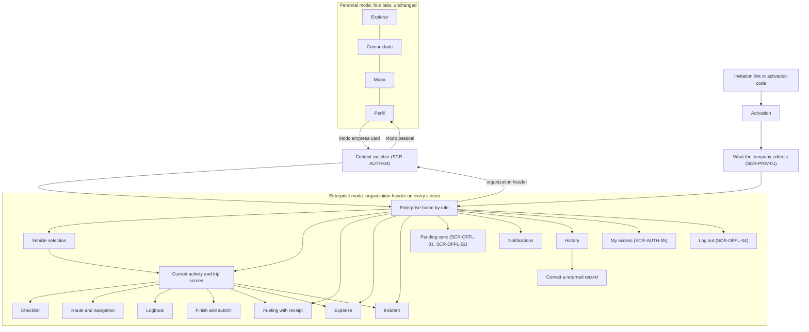

## 3. Shared screen states

Every app screen inherits these defaults. A module screen states only what differs.

| State | When | What the screen shows | Action offered | TalkBack |
|---|---|---|---|---|
| Loading | Nothing is cached yet | Skeletons with the final layout (`SkeletonCard`, 12dp); the organization header is already real. Cached content is shown at once with its age instead of a skeleton. | None | "Carregando" once, as a polite live region; focus moves to the screen heading when content arrives. |
| Empty | The list or record set has no items | One sentence saying what will appear here, and exactly one next action when the member may take it (`EmptyState`). | The single next action, or none | Sentence, then the action. |
| Error | A read or a local write failed | What failed in plain words and that saved data is safe (`ErrorState`). No code or identifier is displayed; "Copiar detalhes para o suporte" copies a reference without showing it. | "Tentar de novo" | Announced as an alert; focus on the retry button. |
| Unavailable | No connection for an online-only action; or the organization, membership or plan does not allow it now | The reason in one sentence and what still works. Offline: "Sem internet. Isto precisa de conexão." with the last successful send. Suspended or not included: says so, with no price and no purchase link (EDR-024). | Go back; retry when online | Reason read with the disabled control: "indisponível, " and the reason. |
| Forbidden | The member lacks the permission | The no-permission pattern (SCR-AUTH-06): the action that was denied and who can grant it. Never any record data (BR-AUTH-013). | "Voltar" | Heading "Sem permissão", then the explanation. |

Two more defaults apply everywhere. Cached reference data shows when it was confirmed ("Atualizado em …"), and is marked as not confirmed after 24 hours without contact (BR-OFFL-016, [07-permissions](07-permissions.md) §8). A state name the app does not know is shown as unknown with a request to update the app, never mapped to a known one ([08-state-model](08-state-model.md) §4).

Sync labels ([08-state-model](08-state-model.md) §2). The text is fixed; the icon shape differs per state; colour only reinforces.

| State | Label | Icon shape | Tone | TalkBack text |
|---|---|---|---|---|
| `SAVED_ON_DEVICE` | Salvo no aparelho | Phone | Neutral | "Salvo no aparelho. Ainda não enviado." |
| `SENDING` | Salvo no aparelho, with a progress hint | Phone with progress | Neutral | "Salvo no aparelho. Enviando." Not repeated while it lasts. |
| `SENT` | Enviado | Arrow up | Neutral | "Enviado. Aguardando confirmação." |
| `ACCEPTED` | Aceito pela empresa | Check | Neutral ink | "Aceito pela empresa." |
| `NEEDS_REVIEW` | Precisa de revisão | Triangle with exclamation | Notice (amber) | "Precisa de revisão", then the reason. |
| `REJECTED` | Não aceito | Circle with a cross | Error | "Não aceito", then the reason. |

A change of sync state on a visible record is announced once through a polite live region. "Aceito pela empresa" never appears as "aprovado": the record detail shows the review state on its own line (BR-REV-001). In lists a row shows one chip, the most urgent of the record: Não aceito, Precisa de revisão, returned, Salvo no aparelho, then the rest. The detail screen shows the operational, sync and review states as three labelled lines.

## 4. Flows

Each flow names the module that specifies its screens. Diagrams show the main path and the exceptions that change what the user sees.

### 4.1 Activation: invitation and managed corporate access

Screens: [identity](modules/identity.md), SCR-PRIV-01, SCR-PRIV-05. Online only. Journeys JRN-01 and JRN-02.
**Steps.** 1) Invitation: the employee opens the link, or types the code under "Tenho um convite", and signs in with their own account if needed. 2) The app shows the organization's name and what joining means: the company sees what is recorded in enterprise mode; personal data stays personal. 3) Corporate access: the employee chooses "Ativar acesso corporativo", types the activation code and sets the local unlock. 4) Both paths show what the company collects (SCR-PRIV-01), with nothing pre-ticked, and then open the enterprise home. 5) An expired, revoked, used or locked invitation or code says that it no longer works and that the company issues a new one.

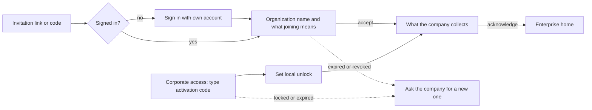

### 4.2 Choosing context

Screen: SCR-AUTH-04 (UC-AUTH-04, UC-OFFL-05). Journey JRN-03.
**Steps.** 1) The user taps the organization header, or the "Modo empresa" card in Perfil. 2) A bottom sheet lists personal mode and each organization, with its state and its count of pending sends. 3) Choosing one opens that context's home and announces "Você está em" followed by the name. 4) A suspended membership is listed disabled with the reason. Offline, the list is the last known one, marked as not confirmed. 5) With a trip in progress, the sheet says that the trip and its tracking continue; the tracking indicator follows the user (§5.4).

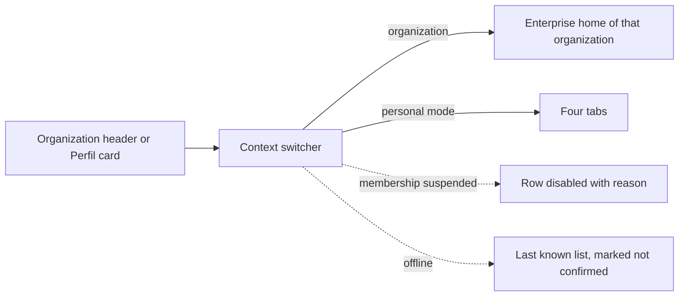

### 4.3 Enterprise home

Screens: [identity](modules/identity.md) (home shell), §2.3. Works offline from cached data (UC-OFFL-08).
**Steps.** 1) The home is drawn at once from cached permissions and reference data. 2) In the background the app refreshes missions, assets and policies and updates "Atualizado em …". 3) The current activity card and the quick actions come first; lists follow. 4) A block the member cannot use is absent, not disabled.

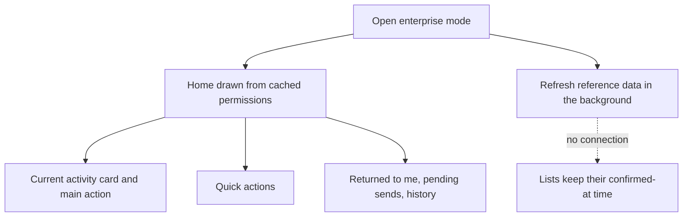

### 4.4 Current activity

Screens: [trips](modules/trips.md). Offline. The current activity is a trip `IN_PROGRESS` or `PAUSED`, or else the next mission `ASSIGNED` or `ACCEPTED`.
**Steps.** 1) The card shows the asset, the running time and the tracking state; tapping it opens the trip screen. 2) An assigned mission opens its detail; the driver accepts, or declines with a reason, and may start the trip from it. 3) With nothing current, the card is the "Iniciar viagem" action. 4) The trip screen offers: add event, pause or resume, route, and finish.

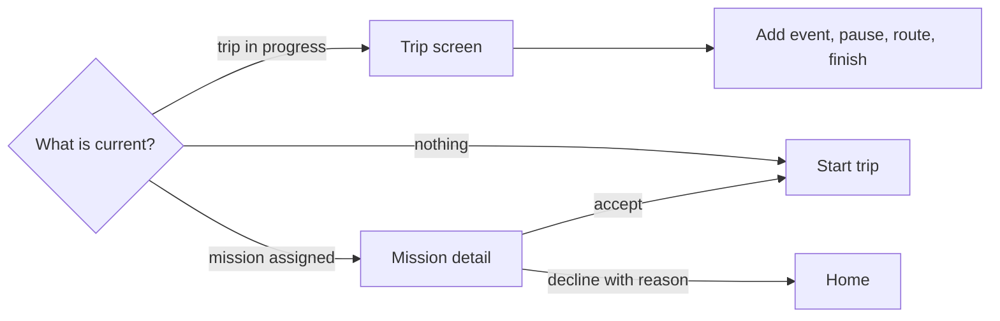

### 4.5 Vehicle selection

Screens: [fleet](modules/fleet.md). Offline from the cached asset list.
**Steps.** 1) When the member has exactly one assigned asset, it is preselected and only shown for confirmation. 2) Otherwise the list shows assigned assets first, then the others the member may use, with search by plate or fleet number. 3) An asset that is `RESERVED`, `IN_USE`, `IN_MAINTENANCE`, `BLOCKED` or `UNAVAILABLE` is listed disabled with the reason. 4) The list shows its confirmed-at time; a choice made on old data is checked by the company when it arrives (BR-OFFL-016).

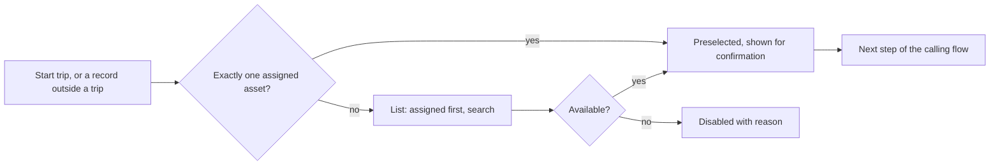

### 4.6 Checklist

Screens: [maintenance](modules/maintenance.md). Offline.
**Steps.** 1) When the asset's template asks for it, the checklist opens before the trip starts or finishes. 2) Each item is one row with two large targets, OK and problem; a problem asks for a photo and a short note. 3) A failed critical item ends in `BLOCKING`: the app explains the company's policy and offers another asset or an incident report. 4) Otherwise the run ends as `COMPLETED_OK` or `COMPLETED_WITH_ISSUES` and the calling flow continues.

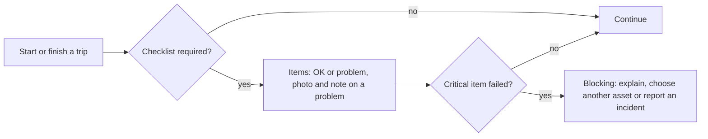

### 4.7 Route and navigation

Screens: [gps-navigation](modules/gps-navigation.md). Offline with a downloaded map region; no live traffic is offered.
**Steps.** 1) From the trip screen, "Rota" shows the planned stops, or lets the driver pick a destination. 2) If the map region is not on the device, the app offers the download, which needs a connection. 3) The preview shows the planned distance, labelled as planned. 4) Guidance runs in the driving layout (§5.5) with the organization line and the tracking indicator visible. 5) Arriving at a stop offers a one-tap stop event; ending guidance returns to the trip screen and the trip continues.

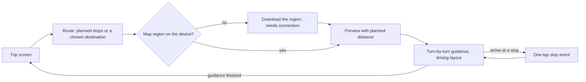

### 4.8 Logbook

Screens: [trips](modules/trips.md). Offline. The screen says that the logbook is an operational record and not a time clock (LV-05); its interface name is open (OQ-12).
**Steps.** 1) The trip screen shows the timeline in order of occurrence, each event with its time and its sync label. 2) "Adicionar evento" opens a grid of kinds: stop, fueling, toll, parking, incident, handover, note. 3) Each kind asks for the fewest fields; a photo is optional unless the kind needs one. 4) Correcting an event creates a new version and keeps the old one.

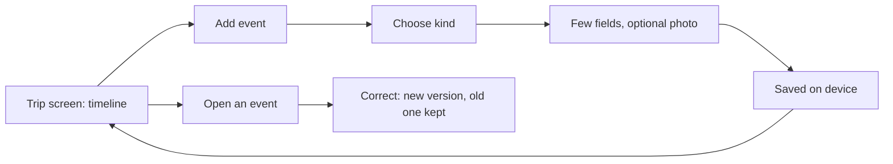

### 4.9 Fueling with receipt capture

Screens: [fuelings](modules/fuelings.md), [documents](modules/documents.md). Offline, except with an agreement voucher code, which is online-only. Journey JRN-01.
**Steps.** 1) "Abastecimento" on the home or on the trip screen opens the camera on the receipt. "Sem comprovante agora" skips the photo. 2) The photo is checked for legibility on the device; the driver keeps it or retakes it. 3) The form has the asset and product already filled, and asks for quantity, total paid and the meter reading. Unit price, fill level and place are optional. 4) Missing quantity or total blocks saving (BR-MONEY-006). An arithmetic difference or a volume above the tank is a warning, not a block (BR-MONEY-005). 5) "Registrar" saves on the device and marks the fueling ready to send; the photo is sent after the record (BR-OFFL-015).

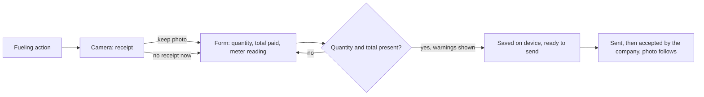

### 4.10 Expense

Screens: [expenses-finance](modules/expenses-finance.md), [documents](modules/documents.md). Offline.
**Steps.** 1) "Despesa" opens the grid of categories cached from the organization. 2) The receipt photo comes next, when the category's policy asks for one. 3) The form asks for the amount and who paid; "paid by me" marks the expense for reimbursement. 4) A trip in progress is linked automatically; saving marks the expense ready to send.

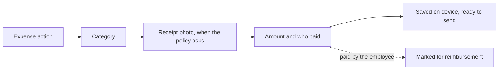

### 4.11 Incident

Screens: [maintenance](modules/maintenance.md). Offline.
**Steps.** 1) "Ocorrência" asks for the kind: breakdown, accident, fine notice, theft or damage. 2) Photos and a short note follow; the note field asks not to enter health or other sensitive details about people (BR-PRIV-007). 3) The asset and the trip in progress are already filled. 4) After saving, the app offers a maintenance request when the asset needs repair.

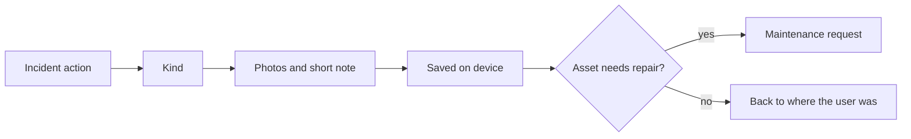

### 4.12 Pending sync

Screens: SCR-OFFL-01, SCR-OFFL-02, SCR-OFFL-05 (UC-OFFL-01 to UC-OFFL-03).
**Steps.** 1) The header button or the home block opens the list, grouped by state, with kind, time and reason. 2) "Enviar agora" is enabled only with a connection; otherwise the list says when the last send succeeded. 3) A record opens its history: saved, sent, accepted, review, outcome, and the progress of its photo. 4) A record that was not accepted shows the reason; the user creates a new one from it, or dismisses it. Nothing leaves the list by itself (BR-OFFL-013).

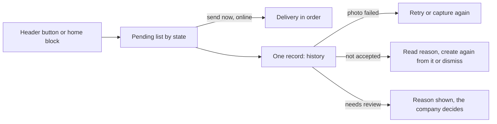

### 4.13 History

Screens: [trips](modules/trips.md), [fuelings](modules/fuelings.md), [expenses-finance](modules/expenses-finance.md). Offline with the last known review results.
**Steps.** 1) "Histórico" lists the member's own trips, fuelings and expenses, newest first, with one chip per row (§3). 2) Filters are kind and period; the list says when review results were last confirmed. 3) A record opens its detail: three state lines, timeline, documents. 4) A returned record leads to §4.16.

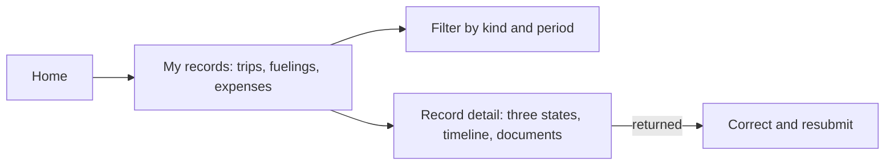

### 4.14 Notifications

Screens: [imports-notifications-integrations](modules/imports-notifications-integrations.md). In-app first (EDR-032); the list works offline with what was last received.
**Steps.** 1) The header button shows the unread count of the active organization and opens its notification centre. 2) Items are returned records, review outcomes, assigned missions and access changes; each opens its destination. 3) A system notification always names the organization. 4) Opened from another context, it switches to that organization and announces the change before showing the item.

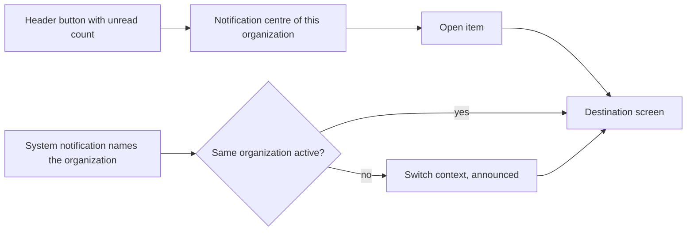

### 4.15 Finishing and submitting a trip

Screens: [trips](modules/trips.md), [fleet](modules/fleet.md) (reading). Offline. Journeys JRN-01 and JRN-06.
**Steps.** 1) "Encerrar viagem" on the trip screen asks for the final meter reading. 2) The return checklist runs when required (§4.6). 3) The conference lists the trip's fuelings, expenses and documents and flags a missing receipt; the driver fixes it or continues. 4) "Encerrar e enviar" ends tracking and marks the trip `COMPLETED`, "Salvo no aparelho" and ready to send. 5) When the server accepts it, the review state becomes `SUBMITTED` (BR-REV-002).

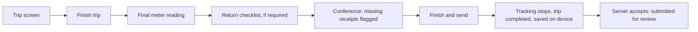

### 4.16 Correcting a returned record

Screens: [expenses-finance](modules/expenses-finance.md) (my submissions), plus the record's module. Offline (BR-REV-005).
**Steps.** 1) A notification, or "Returned to me" on the home, opens the record with the reviewer's reason at the top. 2) The author edits the fields or adds the missing receipt. 3) "Reenviar" saves a new version on the device; the review state stays `RETURNED` until the server accepts it. 4) If the record changed meanwhile, it shows "Precisa de revisão" and both versions are kept.

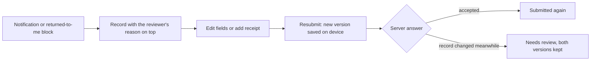

### 4.17 Logging out with pending data

Screens: SCR-OFFL-04 (UC-OFFL-06, BR-PRIV-017).
**Steps.** 1) "Sair" is in the account block of the home. 2) With a trip in progress, the app first asks the driver to pause or finish it, so that tracking never runs without a session. 3) With pending sends, a dialog shows their count and size and offers "Enviar agora" (online), "Manter neste aparelho" and "Cancelar". 4) The dialog says that uninstalling the app or resetting the phone loses what was not sent (BR-OFFL-013, BR-OFFL-014). 5) Logging out removes the session and locks the organization's local data; the same account sends what was kept at its next login.

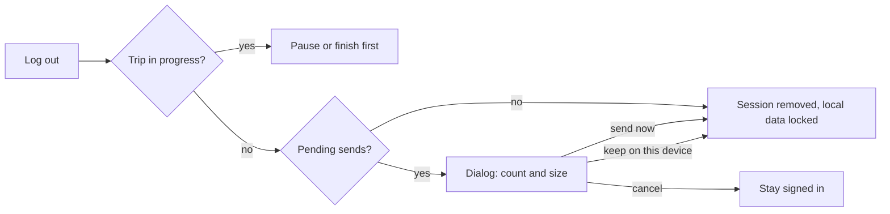

### 4.18 Tap counts of the two most frequent flows

A tap is one touch on a control. Typing a value and the keyboard's "next" key are counted as typed values, not taps. One-time system permission dialogs are not counted.

| Flow | Starting point and conditions | Taps | Typed values | Target |
|---|---|---|---|---|
| Record a fueling | Enterprise home or trip screen; asset known from the trip or the single assignment; product remembered | 4: fueling action → shutter → keep photo → "Registrar" | 3: quantity, total paid, meter reading | At most 4 taps and 3 values. Choosing an asset or changing the product adds 1 tap each. |
| Start a trip | Enterprise home; one assigned asset; no checklist required | 2: "Iniciar viagem" → "Iniciar" | 1: meter reading | At most 2 taps and 1 value. Asset selection adds 1 tap; a checklist adds 1 tap per item. |

The start button states in one line that tracking starts with the trip and stops when it pauses or ends (LV-03), so the notice costs no extra tap. These counts are design targets; counts measured on a device are owed evidence (§8).

## 5. Components and visual rules

### 5.1 Existing components and tokens used as they are

| Need | Existing piece |
|---|---|
| Colours, type, shapes, spacing | `AnpFuelTheme`; `EnergiaLightTokens`, `EnergiaDarkTokens`, `AbastevoAccent`; Manrope and Source Sans 3; 8, 12, 16 and 24dp radii; `AbastevoSpacing` with the 16dp `screenGutter` |
| Main and secondary actions | `Button` (ink fill), `OutlinedButton`, `TextButton` from `ui/designsystem`; one filled button per screen section |
| Cards and grouped content | `AnpContainerDefaults` outline and shape; no second outline, no outlined layouts |
| Inner screen title | `AnpTopAppBar`, flat on the screen colour |
| Loading, empty, error | `SkeletonCard`, `LoadingState`, `EmptyState`, `ErrorState` |
| Offline and stale banners | `SyncStatusBanner`; amber (`tertiary`) for notice |
| Source and time on a value | `SourceTimeBadge` pattern for "Atualizado em …" |
| Large action tiles, account rows | `ActionCardButton`, `ProfileActionRow` |
| Filters and kinds | `FilterChip` (selected: solid ink), `AssistChip` |
| Dialogs and sheets | 24dp shape; the context switcher and the logout dialog use it |
| Map, route preview, guidance | The existing map engine, route sheet and guidance controls |
| Receipt camera | The existing capture flow, with a document-oriented frame |

### 5.2 New components and why they are needed

| Component (proposed) | Why existing pieces are not enough | Built from |
|---|---|---|
| Organization header | Nothing in the app shows an active context | The flat header chrome and its gray pill field: uppercase label "Modo empresa", business icon in ink, organization name in Manrope, chevron; round gray buttons for notifications and pending sends |
| Context switcher sheet | New concept | Bottom sheet with selectable option rows |
| Status chip | Three kinds of state need one consistent, non-interactive label | Pill with icon and text on `surfaceContainerHigh`; amber and error roles for the two urgent states |
| Tracking indicator | Location recording must be visible on every screen (BR-PRIV-006) | One-line strip under the header |
| Driving layout | Guidance and trip actions must be usable at a glance | Scaffold with two to four full-width actions |
| Trip return bar | A trip in progress must stay visible outside enterprise mode | One-line bar above the bottom bar of the four tabs |

The organization name wraps to two lines on the home and is cut to one line elsewhere; its full text is always in the content description.

### 5.3 Status chips

- A chip is text with an icon. It is never a button and never the only place where a reason is given.
- Sync chips use the labels of §3. Review chips use the wording below. Operational states use the module's wording.
- Neutral chips are ink on gray. Amber marks what waits for someone; the error role marks what was refused. Green is not used for "accepted" or "approved", because the accent already means selection, links and community.
- Review-state wording is not yet fixed in the glossary. Proposed, to be recorded there: `DRAFT` "Rascunho" (offline after submitting: "Pronto para enviar"), `SUBMITTED` "Aguardando aprovação", `IN_REVIEW` "Em análise", `APPROVED` "Aprovado", `RETURNED` "Devolvido para correção", `REJECTED` "Rejeitado", `CANCELLED` "Cancelado", `VOIDED` "Anulado". "Enviado" is reserved for the sync state.

### 5.4 Tracking indicator

| Tracking session | Strip | Tap |
|---|---|---|
| `RECORDING` | Location icon in the accent (its existing meaning), "Rastreamento ativo" and the running time | Opens what is collected and the session history |
| `SUSPENDED` | "Rastreamento pausado" | Same |
| `INTERRUPTED` | Amber notice: "Rastreamento interrompido" with the action "Retomar" | Resumes after the user confirms; the gap stays recorded |
| `NOT_STARTED`, `ENDED` | Not shown | — |

With approximate location only, the strip adds that GPS distance will not be calculated. The system notification of the foreground service is always present while recording and names the organization. Outside enterprise mode the trip return bar repeats the indicator.

### 5.5 Driving layout

- Used by guidance and by the trip screen while the trip is `IN_PROGRESS` and the phone is moving.
- At most four actions, each full width and at least 64dp tall (hypothesis, to be confirmed in the field test): stop, fueling, incident, pause. Text uses the title role; no body-size text is needed to act.
- No text entry, no lists longer than the screen, no photo capture while moving. Those actions open after the driver confirms that the vehicle is stopped.
- The organization line and the tracking indicator stay visible.

### 5.6 Themes, text size, TalkBack and targets

- **Dark mode.** White on true black, cards on `#141414`. Every new text pair meets 4.5:1 and every new control fill, outline and indicator meets 3:1 in both themes; the pairs are added to `BrandPaletteContrastTest`.
- **Font scale.** All sizes are `sp`. Screens work up to 200 %: chips and tiles grow in height, labels wrap, nothing is cut by a fixed height.
- **TalkBack.** Reading order is header, tracking indicator, heading, content, actions. The organization header reads "Modo empresa" and the name. Chips read their full sentence (§3). Headings use `headingSemantics`; state changes use `liveRegionSemantics`.
- **Targets.** Every control and tappable row is at least 48dp tall (`controlMinHeight`); driving actions are larger (§5.5).
- **Amounts and quantities.** Ink, Manrope, with the unit beside the number; never the accent.

### 5.7 Interface vocabulary

Labels use the pt-BR terms of [03-glossary](03-glossary.md). The ones that appear most in enterprise mode: Empresa, Modo empresa, Modo pessoal, Acesso corporativo, Convite, Código de ativação, Aparelho, Atividade, Viagem, Parada, Trecho, Diário de bordo, Evento, Troca de condutor, Encerramento, Checklist, Ocorrência, Avaria, Veículo, Máquina, Leitura, Abastecimento, Tanque cheio / parcial, Comprovante, Despesa, Reembolso, Rota planejada, Navegação, Situação de envio, Situação de revisão.

Protocol concepts never appear on a screen: queue, payload, tenant, revision numbers, record identifiers and error codes. Action labels in this file ("Iniciar viagem", "Registrar", "Enviar agora", "Tentar de novo") are proposed copy built from the glossary terms.

## 6. Offline behaviour in the interface

The rules are in [10-offline-sync](10-offline-sync.md); what works offline is the matrix in its §10.3. The interface applies it with four patterns.

1. **Works offline.** The action is always enabled. Saving answers at once with "Salvo no aparelho". The offline banner says that records stay on the phone and shows the last successful send.
2. **Needs a connection.** The control stays visible, disabled, with the reason beside it. It is never queued as if it had happened (BR-OFFL-017).
3. **Shows its age.** Lists from the organization show when they were confirmed; old data is a notice, not an error.
4. **Announces limits early.** The storage warning (SCR-OFFL-05) and the end of the device's offline validity (BR-PRIV-018) are shown days before they bite, with what to do.

| Online-only in the app | What the user sees offline |
|---|---|
| Sign in, accept an invitation, activate corporate access | "Sem internet. Para entrar na empresa é preciso conexão." |
| Fueling with an agreement voucher code | The code field is disabled: the code is checked at the station and needs a connection. The ordinary fueling stays available. |
| Budget hold or pre-authorization | Disabled with the reason; the expense itself can still be recorded. |
| "Enviar agora", photo upload | Disabled; the list says that sending resumes by itself when the connection returns. |
| Refreshing missions, assets and review results | The last known data with its confirmed-at time. |
| Downloading a map region | Disabled; guidance works only where the region is already on the device. |
| Confirming the list of organizations in the switcher | The last known list, marked as not confirmed. |

A revoked device or an ended membership is learned only on contact. The app then says what happened, what was delivered and what the company must be asked about, following UC-OFFL-07 and BR-OFFL-014; it never promises that unsent data of a lost phone can be recovered.

## 7. Screen index

The table between the markers lists every screen whose surface is APP, generated from section 11 of the module files ([00-conventions](00-conventions.md) §7).

<!-- SCREEN-INDEX:APP:BEGIN -->
| Screen | Objective | Specified in |
|---|---|---|
| SCR-AUTH-04 | Choose personal mode or an organization | [07-permissions.md](07-permissions.md) |
| SCR-AUTH-05 | Understand own access | [07-permissions.md](07-permissions.md) |
| SCR-AUTH-06 | Explain a denial | [07-permissions.md](07-permissions.md) |
| SCR-CHECK-01 | Fill a departure or return checklist | [modules/maintenance.md](modules/maintenance.md) |
| SCR-CHECK-02 | Show the outcome and what it means for the trip | [modules/maintenance.md](modules/maintenance.md) |
| SCR-CHECK-03 | Report a damage or an incident | [modules/maintenance.md](modules/maintenance.md) |
| SCR-CLAIM-10 | Show what the badge means on the public station profile | [modules/station-claims.md](modules/station-claims.md) |
| SCR-DOC-01 | Capture or import synthetic evidence | [modules/documents.md](modules/documents.md) |
| SCR-EXP-01 | Record a scoped expense | [modules/expenses-finance.md](modules/expenses-finance.md) |
| SCR-FLEET-08 | See the assets I may use | [modules/fleet.md](modules/fleet.md) |
| SCR-FLEET-09 | Choose the asset for a trip, fueling or checklist | [modules/fleet.md](modules/fleet.md) |
| SCR-FLEET-10 | Check an asset before using it | [modules/fleet.md](modules/fleet.md) |
| SCR-FUEL-01 | Record a fueling in under a minute, with no signal | [modules/fuelings.md](modules/fuelings.md) |
| SCR-FUEL-02 | Follow my fuelings | [modules/fuelings.md](modules/fuelings.md) |
| SCR-FUEL-03 | Correct a returned fueling | [modules/fuelings.md](modules/fuelings.md) |
| SCR-GPS-01 | Start a trip knowing whether it will be tracked | [modules/gps-navigation.md](modules/gps-navigation.md) |
| SCR-GPS-02 | Always know the tracking state | [modules/gps-navigation.md](modules/gps-navigation.md) |
| SCR-GPS-03 | Resume after an interruption | [modules/gps-navigation.md](modules/gps-navigation.md) |
| SCR-GPS-04 | See my tracking | [modules/gps-navigation.md](modules/gps-navigation.md) |
| SCR-GPS-07 | Compare the four distances of a trip | [modules/gps-navigation.md](modules/gps-navigation.md) |
| SCR-IDN-09 | Enter a company with a code | [modules/identity.md](modules/identity.md) |
| SCR-IDN-10 | Decide on an invitation | [modules/identity.md](modules/identity.md) |
| SCR-IDN-11 | Activate corporate access | [modules/identity.md](modules/identity.md) |
| SCR-IDN-12 | Enterprise home | [modules/identity.md](modules/identity.md) |
| SCR-IDN-13 | See my access, devices and data in this company | [modules/identity.md](modules/identity.md) |
| SCR-IDN-14 | Know that access was suspended or ended | [modules/identity.md](modules/identity.md) |
| SCR-IDN-15 | Understand what deleting the account does to company records | [modules/identity.md](modules/identity.md) |
| SCR-MAINT-06 | Ask for maintenance | [modules/maintenance.md](modules/maintenance.md) |
| SCR-MAINT-07 | See an asset's restrictions before using it | [modules/maintenance.md](modules/maintenance.md) |
| SCR-METER-01 | Type a reading correctly | [modules/fleet.md](modules/fleet.md) |
| SCR-NOTIF-01 | Read own notices | [modules/imports-notifications-integrations.md](modules/imports-notifications-integrations.md) |
| SCR-OFFL-01 | See everything not yet accepted by the company | [10-offline-sync.md](10-offline-sync.md) |
| SCR-OFFL-02 | Understand one record's sync history | [10-offline-sync.md](10-offline-sync.md) |
| SCR-OFFL-04 | Decide what happens to pending data before logout or context removal | [10-offline-sync.md](10-offline-sync.md) |
| SCR-OFFL-05 | Warn about storage or long-unsent data | [10-offline-sync.md](10-offline-sync.md) |
| SCR-ORG-12 | Tell members the organization is suspended, archived or closing | [modules/organizations.md](modules/organizations.md) |
| SCR-PRIV-01 | Tell the employee what the company collects | [11-privacy-security.md](11-privacy-security.md) |
| SCR-PRIV-05 | Unlock corporate access | [11-privacy-security.md](11-privacy-security.md) |
| SCR-PUB-01 | Understand active product context | [modules/subscriptions.md](modules/subscriptions.md) |
| SCR-ROUTE-02 | Preview the route before leaving | [modules/gps-navigation.md](modules/gps-navigation.md) |
| SCR-ROUTE-03 | Be guided while driving | [modules/gps-navigation.md](modules/gps-navigation.md) |
| SCR-ROUTE-04 | Complete entries at a stop | [modules/gps-navigation.md](modules/gps-navigation.md) |
| SCR-ROUTE-05 | Choose where to fuel on the route | [modules/gps-navigation.md](modules/gps-navigation.md) |
| SCR-ROUTE-06 | Open navigation from a trip in phase 1 | [modules/gps-navigation.md](modules/gps-navigation.md) |
| SCR-STOCK-02 | Record an authorized dispense | [modules/fuel-stock.md](modules/fuel-stock.md) |
| SCR-TRIP-01 | Execute an eligible trip | [modules/trips.md](modules/trips.md) |
<!-- SCREEN-INDEX:APP:END -->

## 8. Acceptance for the experience

1. Every enterprise screen shows the organization header with the active organization's name, in both themes and at 200 % font scale.
2. The four tabs render and behave exactly as before for an account with no membership, and no enterprise element appears in them except the entry card in Perfil and, during a trip, the trip return bar.
3. System back on the enterprise home never changes the active context; only the context switcher does.
4. A member sees on the home only the blocks whose permission they hold; a test per role of §2.3 asserts the blocks present and absent.
5. Each of the five shared states of §3 renders on every app screen with the default content unless the module states a difference.
6. Each sync state shows its fixed label and a distinct icon shape; a test removes colour and the six states remain distinguishable.
7. Recording a fueling and starting a trip meet the tap targets of §4.18 in an instrumented run on an emulator.
8. With no connection, every online-only action of §6 is visible, disabled and explained, and no field action of the offline matrix is disabled.
9. No screen displays a record identifier or an error code; a test scans the string resources of the enterprise package for the codes of [09-architecture](09-architecture.md) §6 and [10-offline-sync](10-offline-sync.md) §10.2.
10. While a tracking session is `RECORDING`, the tracking indicator is visible on every enterprise screen and the trip return bar on the four tabs.
11. TalkBack reads the organization, the tracking state and each chip as full sentences, in the order of §5.6.
12. All new colour pairs pass the contrast test in light and dark.

Owed evidence, never assumed:

- **Comprehension with real drivers.** At least five drivers and two operations employees of pilot organizations (default sample) perform the flows of §4.9, §4.15, §4.12 and §4.16 without help and explain in their own words what "Salvo no aparelho", "Aceito pela empresa", "Precisa de revisão" and "Não aceito" mean. Until this is done and recorded, the wording is a proposal.
- **Field legibility.** The driving layout and the status chips are read in daylight, in a vehicle mount and with one hand; the 64dp hypothesis is confirmed or changed.
- **Rendered checks.** Light, dark and 200 % font on an emulator and on at least one small screen; the existing design-system checks are themselves still pending.
- **TalkBack pass** of the two most frequent flows by a person, not only by semantics tests.

These items are recorded with the release gates in [15-validation](15-validation.md) and block a pilot with real data, not local construction.
