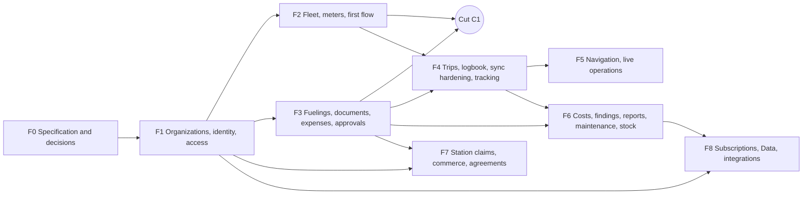

# Roadmap

Status: **PLANNED**, 2026-11-10. Phases, milestones, the first operational cut, the critical path and what can run in parallel. Task detail is in `backlog/ep*.md`; the generated lists in this file come from those task blocks ([00-conventions](00-conventions.md) §7). Efforts are relative hypotheses for agent cycles, not dates: no calendar is promised without knowing the execution capacity.

## 1. How this programme relates to the existing roadmap

- Local F1 starts only after M0 closes and the current ADR-019 construction
  batch is integrated through protected `main`. The maintainer confirmed
  this sequence on 2026-11-10 (EMP-GOV-012, CX-09).
  [Decision record](evidence/f0-m0-decisions.md#roadmap-sequencing)
- This programme uses its own identifiers (`F0…F8`, `M0…M8`, `C1`, `EMP-…`) and never renumbers an existing `P##`, `G##` or task namespace.
- Delivery follows the existing workflow: work on maintained `dev`, one planning stage delivered as one protected `dev → main` pull request, local checkpoints during construction, immediate targeted tests per task, no bookkeeping-only pull requests. In this programme **one phase (or the cut C1) is one planning stage and one pull request**.
- A phase gate here is a local functional gate. It never certifies production. Any pilot with real company data additionally needs the legal validation (EMP-GOV-005) and inherits the project's production gates.

## 2. Phases

The order follows the reference sequence of the request, adjusted by real dependencies: the cut C1 pulls a minimal trip (from F4's theme) and a minimal fueling with receipt (from F3) forward, so that a complete flow exists before either phase is complete.

| Phase | Milestone | Value delivered | Capabilities available at exit | Explicit limits at exit |
|---|---|---|---|---|
| **F0** Specification and decisions | **M0** Decisions recorded | The suite is specified; the owner has decided what may be built | This plan; accepted decisions; spike reports; legal question package | No runtime change |
| **F1** Organizations, identity, accounts, permissions | **M1** A company exists with its people | A company can sign up, structure itself, bring employees in and control access | Organization, units, cost centres, teams; employees; invitations; managed access; roles and scopes; context switch in the app; business web shell; audit trail; sync core | No assets, no operations; e-mail invitations only if delivery was decided |
| **F2** Fleet, meters, first enterprise flow | **M2** Assets under control, and **cut C1** | The company knows its assets and who is responsible; the first complete field-to-panel flow works | Assets, tanks, tenure, assignments, readings with history; imports of employees and assets; with the pulled tasks: basic trip and logbook, fueling with receipt, sync, review | Basic trip only (driver-started, no missions, no tracking); single-level review; no consumption figures yet |
| **F3** Fuelings, documents, expenses, approvals | **M3** Every cost has a record, a document and a decision | Costs are recorded once, supported, approved and settled | Complete fuelings; consumption intervals; documents with conference, fiscal structure and allocation; expenses; approval policies and levels; budgets and holds; payables, reimbursements, advances; period lock; CSV exports; notifications | No tracking; indicators limited to lists and exports |
| **F4** Trips, logbook, sync, location fundamentals | **M4** Operations are planned and followed | Managers plan work; drivers execute it with checklists and tracking; offline edge cases are handled | Missions, planned trips, stops and legs, pause and resume, handover, supervisor closure, amendments, period lock for trips; checklists and incidents; tracking sessions with upload; GPS distance; post-offboarding intake | No live map yet; navigation opened from a trip without trip-aware guidance |
| **F5** Integrated navigation, live operations | **M5** The company sees operations as they happen | Trip-aware navigation; live map with honest freshness; geofences and alerts | Route plans; navigation tied to the trip; driving mode; live map; track replay; geofences; operational alerts; station suggestions on the route | Phone tracking only; no hardware telematics |
| **F6** Costs, audit, reports, maintenance, controls | **M6** The company understands and controls its fleet | Indicators with stated methods; findings; maintenance; internal fuel; retention enforced | Indicator dashboards; findings with review; PDF reports; maintenance plans and work orders; expiries; internal tanks; groups; custom roles; retention jobs; data-subject tooling | Organization plans still administered by hand |
| **F7** Station claims, representation, commerce, agreements | **M7** Stations take part as businesses | A station proves representation, manages its commercial data and serves fleets under agreements | Organization-held station authority; contest and appeal; station teams; announced prices; promotions; official replies; interaction metrics; agreements; fueling authorisations and redemption; back-office review queues | Requires the Stage D override; staffing evidence owed |
| **F8** Subscriptions, Data, integrations | **M8** The suite is sold and connected | Plans with entitlements and limits; Data products; optional connectors | Organization subscriptions and billing; usage metering; upgrade and downgrade; Data API keys and datasets; accounting, card, fiscal and telematics connectors; organization closure | Data sale only for sources with recorded rights |

Foundations that later phases need are built early, not at the end: the entitlement gate and per-organization capability flags are in F1 (so that plans in F8 only change who sets them), the audit trail and sensitive-access log are in F1 and F3, and the export infrastructure is in F3.

## 3. Entry, exit and activation per milestone

| Milestone | Entry criteria | Exit criteria (gate task) | Activation strategy |
|---|---|---|---|
| M0 | Owner agrees to consider the plan | EMP-GOV-001, 002, 003, 005, 008 and 012 recorded, remaining governance tasks scheduled and full plan consistency check passes | Documents only |
| M1 | M0 closed and current ADR-019 construction batch integrated through protected `main`. Organization boundary from [ADR-025](../adr/025-private-abastevo-empresas-organization-boundary.md). | EMP-REL-003: authorization matrix suite passes; isolation harness passes; revoked and offboarded access is denied; suspension blocks writes | Global flag off by default; one internal test organization |
| C1 | M1 core; document decision (EMP-GOV-002) | EMP-REL-001: the end-to-end scenario passes on real PostGIS and an emulator; EMP-REL-002: runbook and rollback rehearsed | Capability flags per organization; named pilot organizations only; legal validation before real data |
| M2 | M1 | Fleet and meter tasks of F2 done; imports usable | Same flags; pilots |
| M3 | C1 | EMP-REL-004: no double counting in allocation and cost tests; budget race test; partial approval and return loop; consumption intervals recomputed after corrections | Enable per organization by capability |
| M4 | M3; tracking spike and legal validation (EMP-GOV-005, 006) | EMP-REL-005: sync resilience suite; amendments after closure; GPS distance and divergence; tracking interruption matrix on real devices (owed evidence listed, not assumed) | Tracking capability enabled per organization after the employee notice exists |
| M5 | M4; map decision (EMP-GOV-007) | EMP-REL-006: trip-aware navigation; live map never shows a stale position as current; geofence evaluation | Per organization |
| M6 | M3 and M4 | EMP-REL-007: indicator vectors; findings lifecycle; maintenance due computation; single-count stock | Per organization |
| M7 | Stage D override (EMP-GOV-015); legal-entity verification; back-office queues | EMP-REL-008: claim lifecycle including concurrent claims and revocation; ranking neutrality; cross-organization sharing guards | Station front enabled for named stations first; containment lifted deliberately |
| M8 | Billing and rights decisions (EMP-GOV-009, 016) | EMP-REL-009: subscription state effects; repeated billing events; Data privacy guard | Plans switched from administrative activation to billing per organization |

## 4. First operational cut (C1)

**Scope:** company → employee → vehicle → basic trip and logbook → fueling → receipt → synchronization → review in the panel.

Concretely, at the end of C1:

1. A person signs in with an existing account, creates an organization and its first unit in the business web.
2. They register employees and invite one; the employee accepts in the app and sees enterprise mode with the organization's name.
3. They register a vehicle and assign it to the employee.
4. The employee, with no signal, starts a trip with the odometer reading, adds a stop and a note, records a fueling with a receipt photo, finishes the trip with the final reading and marks it ready to send.
5. When the phone reconnects, everything is delivered once; the app shows each record moving from "Salvo no aparelho" to "Aceito pela empresa".
6. In the panel a manager opens the trip timeline and the fueling with its receipt, approves one and returns the other for correction; the employee sees the result.
7. A second organization in the same database sees none of it.

**Deliberately not in C1:** missions planned by a manager, tracking and navigation inside the trip, consumption figures, expenses other than fuel, multi-level approvals, budgets, managed access without an existing account, e-mail delivery, plans and billing.

**Tasks in C1, from several phases:**

<!-- C1-TASKS:BEGIN -->
| Home phase | Tasks |
|---|---|
| F0 | EMP-GOV-001, EMP-GOV-002, EMP-GOV-003, EMP-GOV-005, EMP-GOV-008, EMP-GOV-012 |
| F1 | EMP-PLAT-001, EMP-PLAT-002, EMP-PLAT-003, EMP-PLAT-004, EMP-PLAT-005, EMP-PLAT-006, EMP-PLAT-007, EMP-PLAT-008, EMP-PLAT-009, EMP-PLAT-010, EMP-PLAT-011, EMP-PLAT-013, EMP-PLAT-015, EMP-PRIV-003, EMP-ORG-001, EMP-ORG-002, EMP-ORG-003, EMP-ORG-005, EMP-ORG-008, EMP-ORG-014, EMP-IDN-001, EMP-IDN-002, EMP-IDN-003, EMP-IDN-004, EMP-IDN-005, EMP-IDN-016, EMP-IDN-017, EMP-IDN-018, EMP-AUTH-001, EMP-AUTH-002, EMP-AUTH-003, EMP-AUTH-004, EMP-AUTH-009, EMP-OFFL-001, EMP-OFFL-002, EMP-OFFL-003, EMP-OFFL-004, EMP-OFFL-007, EMP-OFFL-010, EMP-PUB-001 |
| F2 | EMP-OFFL-006, EMP-OFFL-008, EMP-OFFL-014, EMP-FLEET-001, EMP-FLEET-002, EMP-FLEET-006, EMP-FLEET-012, EMP-FLEET-013, EMP-METER-001, EMP-METER-002, EMP-METER-003, EMP-TRIP-001, EMP-TRIP-002, EMP-TRIP-003, EMP-TRIP-004, EMP-TRIP-005, EMP-TRIP-006, EMP-REL-001, EMP-REL-002 |
| F3 | EMP-PRIV-005, EMP-OFFL-005, EMP-FUEL-001, EMP-FUEL-002, EMP-FUEL-003, EMP-FUEL-011, EMP-FUEL-012, EMP-DOC-001, EMP-DOC-002, EMP-DOC-003, EMP-DOC-004, EMP-DOC-014, EMP-DOC-015, EMP-APPR-001, EMP-APPR-005 |

Total: 80 tasks, relative effort 142.5.
<!-- C1-TASKS:END -->

**Critical path of C1** (longest dependency chain by relative effort):

<!-- C1-CRITICAL:BEGIN -->
EMP-GOV-001 → EMP-PLAT-001 → EMP-PLAT-002 → EMP-ORG-002 → EMP-IDN-003 → EMP-AUTH-002 → EMP-AUTH-003 → EMP-OFFL-002 → EMP-METER-002 → EMP-TRIP-002 → EMP-TRIP-003 → EMP-TRIP-005 → EMP-REL-001 → EMP-REL-002

Relative effort along this chain: 29 agent cycles (hypothesis). Every other C1 task has slack against it.
<!-- C1-CRITICAL:END -->

## 5. What can run in parallel

Four tracks can advance at the same time once EMP-GOV-001 and the tenancy kernel exist; they meet at the integration points listed.

| Track | Work | Starts after | Integration point |
|---|---|---|---|
| **Backend core** | Organization, membership, access, sync intake | EMP-PLAT-001, 002 | EMP-AUTH-003 (authorization service) and EMP-OFFL-002 (intake) |
| **Pure domains** | Asset, meter, trip, fueling, document and review domain packages with shared vectors | EMP-PLAT-001, 009, 015 | Each domain's persistence task |
| **Android** | Enterprise foundation, device protection, operation queue, context switch, then feature screens | EMP-GOV-008 | EMP-OFFL-001 (protocol contract) and the feature handlers |
| **Business web** | Session, scaffold, organization and people screens, then lists and review | EMP-GOV-003 | EMP-PLAT-004 (API conventions) and each module's routes |
| **Governance and discovery** | Legal validation, spikes, provider and rights decisions, pilot interviews | Now | Gates of the phases they unblock |

Work order inside C1 by dependency level (tasks on the same level have no dependency on each other):

<!-- C1-WAVES:BEGIN -->
| Level | Tasks that can start once the previous level is done |
|---|---|
| 1 | EMP-GOV-001 |
| 2 | EMP-GOV-002, EMP-GOV-003, EMP-GOV-005, EMP-GOV-008, EMP-GOV-012, EMP-PLAT-001, EMP-PLAT-009, EMP-PLAT-015 |
| 3 | EMP-PLAT-002, EMP-PLAT-004, EMP-PLAT-011, EMP-ORG-001, EMP-IDN-001, EMP-AUTH-001, EMP-FLEET-001, EMP-DOC-001 |
| 4 | EMP-PLAT-003, EMP-PLAT-005, EMP-PLAT-006, EMP-PLAT-007, EMP-PLAT-010, EMP-PLAT-013, EMP-PRIV-003, EMP-ORG-002, EMP-OFFL-001, EMP-METER-001, EMP-PUB-001 |
| 5 | EMP-PLAT-008, EMP-PRIV-005, EMP-IDN-003, EMP-OFFL-003, EMP-TRIP-001, EMP-FUEL-001 |
| 6 | EMP-AUTH-002, EMP-OFFL-004 |
| 7 | EMP-ORG-003, EMP-AUTH-003 |
| 8 | EMP-ORG-005, EMP-ORG-008, EMP-IDN-002, EMP-AUTH-004, EMP-AUTH-009, EMP-OFFL-002, EMP-FLEET-002, EMP-DOC-002, EMP-APPR-001 |
| 9 | EMP-ORG-014, EMP-IDN-004, EMP-OFFL-005, EMP-OFFL-007, EMP-OFFL-008, EMP-FLEET-006, EMP-METER-002, EMP-DOC-003, EMP-DOC-014, EMP-APPR-005 |
| 10 | EMP-IDN-005, EMP-IDN-016, EMP-OFFL-006, EMP-OFFL-014, EMP-FLEET-012, EMP-METER-003, EMP-TRIP-002, EMP-FUEL-002, EMP-DOC-004 |
| 11 | EMP-IDN-017, EMP-TRIP-003, EMP-TRIP-004, EMP-FUEL-003 |
| 12 | EMP-IDN-018, EMP-TRIP-006, EMP-FUEL-012 |
| 13 | EMP-OFFL-010, EMP-FLEET-013, EMP-DOC-015 |
| 14 | EMP-TRIP-005, EMP-FUEL-011 |
| 15 | EMP-REL-001 |
| 16 | EMP-REL-002 |
<!-- C1-WAVES:END -->

After C1 the phases F3 (remaining), F4, F7-preparation and governance for F8 can be worked by different agents in parallel, because their modules write to different tables and files; the shared pieces they all touch are the authorization service, the sync intake and the review component, which are finished in C1.

## 6. First set of unblocked tasks

Tasks with no task dependency and tasks that depend only on EMP-GOV-001
appear below. Local F1 tasks also require the M1 entry conditions in §3.

<!-- UNBLOCKED:BEGIN -->
- No dependency: EMP-GOV-001, EMP-GOV-010.
- After EMP-GOV-001 only: EMP-GOV-002, EMP-GOV-003, EMP-GOV-004, EMP-GOV-005, EMP-GOV-006, EMP-GOV-008, EMP-GOV-009, EMP-GOV-012, EMP-GOV-013, EMP-GOV-014, EMP-GOV-015, EMP-GOV-016, EMP-PLAT-001, EMP-PLAT-009, EMP-PLAT-015.
<!-- UNBLOCKED:END -->

## 7. Effort hypotheses

<!-- EFFORT:BEGIN -->
| Phase | Tasks | Relative effort | Of which cut C1 |
|---|---|---|---|
| F0 | 16 | 18.5 | 6.5 |
| F1 | 62 | 101 | 70 |
| F2 | 34 | 60 | 38 |
| F3 | 67 | 113 | 28 |
| F4 | 38 | 65 | 0 |
| F5 | 16 | 30 | 0 |
| F6 | 50 | 90 | 0 |
| F7 | 36 | 65 | 0 |
| F8 | 29 | 58 | 0 |
| **All** | **348** | **600.5** | **142.5** |
<!-- EFFORT:END -->

Reading these numbers: a cycle is one focused agent session that ends in tested, reviewable work ([00-conventions](00-conventions.md) §5). The totals assume no rework from decisions that change after acceptance and no waiting for external approvals. They are a way to compare phases, not a schedule. After M1 the sizes are re-estimated from the measured ratio between estimate and actual.

## 8. Risks to the roadmap

| Risk | Effect | Response |
|---|---|---|
| The accepted organization boundary is changed later | Dependent permissions, persistence and sync designs must be reviewed | Record the change in an ADR and revalidate isolation before accepting affected work |
| Legal validation restricts tracking or document retention | F4 tracking and the document module change | Retention and tracking parameters are configuration; manual trips and fuelings do not depend on them |
| Hand-written web code becomes the bottleneck | Panel tasks slip | Recorded review of a UI library (EDR-019), limited to the panel |
| Android background behaviour differs by manufacturer | Tracking gaps | Gaps are first-class data; odometer distance stays the primary source; device matrix in the spike |
| Review queues grow faster than managers resolve them | Records stay uncounted | Precise reason codes, digests, escalation, and metrics on queue age |
| Station review staffing is insufficient | F7 cannot open | Existing freeze already requires capacity evidence; F7 stays behind its gate |
| Source rights are not obtained | Data cannot be sold | The Data API can still serve an organization its own data exports; market datasets wait |
| The existing roadmap's priorities delay the start | Later start | Governance, discovery and pure-domain work have no production dependency |
