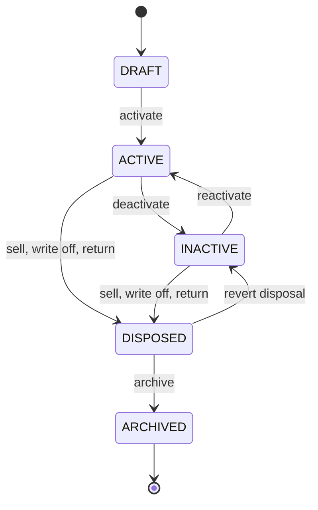

# Fleet and meters

Status: **PLANNED**, 2026-11-10. Module codes `FLEET` and `METER`. Tasks: `EMP-FLEET-001…013` and `EMP-METER-001…007` in [backlog/ep05-fleet-meters](../backlog/ep05-fleet-meters.md).

Evidence updated2026-11-14. The accepted private Fleet/Meter pure Go and Kotlin domains, actual asset persistence/routes (migration197) and current meter persistence/intake construction (migration198) now exist. [F2 execution](../evidence/f2-execution.md), [asset acceptance](../evidence/f2-fleet002-asset-persistence.md) and [meter evidence](../evidence/f2-meter002-persistence-intake.md) distinguish tested source from unfinished whole-task/integration/runtime gates; none certifies live deployment. Actual assignments, reservations, suppliers, maintained meter projections and their dependent screens remain owning backlog tasks. Personal data is not reused as organization data. The Android table `vehicle` (`data/src/main/kotlin/com/anpfuel/data/local/entity/VehicleEntity.kt`) is device-global, has no owner column and is bounded at three vehicles by `docs/product/VEHICLE_REGISTRATION_POLICY.md`; the server keeps personal vehicles as the `vehicles` dataset of the cloud protocol (`backend/internal/modules/cloudsync/domain/datasets.go`) (`IMPLEMENTED`). The personal ledger stores odometer values in metres and opens an append-only segment when an odometer is reset or replaced (`backend/db/migrations/000086_ledger_odometer.sql`, `IMPLEMENTED`); this module adopts the same idea for organization meters and shares no table with it. The driver-suite contract separates odometer readings from GPS estimates (B-BR-DRV-08 in `docs/product/DRIVER_SUITE_CONTRACT.md`; the module `backend/internal/modules/driver/` is `PARTIAL`, disabled by flag). Exact integer metres are an existing convention with shared vectors in `contracts/testdata/premium/` (`IMPLEMENTED`); seconds for hour meters follow BR-MONEY-002 (`PROPOSED`). Private source now lives in `backend/internal/modules/fleet/` and `com.anpfuel.domain.enterprise.fleet`/`meter`; the fleet management panel remains its owning `business-web/` task.

## 1. Purpose

A company must know which vehicles, machines and implements it works with, how it holds each one, who is responsible for each at any moment, whether an asset can start an operation now, and what its odometer or hour meter said over time. Today that knowledge lives in spreadsheets and in the memory of whoever handed over the keys, and a meter value is whatever was typed last.

Users: fleet managers and administrators (register and control), supervisors (assign, reserve, correct readings), drivers and operations staff (choose an asset, record readings), finance (unit and cost-centre attribution), and every later module that needs a trustworthy asset and a trustworthy usage figure: [trips](trips.md), [fuelings](fuelings.md), [maintenance](maintenance.md), [intelligence](intelligence.md).

Expected result: one register of assets with history instead of overwritten fields; assignments and reservations with periods; availability that is derived, never typed; and meter readings kept as evidence, so that distance and hours between any two readings can be recomputed after a correction.

## 2. Scope

- **Basic (F2, cut C1):** asset register for vehicles, machines and implements with identification, category, tanks and accepted products, and meters; activation; driver assignments (primary, additional, temporary); readings as append-only evidence with validation and suspect flags; panel list, detail and assignments; app list of my assets and the asset picker. Tasks EMP-FLEET-001, 002, 006, 012, 013 and EMP-METER-001, 002, 003.
- **Rest of F2:** lifecycle commands for acquisition, deactivation, sale, write-off, return and archive (EMP-FLEET-003); tenure periods (EMP-FLEET-004); unit and cost-centre allocation history (EMP-FLEET-005); transfer with an effective instant (EMP-FLEET-008); correction and void of readings (EMP-METER-004); meter replacement, reset and rollover (EMP-METER-005); panel meter history (EMP-METER-007).
- **F3:** supplier registry (EMP-FLEET-009), needed by fuelings and expenses; maintained current-value projection and the usage-between-instants query (EMP-METER-006), needed by consumption.
- **F4:** reservations, blocks and the full derived availability (EMP-FLEET-007), needed by missions; implements attached to a powered asset (EMP-FLEET-011).
- **F6:** asset documents and their expiry dates on the asset side (EMP-FLEET-010). Expiry tracking and alerts are specified in [maintenance](maintenance.md); files and their statuses in [documents](documents.md).
- **Out of scope:** meter values fed by telematics hardware (a later integration, see [imports-notifications-integrations](imports-notifications-integrations.md)); depreciation and asset accounting; tyre and component history ([maintenance](maintenance.md)); lookups in government vehicle registries; any copy from or link to personal vehicles; a shared pool of assets without individual assignments (see risks in §12).

In cut C1 availability has only what the cut can know: lifecycle and the trip in progress. Reservations, blocks and maintenance holds join in F4 and F6 without changing the state names.

## 3. Entities and ownership

Every entity belongs to exactly one organization (BR-TEN-001). References to units, cost centres and employees point to records of the same organization ([organizations](organizations.md), [identity](identity.md)).

| Entity | Owner | Content | Invariants |
|---|---|---|---|
| Asset | Organization | Kind (`VEHICLE`, `MACHINE`, `IMPLEMENT`), category, display name, identifiers (fleet number, plate, chassis or serial number), make, model, model year, usage basis (`DISTANCE` or `HOURS`), expected consumption per product, acquisition and disposal data, lifecycle state, revision | One organization; identifiers unique per organization (BR-FLEET-003); kind fixed after the first accepted operation |
| Tank | Organization (part of the asset) | Order, label, role (`MAIN`, `AUXILIARY`, `ADDITIVE`, `BATTERY`), capacity, accepted products | Capacity positive; all accepted products share one unit |
| Meter | Organization (aggregate root, METER) | Asset, kind (`ODOMETER` in metres, `HOUR_METER` in seconds), label, installation and removal instants, rollover modulus, segments | At most one meter of each kind in service per asset at any instant; unit never changes |
| Meter segment | Organization (part of the meter) | Order, opening value, closing value, reason (`INSTALLATION`, `RESET`, `ROLLOVER`) | Segments of a meter do not overlap in time; values never decrease inside a segment |
| Meter reading | Organization (part of the meter) | Segment, displayed value, `occurred_at` with zone and offset, `received_at`, author, device, origin, method, context link, photo reference, state, flags, supersession link, reason | Insert-only; superseded at most once; state as in §6.5 |
| Assignment | Organization | Asset, employee, kind (`PRIMARY`, `ADDITIONAL`, `TEMPORARY`), period, assigner, reason | Half-open period; `PRIMARY` periods of one asset never overlap |
| Tenure period | Organization (part of the asset) | Kind (`OWNED`, `LEASED`, `RENTED`, `THIRD_PARTY`, `LOANED`), counterpart supplier, contract reference, period, expected end | Exactly one tenure period at any instant from acquisition |
| Unit allocation, cost-centre allocation | Organization (part of the asset) | Unit or cost centre, period | Non-overlapping; exactly one unit at any instant while the asset is `ACTIVE`; at most one cost centre |
| Reservation | Organization | Asset, requester, mission reference, reserved employee when known, period, purpose, state | `CONFIRMED` periods of one asset never overlap |
| Block | Organization | Asset, reason kind (`ADMINISTRATIVE`, `SAFETY`, `DOCUMENT`, `INVESTIGATION`, `LENT_OUT`), note, period (may be open-ended), author | Removed only by an explicit command with a reason |
| Implement attachment | Organization | Implement, powered asset, period | An implement is attached to at most one powered asset at any instant |
| Supplier | Organization | Kinds (`STATION`, `WORKSHOP`, `LESSOR`, `PARTS`, `INSURER`, `OTHER`), legal and trade name, CNPJ or CPF when needed, municipality and state, business contact, optional catalog station reference, archive instant | Private to the organization; never creates or changes a catalog station |
| Asset document link | Organization | Asset, document kind, document reference, declared expiry date | The file and its statuses belong to [documents](documents.md); tracking belongs to [maintenance](maintenance.md) |

What the asset record holds, and why (BR-PRIV-005):

| Field | Purpose |
|---|---|
| Display name, category, kind | Recognise the asset in lists and pickers; choose checklist templates and plausibility limits |
| Fleet number | The organization's own code; matches paper, imports and stickers on the asset |
| Plate | Identify a road vehicle on receipts, fines and documents |
| Chassis or serial number (optional) | Identify an asset that has no plate |
| Make, model, model year (optional) | Compare like with like in indicators |
| Tanks, accepted products, capacity | Validate fuelings and compute consumption |
| Usage basis and meters | Decide which reading an operation needs and which figure is the default denominator |
| Expected consumption (optional) | A comparison reference for findings, never a measured value |
| Tenure and counterpart | Know who owns or leases the asset and when it must be returned |
| Unit and cost centre | Scope of access and attribution of cost |
| Acquisition and disposal date and kind (amounts optional, informational) | Bound the period in which the asset can have operations; amounts create no expense here ([expenses-finance](expenses-finance.md)) |

Registration numbers of official documents, insurance policy numbers and similar data stay on the linked document, not on the asset record. For a third-party asset the record holds the holder's name and the contract reference, nothing else about the holder.

## 4. Business rules

Register and identification:

- **BR-FLEET-001 — Separate from personal vehicles.** An organization asset is its own entity: the app's personal `vehicle` table and the cloud `vehicles` dataset are never read, copied or linked to create or update an asset, and the personal ceiling of three vehicles does not apply to assets.
- **BR-FLEET-002 — Three kinds.** An asset is a `VEHICLE`, a `MACHINE` or an `IMPLEMENT`; the kind cannot change once the asset has an accepted trip, fueling or reading.
- **BR-FLEET-003 — Identifiers unique inside the organization.** Plate and fleet number are each unique per organization among assets that are not `ARCHIVED`, compared without case, spaces or hyphens; the same value in another organization is neither visible nor a conflict (BR-TEN-002).
- **BR-FLEET-004 — Minimum data to activate.** An asset becomes `ACTIVE` only with a kind, a category, a display name, at least one identifier, an operating unit and, for a `VEHICLE` or `MACHINE`, at least one tank and one meter in service; an `IMPLEMENT` needs neither tank nor meter.
- **BR-FLEET-005 — Tanks state capacity and accepted products.** Each tank has a positive capacity in the unit of its products and a non-empty list of accepted fuel products that all share one unit; a product outside the list is incompatible with that tank.
- **BR-FLEET-006 — Expected consumption is a reference.** Expected consumption is stored per accepted product as an integer with its basis, source and date, is used only as a comparison reference, and never replaces or fills a measured figure (BR-TRUTH-003).
- **BR-FLEET-007 — Only data with a purpose.** The asset record holds only the fields listed in §3; a field added later needs a stated purpose in that table before it is collected (BR-PRIV-005).

Lifecycle, tenure and allocation:

- **BR-FLEET-008 — Lifecycle moves by command.** The lifecycle state changes only through the transitions of §6.1, each with an actor, a reason where the table requires one and an audit event (BR-AUD-001); no field edit sets the state.
- **BR-FLEET-009 — Disposal keeps history.** A sale, write-off or return sets `DISPOSED` with its kind, instant and reason; every trip, reading, fueling, cost and document of the asset stays readable under the scope it had when it was created, and an operation declared after the disposal instant is held for review (BR-FLEET-027).
- **BR-FLEET-010 — Open work blocks removal from service.** An asset with a trip `IN_PROGRESS` or `PAUSED`, or with an open maintenance work order, cannot become `INACTIVE`, `DISPOSED` or `ARCHIVED`; the command fails with `ASSET_HAS_OPEN_OPERATIONS` naming the kinds of open work.
- **BR-FLEET-011 — Only drafts are discarded.** A `DRAFT` asset with no reading and no operation can be discarded; every other asset is kept and at most archived.
- **BR-FLEET-012 — Tenure is a history of periods.** From its acquisition instant an asset has exactly one tenure period at any instant; a change of tenure closes one period and opens the next and never rewrites an earlier period.
- **BR-FLEET-013 — Assets held from others have a counterpart.** A `LEASED`, `RENTED`, `THIRD_PARTY` or `LOANED` tenure names the counterpart and may state an expected end; reaching that date raises an alert and never changes the lifecycle by itself.
- **BR-FLEET-014 — Lending out is a block.** When the organization lends its own asset to another party, tenure does not change; a block with reason `LENT_OUT` covers the loan period and is removed when the asset returns.
- **BR-FLEET-015 — One unit at a time.** An `ACTIVE` asset is allocated to exactly one operating unit and to at most one cost centre at any instant; allocations are non-overlapping periods.
- **BR-FLEET-016 — History does not follow the asset.** Changing the current unit, cost centre, tenure, primary driver or any assignment never changes a past trip, reading, fueling, expense or document: each keeps the unit, cost centre, asset and people stored when it was created (BR-AUTH-005).
- **BR-FLEET-017 — Transfers state an effective instant.** A transfer between units or cost centres names the instant from which it applies; records created before that instant keep their snapshot even when the instant is in the past, and a trip in progress keeps the unit it started with.

Assignments:

- **BR-FLEET-018 — Assignment kinds.** `PRIMARY` names the employee responsible for the asset; `ADDITIONAL` names another employee allowed to use it; `TEMPORARY` names a substitute for a stated period. Every assignment names one employee; a bulk command creates one assignment per employee.
- **BR-FLEET-019 — Assignment periods.** An assignment has a start and may have an end; `TEMPORARY` requires an end; periods are half-open; the state is `SCHEDULED` before the start, `ACTIVE` inside the period and `ENDED` after it, evaluated at server time.
- **BR-FLEET-020 — One primary at a time.** Two `PRIMARY` assignments of one asset never overlap; a new primary either starts where the previous one ends or ends it at the new start in the same transaction.
- **BR-FLEET-021 — A substitute does not remove the primary.** A `TEMPORARY` assignment leaves the `PRIMARY` in place; during it both may use the asset and the substitute is shown as acting responsible.
- **BR-FLEET-022 — Who can be assigned.** The employee record is `ACTIVE` and belongs to the same organization; where the organization enabled the driver-profile control, assigning a `VEHICLE` applies the eligibility checks of [identity](identity.md).
- **BR-FLEET-023 — Assignments end with the person or the asset.** When an employee record becomes `TERMINATED` or an asset becomes `DISPOSED`, every assignment of that employee or asset that is not `ENDED` is ended at that instant with the cause recorded.
- **BR-FLEET-024 — Assignment is not exclusive use.** An assignment gives the right to select the asset; it reserves nothing. Ending an assignment does not end a trip already in progress; the next start needs a new assignment.

Availability, reservations and concurrent use:

- **BR-FLEET-025 — Availability is derived.** Availability is computed when read from lifecycle, trips, maintenance holds, blocks and reservations in the order of §6.2; it is never typed, and a stored copy is a projection that can be rebuilt.
- **BR-FLEET-026 — One active trip per asset.** An asset is the main asset of at most one trip `IN_PROGRESS` or `PAUSED` at any instant; the first start the server receives holds the asset until that trip ends.
- **BR-FLEET-027 — Incompatible field operations are held.** A field operation that needs an asset which another accepted fact makes unusable at the declared instant is accepted for review, never discarded: `ASSET_BUSY` when another trip holds the asset, `ASSET_UNAVAILABLE` when the asset is reserved for someone else, in maintenance, blocked, not `ACTIVE` or not assigned to the author (BR-OFFL-006).
- **BR-FLEET-028 — Online commands are refused, not held.** A panel command that conflicts with an accepted fact (overlapping primary assignment, overlapping confirmed reservation, removal from service with open work, stale revision) changes nothing and answers with the error of §10.5.
- **BR-FLEET-029 — Confirmed reservations do not overlap.** Two `CONFIRMED` reservations of one asset never overlap; confirming needs `fleet.reservation.manage` on the asset; `REQUESTED` reservations may overlap until one is confirmed.
- **BR-FLEET-030 — Reservation outcomes follow the clock.** A `REQUESTED` reservation becomes `EXPIRED` when its start passes unconfirmed; a `CONFIRMED` one becomes `FULFILLED` when a qualifying trip starts between its start minus the early tolerance and its end, and `NO_SHOW` when the no-show tolerance passes without one; both are also evaluated at read time.
- **BR-FLEET-031 — A reservation holds the asset against others only.** During a confirmed window the reserved employee, or an assignee of the reserving mission, starts normally; a start by anyone else is held with `ASSET_UNAVAILABLE`.
- **BR-FLEET-032 — Blocks state a reason and a period.** A block names its reason kind, start and optional end, makes the asset `BLOCKED` for new starts and does not interrupt a trip in progress.
- **BR-FLEET-033 — Implements attach to one powered asset.** An `IMPLEMENT` is never the main asset of a trip; it is attached to at most one powered asset at a time by period, and a trip lists the implements attached when it started.

Suppliers and documents:

- **BR-FLEET-034 — Suppliers are private to the organization.** A supplier belongs to one organization, is never published and never creates or alters a catalog station; a supplier of kind `STATION` may reference one catalog station, which gives no right over it (BR-SRC-004, BR-TEN-005).
- **BR-FLEET-035 — Supplier identification is optional and checked.** A CNPJ or CPF is stored only when the organization needs it, is validated by its check digits (alphanumeric CNPJ included, AS-10) and is unique per organization among suppliers that are not archived; a supplier is archived, never deleted.
- **BR-FLEET-036 — The asset record links documents; it does not hold them.** Photos and documents of an asset are documents of [documents](documents.md) linked to the asset with a kind and a declared expiry date; no file content or document number is copied into the asset record.

Meters and readings:

- **BR-METER-001 — Readings are evidence.** A reading records what a person or an integration observed on a meter at an instant; readings are insert-only and are never updated or deleted by a product flow.
- **BR-METER-002 — What a reading carries.** A reading stores its meter and segment, the displayed value, `occurred_at` with zone and offset, `received_at`, the author's membership and device, origin, method, the operation it belongs to and an optional photo reference (BR-TIME-001, BR-TIME-002).
- **BR-METER-003 — Origin and method.** The origin is one of `TRIP_START`, `TRIP_END`, `HANDOVER`, `FUELING`, `CHECKLIST`, `MAINTENANCE`, `STANDALONE`, `IMPORT`, `METER_INSTALLATION`, `METER_REMOVAL`; the method is `TYPED`, `TYPED_WITH_PHOTO`, `IMPORTED` or `INTEGRATION`.
- **BR-METER-004 — Units and entry.** An odometer value is stored in metres and an hour-meter value in seconds; kilometres with up to three decimals and hours with up to two decimals, or hours and minutes, convert exactly; any other input is refused with `VALIDATION_FAILED` (BR-MONEY-002).
- **BR-METER-005 — One meter of each kind in service.** An asset has at most one odometer and one hour meter in service at any instant; both may be in service together; a replaced meter is a new meter.
- **BR-METER-006 — The current value is a projection.** The asset never stores a meter value as truth: the current reading of a meter is the latest `VALID` reading by `occurred_at` of its open segment, and can be rebuilt from the readings at any time.
- **BR-METER-007 — Segments carry the count.** Every meter counts in segments with an opening value; a reset, a rollover or a replacement closes one segment and opens the next; usage is the sum of segment differences (§10.3), never the difference of two displayed values from different segments.
- **BR-METER-008 — Order follows the observation instant.** Readings of a meter are ordered by `occurred_at`, then `received_at`, then identifier; arrival order alone never decides.
- **BR-METER-009 — Values never decrease inside a segment.** A new reading lower than its predecessor or higher than its successor in the same segment is stored as `SUSPECT` with `READING_BELOW_PREVIOUS` or `READING_ABOVE_NEXT`; it is not refused and does not count.
- **BR-METER-010 — Plausible rate.** A reading whose usage since its predecessor exceeds the rate limit of §10.2, or whose `occurred_at` is later than `received_at` plus the clock-skew limit, is stored as `SUSPECT` with `IMPLAUSIBLE_RATE` or `FUTURE_INSTANT`.
- **BR-METER-011 — Suspect readings wait.** A `SUSPECT` reading is excluded from the projection, from usage and from every figure derived from them, and is listed for members with `meter.reading.correct` until it is confirmed, corrected or voided; it never holds back the trip or fueling that carried it.
- **BR-METER-012 — Monotonicity cannot be overridden.** A `READING_BELOW_PREVIOUS` or `READING_ABOVE_NEXT` flag clears only when a neighbour is corrected or voided or a segment boundary is recorded between the two readings; `IMPLAUSIBLE_RATE` and `FUTURE_INSTANT` can be confirmed with a reason.
- **BR-METER-013 — Correction is supersession.** A correction is a new reading with the corrected value or instant, the author, a reason and a link to the reading it supersedes; the superseded reading becomes `VOIDED` and stays visible; a reading is superseded at most once.
- **BR-METER-014 — Void without replacement.** A reading recorded for the wrong asset or that never happened is `VOIDED` with a reason; `VOIDED` is terminal.
- **BR-METER-015 — Who corrects.** The author replaces a reading through the edit of its parent record while that record is `DRAFT` or `RETURNED` (BR-AMD-006); otherwise the correction needs `meter.reading.correct`, and when the parent record is `APPROVED` it is part of an amendment of that record (BR-AMD-001, BR-AMD-004).
- **BR-METER-016 — Derived data follows.** A retroactive insert, a correction, a void or a new segment boundary recalculates every figure that used the affected span, and each recalculation is identifiable by revision (BR-AMD-005, BR-TRUTH-004).
- **BR-METER-017 — Retroactive readings.** A reading whose `occurred_at` is earlier than the latest reading is inserted in its place: `VALID` with the note `RETROACTIVE` when its value lies between its neighbours, `SUSPECT` otherwise.
- **BR-METER-018 — Replacement.** Replacing a meter records the final value of the old meter at removal, closes its last segment, and installs a new meter whose first segment opens at the value it displays; when the old display cannot be read, the removal says so and usage across that gap is `INSUFFICIENT_DATA`.
- **BR-METER-019 — Reset.** A count that restarts on the same device is recorded as a reset: the value observed before, the value observed after and the instant; it closes one segment and opens the next on the same meter.
- **BR-METER-020 — Rollover is confirmed by a person.** When a meter has a rollover modulus and a lower reading would be plausible as a wrap, the reading is stored as `SUSPECT` with `POSSIBLE_ROLLOVER`; a member with `meter.reading.correct` confirms it, which closes the segment at the modulus and opens the next at zero. The system never applies a rollover by itself.
- **BR-METER-021 — Kilometres and hours are separate series.** An asset with both meters keeps two independent series; neither is derived from the other, they are never added or converted, and the asset's usage basis says which one is the default denominator (BR-MONEY-009).
- **BR-METER-022 — No invented readings.** A value nobody observed is never stored as a reading; an operation that requires a reading and cannot have one records that it is missing, with a reason, and figures that need it are `INSUFFICIENT_DATA` (BR-TRUTH-003).
- **BR-METER-023 — Bounds.** A value is not negative, is below the meter's modulus when it has one, and does not exceed 10¹² metres for an odometer or 3 600 000 000 seconds for an hour meter (BR-MONEY-010).
- **BR-METER-024 — Equal readings are not duplicates.** Two readings of one meter with the same value from different operations are both kept; only the same operation identifier is a replay (BR-OFFL-004).
- **BR-METER-025 — Photo of the meter.** A reading may carry a photo of the display, stored as a document; it is optional by default and an organization policy may require it for trip start and end.
- **BR-METER-026 — History stays visible.** The meter history shows every reading, including `SUSPECT` and `VOIDED` ones, with origin, author, both instants, flags and the supersession chain.

## 5. Use cases

**UC-FLEET-01 — Register and activate an asset.** Actor: member with `fleet.asset.manage`. Preconditions: an operating unit exists. Main flow: enter kind, category, name and identifiers → add tanks with capacity and accepted products → add meters with their opening reading → choose unit and optional cost centre → save as `DRAFT` → activate. Alternatives: plate or fleet number already used by an asset that is not archived → `ASSET_IDENTIFIER_TAKEN`; minimum data missing at activation → `VALIDATION_FAILED` listing the fields; plan limit of active assets reached → `LIMIT_REACHED`. Result: asset `ACTIVE`, with its first tenure period, unit allocation and one opening reading per meter.

**UC-FLEET-02 — Take an asset out of service or dispose of it.** Actor: member with `fleet.asset.manage`. Main flow: choose deactivate, dispose (sale, write-off, return to the holder) or archive → state the instant and reason → server checks open work → state changes; on disposal assignments end and future reservations are cancelled. Alternatives: trip in progress or open work order → `ASSET_HAS_OPEN_OPERATIONS`; disposal recorded by mistake → revert to `INACTIVE` with a reason while not archived. Result: lifecycle changed, history intact (BR-FLEET-009).

**UC-FLEET-03 — Record tenure.** Actor: member with `fleet.asset.manage`. Main flow: choose the kind, the counterpart supplier and contract reference when held from others, the start and optional expected end → the previous period is closed at the new start. Alternatives: start before the previous period's start → `VALIDATION_FAILED`; counterpart archived → `VALIDATION_FAILED`. Result: one tenure period per instant (BR-FLEET-012).

**UC-FLEET-04 — Transfer an asset to another unit.** Actor: member with `fleet.asset.manage` whose scope covers the asset's current unit. Main flow: choose destination unit and optional cost centre → state the effective instant and reason → the current allocation is closed at that instant and the next opens. Alternatives: destination unit archived → `VALIDATION_FAILED`; effective instant in the future → the transfer is scheduled and listed; a trip in progress → the trip keeps its unit. Result: allocation history extended; no past record changes (BR-FLEET-016, BR-FLEET-017).

**UC-FLEET-05 — Assign an asset.** Actor: member with `fleet.asset.assign` covering the asset. Main flow: choose employee or several employees, kind and period → server checks BR-FLEET-020 and BR-FLEET-022 → assignments created → assignees are notified and the asset appears in their app at the next reference pull. Alternatives: overlapping primary → `ASSIGNMENT_OVERLAP`, with the option to replace the primary from the new start; employee not `ACTIVE` → `VALIDATION_FAILED`; ending an assignment while its assignee has a trip in progress → the trip continues (BR-FLEET-024). Result: assignments with periods; history kept.

**UC-FLEET-06 — Reserve an asset.** Actor: member with `trip.mission.manage` (request) or `fleet.reservation.manage` (request and confirm). Preconditions: asset `ACTIVE`. Main flow: choose asset, window and mission or purpose → server checks overlap with confirmed reservations and blocks → reservation `REQUESTED`, or `CONFIRMED` when the requester may confirm → when the window arrives and the reserved trip starts, the reservation becomes `FULFILLED`. Alternatives: overlap with a confirmed reservation → `RESERVATION_CONFLICT` showing only the conflicting window; nobody confirms before the start → `EXPIRED`; nobody starts within the tolerance → `NO_SHOW` and the asset is released. Result: the asset is held for the window against other users only.

**UC-FLEET-07 — Block an asset.** Actor: member with `fleet.reservation.manage`. Main flow: choose the reason kind, start, optional end and a note → the asset shows `BLOCKED` for new starts → remove the block with a reason. Alternatives: trip in progress → the block applies to the next start and the panel says so; lending the asset out → reason `LENT_OUT` with the expected return. Result: block recorded and audited.

**UC-FLEET-08 — Choose an asset in the app.** Actor: member with `fleet.asset.read` on own assignments. Preconditions: reference data cached. Main flow: open the picker → see assigned assets with availability and its confirmation time, tanks and last known reading → choose one. Alternatives: no assignment → empty state naming who can assign; cached list older than the freshness limit → marked "não confirmado" (BR-OFFL-016); asset shown as not available → may still be chosen offline with a warning, and the server decides (BR-FLEET-027). Result: the operation carries the asset chosen.

**UC-FLEET-09 — Two starts on the same asset.** Actor: system at intake. Main flow: two trip starts for one asset arrive → the first received is accepted and holds the asset → the second is accepted for review with `ASSET_BUSY` and the two declared intervals are shown to the reviewer ([trips](trips.md), [10-offline-sync](../10-offline-sync.md) §8 and §10.2). Alternatives: the held trip's finish arrives and its declared interval does not overlap the other → the item is resolved in favour by the system with that evidence recorded. Result: no trip is lost and the asset never has two active trips.

**UC-FLEET-10 — Attach an implement.** Actor: member with `fleet.asset.manage`. Main flow: choose the implement and the powered asset → state the start → attachment recorded; detach states the end. Alternatives: implement already attached elsewhere in that period → `CONFLICT`; powered asset is itself an implement → `VALIDATION_FAILED`. Result: trips of the powered asset list the implement while attached.

**UC-FLEET-11 — Maintain suppliers.** Actor: member with `fleet.supplier.manage`. Main flow: create a supplier with kinds and name → optionally add CNPJ or CPF, municipality, business contact and a catalog station reference → archive when no longer used. Alternatives: document already used by another supplier → `SUPPLIER_DOCUMENT_TAKEN`; invalid check digits → `VALIDATION_FAILED`; the station is not in the catalog → the supplier stays without a reference and nothing is created in the catalog. Result: supplier available as reference data for fuelings, expenses, tenure and maintenance.

**UC-METER-01 — Record a reading.** Actor: member with `meter.reading.record` on an own or assigned asset, alone or as part of a trip, fueling or checklist. Main flow: the app shows the last known reading and its instant → the user types the value shown on the display, optionally with a photo → the app warns when the value is lower than the last known one → the reading is saved and sent → the server validates and stores it `VALID` or `SUSPECT`. Alternatives: offline → saved on the device and validated on arrival; display unreadable → the operation records the reading as missing with a reason (BR-METER-022). Result: one reading as evidence.

**UC-METER-02 — Insert a retroactive reading.** Actor: as UC-METER-01, or system at intake of an operation recorded earlier. Main flow: a reading arrives whose `occurred_at` is before the latest reading → it is placed by `occurred_at` → checked against both neighbours → stored `VALID` with `RETROACTIVE` → affected figures are recalculated. Alternatives: value outside its neighbours → `SUSPECT`; reporting day in a locked period → the operation is held with `PERIOD_LOCKED`. Result: the series stays ordered and usage totals stay exact (§10.4, example A).

**UC-METER-03 — Correct a typing error.** Actor: member with `meter.reading.correct`. Main flow: open the reading with its neighbours and photo → enter the corrected value and a reason → a new reading supersedes the original, which becomes `VOIDED` → neighbours flagged because of it are re-evaluated → recalculation. Alternatives: the reading was already superseded → `READING_ALREADY_SUPERSEDED`; the corrected value still breaks monotonicity → the correction is stored `SUSPECT` and the dialog says which neighbour conflicts; the parent record is approved and its period is locked → BR-AMD-004 applies. Result: corrected series, original preserved (§10.4, example B).

**UC-METER-04 — Void a reading.** Actor: member with `meter.reading.correct`. Main flow: choose void and give the reason → the reading becomes `VOIDED` → recalculation. Alternative: the reading is the only one bounding an approved trip → the void proceeds and the trip's odometer distance becomes `INSUFFICIENT_DATA` through an amendment. Result: the reading no longer counts and stays visible.

**UC-METER-05 — Replace or reset a meter.** Actor: member with `meter.reading.correct`. Main flow (replacement): record the removal instant and the final value of the old meter → install the new meter with its label, modulus and opening value → both readings are stored with origins `METER_REMOVAL` and `METER_INSTALLATION`. Main flow (reset): record the value before, the value after and the instant. Alternatives: final value unreadable → removal recorded with the value unknown and the gap marked; a meter of that kind is still in service → `METER_ALREADY_IN_SERVICE`. Result: cumulative usage continues across the change (§10.4, example C).

**UC-METER-06 — Confirm a rollover.** Actor: member with `meter.reading.correct`. Main flow: open a reading flagged `POSSIBLE_ROLLOVER` → see the previous reading, the modulus and the usage the wrap would imply → confirm → the segment closes at the modulus, the next opens at zero and the reading becomes `VALID`. Alternative: it was a typing error → correct it instead (UC-METER-03). Result: usage across the wrap is exact (§10.4, example D).

**UC-METER-07 — Resolve suspect readings.** Actor: member with `meter.reading.correct`. Main flow: open the list of `SUSPECT` readings in scope → for each, see flags, neighbours, author and photo → confirm with a reason, correct or void. Alternative: correcting one reading clears the flags of others, which return to `VALID` by system re-evaluation. Result: no reading stays excluded without a decision.

**UC-METER-08 — Ask for usage between two instants.** Actor: system (trips, fuelings, maintenance, indicators). Main flow: give asset, kind and two instants → the query finds the latest `VALID` reading at or before each instant → returns usage, both anchors and the projection revision. Alternatives: no anchor for an instant, or a gap with unknown closing value between them → `INSUFFICIENT_DATA` with the reason; no interpolation is ever done. Result: a figure that names the readings it used (BR-TRUTH-004).

## 6. States and transitions

State names are those of [08-state-model](../08-state-model.md) §3.

### 6.1 Asset lifecycle

| From | To | Actor | Validation | Effect | Reversal |
|---|---|---|---|---|---|
| — | `DRAFT` | `fleet.asset.manage` | BR-FLEET-003 | Asset exists; not selectable for operations | Discard (BR-FLEET-011) |
| `DRAFT` | `ACTIVE` | `fleet.asset.manage` | BR-FLEET-004; plan limit of active assets | Selectable; first tenure and allocation periods open | Deactivate |
| `ACTIVE` | `INACTIVE` | `fleet.asset.manage` | Reason; BR-FLEET-010 | Not selectable; assignments kept; future reservations cancelled with notice | Reactivate |
| `INACTIVE` | `ACTIVE` | `fleet.asset.manage` | BR-FLEET-004 still holds; plan limit | Selectable again | Deactivate |
| `ACTIVE`, `INACTIVE` | `DISPOSED` | `fleet.asset.manage` | Disposal kind, instant, reason; BR-FLEET-010 | Assignments ended; reservations cancelled; meters may receive a final reading; history readable | Revert disposal |
| `DISPOSED` | `INACTIVE` | `fleet.asset.manage` | Reason; not archived | Disposal data kept in history; assignments are not restored | Dispose again |
| `DISPOSED` | `ARCHIVED` | `fleet.asset.manage` | — | Hidden from default lists; identifiers free for reuse; history readable and exportable | None (terminal); the same physical asset returning is a new record linked to this one |

### 6.2 Derived availability

Availability is the first row that applies at the evaluated instant; the answer also lists every other cause that applies (BR-FLEET-025).

| Order | Condition | Availability |
|---|---|---|
| 1 | Lifecycle is `DRAFT`, `INACTIVE`, `DISPOSED` or `ARCHIVED` | `UNAVAILABLE` |
| 2 | A trip `IN_PROGRESS` or `PAUSED` has the asset as main asset, or as an attached implement | `IN_USE` |
| 3 | A maintenance hold is open ([maintenance](maintenance.md)) | `IN_MAINTENANCE` |
| 4 | A block covers the instant | `BLOCKED` |
| 5 | A `CONFIRMED` reservation covers the instant | `RESERVED` |
| 6 | None of the above | `AVAILABLE` |

A member may start an operation on an asset that is `AVAILABLE`, or `RESERVED` for that member or for a mission the member is assigned to, provided the member has an `ACTIVE` assignment or the reservation names them. Actor of every change is whoever changes the underlying fact; there is no command that sets availability and therefore no reversal of its own.

### 6.3 Assignment

| From | To | Actor | Validation | Effect | Reversal |
|---|---|---|---|---|---|
| — | `SCHEDULED` | `fleet.asset.assign` | Start in the future; BR-FLEET-020, BR-FLEET-022 | None until the start | End before the start |
| —, `SCHEDULED` | `ACTIVE` | `fleet.asset.assign`, or time | Employee `ACTIVE`; asset not `DISPOSED` | Asset enters the assignee's reference data and `SELF` scope | End the assignment |
| `ACTIVE` | `ENDED` | `fleet.asset.assign`, time at the end, system (BR-FLEET-023, primary replaced) | — | Asset leaves the assignee's reference data at the next pull; a trip in progress continues | New assignment; history kept |

### 6.4 Reservation

| From | To | Actor | Validation | Effect | Reversal |
|---|---|---|---|---|---|
| — | `REQUESTED` | `trip.mission.manage` or `fleet.reservation.manage` | Asset `ACTIVE`; window in the future; no overlap with a `CONFIRMED` reservation | None on availability | Cancel |
| —, `REQUESTED` | `CONFIRMED` | `fleet.reservation.manage` covering the asset | BR-FLEET-029; no block over the window | `RESERVED` during the window | Cancel |
| `REQUESTED` | `EXPIRED` | Time | Start passed unconfirmed | Requester notified | New reservation |
| `REQUESTED`, `CONFIRMED` | `CANCELLED` | Requester, `fleet.reservation.manage`, or system (asset left service, mission cancelled) | Reason when cancelled by someone other than the requester | Window released | New reservation |
| `CONFIRMED` | `FULFILLED` | System | A trip of the reserved employee or mission started inside the tolerance | Reservation linked to the trip | None |
| `CONFIRMED` | `NO_SHOW` | Time | No qualifying start by start plus the no-show tolerance | Window released; requester and managers notified | New reservation |

Defaults: early tolerance 30 minutes; no-show tolerance 60 minutes, configurable from 15 to 240.

### 6.5 Meter reading

| From | To | Actor | Validation | Effect | Reversal |
|---|---|---|---|---|---|
| — | `VALID` | Author, at intake | Passes BR-METER-009, 010 and 023 | Counts in the projection and in usage | Correct or void |
| — | `SUSPECT` | System, at intake | A check of BR-METER-009, 010 or 020 fails | Excluded; listed for review | Resolve |
| `SUSPECT` | `VALID` | `meter.reading.correct` (confirm with reason, or confirm rollover); system re-evaluation after a neighbour changed | BR-METER-012 | Counts; recalculation | Correct or void |
| `VALID`, `SUSPECT` | `VOIDED` | `meter.reading.correct` (void or supersede); author through the edit of an unapproved parent record | Reason; not already superseded | Excluded and visible; recalculation | None (terminal); record a new reading |

## 7. Roles and permissions

| Permission | Used for | Roles in [07-permissions](../07-permissions.md) §7.3 |
|---|---|---|
| `fleet.asset.read` | Lists, detail, availability, meter history | `OWNER`, `ADMIN`, `FLEET_MANAGER`, `SUPERVISOR`, `FINANCE`, `APPROVER`, `AUDITOR` in scope; `DRIVER` and `OPERATIONS_STAFF` on assigned assets |
| `fleet.asset.manage` | Register, edit, lifecycle, tenure, allocation, transfer, tanks, meters, implements, document links | `OWNER`, `ADMIN`, `FLEET_MANAGER` |
| `fleet.asset.assign` | Assignments | `OWNER`, `ADMIN`, `FLEET_MANAGER`, `SUPERVISOR` |
| `fleet.reservation.manage` | Reservations and blocks | No matrix row yet; this module assumes the roles of `fleet.asset.assign` |
| `fleet.supplier.manage` | Suppliers | No matrix row yet; this module assumes `OWNER`, `ADMIN`, `FLEET_MANAGER`, `FINANCE` |
| `meter.reading.record` | Record a reading | `OWNER`, `ADMIN`, `FLEET_MANAGER`, `SUPERVISOR` in scope; `DRIVER` and `OPERATIONS_STAFF` on own and assigned assets |
| `meter.reading.correct` | Correct, void, confirm, replace, reset, rollover | `OWNER`, `ADMIN`, `FLEET_MANAGER`, `SUPERVISOR` |
| `trip.mission.manage` | Request a reservation for a mission | As in the matrix |

Scope: `UNIT` and `COST_CENTRE` scopes cover an asset through its current allocation for register actions, and through the stored snapshot for its past records (BR-AUTH-005). `ASSET` scope covers one asset. `SELF` covers assets with an `ACTIVE` assignment to the member. Supplier names and kinds are reference data delivered to any member who can record against a supplier; identification and contact fields need `fleet.supplier.manage`. No permission is evaluated on the device (BR-AUTH-002).

## 8. Offline, concurrency, idempotency and corrections

- **Offline in the app.** The asset list, assignments, tanks, accepted products, meters and the last known `VALID` reading of each meter come from the reference feed and show when they were confirmed (BR-OFFL-016). A reading is created offline, with its own identifier, either alone (`meter.reading.record`) or inside the operation that carries it (trip start, trip end, fueling, checklist). The app compares the typed value with the last known one and warns; it never blocks, because the server may know readings from other devices.
- **Online only.** Register, lifecycle, tenure, transfer, assignment, reservation, block, supplier, correction, void, replacement, reset and rollover commands run in the panel and need the server (BR-OFFL-017).
- **Concurrency on the server.** Intake serialises per meter (row lock on the meter) and per asset (row lock on the asset) for lifecycle, assignment and reservation commands. Period invariants are exclusion constraints; the one-active-trip rule is a partial unique index whose violation becomes a review item ([09-architecture](../09-architecture.md) §5). Asset edits carry the expected revision.
- **Idempotency.** Every command carries an operation identifier; a repeat returns the first result (BR-OFFL-004). A reading embedded in a trip or fueling keeps its own identifier, so a resend never creates a second reading.
- **Corrections.** Asset fields are edited with revision history; identifiers that change keep the previous values in history. Readings are corrected only by supersession or void (BR-METER-013, 014). A suspect reading never holds its parent operation (BR-METER-011); a standalone reading that is suspect is answered `ACCEPTED_FOR_REVIEW` with its flag as the code.

Incompatible operations on one asset:

| Already accepted | Arrives second | Outcome for the second |
|---|---|---|
| Trip start on the asset | Another trip start whose declared interval overlaps | Held for review, `ASSET_BUSY` (BR-FLEET-026, 027) |
| Confirmed reservation for a mission | Trip start in the window by someone not in the mission | Held for review, `ASSET_UNAVAILABLE` |
| Block or maintenance hold | Field operation declared after it began | Held for review, `ASSET_UNAVAILABLE` |
| Disposal at an instant | Field operation declared after that instant | Held for review, `ASSET_UNAVAILABLE`; declared before it, accepted normally |
| Trip in progress | Deactivate, dispose or archive from the panel | Refused, `ASSET_HAS_OPEN_OPERATIONS` |
| Primary assignment | Overlapping primary assignment | Refused, `ASSIGNMENT_OVERLAP`, unless the command replaces the primary |
| Confirmed reservation | Overlapping confirmation | Refused, `RESERVATION_CONFLICT` |
| Reading on a meter | Reading out of order with an inconsistent value | Stored `SUSPECT` |
| Asset edit on revision n | Another edit on revision n | Refused, `CONFLICT`; from a device, held with `STALE_REVISION` |

## 9. Events, notifications and integrations

Produced: `fleet.asset.created`, `fleet.asset.activated`, `fleet.asset.deactivated`, `fleet.asset.disposed`, `fleet.asset.archived`, `fleet.asset.transferred`, `fleet.tenure.changed`, `fleet.assignment.created`, `fleet.assignment.ended`, `fleet.reservation.requested`, `fleet.reservation.confirmed`, `fleet.reservation.cancelled`, `fleet.reservation.expired`, `fleet.reservation.fulfilled`, `fleet.reservation.missed`, `fleet.block.created`, `fleet.block.removed`, `fleet.implement.attached`, `fleet.implement.detached`, `fleet.supplier.created`, `fleet.supplier.archived`, `meter.meter.installed`, `meter.meter.removed`, `meter.segment.opened`, `meter.reading.recorded`, `meter.reading.flagged`, `meter.reading.corrected`, `meter.reading.voided`, `meter.usage.recalculated`.

Consumed: `trip.trip.started`, `trip.trip.completed` and `trip.trip.cancelled` (availability and reservation outcomes); `idn.membership.ended` and the employee termination event of [identity](identity.md) (BR-FLEET-023); unit and cost-centre archive events of [organizations](organizations.md) (an archived unit cannot receive a transfer); maintenance hold events of [maintenance](maintenance.md) (availability).

Notifications: the assignee when an assignment starts, changes or ends; the requester when a reservation is confirmed, cancelled, expired or missed; holders of `meter.reading.correct` receive a digest of new suspect readings in scope; managers when a tenure reaches its expected end. Channels follow [imports-notifications-integrations](imports-notifications-integrations.md).

Integrations: assets and opening readings can be imported from files through the import pipeline of [imports-notifications-integrations](imports-notifications-integrations.md) with method `IMPORTED`; a telematics source, when it exists, records readings with method `INTEGRATION` through the same intake and the same checks. Events carry identifiers only, never plates or names (BR-PRIV-008).

## 10. Data, formulas and examples

### 10.1 Inputs and validations

| Input | Validation |
|---|---|
| Display name | 1 to 80 characters |
| Fleet number | Up to 20 characters; unique as in BR-FLEET-003 |
| Plate | 7 alphanumeric characters after normalisation; unique as in BR-FLEET-003; optional |
| Chassis or serial number | Up to 40 characters; optional |
| Model year | Four digits; optional |
| Tank capacity | Integer in millilitres, milli-cubic-metres or watt-hours; from 1 to 10⁹ (BR-MONEY-010) |
| Accepted products | Codes of the fuel product catalog ([fuelings](fuelings.md)); one unit per tank |
| Expected consumption, basis `DISTANCE` | Integer metres per unit of product: per litre, per cubic metre or per kilowatt-hour |
| Expected consumption, basis `HOURS` | Integer milli-units of product per hour |
| Rollover modulus | Integer in the meter's unit; optional; greater than every reading of the meter |
| Assignment, reservation, block, tenure and allocation periods | Start before end; instants in UTC with the unit's time zone for display (BR-TIME-001) |
| Free-text reasons and notes | Up to 280 characters, with the guidance of BR-PRIV-007 |

Examples of the integer forms: 8.5 km/L is 8 500 metres per litre; 12 L/h is 12 000 millilitres per hour; a 275 L tank is 275 000 mL; 184 532.4 km is 184 532 400 m; 4 212.5 h is `4 212.5 × 3 600 = 15 165 000` s.

### 10.2 Plausibility limits

For two consecutive `VALID` readings of one segment, with values `v1 ≤ v2` and instants `t1 < t2` in seconds:

- Odometer: plausible when `(v2 − v1) × 3 600 ≤ limit × (t2 − t1) + 3 600 000`, where `limit` is the category's maximum average distance per hour in metres (default 150 000, configurable from 20 000 to 200 000) and the constant allows 1 000 m for display rounding.
- Hour meter: plausible when `v2 − v1 ≤ (t2 − t1) + 300`, because a meter cannot count more hours than the clock, with 300 s of tolerance.

A possible rollover (BR-METER-020) is a lower reading `v2 < v1` on a meter with modulus `M` for which `(M − v1) + v2` satisfies the same limit.

### 10.3 Usage formulas

For one asset and one kind, take its meters in installation order and their segments in order. For a segment `s`, `open(s)` is its opening value and `close(s)` its closing value once closed. `last(s, t)` is the value of the latest `VALID` reading of `s` with `occurred_at ≤ t`.

- Cumulative usage at instant `t`: `U(t) = Σ (close(s) − open(s))` over the segments closed at or before `t`, plus `last(s*, t) − open(s*)` for the segment `s*` open at `t`.
- Usage between two instants: `usage(t1, t2) = U(t2) − U(t1)`, returned with the two readings used as anchors.
- Equivalent display: `E(t) = open(first segment of the first meter) + U(t)`; it is what a never-replaced, never-wrapped meter would show.
- Closing values: at a replacement, the final value of the old meter; at a reset, the value observed before the reset; at a rollover, the modulus.

When an anchor is missing, or a segment between the two instants was closed with its final value unknown, the result is `INSUFFICIENT_DATA` with the reason (`NO_READING_BEFORE`, `METER_GAP`). Values are never interpolated between readings.

### 10.4 Worked examples

All data is synthetic. Asset "Caminhão 07", usage basis `DISTANCE`, odometer M1 registered on 2026-11-01T12:00:00Z with the opening reading R0 = 183 000 000 m.

**Example A — a reading inserted between two existing ones.** Existing readings: R1 at 2026-11-03T11:00:00Z = 183 400 000 m; R2 at 2026-11-05T11:00:00Z = 183 932 000 m. Usage R1→R2 = `183 932 000 − 183 400 000 = 532 000` m. On 2026-11-06 a fueling recorded offline arrives with R3 at 2026-11-04T15:30:00Z = 183 610 000 m. Ordered by `occurred_at` the series is R1, R3, R2. Check: `183 400 000 ≤ 183 610 000 ≤ 183 932 000`, so R3 is `VALID` with `RETROACTIVE`. Rate R1→R3: elapsed 28 h 30 min = 102 600 s; `210 000 × 3 600 = 756 000 000 ≤ 150 000 × 102 600 + 3 600 000 = 15 393 600 000`. New intervals: R1→R3 = `183 610 000 − 183 400 000 = 210 000` m; R3→R2 = `183 932 000 − 183 610 000 = 322 000` m; `210 000 + 322 000 = 532 000` m, the same total as before. The current value stays R2, because it is still the latest by `occurred_at`. Had R3 been 183 990 000 m, above its successor R2, it would be `SUSPECT` with `READING_ABOVE_NEXT` and the total would still be 532 000 m.

**Example B — a typing error corrected by supersession.** R4 at 2026-11-06T12:00:00Z is typed as 148 190 km (148 190 000 m) instead of 184 190 km. `148 190 000 < 183 932 000`, so R4 is `SUSPECT` with `READING_BELOW_PREVIOUS`; the current value stays 183 932 000 m and the trip that carried R4 is not held. A supervisor compares the photo and records R4′ = 184 190 000 m at the same instant, superseding R4 with the reason "dígitos trocados". R4 becomes `VOIDED`; R4′ is checked: `183 932 000 ≤ 184 190 000`; elapsed since R2 is 25 h = 90 000 s; `258 000 × 3 600 = 928 800 000 ≤ 150 000 × 90 000 + 3 600 000 = 13 503 600 000`; R4′ is `VALID`. Usage R2→R4′ = `184 190 000 − 183 932 000 = 258 000` m. An error in the other direction is caught by the rate: a reading of 194 400 000 m at 2026-11-07T12:00:00Z would give `10 210 000 × 3 600 = 36 756 000 000 > 150 000 × 86 400 + 3 600 000 = 12 963 600 000`, hence `SUSPECT` with `IMPLAUSIBLE_RATE`.

**Example C — a meter replaced at 184 532 km.** On 2026-11-08T13:00:00Z the instrument panel is replaced. The final value of M1 is recorded: 184 532 000 m (origin `METER_REMOVAL`); its segment closes with `close = 184 532 000`. M1 counted `184 532 000 − 183 000 000 = 1 532 000` m in the register. The new odometer M2 opens at 0 (origin `METER_INSTALLATION`). On 2026-11-09T18:00:00Z a reading on M2 shows 412 000 m. Cumulative usage: `U = 1 532 000 + (412 000 − 0) = 1 944 000` m. Usage between R4′ and that reading: `(184 532 000 − 184 190 000) + (412 000 − 0) = 342 000 + 412 000 = 754 000` m. Equivalent display: `E = 183 000 000 + 1 944 000 = 184 944 000` m, that is 184 944 km, although the panel shows 412 km. Subtracting displayed values across the replacement (`412 000 − 184 190 000`) would give a negative number; the formula never does that.

**Example D — a rollover at 999 999 km.** Asset "Caminhão 11" has a six-digit odometer: the display goes from 999 999 km to 000 000, so the modulus is 1 000 000 000 m. S1 at 2026-11-02T10:00:00Z = 999 950 000 m. S2 at 2026-11-03T10:00:00Z is typed as 120 km = 120 000 m. `120 000 < 999 950 000`; the meter has a modulus and the wrap would mean `(1 000 000 000 − 999 950 000) + 120 000 = 50 000 + 120 000 = 170 000` m in 86 400 s, and `170 000 × 3 600 = 612 000 000 ≤ 150 000 × 86 400 + 3 600 000`; S2 is `SUSPECT` with `POSSIBLE_ROLLOVER`. A supervisor confirms: the first segment closes at 1 000 000 000, the second opens at 0, S2 becomes `VALID` in the second segment. Usage S1→S2 = 170 000 m. If the opening reading of that meter was 999 000 000 m, the equivalent display at S2 is `999 000 000 + (1 000 000 000 − 999 000 000) + 120 000 = 1 000 120 000` m.

**Example E — kilometres and hours on one asset.** Asset "Caminhão-guindaste 03" has an odometer (usage basis `DISTANCE`) and an hour meter for the crane. At a trip start on 2026-11-10T11:00:00Z the readings are 52 300 000 m and 4 212.5 h = 15 165 000 s. At the end, 2026-11-10T19:00:00Z, they are 52 384 000 m and 4 216.0 h = `4 216 × 3 600 = 15 177 600` s. Distance: `52 384 000 − 52 300 000 = 84 000` m. Hours: `15 177 600 − 15 165 000 = 12 600` s, that is 3 h 30 min, and `12 600 ≤ 28 800 + 300`. The trip shows 84 km and 3.5 h as two figures; no figure combines them (BR-METER-021).

### 10.5 Codes added by this module

| Code | Kind | Meaning |
|---|---|---|
| `ASSET_IDENTIFIER_TAKEN` | Error, 409 | Plate or fleet number already used by an asset that is not archived |
| `ASSET_HAS_OPEN_OPERATIONS` | Error, 409 | Removal from service with a trip in progress or open work order |
| `ASSIGNMENT_OVERLAP` | Error, 409 | Overlapping primary assignment |
| `RESERVATION_CONFLICT` | Error, 409 | Overlap with a confirmed reservation or a block |
| `METER_ALREADY_IN_SERVICE` | Error, 409 | A meter of that kind is still in service on the asset |
| `READING_ALREADY_SUPERSEDED` | Error, 409 | The reading was already corrected or voided |
| `SUPPLIER_DOCUMENT_TAKEN` | Error, 409 | CNPJ or CPF already used by a supplier that is not archived |
| `READING_BELOW_PREVIOUS`, `READING_ABOVE_NEXT`, `IMPLAUSIBLE_RATE`, `FUTURE_INSTANT`, `POSSIBLE_ROLLOVER` | Reading flag | Reasons for `SUSPECT`; also the review code of a standalone reading |
| `RETROACTIVE` | Reading note | Inserted before a later reading; not a reason for `SUSPECT` |
| `NO_READING_BEFORE`, `METER_GAP` | Reason of `INSUFFICIENT_DATA` | Usage cannot be computed for the span |

`ASSET_BUSY`, `ASSET_UNAVAILABLE`, `STALE_REVISION` and `PERIOD_LOCKED` are defined in [10-offline-sync](../10-offline-sync.md) §10.2; `CONFLICT`, `VALIDATION_FAILED` and `LIMIT_REACHED` in [09-architecture](../09-architecture.md) §6.

## 11. Screens

| ID | Surface | Objective | Actor | Data | Actions | Rules and permissions | Validations and states |
|---|---|---|---|---|---|---|---|
| SCR-FLEET-01 | PANEL | Find an asset and see the fleet at a glance | `fleet.asset.read` | Name, identifiers, kind, category, unit, lifecycle, availability with its causes, primary driver, current reading with its instant | Filter by unit, kind, lifecycle, availability; search; open; new asset | BR-FLEET-025, BR-METER-006 | Empty: explains what an asset is and offers "Cadastrar ativo" and import. Availability is text plus icon, never colour alone. Archived assets appear only with the filter. |
| SCR-FLEET-02 | PANEL | Understand one asset and its history | `fleet.asset.read` | Identification, tanks and products, meters, assignments, tenure and allocation history, reservations and blocks, linked documents with expiry, recent trips and fuelings as links | Edit, lifecycle actions, assign, reserve, block, open meter history | BR-FLEET-016, BR-FLEET-036 | Sections the member cannot read are omitted, not shown empty. History lists show periods with start and end. |
| SCR-FLEET-03 | PANEL | Register or edit an asset | `fleet.asset.manage` | Fields of §10.1, tanks, meters with opening reading | Save draft, activate | BR-FLEET-002 to BR-FLEET-006 | Field errors beside the field: `ASSET_IDENTIFIER_TAKEN`, product unit mismatch, missing minimum data at activation. `CONFLICT` reloads with the other person's change shown. `LIMIT_REACHED` names the plan limit. |
| SCR-FLEET-04 | PANEL | Say who is responsible for and who may use an asset | `fleet.asset.assign` | Current and scheduled assignments, employees in scope | Add primary, additional or temporary; bulk add; end; replace primary | BR-FLEET-018 to BR-FLEET-024 | `ASSIGNMENT_OVERLAP` offers "substituir a partir de". Ending with a trip in progress shows that the trip continues. |
| SCR-FLEET-05 | PANEL | Change lifecycle, tenure, unit or cost centre | `fleet.asset.manage` | Current state, open work, tenure and allocation periods | Deactivate, reactivate, dispose with kind, revert, archive; new tenure; transfer with effective instant | BR-FLEET-008 to BR-FLEET-017 | `ASSET_HAS_OPEN_OPERATIONS` lists the open work with links. A past effective instant shows "registros anteriores não mudam". Reason required where §6.1 says so. |
| SCR-FLEET-06 | PANEL | Reserve and block assets | `fleet.reservation.manage`; request with `trip.mission.manage` | Calendar per asset with reservations by state, blocks, trips in progress | Request, confirm, cancel; block, unblock | BR-FLEET-029 to BR-FLEET-032 | `RESERVATION_CONFLICT` shows only the conflicting window. Expired and missed reservations stay visible with their state. Keyboard access to every cell action; a list view carries the same data. |
| SCR-FLEET-07 | PANEL | Maintain suppliers | `fleet.supplier.manage` | Name, kinds, document, municipality, contact, catalog station reference, archived flag | Create, edit, link a catalog station, archive | BR-FLEET-034, BR-FLEET-035 | `SUPPLIER_DOCUMENT_TAKEN` links to the existing supplier. Station search says that linking changes nothing in the public catalog. |
| SCR-FLEET-08 | APP | See the assets I may use | Member with assignments | Assigned assets with kind, identifiers, availability and its confirmation time, last known reading | Open asset, start an operation from it | BR-FLEET-024, BR-OFFL-016 | Empty: "Nenhum ativo atribuído a você" and who can assign. Offline: list marked with its confirmation time. |
| SCR-FLEET-09 | APP | Choose the asset for a trip, fueling or checklist | Member starting an operation | Same list, filtered to what the operation accepts | Choose | BR-FLEET-027, UC-FLEET-08 | An asset shown as not available can be chosen offline after a warning that the company will review it. Large touch targets; one asset per row. |
| SCR-FLEET-10 | APP | Check an asset before using it | Member with an assignment | Tanks, accepted products, capacity, meters with last readings, restrictions in effect | Record a reading | BR-FLEET-005, BR-METER-006 | Read-only apart from the reading. Shows only assigned assets; others are forbidden with the standard pattern. |
| SCR-METER-01 | APP | Type a reading correctly | Author of an operation | Meter kind and unit, last known reading with its instant, optional photo | Type value, take photo, declare the reading missing with a reason | BR-METER-004, BR-METER-022, BR-METER-025 | Numeric keyboard; unit shown beside the field; a lower value than the last known one shows a warning and asks for confirmation, never blocks. Used inside trip, fueling and checklist screens. |
| SCR-METER-02 | PANEL | See what a meter said over time | `fleet.asset.read` | Readings by segment with value, both instants, origin, method, author, state, flags, supersession chain; segment boundaries; cumulative usage | Filter by state; open photo (needs `doc.document.view_content`); correct, void | BR-METER-026 | `VOIDED` readings are struck through with their reason; `SUSPECT` ones carry the flag text. Empty only before the opening reading. |
| SCR-METER-03 | PANEL | Correct or void one reading | `meter.reading.correct` | The reading, its neighbours, its photo, its parent record and review state | Supersede with value, instant and reason; void with reason | BR-METER-013 to BR-METER-016 | Shows the effect before saving: which figures will be recalculated. `READING_ALREADY_SUPERSEDED` reloads. A locked period shows the amendment path. |
| SCR-METER-04 | PANEL | Replace or reset a meter, confirm a rollover | `meter.reading.correct` | Meter in service, last reading, modulus | Replace with final and opening values; reset with before and after; confirm rollover | BR-METER-018 to BR-METER-020 | Final value may be declared unknown, with the consequence stated. Rollover dialog shows the implied usage. |
| SCR-METER-05 | PANEL | Decide every suspect reading | `meter.reading.correct` | Suspect readings in scope with flags, neighbours, author, parent record | Confirm with reason, correct, void, confirm rollover | BR-METER-011, BR-METER-012 | Empty: "Nenhuma leitura aguardando decisão". Items cleared by another correction disappear on refresh with a notice. |

## 12. Acceptance, dependencies, risks, phase and microtasks

Acceptance criteria:

1. Creating, reading, listing and changing assets, assignments, reservations, suppliers and readings of organization A with the identity of organization B returns not-found with no data, on every route and job (BR-TEN-006).
2. No code path reads or writes the personal `vehicle` table or the `vehicles` dataset when handling assets, and an organization can register more than three assets (BR-FLEET-001).
3. Two assets with the same plate cannot both be not archived in one organization; the same plate in two organizations is accepted.
4. After transferring an asset to another unit, a trip, fueling and reading created before the transfer are readable by the old unit's roles and not by the new unit's roles (BR-FLEET-016).
5. Two concurrent overlapping primary assignments leave exactly one; the other receives `ASSIGNMENT_OVERLAP`.
6. Two trip starts on one asset from two devices leave one trip holding the asset and one review item with `ASSET_BUSY`; neither operation is lost.
7. Disposing of an asset with a trip in progress fails with `ASSET_HAS_OPEN_OPERATIONS`; after the trip ends it succeeds and its history is still readable.
8. Examples A to E of §10.4 pass as golden vectors with the stated numbers, in Go and in Kotlin.
9. A reading is never updated in place: after a correction both rows exist, the original is `VOIDED` and linked, and the projection shows the corrected value.
10. Deleting the stored projection and rebuilding it from readings gives the same current values and the same `usage(t1, t2)` results.
11. A suspect reading inside a trip start does not hold the trip; it appears in the suspect list and is excluded from usage until resolved.
12. A reservation confirmed for one mission holds a start by another employee with `ASSET_UNAVAILABLE`, and becomes `NO_SHOW` after the tolerance with no start.
13. A supplier linked to a catalog station changes no row of the public catalog.
14. `usage(t1, t2)` across a replacement with an unknown final value returns `INSUFFICIENT_DATA` with `METER_GAP`, never a number.

Dependencies: [organizations](organizations.md) (units, cost centres, settings); [identity](identity.md) (employee records, driver profile); [07-permissions](../07-permissions.md) (keys and scopes); [10-offline-sync](../10-offline-sync.md) (intake, reference feed, review queue); [09-architecture](../09-architecture.md) (schema and API conventions); [trips](trips.md) (active-use information, through a port the trip module implements); [maintenance](maintenance.md) (holds, expiry tracking); [documents](documents.md) (photos and files); EMP-PLAT-001, EMP-PLAT-002, EMP-PLAT-009.

Risks:

- Typing errors are frequent and a queue of suspect readings can grow: precise flags, automatic re-evaluation after a correction and a digest keep it short (BR-METER-011, 012).
- A wrong rollover or replacement record distorts every later figure: only `meter.reading.correct` holders record them, each shows the implied usage before saving, and all are audited.
- Individual assignments are heavy for fleets where everybody uses every vehicle: the bulk command covers it now; a pool by team is a possible evolution and would need a new scope rule in [07-permissions](../07-permissions.md).
- The permission matrix has no row for `fleet.reservation.manage` and `fleet.supplier.manage`; the roles assumed in §7 need confirmation before EMP-FLEET-007 and EMP-FLEET-009.
- Availability depends on three other modules; until they exist their ports answer "no hold", and the screen must not suggest more certainty than the cut has.
- Device clocks far from real time disorder a series ordered by `occurred_at`: `FUTURE_INSTANT`, the `CLOCK_SKEW` flag of BR-TIME-006 and review of the affected readings bound the damage.

Phase: F2 for the register, assignments and readings, with the core in cut C1, because every operation of the first cut needs an asset and a start and end reading. F3 for suppliers and the usage query, which have their first consumers in fuelings and expenses. F4 for reservations, blocks, full availability and implements, which only matter once missions exist. F6 for asset documents, which depend on the document module and feed expiry tracking.

Microtasks: EMP-FLEET-001 to EMP-FLEET-013 and EMP-METER-001 to EMP-METER-007 in [backlog/ep05-fleet-meters](../backlog/ep05-fleet-meters.md).
