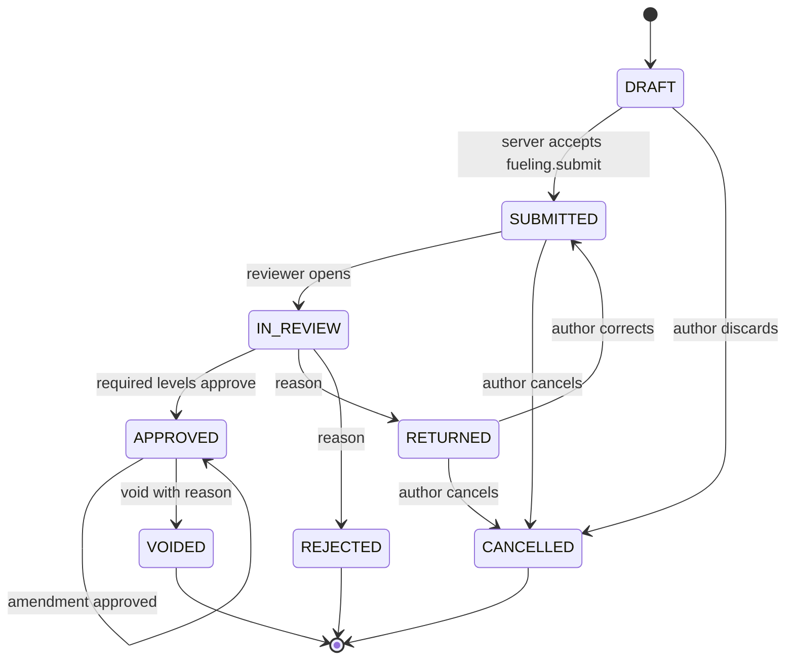

# Fuelings and consumption

Status: **PLANNED**, 2026-11-10. Module code(s) `FUEL`. Tasks: `EMP-FUEL-001…015` in [backlog/ep08-fuelings](../backlog/ep08-fuelings.md).

Evidence. The repository has a personal ledger (`backend/internal/modules/ledger/`, refuel, expense and charge records owned by one account, `IMPLEMENTED`, sale disabled) and a pure full-to-full consumption and purchase-cost engine (`backend/internal/modules/metrics/consumption.go` and `cost.go`, with Kotlin parity in `domain/src/main/kotlin/com/anpfuel/domain/premium/PremiumConsumption.kt`, `IMPLEMENTED`). The method is frozen in `docs/product/PREMIUM_FINANCIAL_METHOD.md` with shared vectors in `contracts/testdata/premium/financial-v1.json` and `financial-execution-v1.csv`. That engine computes distance intervals for one homogeneous liquid fuel and answers every other case with a named unknown reason; it has no hour-meter input. The wire product vocabulary (`backend/internal/modules/kernel/price.go`) has eight products and no additive. The station catalog (`backend/internal/modules/directory/`) is `IMPLEMENTED` and is only referenced here. Organization fuelings, hour-based intervals, trip allocation and the price reference snapshot are `PROPOSED`; no organization fueling table exists. Nothing was executed for this analysis, so behaviour statements about existing code are statements about source ([01-diagnosis](../01-diagnosis.md) §1).

## 1. Purpose

A company needs every supply of fuel, gas, electricity or additive to its assets recorded once, by the person who was there, with the evidence, and reviewed by someone else. From those reviewed facts it needs consumption and fuel cost per distance or per hour that it can trust, which means a figure appears only when the recorded facts support it. Users: drivers and operations staff record; supervisors, fleet managers and finance review; fleet managers read consumption. Expected result: a reviewed fueling history per asset, and consumption figures that show their basis or say why they cannot be computed.

## 2. Scope

The first operational cut contains only what a pilot needs to see a fueling travel from the field to a decision. Everything else is phase F3 or later.

| Capability | Where | Task |
|---|---|---|
| Product catalog, units, fill level, payer, payment method, place kinds (pure domain) | **Cut C1** | EMP-FUEL-001 |
| Persistence, `fueling.submit`, `fueling.correct` and `fueling.cancel` handlers, reading hand-off, arithmetic consistency warning | **Cut C1** | EMP-FUEL-002 |
| Single-level review: open, approve, return, reject, cancel | **Cut C1** | EMP-FUEL-003 |
| App: record a fueling offline with receipt photo and meter reading, mark ready to send | **Cut C1** | EMP-FUEL-011 |
| Panel: list, detail, review with the receipt viewer of [documents](documents.md) | **Cut C1** | EMP-FUEL-012 |
| Link to a catalog station, an organization supplier or "not found"; contracted supplier | F3 | EMP-FUEL-004 |
| Capacity tolerance and product compatibility warnings | F3 | EMP-FUEL-005 |
| Suspected duplicates | F3 | EMP-FUEL-006 |
| Consumption engine for distance and hours; projections and recalculation; retroactive entries | F3 | EMP-FUEL-007, 008, 013 |
| Price reference snapshot | F3 | EMP-FUEL-014 |
| Amendment, void and period lock | F3 | EMP-FUEL-015 |
| Several tanks, flex, CNG and electricity rules | F6 | EMP-FUEL-009 |
| Fuel allocated to trips; cost per distance or hour | F6 | EMP-FUEL-010 |

In cut C1 the place of a fueling is a typed name only, review has one level, and **no consumption figure is shown**; fill level and reading are already recorded so that the F3 engine can use C1 data.

Out of scope: fuelings paid with an agreement voucher (created by [station-commerce](station-commerce.md)); dispensing from an internal tank ([fuel-stock](fuel-stock.md) creates the internal fueling); reimbursement, budgets and payables ([expenses-finance](expenses-finance.md)); price comparison and findings ([intelligence](intelligence.md)); telemetry fuel sensors; any estimate of consumption from route, tank level or price.

## 3. Entities and ownership

Every entity belongs to one organization (BR-TEN-001). Names are proposed; the first persistence task freezes them.

| Entity | Owner | Content | Invariants |
|---|---|---|---|
| Fueling | Organization | Operating unit and cost centre (snapshot at creation), asset, tank or tank group, responsible employee, author membership, optional trip, effective instant with zone, meter reading reference or absence reason, product, quantity, optional unit price with original text, paid total, discount, fill level, payer, payment method, place (kind, optional station, optional supplier, typed name), optional contracted supplier, origin, review state, current revision, warnings | One product and one tank or tank group; unit fixed by product; organization never changes (BR-TEN-004); document links live in [documents](documents.md) |
| Fueling revision | Organization | Full field values, author, time, reason | Append-only; a review decision names a revision (BR-REV-007) |
| Fuel product (catalog `fuel-products-v1`) | Platform, code-defined and versioned | Key, category, unit, storage unit | A product has one category and one unit; a new product is a new catalog version |
| Warning | Organization | Fueling, code, computed values, reviewer note | Recomputed on each revision; never deleted |
| Duplicate suspicion | Organization | The two fuelings, matching signal, outcome, decider, reason | Decided once; never merges records |
| Declared gap | Organization | Asset, tank group, moment, reason, author | Created by a rejection or void marked "fuel entered the tank", or by a manager |
| Consumption interval (derived) | Organization | Asset, meter, tank group, opening and closing anchor, fuelings summed, usage, quantity, cost, state, reason, method version, input digest, revision | Rebuilt from facts; never edited by a person |
| Trip fuel allocation (derived) | Organization | Interval revision, trip or "no trip", usage share, quantity and cost parts | Parts sum exactly to the interval totals (BR-MONEY-007) |
| Price reference snapshot | Organization | Fueling, one row per source: value or unavailable reason, product, unit, place, period, payment condition, sample size, method version, capture time | Written once; never rewritten |

Fuel product catalog, version 1:

| Key | Category | Unit shown | Stored as | Fuel family |
|---|---|---|---|---|
| `ETHANOL` | `LIQUID_FUEL` | L | millilitres | Ethanol |
| `GASOLINE_REGULAR`, `GASOLINE_ADDITIVED`, `GASOLINE_PREMIUM_GRADE` | `LIQUID_FUEL` | L | millilitres | Gasoline |
| `DIESEL_S10`, `DIESEL_S500` | `LIQUID_FUEL` | L | millilitres | Diesel |
| `CNG` | `GAS_FUEL` | m³ | milli-cubic-metres | Natural gas |
| `ELECTRICITY` | `ELECTRICITY` | kWh | watt-hours | Electric |
| `ARLA_32` | `ADDITIVE` | L | millilitres | none: an additive, not a fuel |

The first seven keys reuse the existing wire vocabulary; its eighth key, `LPG_P13`, is cooking gas sold by cylinder and is not a fueling product. `ELECTRICITY` and `ARLA_32` are new and exist only in organization records. Liquefied gas sold by mass (for example for forklifts) is not in version 1, because no mass unit is defined in BR-MONEY-002.

## 4. Business rules

Record content:

- **BR-FUEL-001 — One supply, one fueling.** A fueling records one product put into one tank or tank group of one asset at one moment; two products bought at the same stop are two fuelings, which may share one document.
- **BR-FUEL-002 — Required to submit.** Asset, responsible employee, effective instant with time zone, product, quantity, paid total, fill level, and a meter reading or the reason for its absence are required; unit price, discount, tank, trip, place link and contracted supplier are optional.
- **BR-FUEL-003 — The product fixes the unit.** A quantity is always in the unit of its product; a payload stating another unit is refused with `PRODUCT_UNIT_MISMATCH`.
- **BR-FUEL-004 — Additives are not fuel.** A fueling of category `ADDITIVE` has quantity and cost, never anchors or enters a fuel consumption interval, and never adds to a fuel volume.
- **BR-FUEL-005 — Quantities do not mix.** Quantities are totalled per product; a total across products is allowed only inside one category and unit, is labelled "volume purchased" and never feeds a ratio; quantities in different units are never added (BR-MONEY-009).
- **BR-FUEL-006 — Fill level is declared.** A fueling states `FULL`, `PARTIAL` or `UNKNOWN`; `UNKNOWN` is treated as `PARTIAL`, and no quantity, however large, is ever assumed to be a full tank.
- **BR-FUEL-007 — The reading is evidence in the fleet module.** The reading given with a fueling is recorded through the reading intake of [fleet](fleet.md) with the fueling as its source, in the same transaction, and stays append-only there; a reading that the fleet module marks `SUSPECT` does not refuse the fueling.
- **BR-FUEL-008 — Amounts.** Paid total, discount and the optional unit price follow BR-MONEY-001 to BR-MONEY-006: the paid total is never recomputed, a unit price with more than three decimals keeps its original text, and a difference above one centavo sets the warning `ARITHMETIC_MISMATCH` without refusing the record.
- **BR-FUEL-009 — Payer and payment method.** A fueling states who paid (`COMPANY` or `EMPLOYEE`) and one payment method from a closed list; "paid by the employee" only informs [expenses-finance](expenses-finance.md), which owns reimbursement.
- **BR-FUEL-010 — One cost.** A fueling produces exactly one expense (EDR-013); a payment, a card statement line or a document never creates a second cost for it.

Place and supplier roles:

- **BR-FUEL-011 — Three independent supplier roles.** The fueling establishment (where it happened), the document issuer (read from the document in [documents](documents.md)) and the contracted supplier (who holds the commercial relation) are separate optional references; a difference between them is shown and never corrected automatically.
- **BR-FUEL-012 — The public station link is optional.** The establishment is one of: a catalog station by reference, an organization supplier, an internal tank, or "not found" with a typed name; a fueling is complete without a public station.
- **BR-FUEL-013 — No public station is created.** Recording, reviewing or amending a fueling never creates, edits, merges or suggests a station in the public catalog (BR-SRC-004); linking a fueling to a catalog station later changes only the fueling.
- **BR-FUEL-014 — No device coordinates.** A fueling stores no device location; the place is chosen from a list or typed (BR-PRIV-006).

Warnings:

- **BR-FUEL-015 — Capacity tolerance.** A quantity above the tank capacity multiplied by one plus the tolerance sets the warning `OVER_CAPACITY`; the tolerance defaults to 5 % (organization range 0 to 15 %); the fueling is kept for the reviewer and never refused for it.
- **BR-FUEL-016 — Product compatibility.** A product that is not among the tank's accepted products sets the warning `PRODUCT_NOT_ACCEPTED`; the fueling is kept for the reviewer, and if it is approved the intervals it touches follow BR-FUEL-030.
- **BR-FUEL-017 — Warnings inform, people decide.** A warning never blocks recording in the field; approving a fueling that carries a warning requires one reviewer note per warning.

Resends and duplicates:

- **BR-FUEL-018 — A resend is not a duplicate.** The same operation identifier with the same payload returns the stored acknowledgement, creates nothing and raises no suspicion (BR-OFFL-004).
- **BR-FUEL-019 — Suspected duplicates are flagged, never merged.** Two different fuelings of the same asset and product are both flagged `SUSPECTED_DUPLICATE` when (a) their effective instants are within the window (default 30 minutes, range 5 to 240) and their quantity or their paid total is equal, or (b) they share reporting day, quantity and paid total; the system never merges, rejects, returns or hides either one.
- **BR-FUEL-020 — A person decides a suspicion.** A reviewer records "both valid" with a reason, or returns, rejects or voids one of the two; a flagged fueling cannot be approved while its suspicion is undecided.

Review and corrections:

- **BR-FUEL-021 — Review lifecycle.** Fuelings follow BR-REV-001 to BR-REV-009 with the states of §6; the reviewer is never the author, the responsible employee or the employee who paid (BR-REV-003).
- **BR-FUEL-022 — Retroactive entry.** A fueling may be recorded after the fact with its real effective instant; it takes its place in the asset's sequence by reading and instant, gets the warning `LATE_ENTRY` when received more than the limit after it occurred (default 7 days, range 0 to 90), and follows BR-AMD-004 when its reporting day is locked.
- **BR-FUEL-023 — Approved history is preserved.** A change to an approved fueling is an amendment and a removal is a void (BR-AMD-001 to BR-AMD-006); every revision, decision and reason stays readable.
- **BR-FUEL-024 — Personal ledger stays personal.** No flow copies, links, imports or converts a personal ledger record into an organization fueling, or the reverse (BR-TEN-004, BR-SRC-003).

Consumption method `fuel-consumption-v1`:

- **BR-FUEL-025 — Full-to-full only.** A consumption figure exists only for an interval between two consecutive anchors of the same asset, tank group and meter segment (EDR-011).
- **BR-FUEL-026 — Anchor.** An anchor is an approved fueling of a fuel product with fill level `FULL` and a `VALID` meter reading.
- **BR-FUEL-027 — What an interval sums.** Quantity and cost sum every fueling ordered after the opening anchor up to and including the closing anchor; the opening anchor's quantity and cost are excluded; usage is the closing reading minus the opening reading.
- **BR-FUEL-028 — Every fueling in the span needs a valid reading.** If any fueling in the span has no reading, or a `SUSPECT` or `VOIDED` one, the interval is `INSUFFICIENT_DATA` with reason `READING_MISSING` or `READING_SUSPECT`.
- **BR-FUEL-029 — Everything in the span must count.** If a fueling in the span is not yet approved, or fuel is known to have entered the tank without an approved record (a declared gap), the interval is `INSUFFICIENT_DATA` with reason `PENDING_REVIEW` or `DECLARED_GAP`.
- **BR-FUEL-030 — One product per interval.** An interval whose opening anchor and summed fuelings are not all the same product is `INSUFFICIENT_DATA` with reason `MIXED_PRODUCTS`; an interval of `CNG` is `INSUFFICIENT_DATA` with reason `CNG_METHOD_UNSUPPORTED`.
- **BR-FUEL-031 — No naive division.** The distance or hours since the previous fueling divided by the quantity of one fueling is never computed, stored or shown; where no interval is computed the screen shows the limitation and its reason (BR-TRUTH-003).
- **BR-FUEL-032 — Ratios from sums.** A figure for several intervals or assets divides summed usage by summed quantity (BR-MONEY-008); intervals in `INSUFFICIENT_DATA` are left out and their count is shown beside the figure.
- **BR-FUEL-033 — Recalculation creates revisions.** A change to a fueling, a reading, a review state, a declared gap or a tank in a span recomputes the affected intervals; a changed result is a new revision and the previous one becomes `SUPERSEDED` (BR-TRUTH-004, BR-AMD-005).
- **BR-FUEL-034 — Figures show their basis.** Every figure shows method version, anchors, usage, quantity, cost and the number of fuelings summed; a figure that includes records not yet approved is a separate view labelled "includes pending" (BR-REV-009).
- **BR-FUEL-035 — Shared usage.** For an asset whose two energy sources share one meter (natural gas plus a liquid, or electricity plus a liquid), per-product ratios are `INSUFFICIENT_DATA` with reason `SHARED_USAGE`; quantities and paid totals per product stay exact.
- **BR-FUEL-036 — Tank group anchors.** In an asset with several tanks for one product, an anchor exists only when every tank of the group is full at the same reading; otherwise those fuelings count as partial.
- **BR-FUEL-037 — Trip allocation is an attribution.** Quantity and cost of a computed interval are divided among trips by each trip's share of the interval usage with the largest-remainder rule of BR-MONEY-007; the result is labelled "allocated", never "measured", and a trip that touches an interval in `INSUFFICIENT_DATA` shows that state.
- **BR-FUEL-038 — Purchased is not consumed.** The sum of the fuelings linked to a trip is shown as "purchased during the trip"; it is never presented as that trip's consumption and never added to the allocated figure.

Price reference:

- **BR-FUEL-039 — The price reference is stored once.** When the server accepts a fueling it stores, per price source, the reference available at that moment with product, unit, place, period, payment condition, sample size and method version, or "unavailable" with a reason; sources are never merged (BR-SRC-001) and the snapshot is never rewritten.

## 5. Use cases

**UC-FUEL-01 — Record a fueling offline.** Actor: member with `fuel.fueling.record`, in enterprise mode. Preconditions: device enrolled; the asset is in the cached list of assets the member may use. Main flow: choose the asset (the trip in progress is prefilled) → product, quantity, paid total, fill level, reading → optional unit price, discount, place and payment → photograph the receipt ([documents](documents.md)) → mark ready to send → the operation `fueling.submit` is written to the queue and shown as "Salvo no aparelho" → at the next connection the server accepts it, the record becomes `SUBMITTED` and the receipt bytes follow (BR-OFFL-015). Alternatives: reading unavailable → the member states why and the fueling is still accepted; arithmetic, capacity or product warning → shown, not blocking; trip refused or missing on the server → accepted for review with the trip link removed (`ORPHAN_REFERENCE`); asset no longer available to the member → accepted for review ([10-offline-sync](../10-offline-sync.md) §10.2). Result: one fueling, created once, awaiting review.

**UC-FUEL-02 — Review a fueling.** Actor: member with `fuel.fueling.review` whose scope covers the record. Preconditions: fueling `SUBMITTED`; the reviewer is not its author, responsible employee or payer. Main flow: open the fueling (`IN_REVIEW`) → compare the fields with the receipt and the reading with its neighbours → read the warnings → approve, return with a reason, or reject with a reason. Alternatives: own record → `SELF_APPROVAL`; another reviewer decided first → `CONFLICT` and nothing changes; warning present → a note per warning is required to approve; undecided duplicate suspicion → decide it first (UC-FUEL-07); rejecting → the reviewer states whether fuel entered the tank. Result: `APPROVED`, `RETURNED` or `REJECTED`, audited, and the author sees it at the next sync.

**UC-FUEL-03 — Correct a returned fueling.** Actor: the author. Preconditions: fueling `RETURNED`. Main flow: open the reviewer's reason → edit fields or replace the receipt → resubmit (`fueling.correct` with the expected revision), offline if needed. Alternatives: the record changed meanwhile → accepted for review with `STALE_REVISION`, both versions shown; the author gives up → cancel. Result: a new revision, `SUBMITTED` again; the previous revision is kept.

**UC-FUEL-04 — Cancel before approval.** Actor: the author. Preconditions: `SUBMITTED` or `RETURNED` on the server, or a draft on the device. Main flow: cancel with an optional reason. Alternatives: already `IN_REVIEW` or decided → refused with `FUELING_NOT_CANCELLABLE`. Result: `CANCELLED`; the reading it carried stays in [fleet](fleet.md) and is marked there for a check.

**UC-FUEL-05 — Record where the supplier is not found.** Actor: as UC-FUEL-01 or a manager in the panel. Main flow: search the place → nothing fits → choose "não encontrei o local" and type a name → continue. Later a member with `fuel.fueling.read` and `fleet.supplier.manage` may link the fueling to an organization supplier or to a catalog station. Alternatives: fueling from an internal tank → chosen from the tank list, no public place at all. Result: a complete fueling with no public station; the catalog is unchanged (BR-FUEL-013).

**UC-FUEL-06 — Enter a retroactive fueling.** Actor: the employee, or a member whose `fuel.fueling.record` scope covers the asset, in the app or the panel. Main flow: record the fueling with its real date, time and the reading taken then → the server places it in the asset's sequence → intervals from that point are recomputed. Alternatives: reading not between its neighbours → the fleet module marks it `SUSPECT` and the span becomes `INSUFFICIENT_DATA`; received after the late limit → warning `LATE_ENTRY`; reporting day locked → accepted for review with `PERIOD_LOCKED`. Result: the history is complete and the affected figures carry a new revision.

**UC-FUEL-07 — Decide a suspected duplicate.** Actor: reviewer. Preconditions: two fuelings flagged. Main flow: open them side by side with their documents and the matching signal → record "both valid" with a reason, or return, reject or void one. Alternatives: the two share one document → the reviewer checks the allocation in [documents](documents.md). Result: the suspicion keeps its outcome; nothing was merged.

**UC-FUEL-08 — Amend or void an approved fueling.** Actor: member with `fuel.fueling.amend`. Preconditions: fueling `APPROVED`. Main flow: propose the changed fields with a reason → the amendment is reviewed by someone else → on approval the new revision takes effect and intervals, expense and findings are recomputed. Alternatives: void instead of amend, stating whether fuel entered the tank; reporting day in a locked period → `PERIOD_LOCKED` until an authorized reopening, or an adjustment in the open period (BR-AMD-004). Result: the previous revision stays readable; derived data shows a new revision.

**UC-FUEL-09 — Compute and read consumption.** Actor: system job; reader with `fuel.fueling.read`. Main flow: after any relevant change the job rebuilds the intervals of the asset and tank group → the reader opens the asset's consumption → each interval shows its figure and basis, or `INSUFFICIENT_DATA` with the reason in plain language. Alternatives: fewer than two anchors → "São necessários dois abastecimentos de tanque cheio com leitura"; reader asks for a period total → sums first, divides once, and states how many intervals were left out. Result: figures with their basis, never a default number.

**UC-FUEL-10 — Allocate fuel to trips.** Actor: system job. Preconditions: interval `COMPUTED`; trips of the asset with start and end readings inside the interval. Main flow: split the interval usage among trips and "no trip" → divide quantity and cost by those shares → store the parts. Alternatives: a trip crosses an anchor → it receives a part from each interval; one of them is not computed → the trip shows `INSUFFICIENT_DATA`. Result: allocated fuel and cost per trip, labelled as an attribution.

**UC-FUEL-11 — Store the price reference.** Actor: system, when a fueling is accepted. Main flow: for each price source read the reference for the product and place → store value and basis, or "unavailable" with the reason. Result: a fixed snapshot that [intelligence](intelligence.md) compares later.

## 6. States and transitions

Fueling, review state (BR-REV states plus `VOIDED`; names from [08-state-model](../08-state-model.md) §3). Sync state is a separate field (BR-REV-001).

| From | To | Actor | Validation | Effect | Reversal |
|---|---|---|---|---|---|
| — | `DRAFT` | Author with `fuel.fueling.record` | Field validation on the device or in the panel form | Exists only on the device or in the form; the server stores a fueling from `SUBMITTED` onward | Discard |
| `DRAFT` | `SUBMITTED` | Server, on accepting `fueling.submit` | BR-FUEL-002, BR-FUEL-003; authorization at receipt (BR-OFFL-008) | Record and revision 1 created; reading handed to fleet; warnings computed; review case opened; price reference stored | Author cancels |
| `SUBMITTED` | `IN_REVIEW` | Reviewer with `fuel.fueling.review` | Scope covers the record; BR-REV-003 | The reviewer checks the record against its evidence | None; the reviewer decides |
| `SUBMITTED`, `RETURNED` | `CANCELLED` | Author | Not `IN_REVIEW` | Terminal; out of costs; the reading is marked for a check in fleet | None; a new fueling is recorded |
| `IN_REVIEW` | `APPROVED` | Reviewer | BR-REV-004, BR-REV-007, BR-REV-008; BR-FUEL-017; BR-FUEL-020 | Counts in costs and indicators; intervals recomputed | Amendment or void |
| `IN_REVIEW` | `RETURNED` | Reviewer | Reason required | Author notified | Author resubmits |
| `IN_REVIEW` | `REJECTED` | Reviewer | Reason required; states whether fuel entered the tank | Terminal; out of costs; "fuel entered the tank" creates a declared gap | None; a new fueling is recorded |
| `RETURNED` | `SUBMITTED` | Author, `fueling.correct` | Expected revision is current | New revision; warnings recomputed | — |
| `APPROVED` | `APPROVED` (next revision) | Member with `fuel.fueling.amend`, approved by another reviewer | BR-AMD-001, BR-AMD-002, BR-AMD-004; reason | The previous revision stays in effect until the amendment is approved; then derived data is recomputed | A further amendment |
| `APPROVED` | `VOIDED` | Member with `fuel.fueling.amend` | Reason; BR-AMD-003, BR-AMD-004; states whether fuel entered the tank | Out of costs and indicators from then on; history kept; intervals recomputed | None; a new fueling is recorded |

Consumption interval (derived):

| From | To | Actor | Validation | Effect | Reversal |
|---|---|---|---|---|---|
| — | `COMPUTED` | Recalculation job | Two anchors and BR-FUEL-026 to BR-FUEL-030 hold | Revision stored with its basis and input digest | Superseded by a later revision |
| — | `INSUFFICIENT_DATA` | Recalculation job | One condition fails | Revision stored with exactly one reason; no number | Superseded when inputs change |
| `COMPUTED`, `INSUFFICIENT_DATA` | `SUPERSEDED` | Recalculation job | Input digest changed | The new revision becomes current; the old one stays readable | None |

## 7. Roles and permissions

| Action | Permission | Scope notes |
|---|---|---|
| Record, correct and cancel a fueling | `fuel.fueling.record` (reading through `meter.reading.record`, receipt through `doc.document.attach`) | Own records and assigned assets; a role assigned on a unit records for assets of that unit and names another employee as responsible |
| Read fuelings, warnings, intervals and trip allocations | `fuel.fueling.read` | Scope uses the unit, cost centre and asset stored on the fueling (BR-AUTH-005) |
| Open the receipt content | `doc.document.view_content` | Separate permission, audited (BR-AUTH-011) |
| Approve, return, reject; decide a duplicate suspicion; resolve a fueling held by sync | `fuel.fueling.review` | Never on a record the member authored, is responsible for or paid (BR-REV-003) |
| Amend, void, declare a gap | `fuel.fueling.amend` | A record in a locked period also needs an authorized reopening (`fin.period.reopen`, [expenses-finance](expenses-finance.md)) |
| Link a fueling to an organization supplier | `fuel.fueling.read` and `fleet.supplier.manage` | — |

Which role holds each key is the matrix in [07-permissions](../07-permissions.md) §7.3. The capability of the organization's plan is checked on every write; a capability turned off keeps reads and exports ([09-architecture](../09-architecture.md) §10).

## 8. Offline, concurrency, idempotency and corrections

- **Offline.** Recording, correcting a returned fueling and cancelling work offline; review, amendment and void are online ([10-offline-sync](../10-offline-sync.md) §10.3). Capacity, duplicate and price reference checks run on the server at receipt; the device shows the arithmetic and capacity warnings it can compute from cached data.
- **Operations.** `fueling.submit` carries the whole record and the reading; it lists the trip's start operation as a dependency only when the trip was created on the same device and not yet accepted. The trip reference is a soft reference (BR-OFFL-007). Receipt attachments are declared in the operation and their bytes follow.
- **Idempotency.** One acknowledgement per operation identifier (BR-OFFL-004). The record identifier is the device UUID (BR-OFFL-001), so a resend after a lost answer can never create a second fueling.
- **Concurrency.** A review decision and an amendment name the revision they act on; the loser of a race receives `CONFLICT`. The submit handler locks the asset's fueling sequence while it checks duplicates, so two similar fuelings arriving together are both stored and both flagged.
- **Recalculation.** One job per asset and tank group, de-duplicated by that key, rebuilds intervals from the earliest changed position. It is safe to re-run: an interval gets a new revision only when its input digest changes.
- **Corrections.** Before approval a change is an edit with revision history (BR-AMD-006). After approval it is an amendment or a void. A wrong reading is corrected in [fleet](fleet.md), and that correction triggers recalculation here.

## 9. Events, notifications and integrations

Produced: `fuel.fueling.submitted`, `fuel.fueling.approved`, `fuel.fueling.returned`, `fuel.fueling.rejected`, `fuel.fueling.cancelled`, `fuel.fueling.amended`, `fuel.fueling.voided`, `fuel.fueling.flagged`, `fuel.suspicion.decided`, `fuel.interval.computed`, `fuel.interval.superseded`. Consumed, with names defined by the owning modules: reading recorded, corrected or voided and meter replaced or reset ([fleet](fleet.md)); trip readings fixed or changed ([trips](trips.md)); review decisions and period locks ([expenses-finance](expenses-finance.md)); document linked or replaced ([documents](documents.md)); redemption confirmed ([station-commerce](station-commerce.md)); dispensing recorded ([fuel-stock](fuel-stock.md)). Notifications: the author when a fueling is returned, rejected, approved or held for review; reviewers by digest when their queue grows ([imports-notifications-integrations](imports-notifications-integrations.md)). Integrations: the existing consumption engine through a port; read-only ports to `directory`, `official` and `community` for the place and the price reference. No external service.

## 10. Data, formulas and examples

### 10.1 Fields, units and precision

| Field | Type and unit | Bounds (BR-MONEY-010) | Shown as |
|---|---|---|---|
| Quantity | Integer millilitres, milli-cubic-metres or watt-hours, by product | 1 to 10⁹ | Three decimals of L, m³ or kWh |
| Unit price | Integer milli-BRL per L, m³ or kWh; optional; original decimal text kept when the source has more decimals | 1 to 10⁶ | Three decimals; "derivado" when computed from paid total and quantity |
| Paid total, discount | Integer centavos | 0 to 10¹² | Two decimals |
| Reading | Integer metres (odometer) or seconds (hour meter), owned by fleet | 0 to 10¹² | Whole km, or hours with one decimal |
| Effective instant | UTC instant, IANA zone, device offset (BR-TIME-001) | — | Local time of the operating unit |
| Ratios | Exact rationals of sums | — | Two decimals, half-up, only at display (BR-MONEY-008) |

Closed lists. Fill level: `FULL`, `PARTIAL`, `UNKNOWN`. Payer: `COMPANY`, `EMPLOYEE`. Payment method: `CASH`, `PIX`, `DEBIT_CARD`, `CREDIT_CARD`, `FUEL_CARD`, `SUPPLIER_ACCOUNT`, `AGREEMENT_VOUCHER`, `INTERNAL_STOCK`, `OTHER`. Place kind: `CATALOG_STATION`, `ORG_SUPPLIER`, `INTERNAL_TANK`, `NOT_FOUND`. Origin: `APP`, `PANEL`, `IMPORT`, `AGREEMENT`, `INTERNAL_TANK`.

### 10.2 Unit price times quantity

The check is BR-MONEY-005: `expected_cents = round_half_up(quantity × unit_price_milli / 10 000)` and `gross_cents = paid_cents + discount_cents`; consistent when `|gross_cents − expected_cents| ≤ 1`.

- 37.415 L at R$ 5.899: `37 415 × 5 899 = 220 711 085`; `/ 10 000 = 22 071.1085`; expected 22 071 centavos (R$ 220.71). Paid R$ 220.71: consistent. Paid R$ 220.72: difference 1, consistent. Paid R$ 215.71 with R$ 5.00 discount: `21 571 + 500 = 22 071`, consistent. Paid R$ 221.00 with no discount: difference 29, warning `ARITHMETIC_MISMATCH`; the record keeps 22 100 centavos as paid.
- 30.000 kWh at R$ 1.950: `30 000 × 1 950 / 10 000 = 5 850` centavos (R$ 58.50).
- No unit price given, 40.000 L and R$ 236.00 paid: derived unit price `23 600 × 10 000 / 40 000 = 5 900` milli-BRL, shown as "R$ 5,900/L (derivado)".

A surcharge charged with the fuel has no field in a fueling. If the paid total includes one, the warning appears and the reviewer notes the reason; the surcharge itself is treated in [documents](documents.md) and [expenses-finance](expenses-finance.md).

### 10.3 Capacity and duplicates

Capacity: tank of 300.000 L, tolerance 5 %: limit `300 000 × 105 / 100 = 315 000` mL. A fueling of 310.000 L has no warning. A fueling of 320.000 L gets `OVER_CAPACITY` (`320 000 > 315 000`) and is still accepted.

Duplicates, same asset, `DIESEL_S10`, window 30 minutes:

| Fueling | Instant | Quantity | Paid | Result |
|---|---|---|---|---|
| A, operation `op-1` | 13:42 | 150.000 L | R$ 973.50 | Accepted |
| A again, operation `op-1`, same payload | — | — | — | Stored acknowledgement returned; no new record, no flag (BR-FUEL-018) |
| B, new record, operation `op-2` | 13:47 | 150.000 L | R$ 973.50 | Accepted; A and B flagged `SUSPECTED_DUPLICATE`, signal (a) |
| C, new record, operation `op-3` | 13:50 | 80.000 L | R$ 519.20 | Accepted; no flag: quantity and paid total both differ |

B may be a real second sale (a pump limit, a second tank), so a person decides (BR-FUEL-020). `80 000 × 6 490 / 10 000 = 51 920`.

### 10.4 Consumption method

Definitions. A **meter segment** is the run of readings of one meter between replacements or resets ([fleet](fleet.md)); an interval never crosses one. A **tank group** is the set of tanks of an asset that accept the same products. The **sequence** of an asset and tank group orders its fuelings by reading, then effective instant, then identifier. The **span** of an interval is every fueling in the sequence after the opening anchor up to and including the closing anchor. The fuelings after the last anchor, or all of them when the asset has no anchor yet, form an **open interval**, which is always `INSUFFICIENT_DATA` with `ANCHORS_REQUIRED`.

Formulas, all from the interval sums (`usage` in metres or seconds, `quantity` in millilitres, `cost` in centavos):

| Figure | Formula | Unit |
|---|---|---|
| Distance per volume | `usage_m ÷ quantity_ml` | km/L |
| Volume per 100 km | `quantity_ml × 100 ÷ usage_m` | L/100 km |
| Volume per hour | `quantity_ml × 3 600 ÷ (usage_s × 1 000)` | L/h |
| Fuel cost per distance | `cost_cents × 1 000 ÷ usage_m` | centavos/km |
| Fuel cost per hour | `cost_cents × 3 600 ÷ usage_s` | centavos/h |

An asset with an odometer and an hour meter gets one interval per meter from the same anchors; each ratio uses its own meter. Fuel cost is the paid total of the fuelings summed, a purchase-based figure as in the existing method; total operating cost belongs to [intelligence](intelligence.md).

Reasons for `INSUFFICIENT_DATA` (exactly one per interval, first match in this order) and the existing engine reason each one maps to:

| Reason | Condition | Existing engine reason |
|---|---|---|
| `OUT_OF_BOUNDS` | A value outside BR-MONEY-010 | `input-out-of-bounds` |
| `READING_MISSING` | A fueling of the span has no reading | `odometer-missing` |
| `READING_SUSPECT` | A reading of the span is `SUSPECT` or `VOIDED` | `odometer-missing` |
| `DECLARED_GAP` | Fuel entered the tank without an approved record | `declared-fill-gap` |
| `METER_SEGMENT_BOUNDARY` | The meter was replaced or reset inside the span | `odometer-segment-boundary` |
| `USAGE_NOT_POSITIVE` | Closing reading not above the opening reading | `distance-nonpositive` |
| `CNG_METHOD_UNSUPPORTED` | The product is `CNG` | `unsupported-gnv-method` |
| `METHOD_NOT_AVAILABLE` | Electricity before the F6 task adopts the existing energy method | new |
| `MIXED_PRODUCTS` | More than one product among the opening anchor and the span | `unsupported-mixed-method` |
| `SHARED_USAGE` | Two energy sources share the meter | new (the personal energy engine has `phev-shared-distance`) |
| `TANK_GROUP_NOT_ANCHORED` | Several tanks, not all full at an anchor | new |
| `PENDING_REVIEW` | A fueling of the span is `SUBMITTED`, `IN_REVIEW` or `RETURNED` | new |
| `ANCHORS_REQUIRED` | Fewer than two anchors: first record, partial fuelings only, or a trailing partial | `full-anchors-required` |

The existing reason `incompatible-unit` cannot occur here, because a quantity in the wrong unit is refused when the fueling is submitted (BR-FUEL-003).

### 10.5 Worked examples

**A. The existing example, reused unchanged.** Car, `ETHANOL`, odometer.

| Fueling | Reading | Fill | Quantity | Paid | Role |
|---|---|---|---|---|---|
| 1 (first record of the asset) | 1 000 km | `FULL` | 50.000 L | R$ 300.00 | Opening anchor; excluded |
| 2 | 1 180 km | `PARTIAL` | 20.000 L | R$ 120.00 | Summed |
| 3 | 1 400 km | `FULL` | 20.000 L | R$ 124.00 | Closing anchor; summed |

Usage `1 400 000 − 1 000 000 = 400 000` m. Quantity `20 000 + 20 000 = 40 000` mL. Cost `12 000 + 12 400 = 24 400` centavos. Distance per volume `400 000 ÷ 40 000 = 10` km/L. Volume per 100 km `40 000 × 100 ÷ 400 000 = 10` L/100 km. Cost per distance `24 400 × 1 000 ÷ 400 000 = 61` centavos, R$ 0.61 per km. With a discounted paid total of R$ 230.00 the cost is `23 000 × 1 000 ÷ 400 000 = 57.5` centavos, shown as R$ 0.58, and the stored 23 000 centavos do not change. The reading of fueling 2 is added here; the original example does not state it.

What is never shown: at fueling 2, `180 km ÷ 20 L = 9 km/L`; at fueling 3, `220 km ÷ 20 L = 11 km/L`. Both are the naive division of BR-FUEL-031 and both are wrong. Until fueling 3 exists, the asset shows `INSUFFICIENT_DATA` with `ANCHORS_REQUIRED`, and fueling 1 counts in spend and volume totals only.

**B. A machine measured in hours.** Excavator, `DIESEL_S10`, hour meter.

| Fueling | Reading | Fill | Quantity | Unit price | Paid |
|---|---|---|---|---|---|
| 1 | 2 350.0 h = 8 460 000 s | `FULL` | 180.000 L | — | excluded |
| 2 | 2 362.5 h = 8 505 000 s | `PARTIAL` | 60.000 L | R$ 6.200 | R$ 372.00 |
| 3 | 2 375.0 h = 8 550 000 s | `FULL` | 140.000 L | R$ 6.250 | R$ 875.00 |

Checks: `60 000 × 6 200 / 10 000 = 37 200`; `140 000 × 6 250 / 10 000 = 87 500`. Usage `8 550 000 − 8 460 000 = 90 000` s (25 h). Quantity `60 000 + 140 000 = 200 000` mL. Cost `37 200 + 87 500 = 124 700` centavos. Volume per hour `200 000 × 3 600 ÷ (90 000 × 1 000) = 8` L/h. Cost per hour `124 700 × 3 600 ÷ 90 000 = 4 988` centavos, R$ 49.88 per hour. No km-based figure exists for this asset.

**C. An interval invalidated by a missing reading.** Truck, `DIESEL_S10`, all fuelings approved.

| Fueling | Reading | Fill | Quantity | Paid |
|---|---|---|---|---|
| 1 | 52 000 km | `FULL` | 210.000 L | R$ 1 365.00 |
| 2 | none: "painel apagado" | `PARTIAL` | 80.000 L | R$ 520.00 |
| 3 | 52 900 km | `FULL` | 150.000 L | R$ 975.00 |
| 4 | 53 400 km | `FULL` | 200.000 L | R$ 1 300.00 |

Interval 1→3: fueling 2 is in the span without a reading, so the interval is `INSUFFICIENT_DATA` with `READING_MISSING` and no number is shown; the declared time of fueling 2 is evidence of where it belongs, not proof (BR-OFFL-009). Interval 3→4 is unaffected: usage `500 000` m, quantity `200 000` mL, `500 000 ÷ 200 000 = 2.5` km/L, `200 000 × 100 ÷ 500 000 = 40` L/100 km, cost `130 000 × 1 000 ÷ 500 000 = 260` centavos, R$ 2.60 per km. If an authorized member later records in fleet the reading 52 380 km for fueling 2, interval 1→3 gets revision 2: `900 000 ÷ 230 000 = 90/23`, shown as 3.91 km/L, and revision 1 becomes `SUPERSEDED`.

**D. A correction that triggers recalculation.** Van, `GASOLINE_REGULAR`. Opening anchor at 20 000 km. Closing anchor at 20 472 km, approved as 48.000 L and R$ 236.00 paid, no unit price.

- Interval revision 1: `472 000 ÷ 48 000 = 59/6`, shown as 9.83 km/L; cost `23 600 × 1 000 ÷ 472 000 = 50` centavos per km.
- Finance sees 40.000 L on the receipt and submits an amendment with the reason "quantidade digitada: 48 em vez de 40". Until another reviewer approves it, revision 1 stays in effect (BR-AMD-002).
- After approval, fueling revision 2 has 40 000 mL and a derived unit price of `23 600 × 10 000 / 40 000 = 5 900` milli-BRL. Interval revision 2: `472 000 ÷ 40 000 = 11.8` km/L; cost per km stays 50 centavos because the paid total did not change. Interval revision 1 becomes `SUPERSEDED`.
- The next interval, which opens at this fueling, excludes the opening anchor's quantity; its input digest is unchanged and it gets no new revision.

**E. Fuel allocated to trips inside one interval.** Truck, `DIESEL_S10`. Opening anchor at 80 000 km. Partial of 80.000 L, R$ 528.00, at 80 300 km. Closing anchor of 120.000 L, R$ 792.00, at 80 600 km. Checks at R$ 6.600: `80 000 × 6 600 / 10 000 = 52 800`; `120 000 × 6 600 / 10 000 = 79 200`. Interval: usage 600 000 m, quantity 200 000 mL, cost 132 000 centavos, `600 000 ÷ 200 000 = 3` km/L, `132 000 × 1 000 ÷ 600 000 = 220` centavos per km.

| Line | Trip | Readings | Usage | Quantity exact | Quantity allocated | Cost allocated |
|---|---|---|---|---|---|---|
| 1 | T1 | 80 000 → 80 250 | 250 km | 83 333.33 mL | 83 334 mL | 55 000 centavos |
| 2 | T2 | 80 250 → 80 430 | 180 km | 60 000 mL | 60 000 mL | 39 600 centavos |
| 3 | T3 | 80 440 → 80 600 | 160 km | 53 333.33 mL | 53 333 mL | 35 200 centavos |
| 4 | no trip | 80 430 → 80 440 | 10 km | 3 333.33 mL | 3 333 mL | 2 200 centavos |

Usage `250 + 180 + 160 + 10 = 600` km. Quantity: `200 000 × 250 / 600 = 83 333.33`; floors `83 333 + 60 000 + 53 333 + 3 333 = 199 999`; one millilitre remains; lines 1, 3 and 4 tie on the remainder, so line 1 receives it; total `83 334 + 60 000 + 53 333 + 3 333 = 200 000`. Cost: `132 000 × 250 / 600 = 55 000`, `× 180 / 600 = 39 600`, `× 160 / 600 = 35 200`, `× 10 / 600 = 2 200`; total 132 000. Every trip shows the interval's 3 km/L by construction, which is why the figure is labelled "alocado" and not "medido". The partial fueling was recorded during T2, so T2 also shows "comprado durante a viagem: R$ 528,00", a different number that is never added to the R$ 396,00 allocated (BR-FUEL-038).

**F. Two assets, one figure.** 100 km on 10 L and 900 km on 60 L: `1 000 000 ÷ 70 000 = 100/7`, shown as 14.29 km/L. The mean of 10 and 15 km/L, 12.5, is never used (BR-FUEL-032).

### 10.6 What can and cannot be computed

| Asset | Computed | Not computed, with the reason shown |
|---|---|---|
| One liquid fuel, one tank | Distance per volume, volume per 100 km or per hour, fuel cost per distance or hour, trip allocation | — |
| Flex (ethanol and gasoline in one tank) | Quantity and paid total per product; ratios for intervals in which the opening anchor and every fueling are the same product | An interval that mixes products: `MIXED_PRODUCTS`. No "ethanol against gasoline" efficiency is inferred from mixed intervals |
| Several tanks, one product | Ratios when the tank group is full at both anchors (F6) | `TANK_GROUP_NOT_ANCHORED` |
| Bi-fuel, natural gas plus a liquid | Cubic metres and litres per product, never added; paid totals per product and in total | Distance per cubic metre: `CNG_METHOD_UNSUPPORTED`, because a "full" cylinder depends on pressure. Distance per litre: `SHARED_USAGE`. No cost per distance, because the window cannot be anchored for both sources |
| Electric | Watt-hours and paid total per charge | Energy per distance: `METHOD_NOT_AVAILABLE` until F6 adopts the existing method in `docs/product/EV_FINANCIAL_METHOD.md` |
| Plug-in hybrid | Watt-hours and litres, never added; paid totals | Per-source ratios: `SHARED_USAGE` |
| Diesel with ARLA 32 | Diesel figures as one liquid fuel; ARLA quantity and cost as separate lines | ARLA is in no fuel volume and no fuel ratio; an ARLA usage figure is not defined in version 1 |
| Machine with an hour meter only | Volume per hour, fuel cost per hour | Any figure per distance |

### 10.7 Price reference snapshot

One row per source of BR-SRC-001. Synthetic example for a fueling of `DIESEL_S10` at R$ 6.490 per litre on 2026-11-10 at a catalog station:

| Source | Value | Product and unit | Place | Period (half-open) | Payment condition | Sample | Method |
|---|---|---|---|---|---|---|---|
| `OFFICIAL_ANP` | 6 320 milli-BRL | `DIESEL_S10`, L | Municipality of the station | 2026-11-01 to 2026-11-08 | Not stated by the source | 14 stations | `price-ref-v1` |
| `COMMUNITY` | 6 450 milli-BRL | `DIESEL_S10`, L | The station | 2026-11-09 to 2026-11-10 | Not stated | 3 observations | `price-ref-v1` |
| `ANNOUNCED` | unavailable, `NO_SOURCE_DATA` | — | — | — | — | — | `price-ref-v1` |
| `NEGOTIATED` | unavailable, `NO_AGREEMENT` | — | — | — | — | — | `price-ref-v1` |

A fueling with place kind `NOT_FOUND` or `INTERNAL_TANK` stores every source as unavailable with `NO_PLACE`. The snapshot computes no difference. The comparison, its method and the findings it may open are specified in [intelligence](intelligence.md).

### 10.8 Codes added by this module

Errors (refuse the request): `PRODUCT_UNIT_MISMATCH` (422), `FUELING_NOT_CANCELLABLE` (409), `SUSPICION_UNDECIDED` (409), `WARNING_NOTE_REQUIRED` (422). Warnings (stored on the fueling, never refuse): `ARITHMETIC_MISMATCH`, `OVER_CAPACITY`, `PRODUCT_NOT_ACCEPTED`, `SUSPECTED_DUPLICATE`, `READING_ABSENT`, `LATE_ENTRY`. Shared codes are in [09-architecture](../09-architecture.md) §6 and [10-offline-sync](../10-offline-sync.md) §10.2.

## 11. Screens

| ID | Surface | Objective | Actor | Data | Actions | Rules and permissions | Validations and states |
|---|---|---|---|---|---|---|---|
| SCR-FUEL-01 | APP | Record a fueling in under a minute, with no signal | Member with `fuel.fueling.record` | Asset and tank, trip in progress, product, quantity, paid total, optional unit price and discount, fill level, reading with the previous value, place, payer and payment method, receipt | Photograph or import the receipt, save draft, mark ready to send | BR-FUEL-002, BR-FUEL-006, BR-FUEL-008, BR-OFFL-002 | Decimal keypad with comma. Warnings appear inline and do not block. A reading below the previous one asks for confirmation; no reading asks for the reason. Unavailable: no asset in the cached list, with whom to ask. |
| SCR-FUEL-02 | APP | Follow my fuelings | Author | Fuelings with sync state and review state as two separate labels, warnings, receipt upload progress | Open, retry attachment, cancel | BR-OFFL-010, BR-REV-001 | Empty: "Nenhum abastecimento registrado". A refused operation stays listed with its reason. |
| SCR-FUEL-03 | APP | Correct a returned fueling | Author | Reviewer's reason, current values, receipt | Edit, replace receipt, resubmit, cancel | BR-REV-005, BR-AMD-006 | Works offline. A stale revision shows "Precisa de revisão" with both versions. |
| SCR-FUEL-04 | PANEL | Find fuelings | `fuel.fueling.read` | Date, asset, employee, product, quantity, paid, fill level, review state, warnings, receipt presence; filters by unit, asset, employee, state, period, warning | Open, new retroactive fueling | BR-AUTH-004, BR-AUTH-005, BR-REV-009 | Totals are per product and say "inclui pendentes" when they do. Empty: "Nenhum abastecimento neste filtro". |
| SCR-FUEL-05 | PANEL | Review one fueling | `fuel.fueling.review` | All fields, derived values labelled, warnings, reading against its neighbours, declared and receipt times, revision history, receipt viewer | Approve, return, reject, note per warning | BR-FUEL-017, BR-FUEL-020, BR-FUEL-021, BR-REV-007 | Errors: `SELF_APPROVAL`, `CONFLICT` ("já decidido"). Without `doc.document.view_content` the receipt shows metadata only. Rejecting asks whether fuel entered the tank. |
| SCR-FUEL-06 | PANEL | Decide a suspected duplicate | `fuel.fueling.review` | Both fuelings side by side, their documents, the matching signal | Both valid with reason; return, reject or void one | BR-FUEL-019, BR-FUEL-020 | Never offers a merge. |
| SCR-FUEL-07 | PANEL | Amend or void an approved fueling | `fuel.fueling.amend` | Approved revision, proposed changes, reason, intervals that will be recomputed, period state | Submit amendment, void, declare a gap | BR-FUEL-023, BR-AMD-002, BR-AMD-004 | `PERIOD_LOCKED` explains reopening or an adjustment in the open period. |
| SCR-FUEL-08 | PANEL | Read the consumption of an asset | `fuel.fueling.read` | Intervals with anchors, usage, quantity, cost, figures, method version and revision; superseded revisions on demand; trip allocations | Open an interval's basis, open a fueling | BR-FUEL-031, BR-FUEL-034, BR-FUEL-037 | An interval in `INSUFFICIENT_DATA` shows its reason in plain language and no number. Empty: "São necessários dois abastecimentos de tanque cheio com leitura". |

Shared loading, error, unavailable and forbidden states follow the defaults in [12-ux-app](../12-ux-app.md) §3 and [13-ux-web](../13-ux-web.md) §3.

## 12. Acceptance, dependencies, risks, phase and microtasks

Acceptance criteria:

1. A fueling recorded with no signal, with a receipt photo and a reading, appears once in the panel after reconnection; sending the same batch three times produces one fueling.
2. A member cannot approve a fueling they authored, are responsible for or paid; a second reviewer deciding a stale revision receives `CONFLICT`.
3. Each row of §10.2 produces the stated expected value and warning, and the paid total stored is the one entered.
4. A fueling with place kind `NOT_FOUND` is accepted and approved, and the station catalog has the same rows before and after.
5. The duplicate table of §10.3 produces exactly the stated results; no path merges or auto-rejects a flagged fueling.
6. Examples A to F of §10.5 produce the stated figures in the Go and the Kotlin implementation from one shared vector file.
7. Example A and the existing vector `full-partial-full` of `contracts/testdata/premium/financial-execution-v1.csv` give the same quantity, cost, distance and ratios.
8. No screen, export or API field contains the usage since the previous fueling divided by one fueling's quantity; an asset with one full fueling shows `INSUFFICIENT_DATA`.
9. Each reason of §10.4 is reached by a test, and each interval in `INSUFFICIENT_DATA` carries exactly one reason and no number.
10. Approving the amendment of example D creates interval revision 2, marks revision 1 `SUPERSEDED`, and creates no revision for the following interval.
11. In example E the allocated parts sum to 200 000 mL and 132 000 centavos.
12. Litres, cubic metres and watt-hours never appear in one sum; an `ARLA_32` fueling changes no fuel volume and no fuel ratio.
13. The price reference snapshot of an accepted fueling is identical after the sources change.
14. Every read, list and job of this module passes the two-organization isolation test, and no personal ledger record is read or written by it.

Dependencies: [fleet](fleet.md) (assets, tanks, meters, readings, suppliers); [trips](trips.md) (trip reference and trip readings); [documents](documents.md) (receipts); the review component and period lock in [expenses-finance](expenses-finance.md); [10-offline-sync](../10-offline-sync.md) (intake); [07-permissions](../07-permissions.md); the exact-value kernel (EMP-PLAT-009); the existing engine `backend/internal/modules/metrics`.

Risks: drivers marking "full" when the tank was not full (the figure shows its anchors, and outliers are a finding in [intelligence](intelligence.md)); many intervals in `INSUFFICIENT_DATA` at the start (the reason says what to record next); the stricter reading rule discards spans that a looser method would compute (accepted, to stay equal to the existing method); hour-based intervals are new and have no existing vectors (EMP-FUEL-007 adds them before any screen uses them); extending the engine must not change the frozen personal vectors.

Phase: cut C1 for recording and single-level review (tasks EMP-FUEL-001, 002, 003, 011, 012), pulled forward from F3 so that the first flow is complete. F3 for the rest of the record and the consumption engine. F6 for several tanks, flex, CNG, electricity and trip allocation, because they need trips with closed readings and add rules that the pilot does not need to prove the method. Microtasks: EMP-FUEL-001 to EMP-FUEL-015.
