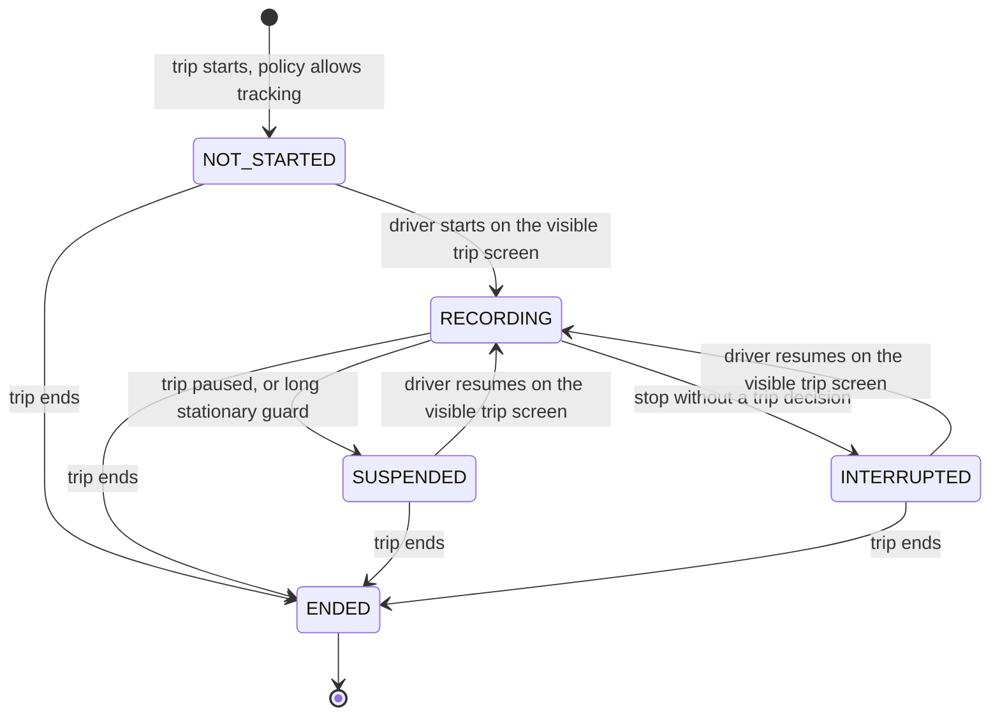

# Tracking, routes and navigation

Status: **PLANNED**, 2026-11-10. Module codes `GPS` and `ROUTE`. Tasks: `EMP-GPS-001…015` and `EMP-ROUTE-001…010` in [backlog/ep07-gps-navigation](../backlog/ep07-gps-navigation.md).

Evidence. The Android app already has an offline map, search and car routing behind an Abastevo-owned port (`maps/engine/src/main/kotlin/com/anpfuel/maps/engine/MapEngine.kt`, `ComapsRoutePlanner.kt`; [ADR-022](../../adr/022-comaps-derived-native-map-engine.md)), `IMPLEMENTED`: a route accepts up to 100 intermediate points and four avoidances (`domain/src/main/kotlin/com/anpfuel/domain/routing/NativeRoute.kt`), and the planner selects the car router only — no truck profile was found. Turn-by-turn guidance runs in a location foreground service with one-second updates, offline voice and recalculation inside the native core (`app/src/main/kotlin/com/anpfuel/app/ui/map/GuidanceService.kt`, `LocalGuidanceVoice.kt`), `IMPLEMENTED`; it is not aware of an organization trip, so it is `PARTIAL` for this module. A personal track recorder exists (`app/src/main/kotlin/com/anpfuel/app/ui/map/TripRecordingService.kt`), `IMPLEMENTED`: it is local only and refuses to start while guidance is active, so guidance and recording are mutually exclusive today. The individual driver suite counts distance without storing coordinates (`app/src/main/kotlin/com/anpfuel/app/ui/driver/work/DriverGpsService.kt`), with lifecycle obligations still open ([DRV-21](../../product/DRV_21_GPS_LIFECYCLE_CONTRACT.md)), `PARTIAL`. The manifest declares fine and coarse location, `FOREGROUND_SERVICE_LOCATION` and `POST_NOTIFICATIONS`, no background location and no boot receiver (`app/src/main/AndroidManifest.xml`); a static guard forbids `ACCESS_BACKGROUND_LOCATION` and continuous location outside those three services ([scripts/check-mobile.sh](../../../scripts/check-mobile.sh), section 5), `IMPLEMENTED`. No hand-off to an external maps app exists in the map flow (`docs/product/MAP_21_23_CONTRACT.md`, B-BR-MAP23-04). Address lookup uses public Nominatim at one request per second (`data/src/main/kotlin/com/anpfuel/data/remote/NominatimClient.kt`), `IMPLEMENTED`. On the server there is no tracking table, routing, geofence or web map: `PROPOSED`. Whether two location foreground services can run together acceptably on target devices, and any battery figure, are `UNVERIFIED` until the spike EMP-GOV-006.

## 1. Purpose

A company needs to tell a driver where to go, guide the driver there, know which path was really travelled and see the operation while it happens, without turning the employee's phone into a permanent tracker. This module specifies four capabilities that are separate and meet at the trip ([trips](trips.md)):

1. **Route planning** — destinations, stops and a planned distance, attached to a mission or trip and delivered to the assigned driver.
2. **Navigation** — guidance in the app with spoken instructions and recalculation, using the engine already in the app.
3. **Track recording** — the positions travelled during an authorised trip, aligned with logbook events.
4. **Operations view** — transmission of those positions and their display in the company panel, with honest freshness.

Users: drivers (are guided, are tracked only during their own trips, see what is collected); supervisors and fleet managers (plan, follow, replay); auditors (recorded tracks only). Expected result: each trip shows its plan, the engine's estimate, the path recorded and the odometer distance as four separate facts, and nobody mistakes an old position for a current one.

## 2. Scope

### 2.1 Capabilities and phases

| Capability | Phase | Content | Tasks | Limit at that phase |
|---|---|---|---|---|
| 3. Track recording | F4 | Tracking session bound to a trip, foreground service, sampling, buffer, batch intake, processing, GPS distance, divergence signal, interruptions, access audit, employee transparency | EMP-GPS-001 to EMP-GPS-006, EMP-GPS-010, EMP-GPS-012, EMP-GPS-015 | Recorded tracks are stored and summarised; no map in the panel yet |
| 2. Navigation, phase 1 | F4 | From the trip screen, open the existing in-app route preview and guidance for the trip's destination | EMP-ROUTE-004 | Guidance does not know the trip; nothing about navigation is written to the trip |
| 1. Route planning | F5 | Route plan on missions and trips, routing port, preview on the device, engine estimate stored on the server | EMP-ROUTE-001, EMP-ROUTE-002, EMP-ROUTE-003, EMP-ROUTE-005 | Car routing only; no route computed in the browser |
| 2. Navigation, phase 2 | F5 | Trip-aware guidance, guidance and tracking as coordinated location consumers, driving mode, degraded behaviour | EMP-ROUTE-006, EMP-ROUTE-007, EMP-ROUTE-009 | No live traffic; no truck restrictions |
| 4. Operations view | F5 | Live position projection, live operations map, track replay with logbook events, retention purge | EMP-GPS-007, EMP-GPS-008, EMP-GPS-009, EMP-GPS-011 | Phone tracking only |
| Geofences and alerts | F5 | Geofences evaluated on the server; stale-tracker and long-stop alerts | EMP-GPS-013, EMP-GPS-014 | Alerts arrive with the upload delay |
| Station suggestions on the route | F5 | Stations near the route with comparable prices and detour cost | EMP-ROUTE-008 | No saving is promised |
| Provider replacement | F5 | Drill against the map and routing ports | EMP-ROUTE-010 | — |

### 2.2 The navigation path and its dependencies

The owner accepted that opening an external maps app could be an explicitly limited first phase, provided the planning did not stop there. In this repository that hand-off does not exist in the map flow, and an external app returns no trajectory, arrival or reroute to the caller (Google Maps and Waze deep-link documentation, read 2026-11-10, [18-references](../18-references.md) §2). The path is therefore entirely inside the app:

| Step | Phase and task | What the driver gets | Depends on | Explicit limits |
|---|---|---|---|---|
| Phase 1 | F4, EMP-ROUTE-004 | "Navegar" on the trip screen opens the existing route preview and guidance for the trip's destination or next stop | EMP-TRIP-005 only; works with tracking off | Guidance is not trip-aware: arrival, reroutes and remaining distance are not written to the trip. Tracking and guidance are independent consumers, each with its own location subscription; the battery cost of both together is measured in EMP-GOV-006 |
| Phase 2 | F5, EMP-ROUTE-005 then EMP-ROUTE-006 | Route preview from the route plan; guidance that carries the trip and stop; arrival proposed as a logbook event; reroutes recorded | EMP-ROUTE-003 (route plans), EMP-GPS-002 (tracking service), EMP-GOV-007 (map decision) | One location owner with consumer leases replaces the two subscriptions, as the existing rule B-BR-DRV-10 already asks for the driver suite |
| Phase 2 completion | F5, EMP-ROUTE-007, EMP-ROUTE-009, EMP-ROUTE-010 | Driving mode, degraded and offline behaviour, replacement drill | EMP-ROUTE-006 | — |
| Later | No committed phase | Server-side routing through the adapter slot, truck restrictions, deviation alerts | Decision EMP-GOV-007 and a measured need | Not promised |

### 2.3 Later evolutions and out of scope

- **Later:** tracking by dedicated hardware through the ingestion port of [imports-notifications-integrations](imports-notifications-integrations.md) (EMP-INTEG-002); a server routing adapter; route deviation alerts; map matching as a derived layer; per-organization sampling overrides; track export files.
- **Out of scope:** the background-location permission; tracking outside a trip; tracking in personal mode; working-hours or journey computation from positions (EDR-028); driver behaviour scores; live traffic (excluded by ADR-022); sending destinations or positions to an external maps app; reverse geocoding of tracks through public Nominatim, whose policy tells vehicle-tracking services to run their own instance (operations.osmfoundation.org/policies/nominatim, read 2026-11-10).

### 2.4 Phone tracking is not telematics

Tracking here uses the driver's phone during a trip the driver started. It says where that phone was; it knows nothing about ignition, the vehicle's own odometer, fuel level or a phone left behind, and it depends on the phone's battery, permissions and operating-system behaviour. Dedicated telematics is hardware installed in the vehicle and is a separate evolution: its fixes would enter the same track storage with their own source label and the same freshness and quality rules (assumption AS-01).

### 2.5 Existing constraints this module respects

| Constraint | Source | Consequence here |
|---|---|---|
| Continuous location only in three named services; no `ACCESS_BACKGROUND_LOCATION` | [scripts/check-mobile.sh](../../../scripts/check-mobile.sh) section 5 | The organization tracking service is a fourth consumer. The guard is updated deliberately in the same change that adds the service: the new file is allow-listed, its request line is pinned, its manifest entry must be non-exported with type `location`, and the background-location prohibition stays (BR-GPS-003) |
| Voluntary location, explicit start and stop, no automatic start, shared ownership with navigation through leases | B-BR-DRV-09 and B-BR-DRV-10 (`docs/product/DRIVER_SUITE_CONTRACT.md`) | BR-GPS-002, BR-GPS-011, BR-GPS-013, BR-ROUTE-014 |
| Lifecycle lessons: checkpoint before fixes, no restart after process death, owner never rebound, changes may arrive without a callback | [DRV-21](../../product/DRV_21_GPS_LIFECYCLE_CONTRACT.md) | BR-GPS-012, BR-GPS-014, BR-GPS-015 |
| No location history; raw traces stay local | Conflict CX-06 in [16-decisions](../16-decisions.md) | Organization tracks are a new rule set with their own purpose, indicator, retention and access audit (EDR-015). No task here starts before EMP-GOV-005 and EMP-GOV-006; the public privacy page is updated before any pilot. Personal and community rules do not change |
| Legal basis for employee location (LV-01), notice to employees (LV-03), location as evidence in labour disputes (LV-06) | [11-privacy-security](../11-privacy-security.md) §10.4 | Open legal points and a release condition. This module is an engineering proposal, not a statement of compliance |
| Engine behind a narrow port; no upstream service as a production dependency | ADR-022 decisions 2 and 6 | BR-ROUTE-023, BR-ROUTE-024 |
| The app targets API level 35; Play requires level 36 for new apps and updates since 31 August 2026; Android 17 adds a location button, a persistent location indicator and stricter background audio | developer.android.com/google/play/requirements/target-sdk and …/about/versions/17/behavior-changes-17, read 2026-11-10; open question OQ-16 | Tracking and guidance are built and tested at the target level in force when their tasks start; voice guidance from the service is re-tested when the target is raised |
| Play asks for a declaration with a video for each foreground-service type; background location has a separate form | support.google.com/googleplay/android-developer/answer/13392821 and …/answer/9799150, read 2026-11-10 | The `location` declaration text is revised to cover employee trip tracking before any Play release; the background-location form is not needed |

## 3. Entities and ownership

Every entity belongs to one organization (BR-TEN-001). Backend module `tracking` (proposed, [09-architecture](../09-architecture.md) §2).

| Entity | Code | Content | Invariants |
|---|---|---|---|
| Route plan | ROUTE | Mission or trip, ordered points (label, coordinates, optional catalog or organization-place reference, note), options (avoid toll, motorway, ferry, unpaved), planned distance and duration with source, revision | Belongs to exactly one mission or one trip. Two to 102 points. No state machine: it has revisions and follows its mission or trip |
| Route computation | ROUTE | Engine identity, map data version, options, origin, instant, distance in metres, duration in seconds, optional simplified geometry, kind (`PLANNING`, `DEPARTURE`, `RECALCULATION`) | Immutable. Never overwrites a planned distance |
| Tracking session | GPS | Trip, membership, device, state, precision granted, sampling policy version, start, end, end reason, counters of accepted and dropped fixes | Exactly one trip; at most one session per trip; bound to the account, origin and organization that started it |
| Track segment | GPS | One accepted batch: session, sequence, device, boot identity, base instant, array of fixes | Insert-only. Unique per (organization, batch identifier) and per (session, sequence) |
| Fix (value inside a segment) | GPS | Offset in milliseconds, latitude and longitude in 10⁻⁷ degrees, accuracy in metres, speed in centimetres per second, bearing in degrees, flags (coarse, mock) | Never edited. Deleted only by retention or trimming |
| Gap | GPS | Session, start, end, reason, detected by (device or server) | Never overlaps another gap of the session |
| Track summary (derived) | GPS | GPS distance in metres, coverage in permille, quality, moving seconds, gap count and seconds, simplified geometry, method version, revision | One current revision per trip; a recalculation supersedes the previous one (BR-TRUTH-004) |
| Live position (derived) | GPS | Trip, newest accepted fix, collection instant, receipt instant, last communication, revision | One row per trip `IN_PROGRESS` or `PAUSED`; a projection that can be rebuilt |
| Geofence | GPS | Name, unit (optional), circle (centre, radius) or polygon, rules (enter, exit, dwell), enabled flag, archive instant | Geometry valid; radius 50 to 50 000 m; polygon up to 100 vertices. No state machine |
| Geofence event (derived) | GPS | Geofence, trip, kind, fix instant, detection instant | One per (geofence, trip, kind, fix instant) |
| Location alert rule | GPS | Kind (stale tracker, long stop, geofence), thresholds, scope, recipients | Thresholds inside the allowed range |
| Tracking settings | GPS | Policy (`OFF`, `OPTIONAL`, `EXPECTED`), freshness limits, divergence thresholds, long-stationary limit, raw-fix retention | Values inside the ranges of §10 and of [11-privacy-security](../11-privacy-security.md) §10.1 |

The four distances of a trip (planned, engine estimate, GPS, odometer) are four fields with four sources (§10.1). Odometer readings belong to [fleet](fleet.md); this module only reads them.

## 4. Business rules

### 4.1 Tracking — `BR-GPS`

- **BR-GPS-001 — Trip-bound collection.** Continuous location is collected in enterprise mode only while the tracking session of an organization trip in state `IN_PROGRESS` is `RECORDING`; no other screen, state or mode feeds organization data (BR-PRIV-006).
- **BR-GPS-002 — Explicit start from the visible trip screen.** Recording starts only by the driver's action on the visible trip screen, on a control whose text names tracking, and runs in a foreground service of type `location`; nothing else starts it: no boot event, worker, push message, geofence or server command.
- **BR-GPS-003 — No background-location permission.** The app never declares or requests `ACCESS_BACKGROUND_LOCATION`, and the static guard fails the build if it appears.
- **BR-GPS-004 — Visible indicator.** While `RECORDING`, an ongoing notification names the organization, says that tracking is active and offers a stop action, and every enterprise screen shows the same state; when the notification cannot be shown (permission denied or channel blocked) recording does not start and the result is `NOTIFICATION_BLOCKED`.
- **BR-GPS-005 — The trip never depends on location.** A denied permission, an approximate-only grant, a disabled provider, a blocked notification or a disabled capability never prevents starting, running or finishing a trip; the trip shows what is missing.
- **BR-GPS-006 — Capability and policy.** A session is created only when the organization has the tracking capability and its policy is `OPTIONAL` or `EXPECTED`; with `EXPECTED` a trip without recording is marked "sem rastreamento" with its reason for supervisors; turning the capability off stops new sessions and keeps stored data readable until retention.
- **BR-GPS-007 — Precision is detected.** At each start and resume the app requests fine and coarse location together and records which was granted; with an approximate-only grant fixes are flagged coarse, the track quality is at most `APPROXIMATE`, and no GPS distance and no geofence event is derived from them.
- **BR-GPS-008 — One session per trip.** A trip has at most one tracking session, whose state is one of `NOT_STARTED`, `RECORDING`, `SUSPENDED`, `INTERRUPTED`, `ENDED`; every transition is a recorded operation with actor, instant and reason (§6.1).
- **BR-GPS-009 — Pause suspends.** When the trip becomes `PAUSED` the session becomes `SUSPENDED`: location updates are removed and the service stops; recording returns only when the driver resumes the trip on the visible trip screen.
- **BR-GPS-010 — End ends.** When the trip becomes `COMPLETED` or `CANCELLED` the session becomes `ENDED` at once on the device; fixes already buffered stay queued for upload and no new fix is collected.
- **BR-GPS-011 — No silent resume.** After a device restart, a stop from the task manager, a force-stop, a process death or a lost permission, recording never restarts by itself; the session becomes `INTERRUPTED`, the gap is recorded with its reason, and the driver is asked to resume from the visible trip screen.
- **BR-GPS-012 — Durable checkpoint.** A checkpoint with session, owner, organization and boot identity is written before the first fix and at least every 30 seconds; an open checkpoint found at app start with no running service yields `INTERRUPTED` and a gap starting at the last checkpointed fix.
- **BR-GPS-013 — One listener, safe stop.** A repeated start adds no second location listener and resets no counter; a stop releases only this service's listener and persists the buffer before leaving the foreground.
- **BR-GPS-014 — Owner binding.** A session and its buffer belong to the account, origin, organization, membership and device that started it; a change of account, context or membership stops collection, and the buffer is never rebound to another owner (BR-OFFL-003).
- **BR-GPS-015 — Watchdog.** Every 30 seconds while `RECORDING` the service re-checks permission, precision, provider, notification visibility, owner and trip state, because a change may arrive without a callback; a failed check moves the session to the state that the cause requires.
- **BR-GPS-016 — Long stationary guard.** After 4 hours (default; range 1 to 12 hours, or disabled) without leaving a 200 m radius, the app suspends the session with reason `LONG_STATIONARY`, tells the driver, and resumes only by the driver's action.
- **BR-GPS-017 — Fix quality filter.** A fix is accepted only when its coordinates are finite, it is at most 15 seconds old at collection, its accuracy is known and at most 50 m (precise mode), the speed implied from the previous accepted fix is at most 70 m/s and it is not flagged as mock; rejected fixes are counted by reason and not stored.
- **BR-GPS-018 — Adaptive sampling.** Accepted fixes are recorded according to the versioned policy of §10.2 (defaults: every 10 seconds while moving, 50 m when moving slowly, a turn of 30 degrees, a heartbeat every 120 seconds when stationary), and the policy version is stored with the session.
- **BR-GPS-019 — Battery economy.** Below 15 % of battery and not charging, the routine interval becomes 30 seconds, the change is recorded on the session and shown to the driver; the app does not ask for a battery-optimisation exemption by default.
- **BR-GPS-020 — Durable buffer and batches.** Recorded fixes are written to the device's protected store before they count, and are uploaded in batches of at most 360 fixes and 64 KiB (default every 60 seconds when online), after pending operations and before attachments; the app never drops an unsent fix by itself (BR-OFFL-013).
- **BR-GPS-021 — Idempotent batch intake.** The server keeps one result per (organization, batch identifier): an identical resend returns it, the same identifier with a different digest is refused with `OPERATION_ID_REUSED`, and a fix already stored for the session is ignored.
- **BR-GPS-022 — Session bounds on the server.** The server stores only fixes collected inside the session's recording periods as established by accepted session operations; a fix outside them is discarded and counted as `OUTSIDE_SESSION`; a batch whose session operation is not yet accepted is answered `RETRY` with `DEPENDENCY_PENDING`.
- **BR-GPS-023 — Raw fixes are the source of truth.** Stored fixes are never edited; distance, gaps, simplified geometry and summary are derived with a method version and recomputed as a new revision; no map-matched path replaces raw fixes.
- **BR-GPS-024 — Gaps are data.** Any interval longer than 180 seconds inside a recording period without an accepted fix, and any interval in which recording was expected and not running, is a gap with start, end and reason; no position, path or distance is invented across a gap.
- **BR-GPS-025 — GPS distance.** GPS distance is the sum, in whole metres, of great-circle lengths between consecutive accepted precise fixes of the same continuous run, ignoring steps shorter than 10 m and never bridging a gap; it is stored with coverage and method version.
- **BR-GPS-026 — Coverage and track quality.** Coverage is the share, in permille, of the time the trip was `IN_PROGRESS` that is not inside a gap; quality is `PRECISE` when every part was recorded with precise permission and coverage is at least 900, `APPROXIMATE` when any part is coarse or coverage is from 500 to 899, and `INSUFFICIENT` otherwise.
- **BR-GPS-027 — Four distances stay apart.** Planned distance, engine estimate, GPS distance and odometer distance are stored in separate fields, each with its source and instant, and are never added, averaged or substituted silently.
- **BR-GPS-028 — Distance basis.** A figure that needs travelled distance uses odometer distance; when there is none, GPS distance may be used only if the track quality is `PRECISE`, and the figure is labelled "por GPS"; otherwise the result is `INSUFFICIENT_DATA`; planned distance and engine estimate are never used as travelled distance.
- **BR-GPS-029 — Divergence signal.** When odometer distance and GPS distance both exist and the quality is `PRECISE`, a divergence signal is raised if their absolute difference is more than 2 000 m and more than 10 % of the odometer distance (defaults; ranges 500 to 10 000 m and 5 to 30 %); the signal asks for review with both values, coverage and gaps, and states nothing else (BR-TRUTH-005).
- **BR-GPS-030 — Live position is the newest accepted fix.** Each trip `IN_PROGRESS` or `PAUSED` has one live position, replaced only by a fix with a later collection instant, so a batch that arrives late never moves it backwards.
- **BR-GPS-031 — Freshness is derived at read time.** The age of a live position is server time minus the collection instant; it is `CURRENT` up to 180 seconds, `STALE` up to 900 seconds and `NO_SIGNAL` beyond that or when no fix exists (defaults); the `CURRENT` limit is never lower than the heartbeat plus the upload interval in force.
- **BR-GPS-032 — An old position is never shown as current.** Every display of a position shows its collection time, the last communication, its accuracy and its freshness; `STALE` and `NO_SIGNAL` use a different marker and text, and no position is extrapolated or animated forward (BR-TRUTH-006).
- **BR-GPS-033 — Location reads are permissioned and audited.** Live positions need `gps.location.read_live` and recorded tracks need `gps.track.read`; neither is implied by reading the trip (BR-AUTH-011); each access writes an audit event without coordinates (BR-AUD-003, BR-AUD-004); a driver reads only their own trips.
- **BR-GPS-034 — Employee transparency.** In enterprise mode an employee can always see what tracking collects, whether it is active, and their own sessions with start, end, gaps and reasons (BR-PRIV-015); the notice is shown at first use and at each tracking start.
- **BR-GPS-035 — Retention.** Raw fixes are deleted 90 days after the trip ends (organization range 30 to 365 days), the live position 24 hours after the trip ends, and the summary and simplified geometry follow the trip; an expired fix is unreadable even if the purge has not run ([11-privacy-security](../11-privacy-security.md) §10.1, BR-PRIV-009).
- **BR-GPS-036 — Trimming.** When a trip's end is corrected to an earlier instant, fixes collected after the effective end are purged within 24 hours and the summary is recomputed as a new revision.
- **BR-GPS-037 — Geofences are evaluated on the server.** Entry, exit and dwell are computed from received precise fixes; the platform geofencing interface is not used; an event carries the fix instant and the detection instant, and an event detected more than 30 minutes after its fix is recorded without raising a live alert.
- **BR-GPS-038 — Alerts state facts.** A location alert says what was observed, where the rule applies and when; it never states misconduct, and its thresholds and recipients are configured by the organization.
- **BR-GPS-039 — No location in logs.** Coordinates never appear in logs, metrics, traces, audit events, notification texts or error messages (BR-PRIV-008).
- **BR-GPS-040 — Phone tracking is labelled.** Every track and position carries its source (`PHONE` today); the interface says that the position is the driver's phone, not the vehicle.

### 4.2 Routes and navigation — `BR-ROUTE`

- **BR-ROUTE-001 — One plan, one owner.** A route plan belongs to exactly one mission or one trip of one organization.
- **BR-ROUTE-002 — Ordered points within the engine bound.** A plan has from 2 to 102 ordered points with distinct coordinates (an origin, up to 100 intermediate stops and a destination); a plan beyond the bound is refused with `ROUTE_POINT_LIMIT`.
- **BR-ROUTE-003 — Where points come from.** A point is chosen from the organization's own places (units, suppliers, geofences), from the public station catalog as a reference only (BR-SRC-004), from the search of the app's offline map, or by typed coordinates; tracks and plans are never geocoded in bulk through a public service.
- **BR-ROUTE-004 — Planned distance has a source.** A planned distance is either typed by the planner (`MANUAL`) or copied from one named route computation (`ENGINE`); when absent it is shown as "não informada", never as zero (BR-TRUTH-003).
- **BR-ROUTE-005 — Engine estimates are attributed.** Each route computation records the engine, the map data version, the options, the origin, the instant, the distance and the duration; a recalculation is a new computation, and none changes the planned distance.
- **BR-ROUTE-006 — Plans are revisioned.** Changing points or options creates a new revision; a trip `IN_PROGRESS` keeps the revision it started with until the driver accepts the new one while stopped.
- **BR-ROUTE-007 — Assignment through the mission or trip.** A plan reaches a driver only because its mission or trip is assigned to that driver ([trips](trips.md)); `route.plan.manage` assigns nobody.
- **BR-ROUTE-008 — Planned and actual stay apart.** Stops the driver adds, skips or reorders are recorded as actual stops in the logbook; the plan revision is not rewritten to match what happened.
- **BR-ROUTE-009 — Routes are computed on the device.** Route computation runs in the engine on the driver's device through the routing port, and the server stores what the device computed; the server computes no route unless a server adapter is configured by decision (EDR-016).
- **BR-ROUTE-010 — Engine profile honesty.** The engine computes car routes; height, weight and cargo restrictions are not considered, and the plan and navigation screens say so for assets whose kind is heavy.
- **BR-ROUTE-011 — Navigation phase 1.** From the trip screen the driver opens the existing in-app route preview and guidance for the trip's destination or next stop; starting or stopping guidance neither starts, stops nor pauses the tracking session, and nothing about that guidance is written to the trip.
- **BR-ROUTE-012 — No external hand-off.** The trip flow never sends a destination or a position to an external maps application.
- **BR-ROUTE-013 — Trip-aware navigation.** In phase 2 guidance started from a trip carries the trip, the plan revision and the target stop; on arrival the app proposes the arrival event and the driver confirms it with one tap; nothing is added to the logbook without that confirmation.
- **BR-ROUTE-014 — Coordinated consumers.** In phase 2 one location owner serves guidance and tracking through leases: ending guidance releases only the guidance lease, ending or pausing the trip releases the tracking lease and ends trip-aware guidance, and no distance is counted twice.
- **BR-ROUTE-015 — Guidance alone sends nothing.** Fixes used for guidance reach the organization only through the tracking session; with tracking off, declined or not `RECORDING`, navigation sends no position to the server.
- **BR-ROUTE-016 — Recalculation is recorded, not judged.** When the engine recalculates, the trip records the instant and the new estimate; the count is information and never an offence.
- **BR-ROUTE-017 — Degraded and offline behaviour.** Without the map region a route needs, the result is `MAP_REGION_MISSING` with the regions to download; with no usable fix guidance says so and does not advance; without voice it continues visually; live traffic is not offered.
- **BR-ROUTE-018 — Driving mode.** While the vehicle moves (speed of at least 1.5 m/s) the app shows only the next manoeuvre, remaining distance and time, the tracking indicator and at most four one-tap quick actions; detailed entry opens only when stopped.
- **BR-ROUTE-019 — Quick actions are completed at a stop.** A quick action stores a minimal logbook event with its instant, flagged to complete; the trip closing lists every event still to complete.
- **BR-ROUTE-020 — Suggestions compare only comparable references.** A price difference between two stations is computed only when both references have the same source kind, product, unit and payment condition and are inside their freshness limit; otherwise both are shown with source and age and no difference (BR-SRC-001).
- **BR-ROUTE-021 — Detour cost shows its inputs.** A suggestion shows the detour distance and time from two route computations and the fuel cost of the detour from the asset's own reference consumption; when that consumption is `INSUFFICIENT_DATA` no net value is shown.
- **BR-ROUTE-022 — Suggestions are neutral.** Suggestions are ordered by detour and comparable price only, never by a station's plan, agreement payment or advertising (BR-SRC-002), and are never worded as a guaranteed saving (BR-TRUTH-005).
- **BR-ROUTE-023 — Attribution and tile hosting.** Every map in the app and in the panel shows the OpenStreetMap attribution; panel tiles are hosted by the project and contain no organization data; no third-party tile, routing or geocoding service receives an organization's positions.
- **BR-ROUTE-024 — Providers behind ports.** Map rendering, route computation, guidance, the location source and the panel map each sit behind an Abastevo-owned port; no provider type crosses a port, and a provider is replaced by changing one adapter and passing the replacement drill.

## 5. Use cases

**UC-ROUTE-01 — Plan a route.** Actor: member with `route.plan.manage`. Preconditions: a mission or planned trip exists in scope. Main flow: open the mission or trip in the panel → add destination and stops from organization places, the station catalog or coordinates → order them → choose options → optionally type a planned distance → save; the plan gets revision 1 and reaches the assigned driver with the next reference pull (UC-OFFL-08). Alternatives: more than 100 intermediate stops → `ROUTE_POINT_LIMIT`; two points with the same coordinates → `VALIDATION_FAILED`; no map in the panel → the same form works as a list. Result: a plan with points and, when typed, a planned distance with source `MANUAL`.

**UC-ROUTE-02 — Preview the route on the device.** Actor: assigned driver. Preconditions: plan cached; map region downloaded. Main flow: open the trip → the engine computes the route through the plan's points → the app shows the line, distance, duration and the list of stops → the computation is queued as an operation and attached to the plan as kind `PLANNING` or `DEPARTURE`. Alternatives: region missing → `MAP_REGION_MISSING` and a download action; the points remain usable as a list; no route found → `ROUTE_NOT_FOUND` with the stop that failed; heavy asset → the notice of BR-ROUTE-010. Result: an engine estimate stored beside the planned distance, never over it.

**UC-ROUTE-03 — Navigate from a trip, phase 1.** Actor: driver with a trip `IN_PROGRESS`. Main flow: tap "Navegar" on the trip screen → the existing route preview opens for the destination or next stop → the driver starts guidance as in the public app → spoken instructions and recalculation work offline. Alternatives: the trip has no destination with coordinates → the driver searches or picks a place first; guidance cannot start (permission, GPS off, notifications blocked) → the existing guidance messages apply and the trip continues. Result: the driver is guided; the trip records nothing about it; tracking, if recording, is unaffected.

**UC-ROUTE-04 — Navigate trip-aware.** Actor: driver, phase 2. Preconditions: route plan on the trip. Main flow: start guidance from the route preview → guidance holds a lease on the shared location owner → on arrival at a stop the app proposes "Cheguei" → the driver confirms → the arrival event enters the logbook → guidance continues to the next stop. Alternatives: off route → the engine recalculates and the trip records it (BR-ROUTE-016); the manager revised the plan → the driver is offered the new revision at the next stop; the trip is paused or ended → guidance ends; tracking not recording → guidance works and sends nothing (BR-ROUTE-015). Result: navigation events tied to the trip, with no double location subscription.

**UC-ROUTE-05 — Act while driving and complete at a stop.** Actor: driver. Main flow: while moving the driver taps one quick action (for example "Parada" or "Ocorrência") → a minimal event is stored → when the vehicle stops the app offers to complete it with details, photo or receipt. Alternatives: no location available → the app cannot tell movement from rest and shows detailed entry with a reminder to use it only when stopped; the event is never completed → the trip closing lists it. Result: nothing important is lost and nothing long is typed while moving.

**UC-ROUTE-06 — See station suggestions on the route.** Actor: driver or planner. Preconditions: a route computation exists; the asset's product is known. Main flow: ask for suggestions → the server lists catalog stations near the route geometry with their price references → for each candidate the device computes the route through it → the app shows detour distance and time, each price with source and age, and, when comparable, the difference for the stated volume minus the detour fuel cost. Alternatives: references not comparable → no difference; consumption unknown → no net value; no price inside its freshness limit → the station is listed without price. Result: information for a decision, with every input visible and no promised saving.

**UC-ROUTE-07 — Replace a provider.** Actor: maintainer. Main flow: implement another adapter for one port (a fake engine, a fake server routing adapter, another panel map adapter) → run the replacement drill → every acceptance test of this module passes with no change outside the adapter. Result: evidence that a provider can be changed.

**UC-GPS-01 — Start a trip with tracking.** Actor: driver with `trip.trip.start`. Preconditions: capability on, policy `OPTIONAL` or `EXPECTED`; trip being started on the visible trip screen. Main flow: the screen says the trip will be tracked and shows the notice → the driver taps "Iniciar viagem e rastreamento" → the app requests fine and coarse location → the service starts with its notification → checkpoint written → the session is `RECORDING` and the start operation is queued. Alternatives: permission denied → the trip starts, the session stays `NOT_STARTED` with reason `PERMISSION_DENIED`; approximate only → recording with coarse fixes and a notice that no GPS distance will exist; notifications blocked → `NOTIFICATION_BLOCKED`, trip without tracking; policy `OPTIONAL` → "Iniciar sem rastreamento" is offered. Result: a trip that is tracked only by the driver's visible action.

**UC-GPS-02 — Pause, resume and end.** Actor: driver. Main flow: pause the trip → session `SUSPENDED`, service stopped, indicator shows "Rastreamento suspenso" → resume the trip on the trip screen → session `RECORDING` again → finish the trip → session `ENDED`, backlog uploads later. Alternatives: the driver stops tracking from the notification while the trip continues → `INTERRUPTED` with reason `STOPPED_BY_DRIVER`, visible to supervisors as a gap; a supervisor closes the trip for the driver → the device ends the session at its next contact and fixes after the closing instant are discarded. Result: collection follows the trip.

**UC-GPS-03 — Recover from an interruption.** Actor: driver. Main flow: the phone restarted, the app was stopped or the permission was lost → at the next app start the open checkpoint is found → the session is `INTERRUPTED` and a gap is recorded with its reason → the trip screen asks "Retomar rastreamento?" → the driver confirms on the visible screen → `RECORDING`. Alternatives: the driver does not open the app → the gap stays open until the trip ends; the driver declines → the trip continues untracked; a local notification is posted when allowed, and it only opens the trip screen. Result: an honest gap, never a silent resume.

**UC-GPS-04 — Upload track batches.** Actor: system (device). Main flow: every 60 seconds when online, after pending operations, the app sends the oldest unsent batches in sequence → the server authenticates session and device proof, checks the session bounds, stores each batch as a segment and answers per batch → the app deletes acknowledged fixes from the buffer. Alternatives: connection lost → the same batch is resent and the stored result is returned; session operation not accepted yet → `RETRY`; device revoked as lost → refused; membership ended → fixes collected before the end are stored inside the intake window (BR-OFFL-011); batch too large → `BATCH_TOO_LARGE`, the app splits it. Result: each fix stored once.

**UC-GPS-05 — Process a track.** Actor: system (job). Main flow: after the trip ends or new segments arrive for an ended trip → order fixes, drop duplicates, derive gaps, compute GPS distance, coverage and quality, simplify the geometry → write a new summary revision → evaluate the divergence signal against the odometer distance. Alternatives: fixes arrive after processing → a new revision supersedes the previous one; the job fails → it is retried and is safe to re-run. Result: a summary whose basis is visible.

**UC-GPS-06 — Follow operations on the live map.** Actor: member with `gps.location.read_live`. Main flow: open the map → the panel polls positions changed since its revision every 15 seconds → each trip in scope appears with collection time, last communication, accuracy and freshness → the access is audited. Alternatives: a position is `STALE` or `NO_SIGNAL` → distinct marker and text; coarse position → an area, not a pin; session `SUSPENDED` → "viagem pausada"; the map component fails → the same data as a list. Result: a current view that never overstates what is known.

**UC-GPS-07 — Replay a trip.** Actor: member with `gps.track.read`. Main flow: open a trip → the track is drawn with gaps shown as breaks and logbook events placed at their instants → moving along the timeline shows time, speed and accuracy. Alternatives: raw fixes past retention → the simplified geometry and summary only; quality `INSUFFICIENT` → "dados insuficientes" and the logbook alone. Result: what was recorded, with what is missing visible.

**UC-GPS-08 — Review a distance divergence.** Actor: member with `trip.trip.review`. Main flow: a trip shows the signal → the reviewer sees odometer distance with its two readings, GPS distance with coverage and gaps, planned distance and engine estimate → records an outcome (reading corrected in [fleet](fleet.md), accepted with a justification, or sent to findings in [intelligence](intelligence.md)). Result: the difference is explained or kept open; nothing is stated beyond the numbers.

**UC-GPS-09 — Maintain geofences and alerts.** Actor: member with `gps.geofence.manage`. Main flow: draw a circle or polygon or pick a unit's place → choose rules and recipients → save → events appear from the next processed batch. Alternatives: invalid geometry → `GEOFENCE_INVALID_GEOMETRY`; event detected late → recorded in history, no live alert. Result: alerts with fix time and detection time.

**UC-GPS-10 — See my tracking.** Actor: any employee in enterprise mode. Main flow: open "Meu rastreamento" → see what is collected, the current state, and the list of own sessions with start, end, gaps and reasons. Result: the employee knows when the organization had location and when it did not.

**UC-GPS-11 — Purge by retention.** Actor: system (job). Main flow: find trips whose raw fixes passed the organization's period and are not under legal hold → delete the segments → keep summary and simplified geometry → write the deletion ledger. Alternatives: job stopped → reads still refuse expired fixes. Result: raw positions do not outlive their period.

## 6. States and transitions

### 6.1 Tracking session



| From | To | Actor | Validation | Effect | Reversal |
|---|---|---|---|---|---|
| — | `NOT_STARTED` | System, when the trip starts | Capability on; policy `OPTIONAL` or `EXPECTED` | Session exists; nothing is collected | — |
| `NOT_STARTED` | `RECORDING` | Driver on the visible trip screen | Trip `IN_PROGRESS`; fine or coarse permission granted; notification visible; notice shown | Foreground service started; checkpoint written; start operation queued | Stop by the driver, pause or end |
| `RECORDING` | `SUSPENDED` | Driver pausing the trip; the app after the long stationary guard | — | Listener removed, buffer persisted, service stopped; gap opened when the trip is still `IN_PROGRESS` | Resume |
| `SUSPENDED` | `RECORDING` | Driver on the visible trip screen | Same as a start | New recording period; gap closed | Pause again |
| `RECORDING` | `INTERRUPTED` | Watchdog, checkpoint recovery at app start, or the driver's stop action | Cause identified (§8.2) | Gap opened with its reason; driver prompted | Resume |
| `INTERRUPTED` | `RECORDING` | Driver on the visible trip screen | Same as a start | Gap closed at the first accepted fix | — |
| `NOT_STARTED`, `RECORDING`, `SUSPENDED`, `INTERRUPTED` | `ENDED` | Trip completion or cancellation by the driver; closure by a supervisor; end of membership; device revocation | — | No new fix; backlog stays queued; terminal | None; a new trip has a new session |

### 6.2 Track quality

Computed by the processing job at each summary revision; it is a result, not a command.

| Quality | Condition | What may be derived |
|---|---|---|
| `PRECISE` | Precise permission in every recording period and coverage of at least 900 permille | GPS distance, usable as a labelled alternative and for the divergence signal; geofence events; replay |
| `APPROXIMATE` | Any period with coarse fixes, or coverage from 500 to 899 permille | Replay with breaks; a partial GPS distance shown with its coverage and never used as an alternative or for divergence; no distance at all from coarse periods |
| `INSUFFICIENT` | Coverage below 500 permille, fewer than two accepted fixes, or no data received | Nothing; the trip shows "dados insuficientes" |

### 6.3 Live position freshness

Derived when read ([08-state-model](../08-state-model.md) §4 rule 5); never stored as truth.

| State | Condition (defaults) | Range | Display (pt-BR) |
|---|---|---|---|
| `CURRENT` | Age up to 180 s | 60 to 600 s, never below heartbeat plus upload interval | "Atual — há 40 s"; solid marker |
| `STALE` | Age above 180 s and up to 900 s | upper limit 300 to 3 600 s | "Desatualizada — há 7 min"; faded marker with a clock |
| `NO_SIGNAL` | Age above 900 s, or no accepted fix for the trip | — | "Sem sinal desde 13:40"; hollow marker at the last known position, or the trip listed without a position |

## 7. Roles and permissions

Keys from [07-permissions](../07-permissions.md) §7.2; roles from its §7.3 where the matrix has the row.

| Permission | Allows here | Roles | Notes |
|---|---|---|---|
| `trip.trip.start` | Start, resume and end tracking of own trip; attach route computations to own trip; navigate | As the matrix: own trips of `OWNER`, `ADMIN`, `FLEET_MANAGER`, `SUPERVISOR`, `DRIVER` | A driver needs no location-read permission to be tracked |
| `trip.trip.read` | Read the route plan, the four distances, coverage, quality, gap count and session state of a trip | As the matrix | Numbers only; no coordinates |
| `gps.location.read_live` | Live positions of trips in scope | `OWNER`, `ADMIN`, `FLEET_MANAGER`, `SUPERVISOR`; `DRIVER` for own trips | Never `AUDITOR`, `FINANCE`, `APPROVER`, `OPERATIONS_STAFF` |
| `gps.track.read` | Recorded tracks, gaps with times, replay | The above plus `AUDITOR` (recorded only) | Audited per trip opened |
| `gps.geofence.manage` | Geofences and location alert rules | Proposed: `OWNER`, `ADMIN`, `FLEET_MANAGER` | Row missing in the matrix of 07; listed as a gap |
| `route.plan.manage` | Create and revise route plans | Proposed: the roles of `trip.mission.manage` (`OWNER`, `ADMIN`, `FLEET_MANAGER`, `SUPERVISOR`) | Row missing in the matrix of 07; listed as a gap |
| `trip.trip.review` | Record the outcome of a divergence signal | As the matrix | Not the trip's author (BR-REV-003) |
| `org.settings.manage` | Tracking policy, freshness limits, thresholds, raw-fix retention | `OWNER`, `ADMIN` | Changes are audited |
| `audit.event.read` | Read who accessed locations | `OWNER`, `ADMIN`, `AUDITOR` | — |

Scopes follow BR-AUTH-004 and BR-AUTH-005: a supervisor of a unit sees positions of trips that carry that unit. Platform operators see a position or a track only inside a support session that names location (BR-PRIV-021).

## 8. Offline, concurrency, idempotency and corrections

### 8.1 Rules

- **Offline:** route computation, preview, guidance and recording work without a network when the map region is on the device; fixes stay in the protected local store (BR-PRIV-016) until acknowledged. One day of a vehicle is about 86 KB, so the buffer is never trimmed to save space.
- **Order of delivery:** pending operations, then track batches, then attachments. Session transitions are ordinary operations of [10-offline-sync](../10-offline-sync.md) (`gps.session.start`, `suspend`, `resume`, `interrupt`, `end`) handled by this module; fixes travel in batches on their own endpoint with the same authentication, organization sealing and replay rule.
- **Held sessions:** when a session operation is accepted for review (for example after the membership ended, BR-OFFL-011), its batches are stored in the same held form and excluded from the live map, distance and replay until the review item is resolved; if it is refused, the fixes are purged within 24 hours.
- **Concurrency:** batches may arrive out of order; segments are ordered by sequence and instant when processed. The live position is replaced under a row lock only by a later collection instant. Two reviewers recording an outcome for the same divergence act on the summary revision; the second receives `CONFLICT`.
- **Handover and second device:** the session stays one; each segment names its device. A fix is stored only when its device held the session at the fix's instant according to accepted session operations.
- **Corrections:** fixes are never edited. A wrong derived value is corrected by fixing its input (an odometer reading in [fleet](fleet.md), a trip end in [trips](trips.md)) and recomputing, which creates a new summary revision (BR-AMD-005). A route plan is corrected by a new revision.
- **Clock:** the collection instant is derived from the batch's monotonic offsets when fix and batch share a boot identity, so a wrong wall clock cannot make an old fix look new (BR-TIME-005); otherwise the device wall time is used and the segment is flagged `CLOCK_UNCERTAIN`.

### 8.2 Interruption matrix

Platform behaviour is quoted from [18-references](../18-references.md) §1; every source there was read on 2026-11-10. `UNVERIFIED` marks are kept from that file.

| Situation | Platform fact and source (read 2026-11-10) | App behaviour | Session state and gap reason |
|---|---|---|---|
| App in the background or screen off | A location foreground service started while the app has a visible activity keeps receiving location; `ACCESS_BACKGROUND_LOCATION` is not needed (developer.android.com/develop/sensors-and-location/location/permissions; …/services/fgs/restrictions-bg-start) | Keeps recording | `RECORDING` |
| Service declaration | From Android 14 every foreground service declares a type; `location` needs `FOREGROUND_SERVICE_LOCATION` plus coarse or fine location at runtime (developer.android.com/develop/background-work/services/fgs/service-types) | Manifest entry non-exported, type `location`; guard asserts it | — |
| Permission denied at start | Runtime grant required (same source) | Trip starts untracked; explains how to allow | `NOT_STARTED`, `PERMISSION_DENIED` |
| Approximate location only | On Android 12 and later the user can grant approximate only, detected by requesting fine and coarse together; approximate is about 3 km² (developer.android.com/develop/sensors-and-location/location/permissions/runtime) | Records coarse fixes at heartbeat rate; says that no GPS distance will exist; offers the change to precise | `RECORDING`, precision coarse; quality at most `APPROXIMATE` |
| Permission removed or reduced during the trip | No documented callback in the facts checked; DRV-21 notes it can go undetected | Watchdog detects within 30 s; if the process was stopped, the checkpoint detects it at next start | `INTERRUPTED`, `PERMISSION_REVOKED`; or `RECORDING` coarse with `PRECISION_REDUCED` |
| Notifications denied | On Android 13 and later the permission is not required to run a foreground service, but the notice then appears only in the task manager (developer.android.com/develop/ui/views/notifications/notification-permission) | Product rule is stricter: recording does not start | `NOT_STARTED`, `NOTIFICATION_BLOCKED` |
| Location provider switched off | — | Service stays; notification says "GPS desligado"; continues when the provider returns | `RECORDING`; gap `PROVIDER_DISABLED` |
| Signal lost (tunnel, building) or accuracy worse than 50 m | A location exposes accuracy, speed, bearing, elapsed time and a mock flag (developer.android.com/reference/android/location/Location) | Drops poor fixes and counts them; no path is invented | `RECORDING`; gap `SIGNAL_LOST` after 180 s |
| Mock location | Same source (`isMock()`) | Fix excluded and counted | `RECORDING`; gap `MOCK_LOCATION` after 180 s |
| Device restart | Starting a location foreground service from the background, for example from a boot receiver, needs background location; a trip cannot resume silently (developer.android.com/develop/background-work/services/fgs/restrictions-bg-start) | No boot receiver. At next app start the boot identity differs: prompt to resume. A local notification from the periodic sync worker, when allowed, only opens the trip screen (its timing after a restart is checked in EMP-GOV-006) | `INTERRUPTED`, `DEVICE_RESTARTED` |
| Stop from the task manager or force-stop | The user must act before the service can run again (…/fgs/restrictions-bg-start; …/fgs/handle-user-stopping) | Checkpoint found at next start; prompt to resume | `INTERRUPTED`, `PROCESS_STOPPED` |
| App swiped away from recents | `UNVERIFIED` whether stock Android keeps the service alive on every device | Treated as a possible process stop; same checkpoint path | `RECORDING`, or `INTERRUPTED`, `PROCESS_STOPPED` |
| Manufacturer background restrictions | No official statement found (`UNVERIFIED`) | Same checkpoint path; device matrix in EMP-GOV-006 and EMP-GPS-010 | `INTERRUPTED`, `PROCESS_STOPPED` |
| Doze and battery saver | Doze suspends network and defers jobs when the device is stationary and unplugged; Play restricts asking for a battery-optimisation exemption (developer.android.com/training/monitoring-device-state/doze-standby). Whether a foreground service is exempt from Doze network restrictions is `UNVERIFIED` | Fixes wait in the buffer; upload when the network returns; no exemption request by default | `RECORDING` |
| Low battery | No official drain figure for continuous GPS was found (`UNVERIFIED`) | Economy interval below 15 % (BR-GPS-019); real drain measured in EMP-GOV-006 | `RECORDING` |
| Long trip | No time limit is documented for the `location` type (developer.android.com/develop/background-work/services/fgs/timeout) | No artificial cut; long stationary guard only | `RECORDING`, or `SUSPENDED`, `LONG_STATIONARY` |
| Driver stops tracking from the notification | — | Stops at once; trip continues | `INTERRUPTED`, `STOPPED_BY_DRIVER` |
| Account, context or membership change; logout | — | Collection stops; buffer stays with its owner | `INTERRUPTED`, `OWNER_CHANGED` |
| Trip closed by a supervisor, membership ended, device revoked | Server-side | Device ends the session at its next contact; later fixes are discarded by the server | `ENDED` |

## 9. Events, notifications and integrations

- **Produced (GPS):** `gps.session.started`, `gps.session.suspended`, `gps.session.resumed`, `gps.session.interrupted`, `gps.session.ended`, `gps.track.processed`, `gps.track.purged`, `gps.divergence.detected`, `gps.geofence.entered`, `gps.geofence.exited`, `gps.tracker.silenced` (stale tracker), `gps.stop.prolonged` (long stop). Reads of location are audit events, not domain events.
- **Produced (ROUTE):** `route.plan.created`, `route.plan.revised`, `route.computation.recorded`, `route.navigation.started`, `route.navigation.rerouted`, `route.navigation.arrived`, `route.navigation.ended` (the navigation events exist from phase 2).
- **Consumed:** `trip.trip.started`, `trip.trip.paused`, `trip.trip.resumed`, `trip.trip.completed`, `trip.trip.cancelled` (session lifecycle on the server), end-of-membership and device-revocation events of [identity](identity.md), and meter-reading changes of [fleet](fleet.md) (to re-evaluate divergence).
- **Notifications:** to the driver — tracking interrupted, tracking suspended by the long stationary guard, new plan revision; to supervisors — the configured location alerts, through the notification core of [imports-notifications-integrations](imports-notifications-integrations.md), in-app first (EDR-032). An alert text names the trip, the rule and the times; it carries no coordinates.
- **Integrations:** map engine (existing port), panel map (new dependency, decision EMP-GOV-007), server routing adapter slot (empty by default), telematics ingestion port (later). Every one has a fallback: list views without a map, routes computed on the device, phone tracking.

## 10. Data, formulas and examples

### 10.1 Four distances and who uses them

| Distance | Interface (pt-BR) | Source | Fixed when | Used by |
|---|---|---|---|---|
| Planned | Distância planejada | Route plan: typed (`MANUAL`) or copied from a named computation (`ENGINE`) | The plan revision is saved | Planning, comparison of plan with what happened |
| Engine estimate | Distância estimada | A route computation by the engine on a device, with engine and map data version | The computation is made; a recalculation is a new one | Remaining distance and time during navigation; detour cost of a suggestion |
| GPS | Distância por GPS | Server computation from accepted precise fixes, with coverage, quality and method version | Each summary revision | Replay; divergence signal; labelled alternative when there is no odometer distance and quality is `PRECISE` |
| Odometer | Distância por odômetro | End reading minus start reading of the trip ([fleet](fleet.md)) | The readings are accepted | **Primary** for consumption and cost ([fuelings](fuelings.md), [intelligence](intelligence.md)) |

Selection rule for a figure that needs travelled distance (BR-GPS-028): odometer distance; else GPS distance if quality is `PRECISE`, labelled "por GPS"; else `INSUFFICIENT_DATA`. The label and the basis are part of the figure (BR-TRUTH-004).

### 10.2 Sampling policy `sampling-v1`

| Parameter | Default | Range | Effect |
|---|---|---|---|
| Moving threshold | Speed of at least 1.5 m/s | 1 to 3 m/s | Below it the vehicle is treated as slow or stationary |
| Routine trigger while moving | 10 s since the last recorded fix | 5 to 60 s | Upper bound of 360 routine fixes per hour |
| Slow-movement trigger | 50 m from the last recorded fix, speed below the moving threshold | 20 to 200 m | Keeps a crawling vehicle from recording every 10 s |
| Turn trigger | Bearing change of at least 30° since the last recorded fix, while moving, not sooner than 5 s | 15 to 60° | Keeps curves in the geometry |
| Stationary heartbeat | 120 s | 60 to 600 s | Shows that the device is alive; coarse mode records at this rate only |
| Accuracy filter | Drop accuracy worse than 50 m (precise mode) | 25 to 100 m | Same limit as the existing guidance fix policy |
| Economy interval | 30 s below 15 % battery, not charging | 15 to 60 s | BR-GPS-019 |
| Upload interval | 60 s when online | 30 to 300 s | Raised to 120 s before the write rate becomes the constraint ([09-architecture](../09-architecture.md) §9) |
| Batch limit | 360 fixes and 64 KiB | fixed | One hour of routine sampling per batch |

The 10-second default follows common practice (Google's driver SDK reports every 10 seconds by default with a 5-second minimum; developers.google.com/maps/documentation/mobility/driver-sdk/on-demand/android/vehicle-ready, read 2026-11-10). Capacity cross-check with [09-architecture](../09-architecture.md) §9: 6 hours of movement × 360 routine fixes per hour = 2 160 fixes per vehicle per day; 2 160 × 40 bytes ≈ 86 KB of upload per day; 2 160 × 22 days = 47 520 fixes per month. Turn fixes add to that figure and slow traffic subtracts from it; the net is a hypothesis until measured in EMP-GOV-006 and EMP-REL-010. Storage follows EDR-018: one row per accepted batch, one live-position row per trip in progress, one simplified geometry (tolerance 20 m, at most 1 000 points) per finished trip.

### 10.3 Batch envelope (documentation example, not a frozen contract)

```json
{
  "batch_id": "6b1f0c1e-0000-4000-8000-00000000a001",
  "session_id": "0d7c2a10-0000-4000-8000-00000000a002",
  "trip_id": "3a9e0c22-0000-4000-8000-000000000005",
  "membership_id": "2f4b7c10-0000-4000-8000-000000000002",
  "device_id": "9a1d3e77-0000-4000-8000-000000000003",
  "seq": 42, "policy": "sampling-v1", "precision": "FINE", "source": "PHONE",
  "boot_id": "b7e1…", "sent_elapsed_ms": 9123456,
  "base": {"at": "2026-11-10T13:42:05Z", "elapsed_ms": 9063000, "lat_e7": -100000000, "lon_e7": -500000000},
  "fixes": [[0, 0, 0, 8, 1389, 270, 0], [10000, 0, -12670, 6, 1389, 270, 0]],
  "dropped": {"accuracy": 1, "stale": 0, "jump": 0, "mock": 0},
  "digest": "sha256:…"
}
```

A fix is `[offset_ms, Δlat_e7, Δlon_e7, accuracy_m, speed_cm_s, bearing_deg, flags]`, each delta relative to the previous fix. In the example the second fix is 10 s later and 12 670 × 10⁻⁷ degrees west at latitude 10° south: 0.001267° × 109 629 m per degree ≈ 138.9 m, which matches 13.89 m/s for 10 s. The path follows [09-architecture](../09-architecture.md) §4: `POST /v1/orgs/{org_id}/tracking/batches`. The answer per batch is `ACCEPTED`, `RETRY` or `REJECTED` with a code.

### 10.4 Coverage, quality and GPS distance

- `expected_s` = seconds the trip was `IN_PROGRESS` (pauses excluded). `gap_s` = seconds of gaps inside that time. `coverage_permille = floor((expected_s − gap_s) × 1000 / expected_s)`.
- GPS distance = Σ great-circle length between consecutive accepted precise fixes of one continuous run, on a sphere of radius 6 371 008.8 m (the constant already used by `TrackRecordingPolicy`), adding a step only when it reaches 10 m, floored to whole metres. Go and Kotlin share golden vectors.

Worked example. A trip is `IN_PROGRESS` for 5 h 40 min: `expected_s = 20 400`. Gaps: a tunnel of 240 s and a phone restart of 780 s: `gap_s = 1 020`. Coverage = `floor(19 380 × 1000 / 20 400) = 950` permille (95.0 %). Precise permission throughout, so quality is `PRECISE`.

### 10.5 Divergence signal

Condition (BR-GPS-029), integer arithmetic: `diff = |odometer_m − gps_m|`; signal when `diff > 2 000` and `diff × 100 > 10 × odometer_m`, evaluated only when quality is `PRECISE`. Odometer in the examples: start 184 532 000 m, end 184 718 400 m, distance 186 400 m.

| Case | Odometer (m) | GPS (m) | Coverage | diff (m) | 10 % of odometer (m) | Result |
|---|---|---|---|---|---|---|
| 1 | 186 400 | 183 900 | 950 | 2 500 | 18 640 | No signal: 2 500 is above 2 000 but not above 18 640 (1.3 %) |
| 2 | 186 400 | 158 300 | 950 | 28 100 | 18 640 | **Signal**: 28 100 > 2 000 and 2 810 000 > 1 864 000 (15.1 %) |
| 3 | 12 000 | 10 400 | 980 | 1 600 | 1 200 | No signal: 13.3 % but 1 600 is not above 2 000 |
| 4 | 186 400 | 120 000 | 700 | — | — | Not evaluated: quality `APPROXIMATE`; GPS distance shown as "parcial, cobertura 70,0 %" |
| 5 | none (final reading missing) | 171 900 | 950 | — | — | Basis is GPS, labelled "por GPS"; no signal possible |
| 6 | none | 120 000 | 700 | — | — | `INSUFFICIENT_DATA` for every figure that needs distance |

In the same trip the planned distance was 180 000 m (`MANUAL`) and the engine estimate at departure 181 000 m. Neither enters any row above: they are shown beside the others and used only for planning and guidance.

### 10.6 Freshness

Server time 14:10:00. A fix collected at 14:08:10 is 110 s old: `CURRENT`. One collected at 14:03:00 is 420 s old: `STALE`. One collected at 13:40:00 is 1 800 s old: `NO_SIGNAL`, shown as "Sem sinal desde 13:40". A batch received at 14:10 with fixes from 11:00 to 12:00 changes "última comunicação" to 14:10 and leaves the collection time at 12:00: the position stays `NO_SIGNAL`. Receiving late data never makes a position current.

### 10.7 Detour example for a station suggestion

Inputs: product diesel S10, planned volume 150 000 mL; route computation to the destination 181 000 m; computation through station B 187 400 m and 540 s longer; reference consumption of the asset from its last closed interval, 2 880 000 m on 900 000 mL. Station A is on the route. Both prices are community prices for the same product and payment condition, inside their freshness limit: A 6 490 milli-BRL per litre (6 hours old), B 6 290 (9 hours old).

- Detour distance: `187 400 − 181 000 = 6 400 m`.
- Detour fuel: `6 400 × 900 000 / 2 880 000 = 2 000 mL`.
- Detour fuel cost at B (BR-MONEY-005): `2 000 × 6 290 / 10 000 = 1 258` centavos.
- Fuel at A: `150 000 × 6 490 / 10 000 = 97 350` centavos. Fuel at B: `150 000 × 6 290 / 10 000 = 94 350` centavos. Difference: 3 000 centavos.
- Net difference on fuel: `3 000 − 1 258 = 1 742` centavos (R$ 17.42).

Text shown: "Posto B — preço da comunidade R$ 6,290 (há 9 h) · desvio 6,4 km, +9 min · diferença estimada em combustível R$ 17,42 para 150 L. Não inclui tempo, pedágio nem mudança de preço." With a detour of 16 000 m the detour fuel is 5 000 mL and costs 3 145 centavos, more than the 3 000 difference: the app says the detour costs more than the price difference. If A had only an official ANP price and B a community price, both would be listed with source and age and no difference (BR-ROUTE-020). If the asset's consumption were `INSUFFICIENT_DATA`, only the detour and the two prices would be shown.

### 10.8 Map, routing and navigation options

Facts and sources are those of [18-references](../18-references.md) §2, all read 2026-11-10; "not checked" means that file holds no fact for the cell. Nothing here assumes an unlimited public service or free offline navigation beyond the engine already in the app.

| Option | Fit with the stack | Licence | Attribution | Permitted caching | Availability | Privacy | Cost | Source (read 2026-11-10) |
|---|---|---|---|---|---|---|---|---|
| Engine already in the app (CoMaps-derived) | Already integrated behind `MapEngine`; Android only; car profile | Apache-2.0 core; OpenStreetMap data under ODbL | OpenStreetMap attribution visible on maps | Map packages are downloaded to the device by design and hosted by the project | Offline; no upstream service in production | Routes computed on the device; no position leaves it for routing | Already built; package hosting | `maps/engine/`, ADR-022; osmfoundation.org attribution guidelines |
| MapLibre GL JS with project-hosted vector tiles in one archive | Static TypeScript site can load it; new dependency (CX-10) | BSD | OpenStreetMap attribution | Self-hosted: the project controls caching. Planet archive about 120 GB; Brazil extract estimated 3 to 5 GB (`UNVERIFIED` estimate) | Project's own storage, served by range requests | Tiles are public and hold no organization data; requests go to the project's host | No usage fee; storage of a few GB | github.com/maplibre/maplibre-gl-js; docs.protomaps.com/pmtiles and …/basemaps/downloads |
| OpenFreeMap public instance | Works with MapLibre | not checked | Required | not checked | No service-level commitment | Viewer address and viewport go to a third party | Free, no key | openfreemap.org |
| OpenStreetMap public tile servers | Raster tiles | — | Required | Bulk and offline download prohibited | Best effort; commercial access may be withdrawn | Third party sees requests | Free | operations.osmfoundation.org/policies/tiles |
| Public Nominatim | Already used by the app for single lookups | — | not checked | Systematic queries discouraged | At most one request per second; vehicle-tracking services are told to run their own instance | Third party sees queries | Free | operations.osmfoundation.org/policies/nominatim |
| Self-hosted Valhalla | A new service (CX-10, EDR-003); truck costing, map matching, pt-BR instructions | MIT | OpenStreetMap | Own results over ODbL data; internal use is not a public derivative | Tiled design with modest memory; operated by the project | Positions stay on the project's host | Hosting and operation | github.com/valhalla/valhalla; osmfoundation.org licence FAQ |
| Self-hosted OSRM | A new service; routing, matching, table | BSD-2 | OpenStreetMap | As above | Memory grows with the extract: planet about 123 GiB; Brazil estimated 4 to 5 GiB (`UNVERIFIED`) | As above | Hosting and operation | github.com/Project-OSRM/osrm-backend |
| Self-hosted GraphHopper | A new service; custom profiles, map matching | Apache-2.0 engine | OpenStreetMap | As above | Operated by the project; hosted plans are paid | As above | Hosting, or a paid plan | github.com/graphhopper/graphhopper; graphhopper.com/pricing |
| Google Maps Platform | Second map stack; terms forbid combining with non-Google maps and building turn-by-turn from Directions plus the Maps SDK; Navigation SDK and Maps SDK cannot share an app | Proprietary terms | not checked | Storing content beyond stated limits is forbidden (30 days for coordinates from several services) | Commercial service | Origins, destinations and positions go to the provider | Maps SDK for Android free; Routes from USD 5 per 1 000; Navigation SDK USD 25 per 1 000 destinations after 1 000 free | developers.google.com/maps/billing-and-pricing/pricing; cloud.google.com/maps-platform/terms and …/maps-service-terms |
| Mapbox | Second map stack | Proprietary terms; applications primarily for use in vehicles need a separately purchased licence | not checked | Results may not be cached | Commercial service | Data processed in the United States | Per user and per trip | mapbox.com/pricing; mapbox.com/legal/tos; mapbox.com/legal/product-terms |
| HERE, TomTom | Second map stack | Proprietary; fleet and asset licences are sales-led | not checked | not checked | Commercial service | Positions go to the provider | Monthly free quotas; paid prices not all public | here.com/get-started/pricing; docs.tomtom.com/pricing |
| Deep links to Google Maps or Waze | Not present in the app's map flow | — | — | — | Depends on another app being installed | Destination leaves the app | Free | developers.google.com/maps/documentation/urls/get-started; developers.google.com/waze/deeplinks |

Cost illustration (hypothesis, one destination per trip): 100 vehicles × 2 trips × 22 days = 4 400 destinations a month; `(4 400 − 1 000) × 25 / 1 000 = USD 85` a month on the Navigation SDK price above; for 1 000 vehicles `(44 000 − 1 000) × 25 / 1 000 = USD 1 075`. The engine already in the app has no per-destination cost.

Recommendation, to be decided in EMP-GOV-007: keep the existing engine for in-app routing and guidance (EDR-016); show the panel map with MapLibre GL JS and a Brazil tile archive hosted by the project (EDR-017), recorded as a new dependency; compute no route on the server in the first phases, keeping only the adapter slot; show places by the organization's own names and the station catalog instead of reverse geocoding.

### 10.9 Ports for replacing a provider

| Port | Side | Operations | Adapter today | Replacement |
|---|---|---|---|---|
| Map engine | Android (existing `MapEngine`) | Map surface, camera, markers, search, guidance feed | CoMaps-derived engine | Needs a revised ADR (ADR-022) |
| Route planner | Android (existing `NativeRoutePlanner`), wrapped by a trip-level routing port (proposed) | Compute a route for ordered points and options; cancel | Engine on the device | Server adapter through the same port |
| Location source | Android (proposed) | Acquire and release a lease; deliver fixes to lease holders | Platform location manager | Any source that delivers fixes with accuracy and elapsed time |
| Routing adapter slot | Server (proposed) | Compute a route for an organization scope, or answer `UNAVAILABLE` | None (always `UNAVAILABLE`) | A self-hosted engine, by decision |
| Panel map | Web (proposed) | Show markers, areas and lines; fit bounds; report selection | MapLibre adapter, by decision | Another library; the list view needs none |
| Track source | Server (proposed) | Accept fixes for a session with a source label | Phone batches | Telematics ingestion (EMP-INTEG-002) |

### 10.10 Codes

Shared codes are in [09-architecture](../09-architecture.md) §6 and [10-offline-sync](../10-offline-sync.md) §10.2. New here:

| Code | Where | Meaning |
|---|---|---|
| `TRACKING_OFF` | Server, 409 | The organization's tracking policy is `OFF`; session operations and batches are refused |
| `BATCH_TOO_LARGE` | Server, 413 | More than 360 fixes or 64 KiB |
| `OUTSIDE_SESSION` | Server, counter in the batch answer | Fixes discarded because they fall outside the session's recording periods |
| `ROUTE_POINT_LIMIT` | Server and app, 422 | More than 102 points |
| `GEOFENCE_INVALID_GEOMETRY` | Server, 422 | Self-intersecting polygon, radius or vertex count out of range |
| `MAP_REGION_MISSING`, `ROUTE_NOT_FOUND` | App | The engine lacks a region, or found no route |
| `NOTIFICATION_BLOCKED`, `PERMISSION_DENIED` | App, start results | Recording did not start |
| Gap reasons | Session data | `SIGNAL_LOST`, `PROVIDER_DISABLED`, `MOCK_LOCATION`, `PERMISSION_REVOKED`, `PRECISION_REDUCED`, `PROCESS_STOPPED`, `DEVICE_RESTARTED`, `STOPPED_BY_DRIVER`, `LONG_STATIONARY`, `OWNER_CHANGED`, `NOT_STARTED` |

## 11. Screens

| ID | Surface | Objective | Actor | Data | Actions | Rules and permissions | Validations and states |
|---|---|---|---|---|---|---|---|
| SCR-GPS-01 | APP | Start a trip knowing whether it will be tracked | Driver | Tracking policy, what is collected, precision granted | "Iniciar viagem e rastreamento"; "Iniciar sem rastreamento" when optional; open the notice | BR-GPS-002, BR-GPS-004, BR-GPS-005; `trip.trip.start` | Denied or approximate permission and blocked notifications each have their own text and a path to settings; never blocks the trip |
| SCR-GPS-02 | APP | Always know the tracking state | Driver | State, since when, fixes waiting to upload, precision | Stop tracking; open session detail | BR-GPS-004, BR-GPS-034 | Ongoing notification plus an indicator on every enterprise screen; text and icon, not colour only; "Rastreamento ativo", "suspenso", "interrompido" |
| SCR-GPS-03 | APP | Resume after an interruption | Driver | Reason, time of the last fix | "Retomar rastreamento"; "Continuar sem rastrear" | BR-GPS-011 | Shown on the trip screen at next start; never resumes without the tap |
| SCR-GPS-04 | APP | See my tracking | Any employee | What is collected, own sessions with start, end, gaps and reasons | Open a session; open the privacy notice | BR-GPS-034; own data only | Empty: "Nenhuma viagem rastreada". Works offline from local data |
| SCR-GPS-05 | PANEL | Follow operations in progress | `gps.location.read_live` | Trips in scope with collection time, last communication, accuracy, freshness, session state, driver, asset | Filter by unit; select a trip; switch to list | BR-GPS-031, BR-GPS-032, BR-GPS-033 | `STALE` and `NO_SIGNAL` have distinct markers and text; coarse positions are areas; map unavailable: list with the same fields; polling every 15 s |
| SCR-GPS-06 | PANEL | Replay a trip with its logbook | `gps.track.read` | Track with gaps, logbook events on the timeline, speed and accuracy at the cursor | Move along the timeline; open an event | BR-GPS-023, BR-GPS-024, BR-GPS-033 | Raw fixes expired: simplified geometry with a notice. Quality `INSUFFICIENT`: no line, logbook only |
| SCR-GPS-07 | PANEL, APP | Compare the four distances of a trip | `trip.trip.read`; outcome needs `trip.trip.review` | Planned, estimated, GPS and odometer distance with source, coverage, quality, gaps, divergence signal | Record an outcome; open the readings | BR-GPS-027, BR-GPS-028, BR-GPS-029 | Missing values read "não informada" or "dados insuficientes", never zero; no coordinates on this screen |
| SCR-GPS-08 | PANEL | Maintain geofences | `gps.geofence.manage` | Geofences with geometry, rules, recipients, last events | Create, edit, disable, archive | BR-GPS-037 | Invalid geometry explained at the field; without the map, circle by coordinates and radius |
| SCR-GPS-09 | PANEL | Set tracking policy and alert rules | `org.settings.manage`; `gps.geofence.manage` for alert rules | Policy, freshness limits, divergence thresholds, long stationary limit, retention, alert rules | Change within ranges | BR-GPS-006, BR-GPS-035, BR-GPS-038 | A value outside its range is refused with the range shown; says that turning tracking off keeps stored data until retention |
| SCR-ROUTE-01 | PANEL | Plan the route of a mission or trip | `route.plan.manage` | Ordered points, options, planned distance with source, revisions, engine estimates received from devices | Add, reorder, remove points; type a planned distance; save a revision | BR-ROUTE-002, BR-ROUTE-004, BR-ROUTE-006 | Point limit and duplicate points explained; heavy asset notice; without the map the list editor is complete |
| SCR-ROUTE-02 | APP | Preview the route before leaving | Assigned driver | Line on the map, stops, estimated distance and duration, planned distance | Start navigation; open a stop; download a region | BR-ROUTE-005, BR-ROUTE-009, BR-ROUTE-010 | `MAP_REGION_MISSING` with the download action; `ROUTE_NOT_FOUND` naming the stop; stops remain usable as a list |
| SCR-ROUTE-03 | APP | Be guided while driving | Driver | Next manoeuvre, remaining distance and time, tracking indicator, up to four quick actions | Quick actions; mute voice; end navigation | BR-ROUTE-013, BR-ROUTE-017, BR-ROUTE-018 | Large text and targets; "Sem sinal de GPS" and "Recalculando" states; no detailed entry while moving |
| SCR-ROUTE-04 | APP | Complete entries at a stop | Driver | Events to complete, arrival proposal, next stop | Confirm arrival; complete an event; add fueling or expense | BR-ROUTE-013, BR-ROUTE-019 | Appears when stopped; with no location, shown with a reminder to use it only when stopped |
| SCR-ROUTE-05 | APP, PANEL | Choose where to fuel on the route | Driver or planner | Stations with price, source, age, payment condition, detour distance and time, net difference when computable | Add as a stop; open the station | BR-ROUTE-020, BR-ROUTE-021, BR-ROUTE-022 | Empty: "Nenhum posto com preço recente no trajeto". No difference shown when references are not comparable; never the word "economia garantida" |
| SCR-ROUTE-06 | APP | Open navigation from a trip in phase 1 | Driver | Destination or next stop of the trip | "Navegar" | BR-ROUTE-011, BR-ROUTE-012 | Explains that this navigation is not recorded on the trip; no destination: search first |

## 12. Acceptance, dependencies, risks, phase and microtasks

Acceptance criteria:

1. With the app in any state other than a trip `IN_PROGRESS` whose session is `RECORDING`, no location listener of the tracking service exists; the static guard passes and fails when `ACCESS_BACKGROUND_LOCATION` or an unlisted continuous-location call is added.
2. Recording starts only from the visible trip screen; a start intent sent with no visible activity, at boot or from a worker starts nothing.
3. After a simulated restart, force-stop and process death, the session is `INTERRUPTED` with the right reason, a gap exists from the last checkpointed fix, and recording returns only after the driver's tap.
4. With approximate-only permission the trip works, fixes are coarse, quality is at most `APPROXIMATE`, and no GPS distance or geofence event exists.
5. With notifications blocked recording does not start and the trip continues.
6. Sending the same batch three times stores its fixes once; a batch for another organization's session answers not-found; fixes outside the session's periods are discarded and counted.
7. The six rows of §10.5 produce the stated results, and the coverage example of §10.4 yields 950.
8. A figure that needs distance uses the odometer; with no odometer and quality `PRECISE` it is labelled "por GPS"; otherwise it is `INSUFFICIENT_DATA`. Planned distance and engine estimate never enter it.
9. The freshness examples of §10.6 hold with a controlled clock; a late batch never makes a position `CURRENT`; the panel shows collection time, last communication, accuracy and state for every position.
10. A member without `gps.location.read_live` or `gps.track.read` gets `FORBIDDEN` with no coordinates; every permitted access writes an audit event that contains none; an auditor reads tracks and is refused live positions.
11. Raw fixes past retention are unreadable with the purge job stopped, and gone after it runs; the summary remains.
12. Phase 1 navigation opens the existing preview and guidance from a trip with tracking on and with tracking off, and changes nothing in the session.
13. In phase 2 one location subscription serves guidance and tracking; ending guidance leaves tracking `RECORDING`; with tracking off no position is sent.
14. While moving, no detailed entry screen can be opened; a quick action is stored in one tap and appears to complete at the next stop.
15. The detour example of §10.7 yields 1 742 centavos; with references of different source kinds no difference is shown.
16. The replacement drill passes with a fake engine, a fake server routing adapter and the list view in place of the panel map.

Dependencies: [trips](trips.md) (trip states, logbook, stops), [fleet](fleet.md) (odometer readings, asset kind), [10-offline-sync](../10-offline-sync.md) (operations, device queue, intake window), [07-permissions](../07-permissions.md), [11-privacy-security](../11-privacy-security.md) (notice, retention, access log), [fuelings](fuelings.md) (reference consumption and price reference for suggestions), [imports-notifications-integrations](imports-notifications-integrations.md) (notification core, telematics port). Decisions: EMP-GOV-005 (legal validation: LV-01, LV-03, LV-06), EMP-GOV-006 (spike), EMP-GOV-007 (panel map and server routing), conflict CX-06, EDR-015 to EDR-018, EDR-026.

Risks: background behaviour differs by manufacturer (gaps are first-class data; odometer stays primary; device matrix owed); two location subscriptions in phase 1 drain the battery (measured in the spike; phase 2 removes the duplication); managers use location to watch people rather than operations (trip-bound collection, access log, employee transparency); a driver forgets to end a trip and personal travel is recorded (visible indicator, long stationary guard, trimming); the car profile routes a heavy vehicle through a restricted road (stated on screen; truck restrictions are a later evolution); the hand-written panel map integration grows (list fallback, port); legal positions change the retention or the notice (configuration, not code).

Phase: F4 for track recording and navigation phase 1; F5 for route plans, trip-aware navigation, the live view, geofences, alerts and suggestions. Justification for the later phases: tracking needs the complete trip lifecycle of F4 (pause, resume, supervisor closure), the legal validation and the spike before any code; the live view and trip-aware navigation need stored tracks, the panel map decision and the coordination of two location consumers, which is the riskiest Android change in the suite and is taken only after tracking alone is proven on devices. Microtasks: EMP-GPS-001 to EMP-GPS-015 and EMP-ROUTE-001 to EMP-ROUTE-010.
