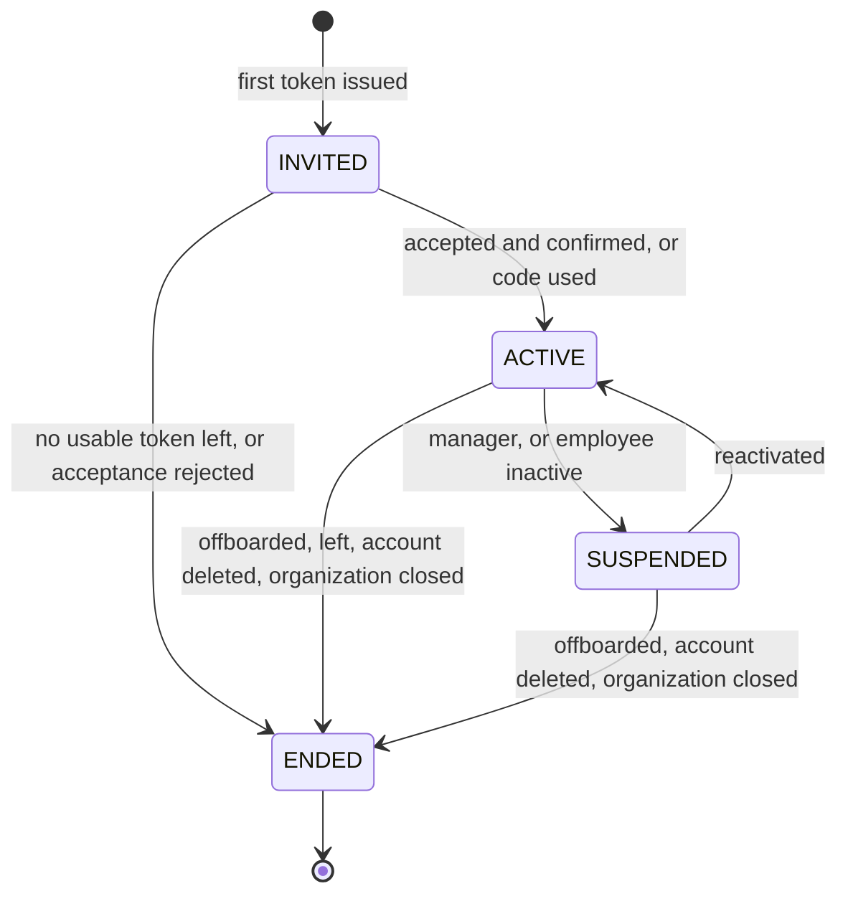

# Identity, employees and access

Status: **EMP-IDN-001/002/003/004/005/009 LOCAL_DONE / INTEGRATION_PENDING**, 2026-11-12; remaining module features PLANNED. Module code `IDN`. Tasks: `EMP-IDN-001…019` in [backlog/ep03-identity-access](../backlog/ep03-identity-access.md).

EMP-IDN-009 supplies fresh manager read/suspend/reactivate routes with original
role periods and suspension causes, immediate organization denial, actual
last-owner protection, immutable CAS outcomes and pending source notices.
[Membership access evidence](../evidence/f1-idn009-membership-access.md) records
ordinary migration190 recovery, adversarial PostGIS/race and actual HTTP/router
checks. Reactivation does not restore consumed invitations, teams, settings
designations or ownership proposals. Personal sessions and other organizations
remain independent; native locking, device revocation and offboarding remain
planned. Managed006..008 still require GOV-013.

EMP-IDN-001 confirms `membership/domain` as the private identity/lifecycle
core, separate from existing contributor proof in `identity/domain`.
[Local evidence](../evidence/f1-idn001-identity-domain.md) covers scoped
employee and membership identities, existing-account references, optional
driver association, credential descriptors and device enrolment/revocation.
There is no platform-wide person record, employee register, licence data,
storage, session issuance or runtime authorization provider in IDN-001. IDN-003 supplies the persistence and minimum deletion safeguard described below.
The implementation inventory below describes existing runtime capabilities;
the new unused pure core does not provision any of the proposed features.

Evidence. Accounts and sessions exist: `backend/internal/modules/account/` issues opaque tokens sent as `family_id` + `access_token`, with a 900-second access token and a 30-day refresh ceiling (`backend/internal/modules/account/domain/policy.go`), a session revoke route and an account deletion route (`backend/internal/modules/account/adapters/http/http.go`): `IMPLEMENTED`. Login methods are `PARTIAL` ([01-diagnosis](../01-diagnosis.md) §3.1): username plus account key works (`backend/internal/modules/account/application/keyaccounts.go`); e-mail codes exist only with the in-memory mail adapter (`backend/internal/modules/account/adapters/mail/memory.go`), so no e-mail is delivered in production; Google and Apple can only be linked to an existing account (`backend/internal/modules/account/adapters/oidc/`). Device proof of possession exists for anonymous contributors (`backend/internal/modules/identity/adapters/auth/auth.go`), one account binds to a contributor key (`backend/db/migrations/000022_account_bindings.sql`), and the personal cloud registers at most three devices per account (`backend/internal/modules/cloudsync/adapters/device.go`): `IMPLEMENTED`, all keyed to a person, none to an organization. Existing private modules erase their rows when an account is deleted through a trigger on the account status (for example `backend/db/migrations/000143_staff_roles.sql`): `IMPLEMENTED`. The Android sign-in screens are in `app/src/main/kotlin/com/anpfuel/app/ui/auth/`: `IMPLEMENTED`. EMP-IDN-003 adds minimal employee identity and membership-period persistence in `backend/internal/modules/membership/`, plus the account-deletion/billing-exit database safeguard: `LOCAL_DONE / INTEGRATION_PENDING`; see [persistence evidence](../evidence/f1-idn003-membership-persistence.md). EMP-IDN-002 adds the scoped minimal employee register, independent profile revisions, explicit duplicate review and real home-unit usage/archival effects: `LOCAL_DONE / INTEGRATION_PENDING`; see [employee register evidence](../evidence/f1-idn002-employee-register.md). EMP-IDN-004 adds manager-mediated invitation issue/read/list/CAS resend/revoke with metadata-only retries, observed expiry and causal reductions: `LOCAL_DONE / INTEGRATION_PENDING`; see [invitation evidence](../evidence/f1-idn004-invitation-lifecycle.md). EMP-IDN-005 adds fresh personal-cookie preview/consent/accept/decline, privileged or optional-policy confirmation, immutable authenticated retries, wrong-secret/unknown-locator limits and observed seven-day admission expiry: `LOCAL_DONE / INTEGRATION_PENDING`; see [acceptance evidence](../evidence/f1-idn005-invitation-acceptance.md). Activation codes, managed account provisioning, native acceptance screens and organization device enrolment remain `PROPOSED`. AUTH-002/003 now supply tested local current role/owner policy; production grants/providers remain separate gates.

## 1. Purpose

A company must be able to say who works for it, give each person an individual access with exactly the rights the job needs, and take that access away at once, without ever holding a password and without touching the person's private life in the app. A person must be able to work for a company, or for several, with one phone, and leave with their personal account intact.

This module defines the people side of an organization: who exists in its register, who can sign in, how access starts (invitation or managed corporate access), how it is recovered, suspended and ended, and what stays behind. Users: owners and administrators who manage people; every employee who receives access; platform flows that delete accounts. Expected result: no access without an explicit act by an authorized member; no shared secret; history that survives the person leaving.

## 2. Scope

- **Basic (F1; tasks marked C1 are in the first cut):** the identity domain; employee records that exist without a login; memberships and their states; invitations issued as a link or code shown to the manager; acceptance by an existing account; panel screens for employees and invitations; app screens for acceptance, the context switch and the enterprise home.
- **Also F1, outside the cut:** managed corporate access (activation code, device key enrolment, local lock, recovery), suspension, offboarding, rehire, multiple memberships, duplicate detection and merge, contact change, device registry and revocation.
- **Next (F2):** driver profile with licence category and expiry.
- **Next (F6):** the complete treatment of personal account deletion (pre-deletion notice, last-owner block, tombstone, data-subject routing). Justification: it depends on the data-subject tooling of [11-privacy-security](../11-privacy-security.md), built in F6; the minimum safeguard, ending memberships when an account is deleted, ships with membership persistence in F1.
- **Later, after a decision:** invitations delivered and bound by e-mail (EMP-GOV-014, OQ-09); a server-verified PIN for managed access (OQ-13); several employees sharing one phone.
- **Out of scope:** single sign-on with a company's identity provider; payroll, working hours or any human-resources record; a platform-wide person record; passwords chosen or reset by a manager.

## 3. Entities and ownership

Nine concepts that are kept apart:

| Concept | Owner | What it is | Invariants |
|---|---|---|---|
| Access account | The person (existing `accounts`) | The login identity. Personal by default; a **managed account** is one created by an activation code and bound to one organization (EDR-007, EDR-031). | Never owned, read or reset by an organization, except that a managed account's device enrolment can be replaced by its organization. |
| Person | Nobody (not stored) | The human being. | The platform keeps no cross-organization person record; an organization knows a person only through its employee record. |
| Employee | Organization | The organization's record of someone who works for it: the fields of the table below, state, merged-into pointer. | Exists with or without a membership. Registration number unique per organization when present. |
| Driver profile | Organization (part of the employee) | Licence categories and expiry date. | Optional; absent for employees who do not drive. |
| Membership | Organization | The link between one account and one employee record: state, start, end, end reason, account reference or tombstone. | At most one membership that is not `ENDED` per (organization, employee) and per (organization, account). |
| Role and scope | Platform catalog; assignment owned by the organization | What a member may do and where ([07-permissions](../07-permissions.md)). | An `ACTIVE` membership has at least one role assignment. |
| Credential | The person | What proves control of an account: account key, e-mail code, linked provider, or an enrolled device key. | Never stored in clear; never known to a manager. |
| Device enrolment | Organization | One installation allowed to work for one membership: device reference, key fingerprint, label, enrolled at, last sync, state, revocation class. | Separate from the personal cloud's device list and its ceiling. |
| Invitation; activation code | Organization | A single-use, expiring secret with the roles it would grant: locator, keyed hash of the secret, expiry, failed attempts, issuer, state. | Only the hash is stored; the secret is shown once. |

Employee fields and their purposes (BR-PRIV-005):

| Field | Required | Purpose |
|---|---|---|
| Display name | Yes | Identify the person on records and screens |
| Registration number (`matrícula`) | No | Match the company's own register; import key |
| Work contact (e-mail or phone) | No | Lets the manager hand over the invitation or code; addressed notices once delivery exists |
| Job title | No | Helps managers choose roles |
| Home unit and teams | No | Lists and scopes ([organizations](organizations.md)) |
| Licence categories and expiry | No | Eligibility to drive, when the organization uses that control |

Not collected: CPF, birth date, home address, photograph, health information. Licence number and licence image are collected only when the organization enables the licence control (LV-09).

Relations are drawn in [06-domain-model](../06-domain-model.md) §4.1.

## 4. Business rules

Concepts:

- **BR-IDN-001 — Accounts belong to people.** An organization never owns, reads, resets or deletes a personal account; of the account behind a membership it sees only the display alias shown at acceptance.
- **BR-IDN-002 — The employee record belongs to the organization.** An employee record is created only by a member with `idn.employee.manage` (or by creating the organization or an import), and stays with the organization whatever happens to the person's account (BR-TEN-009).
- **BR-IDN-003 — Login and driving are optional.** An employee can exist in the register with no membership, and can be assigned to assets and named on records without ever signing in; an employee has a driver profile only when the organization adds one.
- **BR-IDN-004 — One live membership.** Per organization, an employee has at most one membership that is not `ENDED`, and an account has at most one.
- **BR-IDN-005 — Membership is the only door.** Access to an organization starts only by redeeming an invitation or an activation code issued by an authorized member. Knowing a CNPJ, a registration number, a plate, an employee's name or the organization's name or identifier is never enough (BR-TEN-002).
- **BR-IDN-006 — Minimal employee data.** Only the fields listed in §3 exist, each with its stated purpose; only the display name is required (BR-PRIV-005).
- **BR-IDN-007 — Role, credential and device stay apart.** Holding a credential or an enrolled device grants no permission; permissions come only from role assignments of an `ACTIVE` membership (BR-AUTH-001).

Invitations and activation codes:

- **BR-IDN-008 — Secrets are shown once and stored hashed.** The server generates each secret from a cryptographic random source, shows it once to the issuer, and stores only a keyed hash; it is never logged, never placed in an event and cannot be shown again (BR-PRIV-008).
- **BR-IDN-009 — Single use.** The first successful redemption consumes the token in the same transaction that changes the membership; a repeat of that request with the same `operation_id` returns the first result, and any other use fails.
- **BR-IDN-010 — Expiry.** An invitation is valid for 7 days (organization-configurable 1 to 30) and an activation code for 48 hours (configurable 1 to 168 hours). A token is valid while the server time is before its expiry; expiry is checked at redemption, not only by a job.
- **BR-IDN-011 — Attempt limit and lockout.** Five failed secrets against one token make it unusable: an activation code becomes `LOCKED`, an invitation becomes `REVOKED` with reason "too many attempts"; the issuer is notified. Attempts against unknown locators are limited to 10 per hour per account, device and network address.
- **BR-IDN-012 — Uniform failure.** An unknown, expired, revoked, locked, superseded or used token, and a token of an organization that is not accepting members, all answer `TOKEN_INVALID` with no further detail to the person redeeming; the real state is visible only to the issuer's organization.
- **BR-IDN-013 — Reissue replaces.** Issuing a new invitation for an employee makes the previous pending one `SUPERSEDED`; issuing a new activation code makes the previous issued one `REVOKED`. At most one usable token exists per employee.
- **BR-IDN-014 — The issuer delivers.** Until an e-mail delivery decision exists (EMP-GOV-014), the secret is shown to the issuer as a typed code, a link and a QR code, and the issuer hands it to the employee. The link carries the secret in its fragment, so it reaches no server log.
- **BR-IDN-015 — Roles are checked twice.** The roles and scopes a token would grant are validated when it is issued (BR-AUTH-007) and again when it is redeemed; if the issuer's membership is no longer `ACTIVE` or a scope target was archived, the token is invalid.
- **BR-IDN-016 — Privileged invitations need confirmation.** When an invitation grants any role other than `DRIVER` or `OPERATIONS_STAFF`, the accepting account must be confirmed by a member with `idn.invitation.manage` before the membership becomes `ACTIVE`; unconfirmed after 7 days, the membership ends. An organization may require confirmation for every invitation.
- **BR-IDN-017 — Acceptance is informed and refusable.** Before accepting, the person sees the organization's name and whether it has a verified legal entity, the roles offered, and what the organization will and will not see; declining tells the issuer only that it was declined.
- **BR-IDN-018 — Tokens die with their context.** Pending invitations and issued codes are revoked when the employee's contact changes, when the employee becomes `INACTIVE` or `TERMINATED`, when the issuer's membership is suspended or ended, and when the organization is archived.

Two ways in:

- **BR-IDN-019 — Two models, one at a time.** An employee receives access either by invitation of an existing account or by managed corporate access, never both at once; §10.1 says which is recommended when.
- **BR-IDN-020 — No shared or manager-known secret.** No flow lets a manager choose, see or reset to a known value any password, PIN or key. The activation code stops working at its first use; afterwards the only credential of a managed account is a key generated on the device that never leaves it.
- **BR-IDN-021 — A managed account is bound to its organization.** It cannot create or join another organization, has no personal vehicles, Premium or community posting, can read public data (EDR-031), and stops working when its membership ends; other uses answer `MANAGED_ACCOUNT_RESTRICTED`.
- **BR-IDN-022 — Managed access is one app on one device.** In its first version a managed account works only in the Android app, on the single device that activated it; it cannot sign in to the business web and a second device is enrolled only by recovery.
- **BR-IDN-023 — The local lock is not a credential.** A managed account requires a device unlock after inactivity (BR-PRIV-019); the server never trusts it, and trusts only the enrolled device key and the session.
- **BR-IDN-024 — Recovery never reuses a secret.** A personal account is recovered only by the account's own methods, which the organization can neither use nor reset. A managed account is recovered only by a new activation code, which enrols a new device key and revokes the previous device.
- **BR-IDN-025 — Corporate administration stops at the organization's edge.** `idn.credential.manage` acts only on managed accounts of that organization and on that organization's device enrolments; it gives no power over a personal account's sessions, credentials, other memberships or personal data.

Lifecycle:

- **BR-IDN-026 — Suspension stops access at once.** A `SUSPENDED` membership is denied every organization action from the next request with `MEMBERSHIP_SUSPENDED`; its role assignments stay recorded and take effect again on reactivation (BR-AUTH-014).
- **BR-IDN-027 — Offboarding ends permissions and nothing else.** Ending a membership ends its role assignments and delegations, revokes its device enrolments and outstanding tokens, and leaves untouched every record the organization owns and, for a personal account, the account itself with its sessions, credentials and personal data (BR-TEN-009).
- **BR-IDN-028 — Offboarding hands work over.** Offboarding lists what the employee is still responsible for (assets assigned, trips in progress, records awaiting correction, reviews awaited from them, delegations, substitute designations); each item gets a successor or stays flagged for a manager. Offboarding never closes, cancels or deletes work by itself.
- **BR-IDN-029 — Late records get a decision.** Operations recorded before the membership ended and delivered inside the intake window are kept for review, never accepted automatically and never discarded ([10-offline-sync](../10-offline-sync.md) BR-OFFL-011, BR-OFFL-012).
- **BR-IDN-030 — The last owner is protected.** Suspension, offboarding, leaving, inactivation and account deletion are refused with `LAST_OWNER` when they would leave the organization without an active owner (BR-AUTH-006).
- **BR-IDN-031 — Members can leave.** The holder of a personal account can end their own membership at any time, subject to BR-IDN-030; the effects are those of offboarding.
- **BR-IDN-032 — Rehire is a new period on the same record.** Rehiring returns the same employee record to `ACTIVE` and, when access is given again, creates a new membership; earlier periods and their role assignments stay ended and nothing is granted again implicitly.
- **BR-IDN-033 — Memberships are independent.** A person's memberships in different organizations share nothing: roles, employee data, device enrolments and notifications of one are invisible to the other, and no organization can learn that a member belongs to another.
- **BR-IDN-034 — Duplicates are flagged, never merged automatically.** Creating or importing an employee whose registration number already exists is refused; a matching name with a matching contact raises a warning that the manager resolves.
- **BR-IDN-035 — Merge keeps history.** Merging two employee records of one organization keeps one as survivor and marks the other `TERMINATED` with a pointer to the survivor; records keep the employee identifier they were created with and resolve through the pointer. Two records that both have a live membership cannot be merged, and accounts are never merged.
- **BR-IDN-036 — Employee state drives access.** Setting an employee `INACTIVE` suspends its membership; returning to `ACTIVE` reactivates only a membership that was suspended for that reason; `TERMINATED` ends it.

Devices:

- **BR-IDN-037 — Each device is enrolled per membership.** A device works for an organization only while it has an `ENROLLED` enrolment for an `ACTIVE` membership; the default limit is 3 enrolled devices per membership (configurable 1 to 5) and 1 for a managed account.
- **BR-IDN-038 — Revocation is immediate and has a class.** A revoked device is refused from the next request. Class "lost or compromised" refuses everything the device sends afterwards; class "access ended" keeps intake-only delivery for the window of BR-OFFL-011. Local data is erased when the app next reaches the server; no immediate remote erase is promised (BR-OFFL-014, BR-PRIV-018).
- **BR-IDN-039 — Managers see enrolments, not accounts.** A manager sees, for each member, the devices enrolled in this organization (label, enrolment date, last sync); never the account's other sessions, devices or organizations.

Driver profile:

- **BR-IDN-040 — The driver profile is minimal and optional.** It holds licence categories and an expiry date. Licence number and image are stored only when the organization enables the licence control, and are deleted on the schedule of [11-privacy-security](../11-privacy-security.md) §10.1.
- **BR-IDN-041 — Eligibility is computed, not stored.** Whether a driver is eligible is derived when asked, from the expiry date and the local date of the unit; what an expired or missing licence does to a trip is decided in [trips](trips.md).

Account deletion:

- **BR-IDN-042 — Account deletion ends memberships and keeps organization records.** Deleting a personal account ends each of its memberships with reason "account deleted" and replaces the account reference with a tombstone; employee records and everything the person recorded stay with the organization (BR-TEN-009, BR-PRIV-014).
- **BR-IDN-043 — The person is told first.** Before confirming deletion the person sees the organizations they belong to, what each will keep, and any organization where they are the last owner, which blocks deletion until ownership is transferred or the organization is closed.
- **BR-IDN-044 — A managed account ends with its membership.** A managed account has no self-deletion; ending its membership disables it, and requests about the data it produced are answered by the organization (BR-PRIV-013).

## 5. Use cases

**UC-IDN-01 — Register an employee without a login.** Actor: member with `idn.employee.manage`. Main flow: enter the display name and, optionally, registration number, contact, job title, unit and teams → the server checks duplicates (BR-IDN-034) → employee `ACTIVE` with no membership. Alternatives: registration number in use → `VALIDATION_FAILED` with `DUPLICATE`; likely duplicate → warning with "use existing" or "create anyway"; unit of another organization → `NOT_FOUND`. Result: the employee can be assigned to assets and named on records; nobody can sign in as them.

**UC-IDN-02 — Invite an existing Abastevo account.** Actor: member with `idn.invitation.manage`, fresh authentication. Preconditions: employee `ACTIVE` with no `ACTIVE` or `SUSPENDED` membership; organization `ACTIVE` or `PENDING_SETUP`. Main flow: choose the employee, roles and scopes → the server checks BR-AUTH-007 → invitation `PENDING`, membership `INVITED` → the panel shows the code, link and QR code once → the manager hands it over. Alternatives: employee already has access → `EMPLOYEE_HAS_ACCESS`; role not grantable → `FORBIDDEN`; inviting oneself → `FORBIDDEN`. Result: one usable invitation exists for that employee.

**UC-IDN-03 — Accept or decline an invitation.** Actor: a person signed in with a personal account. Preconditions: the secret. Main flow: open "Entrar em uma empresa" in the app or the panel → type or scan the code → review the organization, roles and notice (BR-IDN-017) → accept → invitation `ACCEPTED`; membership `ACTIVE` with its role assignments, or still `INVITED` awaiting confirmation (BR-IDN-016); in the app the device is enrolled → first entry shows what the organization collects ([11-privacy-security](../11-privacy-security.md), BR-PRIV-015) and then the enterprise home. Alternatives: decline → `DECLINED`; invalid token of any kind → `TOKEN_INVALID`; account already a member of that organization → `ALREADY_MEMBER`, invitation unchanged; managed account → `MANAGED_ACCOUNT_RESTRICTED`; not signed in → sign in or create an account first, then return. Result: the person is a member, or nothing changed.

**UC-IDN-04 — Resend or revoke an invitation.** Actor: member with `idn.invitation.manage`. Main flow: resend → a new invitation with a new secret; the old one becomes `SUPERSEDED`. Revoke → `REVOKED`; when no usable token remains, the `INVITED` membership ends. Confirm or reject an acceptance awaiting confirmation → membership `ACTIVE`, or `ENDED`. Alternatives: invitation already terminal → `CONFLICT`. Result: at most one usable token per employee (BR-IDN-013).

**UC-IDN-05 — Issue an activation code for managed access.** Actor: member with `idn.credential.manage`, fresh authentication. Preconditions: employee `ACTIVE`; no live membership held by a personal account. Main flow: choose the employee and roles (never `OWNER`) → activation code `ISSUED`, membership `INVITED` → code shown once as text and QR code → the manager hands it over in person. Alternatives: employee has access through a personal account → `EMPLOYEE_HAS_ACCESS`; role needs the business web → the screen explains that managed access is app-only (BR-IDN-022). Result: one usable code.

**UC-IDN-06 — Activate managed access on the device.** Actor: the employee, with the app installed and no account needed. Main flow: choose "Ativar acesso corporativo" → type or scan the code → the app generates a key pair in the device keystore and sends the code, the public key and a proof of possession → in one transaction the server marks the code `USED`, creates the managed account, enrols the device, makes the membership `ACTIVE` with its roles and opens a session → the app asks the employee to confirm the device unlock (BR-IDN-023) → collection notice → enterprise home. Alternatives: invalid code → `TOKEN_INVALID`; fifth failure → `LOCKED`; device without a secure lock screen → activation refused with instructions; connection lost after the server committed → the repeat with the same `operation_id` returns the same result. Result: an individual corporate access that nobody else knows how to reproduce.

**UC-IDN-07 — Recover access.** Personal account: the person recovers the account by its own methods; the membership is unaffected. When the account is lost for good, a manager ends the membership (UC-IDN-09 without termination) and invites the new account to the same employee record. Managed account: a manager with `idn.credential.manage` issues a new activation code, stating whether the old device is lost → the employee activates on the new device → the new device is `ENROLLED`, the old one `REVOKED` with the stated class, the membership and its history continue. Alternatives: lost device → [11-privacy-security](../11-privacy-security.md) UC-PRIV-03, and the manager is told that unsent records on it are lost. Result: access restored without any secret being revealed.

**UC-IDN-08 — Suspend and reactivate a membership.** Actor: member with `idn.membership.manage`, fresh authentication. Main flow: choose the member and a reason → membership `SUSPENDED` → next request denied; the app locks the organization's data on the device. Reactivate → `ACTIVE`; role assignments that did not expire meanwhile apply again. Alternatives: last owner → `LAST_OWNER`; suspending oneself → `FORBIDDEN`; records delivered while suspended → BR-IDN-029. Result: access paused, nothing lost.

**UC-IDN-09 — Offboard an employee.** Actor: member with `idn.membership.manage`, fresh authentication. Main flow: open the offboarding screen → the server lists open responsibilities and the last sync of each device (BR-IDN-028) → the manager names successors or leaves items flagged, and chooses whether the employee record becomes `TERMINATED` or stays in the register → in one transaction: membership `ENDED`, role assignments and delegations ended, devices revoked with class "access ended", outstanding tokens revoked, managed account disabled → supervisors are notified of trips in progress. Alternatives: last owner → `LAST_OWNER`; successors missing for items that require one → `OPEN_RESPONSIBILITIES`; trips in progress are handled as specified in [trips](trips.md); records still on the phone → UC-OFFL-07 in [10-offline-sync](../10-offline-sync.md). Result: no permission remains; organization history and the personal account are intact.

**UC-IDN-10 — Leave an organization.** Actor: member with a personal account. Main flow: open "Sair desta empresa" → the app shows pending records and what stays with the organization → confirm with fresh authentication → same effects as UC-IDN-09 with reason "left"; managers are notified. Alternatives: last owner → `LAST_OWNER` with a link to ownership transfer in [organizations](organizations.md); pending records → sent first or kept under [10-offline-sync](../10-offline-sync.md) SCR-OFFL-04. Result: the organization disappears from the person's context list.

**UC-IDN-11 — Rehire.** Actor: member with `idn.membership.manage`. Preconditions: employee `TERMINATED` and not merged away. Main flow: reopen the record → employee `ACTIVE` → give access again through UC-IDN-02 or UC-IDN-05 → a new membership with new role assignments. Alternatives: the person now uses a different account → nothing special; the new membership simply links the new account. Result: one employee record with several membership periods (BR-IDN-032).

**UC-IDN-12 — Work in several organizations.** Actor: a person with a personal account. Main flow: accept invitations from two organizations → two memberships, two employee records, one device enrolment per organization on the same phone → switch between them with UC-AUTH-04 in [07-permissions](../07-permissions.md). Alternatives: one organization suspends the membership → only that one is unavailable. Result: independent memberships (BR-IDN-033).

**UC-IDN-13 — Resolve duplicate employees.** Actor: member with `idn.employee.manage`. Main flow: open the duplicates list or a warning → compare the two records → choose the survivor → confirm → the other record becomes `TERMINATED` with a pointer; team links move to the survivor. Alternatives: both have a live membership → `MERGE_CONFLICT`, end one first; records of different organizations → never offered. Result: one record going forward; history readable through the pointer (BR-IDN-035).

**UC-IDN-14 — Change an employee's contact.** Actor: member with `idn.employee.manage`. Main flow: edit the work e-mail or phone → the server revokes pending invitations and issued codes for that employee (BR-IDN-018) → the manager reissues when needed. Alternatives: nothing outstanding → plain edit. Result: nothing sent to the old contact can be used.

**UC-IDN-15 — Maintain a driver profile (F2).** Actor: member with `idn.employee.manage`. Main flow: add licence categories and expiry to an employee → eligibility is shown as eligible, expired or not informed. Alternatives: expiry in the past → saved with a warning; licence control disabled → number and image fields do not exist. Result: other modules can ask whether the employee may drive (BR-IDN-041).

**UC-IDN-16 — List and revoke devices and sessions.** Actors: any member for their own devices; member with `idn.credential.manage` for devices enrolled in the organization. Main flow: open the list → choose a device → revoke as "lost or compromised" or as "no longer used" → the server refuses it from the next request → at next contact the app erases the organization's data on it. Alternatives: lost phone → UC-PRIV-03; revoking the only device of a managed account → the employee needs UC-IDN-07; a personal account's own session list and revocation use the existing account routes and are never shown to managers. Result: the device no longer works for the organization.

**UC-IDN-17 — Delete a personal account that has memberships (F6).** Actor: the account holder. Main flow: request deletion → the app lists memberships, what each organization keeps and any last-owner block (BR-IDN-043) → after resolving blocks, confirm → the existing erasure runs for personal data; for organizations, memberships end and the account reference becomes a tombstone. Alternatives: last owner → blocked with `LAST_OWNER`; the person asks an organization about data it keeps → the organization answers through [11-privacy-security](../11-privacy-security.md) UC-PRIV-01. Result: the personal account is gone; organization records remain under their schedule.

## 6. States and transitions

State names are those of [08-state-model](../08-state-model.md) §3. Membership:

| From | To | Actor | Validation | Effect | Reversal |
|---|---|---|---|---|---|
| — | `INVITED` | System, when the first invitation or code is issued | Employee `ACTIVE`; no other live membership | No access | Ends when no usable token remains |
| `INVITED` | `ACTIVE` | The redeeming person; plus a confirming manager when BR-IDN-016 applies | Token valid; account not already a member | Role assignments created; device enrolled; audit | Suspend or end |
| `INVITED` | `ENDED` | System or `idn.invitation.manage` | Last token terminal without redemption, or acceptance rejected or unconfirmed for 7 days | None | New invitation creates a new membership |
| `ACTIVE` | `SUSPENDED` | `idn.membership.manage`, or system when the employee becomes `INACTIVE` | BR-IDN-030; reason | BR-IDN-026; tokens issued by the member revoked | Reactivate |
| `SUSPENDED` | `ACTIVE` | `idn.membership.manage`, or system when the employee returns to `ACTIVE` | Employee `ACTIVE` | Access resumes | Suspend again |
| `ACTIVE`, `SUSPENDED` | `ENDED` | `idn.membership.manage`; the member (leave); system (account deleted, organization closed) | BR-IDN-030; BR-IDN-028 | BR-IDN-027 | None; rehire creates a new membership |

Employee record:

| From | To | Actor | Validation | Effect | Reversal |
|---|---|---|---|---|---|
| — | `ACTIVE` | `idn.employee.manage`, organization creation, import | BR-IDN-034 | Can be assigned and given access | Remove while nothing references it |
| `ACTIVE` | `INACTIVE` | `idn.employee.manage` | BR-IDN-030; reason | No new assignments; membership suspended; tokens revoked | Return to `ACTIVE` |
| `INACTIVE` | `ACTIVE` | `idn.employee.manage` | — | BR-IDN-036 | — |
| `ACTIVE`, `INACTIVE` | `TERMINATED` | `idn.membership.manage` (offboarding), or `idn.employee.manage` (merge) | BR-IDN-030; BR-IDN-028 | Membership ended; retention clock of personal fields starts | Rehire, unless merged |
| `TERMINATED` | `ACTIVE` | `idn.membership.manage` (rehire) | Not merged away | BR-IDN-032 | Terminate again |

Invitation:

| From | To | Actor | Validation | Effect | Reversal |
|---|---|---|---|---|---|
| — | `PENDING` | `idn.invitation.manage`, fresh authentication | Employee `ACTIVE` without access; BR-AUTH-007 | Secret shown once; earlier pending invitation `SUPERSEDED` | Revoke |
| `PENDING` | `ACCEPTED` | Personal account holding the secret | BR-IDN-010, BR-IDN-011, BR-IDN-015 | Membership `ACTIVE`, or `INVITED` awaiting confirmation | End the membership |
| `PENDING` | `DECLINED` | Same | — | Issuer notified | New invitation |
| `PENDING` | `EXPIRED` | Time | Validity passed | — | New invitation |
| `PENDING` | `REVOKED` | `idn.invitation.manage`, or system under BR-IDN-011 and BR-IDN-018 | — | Secret unusable | New invitation |
| `PENDING` | `SUPERSEDED` | System on reissue | — | Secret unusable | — |

Activation code:

| From | To | Actor | Validation | Effect | Reversal |
|---|---|---|---|---|---|
| — | `ISSUED` | `idn.credential.manage`, fresh authentication | Employee `ACTIVE`; no live membership of a personal account; role is not `OWNER` | Secret shown once; earlier issued code `REVOKED` | Revoke |
| `ISSUED` | `USED` | The app on the activating device | BR-IDN-010, BR-IDN-011, BR-IDN-015; proof of possession valid | UC-IDN-06; on recovery the previous device is revoked | Revoke the device or end the membership |
| `ISSUED` | `EXPIRED` | Time | Validity passed | — | New code |
| `ISSUED` | `REVOKED` | `idn.credential.manage`, or system under BR-IDN-018 | — | Secret unusable | New code |
| `ISSUED` | `LOCKED` | System | Fifth failed secret | Secret unusable; issuer notified | New code |

Device:

| From | To | Actor | Validation | Effect | Reversal |
|---|---|---|---|---|---|
| — | `ENROLLED` | System, at acceptance in the app, at activation, or when a member first enters enterprise mode on another device | Membership `ACTIVE`; device proof valid; under the limit of BR-IDN-037 | Operations from the device are accepted; member and managers notified of a new device | Revoke |
| `ENROLLED` | `REVOKED` | The member; `idn.credential.manage`; system (membership ended, recovery, organization closed) | Class recorded | BR-IDN-038 | None; a later enrolment is a new record |

## 7. Roles and permissions

Keys are those of [07-permissions](../07-permissions.md) §7.2; roles follow its matrix §7.3.

| Permission | Used for | Roles |
|---|---|---|
| `idn.employee.read` | Lists and details of employees in scope | `OWNER`, `ADMIN`, `FLEET_MANAGER`, `SUPERVISOR`, `FINANCE`, `APPROVER`, `AUDITOR` |
| `idn.employee.manage` | UC-IDN-01, UC-IDN-13, UC-IDN-14, UC-IDN-15 | `OWNER`, `ADMIN` |
| `idn.invitation.manage` | UC-IDN-02, UC-IDN-04 | `OWNER`, `ADMIN` |
| `idn.credential.manage` | UC-IDN-05, UC-IDN-07, UC-IDN-16 for others' devices | `OWNER`, `ADMIN` |
| `idn.membership.manage` | UC-IDN-08, UC-IDN-09, UC-IDN-11 | `OWNER`, `ADMIN` |

Scope: `idn.employee.read` held in a `UNIT` or `TEAM` scope covers employees whose home unit or team is that one; the manage permissions are granted with scope `ORG`. Needing no permission: redeeming a token (the secret is the authority), seeing one's own employee data, devices and access, and leaving. Fresh authentication (BR-AUTH-010) is required to issue invitations and activation codes, to suspend, offboard and leave, and to revoke another person's device. Nobody issues a token for, suspends or offboards their own employee record through the management commands (BR-AUTH-007). Platform operators perform none of these actions for an organization outside a support session ([back-office](back-office.md)).

## 8. Offline, concurrency, idempotency and corrections

- **Offline:** signing in, redeeming an invitation, activating managed access and every management command need the server ([10-offline-sync](../10-offline-sync.md) §10.3); offline they are disabled with the reason (BR-OFFL-017). After activation the app works offline as that file describes. The app caches the member's own employee data and the membership state with the time it was confirmed.
- **Concurrency:** two redemptions of one token race on the token row; one succeeds, the other receives `TOKEN_INVALID`. Membership commands carry the membership revision; a stale one fails with `CONFLICT`. The last-owner check runs under the organization row lock shared with role management ([07-permissions](../07-permissions.md) §8). An operation received after a suspension or an end is judged by the server's history at receipt, not by arrival order (BR-TIME-003).
- **Idempotency:** every command carries an `operation_id`. Redemption is idempotent for the same account or device and the same identifier, so a lost answer never burns a token without creating the membership.
- **Corrections:** employee fields are edited with an audit event. The wrong person accepted an invitation → end that membership and invite again; records made meanwhile stay attributed to the membership that made them. Duplicates are merged (UC-IDN-13). A suspension or offboarding made by mistake is corrected by reactivation or by a new membership; assignments are granted again explicitly.

## 9. Events, notifications and integrations

Produced: `idn.employee.created`, `idn.employee.changed`, `idn.employee.terminated`, `idn.employee.merged`, `idn.invitation.issued`, `idn.invitation.accepted`, `idn.invitation.declined`, `idn.invitation.revoked`, `idn.code.issued`, `idn.code.used`, `idn.code.locked`, `idn.membership.activated`, `idn.membership.suspended`, `idn.membership.reactivated`, `idn.membership.ended`, `idn.device.enrolled`, `idn.device.revoked`. No event carries a secret, a contact or a name (BR-AUD-004, BR-PRIV-008).

Consumed: `org.organization.archived` and `org.organization.closed` (revoke tokens; end memberships at closure); `org.unit.archived` (clear home unit); `auth.assignment.ended` (an `ACTIVE` membership left with no assignment is reported to administrators); the existing account-deletion event (BR-IDN-042).

Notifications, in-app first (EDR-032): the issuer when a token is accepted, declined, locked or expires unused; administrators when an acceptance awaits confirmation or a new device is enrolled; the member when suspended, reactivated or offboarded, and when a device of theirs is revoked; supervisors at offboarding about trips in progress. The secret itself is never sent by the system until EMP-GOV-014 decides a delivery channel.

Integrations: none in F1. Employee import is specified in [imports-notifications-integrations](imports-notifications-integrations.md); e-mail delivery is a later channel behind a port.

## 10. Data, formulas and examples

### 10.1 Which model to use

| Situation | Recommended | Why | How access is recovered |
|---|---|---|---|
| The person already uses Abastevo or can keep an account of their own | Invitation | One login for personal mode and for one or more companies; credentials stay with the person | By the account's own methods (username and account key today, AS-04). The organization cannot reset it. If the account is lost for good: end the membership and invite the new account to the same employee record. |
| Owner, administrator, finance, approver or any role that uses the business web | Invitation, always | A managed account cannot own an organization or sign in to the web (BR-IDN-021, BR-IDN-022) | Same |
| Field employee with no Abastevo account and no e-mail | Managed access | Nothing to remember; activated in person with a code | A manager issues a new activation code; the previous device is revoked |
| Employee who does not want a personal account linked to work | Managed access | Complete separation from personal mode | Same |
| Person who works for two companies | Invitation | A managed account is bound to one organization | — |
| One phone shared by several employees | Not supported in the first version | The local lock is the device's, shared by its users; waits for OQ-13 | — |

### 10.2 Token format and defaults

The implemented existing-account invitation format is `AIN1.<UUID locator>.<base64url secret>` (EDR-049/050): a random locator and 256 random secret bits. Only a domain-separated keyed verifier is stored and comparisons use constant time. A valid locator with a malformed secret still counts as a failed secret. The fragment-only handover link never sends the code in a URL query. A first successful issue/resend displays it once; immutable operation receipts cannot recover it.

The earlier `LLLLLL-SSSS-SSSS` construction (6-symbol locator and 8-symbol secret from the 31-symbol account-key alphabet) remains a **managed-code proposal**, subject to EMP-GOV-013. Its `31^8` guessing calculation does not describe the implemented invitation. Managed activation remains gated and unimplemented in this task.

| Token | Validity (default; range) | Uses | Failed attempts | At the limit |
|---|---|---|---|---|
| Invitation | 7 days = 604 800 s; 1 to 30 days | 1 | 5 | `REVOKED`, reason "too many attempts" |
| Activation code (first access and recovery) | 48 hours = 172 800 s; 1 to 168 hours | 1 | 5 | `LOCKED` |
| Acceptance awaiting confirmation | 7 days | — | — | Membership `ENDED` |
| Unknown locators | — | — | 10 per hour per account, device and network address | `RATE_LIMITED` |

### 10.3 Error codes added by this module

| Code | HTTP | Meaning |
|---|---|---|
| `TOKEN_INVALID` | 404 | The invitation or code cannot be used; no detail (BR-IDN-012) |
| `ALREADY_MEMBER` | 409 | The account already has a live membership in that organization |
| `EMPLOYEE_HAS_ACCESS` | 409 | The employee already has a live membership of the other model, or an active one |
| `MANAGED_ACCOUNT_RESTRICTED` | 403 | A managed account attempted something outside its organization's enterprise mode |
| `OPEN_RESPONSIBILITIES` | 409 | Offboarding needs successors for the listed items |
| `MERGE_CONFLICT` | 409 | Both employee records have a live membership |
| `DEVICE_LIMIT_REACHED` | 409 | The membership already has the maximum of enrolled devices |

Shared codes (`LAST_OWNER`, `MEMBERSHIP_SUSPENDED`, `MEMBERSHIP_ENDED`, `FRESH_AUTH_REQUIRED`, `RATE_LIMITED`) are in [09-architecture](../09-architecture.md) §6; `DEVICE_REVOKED` is in [10-offline-sync](../10-offline-sync.md) §10.2.

### 10.4 Worked examples

**Invitation.** A manager invites driver Bruno at `2026-11-10T14:00:00Z` with role `DRIVER`, scope `SELF`. The invitation expires at `2026-11-10T14:00:00Z + 604 800 s = 2026-11-17T14:00:00Z`. Bruno signs in with his own account on 12 November, types the code and accepts: invitation `ACCEPTED`, membership `ACTIVE` (no confirmation needed for `DRIVER`), device `ENROLLED`. Had he typed it at `2026-11-17T14:00:00Z` exactly, the server time would not be before the expiry: `TOKEN_INVALID` for Bruno, `EXPIRED` in the manager's list.

**Reissue.** The manager resends Bruno's invitation on 11 November: invitation 1 becomes `SUPERSEDED`, invitation 2 is `PENDING`. The code of invitation 1 now answers `TOKEN_INVALID`.

**Privileged invitation.** The manager invites Ana as `SUPERVISOR` of unit Norte. Ana accepts: invitation `ACCEPTED`, membership still `INVITED`, and the manager sees "Ana (alias ana.silva) aceitou — confirmar?". The manager confirms: membership `ACTIVE`. If the alias had been unknown to the manager, rejecting it ends the membership and nobody gained access.

**Managed access and lockout.** A code is issued for Carla at `2026-11-10T14:00:00Z` and expires at `2026-11-12T14:00:00Z` (172 800 s later). Someone tries five wrong secrets with the right locator: the code is `LOCKED` and the manager is notified. Carla's correct code now answers `TOKEN_INVALID`; the manager issues a new one. Carla activates: managed account created, device `ENROLLED`, membership `ACTIVE`. The manager never saw or chose any password, and the code no longer works.

**Offboarding with records still on the phone.** Carla is offboarded at `2026-11-10T18:00:00Z`. The intake window is 15 days = 1 296 000 s and closes at `2026-11-25T18:00:00Z`. Her phone, offline since noon, holds three fuelings declared at 13:42, 15:10 and 17:05 that day, and she starts a trip offline at `2026-11-11T08:00:00Z`. The phone reconnects at `2026-11-12T09:00:00Z`: the three fuelings are `ACCEPTED_FOR_REVIEW` with `ACCESS_ENDED_BEFORE_RECEIPT` and wait for a manager; the trip start is `REJECTED` with `MEMBERSHIP_ENDED`. Had the phone reconnected at `2026-11-26T00:00:00Z`, everything would be `REJECTED` with `INTAKE_WINDOW_CLOSED` ([10-offline-sync](../10-offline-sync.md) §10.2).

**Leaving with a personal account.** Bruno leaves the company. His membership is `ENDED`; his trips and fuelings remain in the organization's records under his employee record. His personal account, personal vehicles, history and community identity are exactly as before, and "Modo empresa" no longer lists that organization.

**Rehire.** Carla returns in March. Her employee record, the same identifier, goes from `TERMINATED` to `ACTIVE`; a new activation code creates membership 2. Membership 1 stays `ENDED` with its original period. Her records of last year still point to the same employee.

**Account deletion.** Diego is a driver in organization A and the only owner of organization B. He asks to delete his account. The app lists both: A keeps his employee record and what he recorded; B blocks deletion with `LAST_OWNER`. He transfers ownership of B, confirms deletion, and both memberships become `ENDED` with reason "account deleted". In A, his past trips still show his name as the organization recorded it; the account reference is a tombstone that resolves to nothing.

## 11. Screens

| ID | Surface | Objective | Actor | Data | Actions | Rules and permissions | Validations and states |
|---|---|---|---|---|---|---|---|
| SCR-IDN-01 | PANEL | Find employees and see who has access | `idn.employee.read` | Name, registration number, unit, teams, employee state, access state (none, invited, active, suspended), model (invitation or corporate) | Filter, open, add employee, import | BR-IDN-003, BR-IDN-039 | Empty: "Nenhum funcionário além de você" with add and import actions. Access state is text, not colour only. |
| SCR-IDN-02 | PANEL | Create or edit an employee record | `idn.employee.manage` | Fields of §3, driver profile, duplicate warning | Save, set inactive, open access section | BR-IDN-006, BR-IDN-034, BR-IDN-036 | Duplicate registration number on the field. Likely duplicate: side-by-side comparison before saving. Contact change warns that pending tokens will be revoked. |
| SCR-IDN-03 | PANEL | Give access by invitation | `idn.invitation.manage` | Employee, role catalog with plain descriptions, scopes, validity; then code, link and QR code once | Issue, copy, print | BR-IDN-008, BR-IDN-013 to BR-IDN-016, BR-AUTH-007, BR-AUTH-010 | Says the code is shown only once and how long it lasts. Not grantable roles disabled with the reason. Asks for fresh authentication. |
| SCR-IDN-04 | PANEL | Follow invitations and codes | `idn.invitation.manage` or `idn.credential.manage` | Token kind, employee, issuer, state, expiry, failed attempts, acceptances awaiting confirmation with the account alias | Resend, revoke, confirm, reject | BR-IDN-011, BR-IDN-012, BR-IDN-016 | Empty: "Nenhum convite pendente". Never shows a secret. Locked and expired tokens say why and offer reissue. |
| SCR-IDN-05 | PANEL | Give or recover corporate access | `idn.credential.manage` | Employee, roles, whether the previous device is lost; then code and QR code once | Issue, print | BR-IDN-019 to BR-IDN-025 | Unavailable until managed access is enabled: hidden. Explains app-only use and that nobody will know a password. Recovery states that unsent records on a lost device are lost. |
| SCR-IDN-06 | PANEL | Manage one member's access | `idn.membership.manage`, `idn.credential.manage` | Membership state and periods, roles (link to access screens), devices with last sync | Suspend, reactivate, revoke device, start offboarding | BR-IDN-026, BR-IDN-030, BR-IDN-038, BR-IDN-039 | Last owner: actions disabled with the reason and a link to ownership transfer. Shows only this organization's enrolments. |
| SCR-IDN-07 | PANEL | Offboard with handover | `idn.membership.manage` | Open responsibilities by kind with counts, successors, device last sync, intake window, choice to terminate the record | Name successors, confirm | BR-IDN-027 to BR-IDN-029 | Says that records may still arrive for the window and will need a decision. Missing successor shown per item. |
| SCR-IDN-08 | PANEL | Resolve duplicates | `idn.employee.manage` | Candidate pairs, differences, memberships | Merge, dismiss | BR-IDN-034, BR-IDN-035 | Empty: "Nenhum possível duplicado". Both with access: explains what to end first. |
| SCR-IDN-09 | APP, PANEL | Enter a company with a code | Signed-in personal account (invitation); anyone (activation, app only) | Code field, QR scanner | Continue | BR-IDN-005, BR-IDN-012 | Offline: disabled with the reason. Any failure: one message, "Código inválido ou expirado. Peça um novo ao responsável". Large touch targets; code accepted with or without hyphens. |
| SCR-IDN-10 | APP, PANEL | Decide on an invitation | Signed-in personal account | Organization name and verification status, roles offered, what the company will and will not see | Accept, decline | BR-IDN-017 | Awaiting confirmation: explains that a manager must confirm. No pre-selected choice. |
| SCR-IDN-11 | APP | Activate corporate access | Employee with a code | Progress of key creation and activation; device lock requirement | Activate, retry | BR-IDN-020, BR-IDN-023 | No secure lock screen: explains how to set one. Connection lost: safe retry. Never asks for or shows a password. |
| SCR-IDN-12 | APP | Enterprise home | Any member | Organization name always visible, sync status, entries to the modules the member may use, notices | Open module, switch context, open pending records | BR-AUTH-012, BR-OFFL-010 | Suspended membership or organization: banner with the reason and what still works. Empty: explains that the company has not assigned anything yet. |
| SCR-IDN-13 | APP, PANEL | See my access, devices and data in this company | Any member | Own employee data, roles (link), enrolled devices, pending records | Revoke own device, leave the company | BR-IDN-031, BR-IDN-038 | Leaving shows what stays with the company. Managed account: "leave" replaced by "ask your manager". |
| SCR-IDN-14 | APP | Know that access was suspended or ended | Former or suspended member | State, date, pending records and what will happen to them | Send pending records, dismiss | BR-IDN-026, BR-IDN-029, BR-OFFL-013 | Never shows organization data behind the notice. Window closed: says to contact the company. |
| SCR-IDN-15 | APP | Understand what deleting the account does to company records | Account holder | Organizations, what each keeps, last-owner blocks | Resolve block, continue to deletion | BR-IDN-042, BR-IDN-043 | Shown before the existing deletion confirmation. Block: link to ownership transfer. |

The context switcher is SCR-AUTH-04 and "my access" is SCR-AUTH-05 in [07-permissions](../07-permissions.md); the first-entry notice is SCR-PRIV-01 and the app lock SCR-PRIV-05 in [11-privacy-security](../11-privacy-security.md).

## 12. Acceptance, dependencies, risks, phase and microtasks

Acceptance criteria:

1. An employee created without a login can be assigned and named on records, and no request made with that employee's identifier, registration number or the organization's identifier obtains a session or a membership.
2. The secret of an invitation or code appears exactly once in an API response, and a scan of the database, logs and events in the test suite finds no copy of it.
3. A token is refused at its expiry instant and afterwards, after its first use, after reissue, after revocation and after the fifth failed attempt; in every case the redeeming caller receives the same `TOKEN_INVALID` body.
4. Two concurrent redemptions of one invitation create one membership.
5. An invitation that grants `SUPERVISOR` leaves the membership `INVITED` until a manager confirms; one that grants `DRIVER` activates at once.
6. Activation creates a managed account whose only credential is the device key; no API accepts or returns a password for it; the used code fails on a second device.
7. A managed account cannot create an organization, redeem another organization's invitation, sign in to the business web or write personal-mode data.
8. Recovery enrols the new device and revokes the old one; a request signed by the old device key is refused.
9. A member with `idn.credential.manage` has no route that lists or revokes a personal account's sessions, credentials or other memberships.
10. Suspending a membership denies its next request with `MEMBERSHIP_SUSPENDED`; reactivating restores the assignments that did not expire.
11. After offboarding: every organization request of that account is denied; the organization's records authored by the person are unchanged; with a personal account, a personal-mode request made with the same session still succeeds.
12. The offboarding example of §10.4 produces the stated intake results.
13. The last owner cannot be suspended, offboarded, set inactive, merged away, leave or delete their account.
14. Rehire reuses the employee identifier, creates a new membership identifier and grants no role by itself.
15. In a two-organization fixture, a member of both sees each organization's data only in its own context, and no response of one organization reveals the other membership.
16. Merging keeps both identifiers resolvable; a record created by the merged employee still displays the person.
17. Deleting a personal account ends its memberships, leaves employee records and operations intact and replaces the account reference with a tombstone.
18. A device revoked as lost is refused entirely; a device revoked because access ended delivers earlier operations for review inside the window and nothing else.

Dependencies: [organizations](organizations.md) (organization, units, teams); [07-permissions](../07-permissions.md) (roles, authorization pipeline, last-owner rule); [09-architecture](../09-architecture.md) (API conventions, audit, web session, Android foundation); [10-offline-sync](../10-offline-sync.md) (intake after access ends); [11-privacy-security](../11-privacy-security.md) (device protection, lost device, data-subject requests); EMP-GOV-013 (security review of managed credentials); EMP-GOV-014 (delivery channels); the existing `account` and `identity` modules.

Risks: an invitation handed to the wrong person (confirmation for privileged roles, alias shown, single use, short validity); a manager and employee sharing a phone or a code (individual codes, device binding, audit of issuer); account-key loss by employees who use invitations (managed access offered as the alternative; recovery path stated in §10.1); device loss with unsent records (stated openly in the recovery and revocation screens); the device-key login for managed accounts being new attack surface (EMP-GOV-013 before EMP-IDN-006); over-collection of employee data by habit (closed field list, BR-IDN-006); confusion between the personal cloud device ceiling and organization enrolments (separate records, BR-IDN-037).

Phase: F1 for everything except the driver profile (F2) and the complete account-deletion treatment (F6), both justified in §2. Managed access is F1 but outside cut C1, because the cut signs people in with existing accounts ([14-roadmap](../14-roadmap.md) §4). Microtasks: EMP-IDN-001 to EMP-IDN-019.

EMP-IDN-004 source interpretation (EDR-049): F1 invitations contain1..10 fixed
ORG/SELF role templates within actual current grant authority. They reserve an
unbound INVITED membership and create no roles/accounts. Issue while a live
reservation exists requires explicit resend of its pending invitation and CAS
revision, rather than replacing another manager's code accidentally. A resend
uses current settings validity and issuer authority, supersedes the old token,
and preserves its unbound reservation. Exact command retries return original
metadata without delivery; lost delivery requires another explicit resend.

The first committed response supplies a 256-bit code, a fragment-only panel link
and that link as QR payload. The panel rendering and recipient flow retain their
own tasks. The database retains a keyed verifier only; key rotation requires
reissue. Status/list responses never contain the verifier or delivery. Notices
remain PENDING_NOTIFICATION_CORE. Expiry materializes at actual scoped manager
access and ends unused reservations; IDN-005 must enforce time/context again on
every redemption and implement the public uniform-failure/attempt limits. No
scheduled notification delivery, public redemption, provider or device acceptance
is claimed by IDN-004. The feature plane remains off by default.
