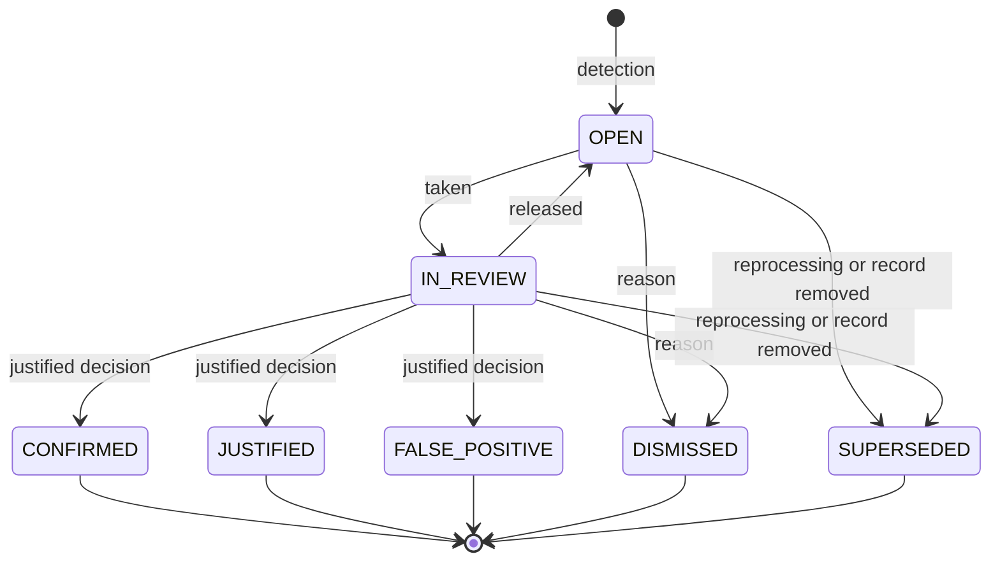
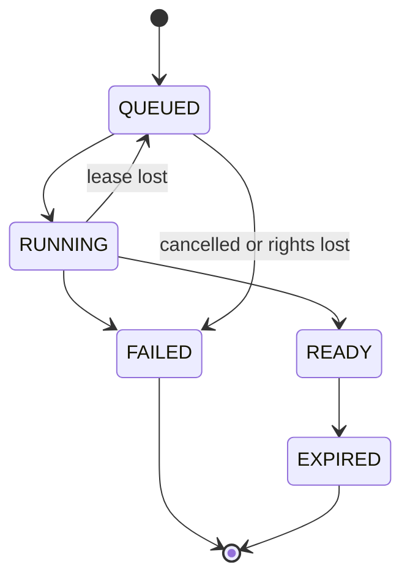

# Intelligence: indicators, findings, reports and exports

Status: **PLANNED**, 2026-11-10. Module code(s) `KPI`, `FIND`, `RPT`. Tasks: `EMP-KPI-001…006`, `EMP-FIND-001…005`, `EMP-RPT-001…006` in [backlog/ep13-intelligence](../backlog/ep13-intelligence.md). This file also owns the indicator definitions (`IND`) and the finding types (`FT`) named in [00-conventions](../00-conventions.md) §2.

Evidence. `IMPLEMENTED`: a pure consumption and cost engine in `backend/internal/modules/metrics/` (`consumption.go`: full-to-full `Interval.Compute`; `cost.go`: `FuelPurchasePerKm`, `MatchedWindowCost`, `SumIntervals`, calculation version 1), its Kotlin twin `domain/src/main/kotlin/com/anpfuel/domain/premium/PremiumConsumption.kt` and shared vectors in `contracts/testdata/premium/`; the engine is reached today only through an account-keyed reader (`backend/internal/modules/metrics/application/ports.go`). Public price read models exist for official ANP prices with revision, survey week, collection date and source checksum (`backend/internal/modules/official/application/queries.go`, `PriceReader`, fixed `STANDARD` condition) and for the community projection with query-time expiry (`backend/internal/modules/community/adapters/read/`). The Android app exports the personal monthly indicators as CSV with formula-injection-safe escaping (`application/src/main/kotlin/com/anpfuel/application/usecase/ledger/MonthlyIndicatorsUseCases.kt`, object `MonthlyIndicatorsCsv`), and the public data portal writes CSV with the same protection (`backend/internal/modules/enterpriseexport/portalgen/downloads.go`, `csvSafe`). The job queue has de-duplication keys, `not_before` and per-kind serial dispatchers (`backend/internal/platform/jobs/`, `backend/cmd/worker/dispatchers.go`). `PARTIAL`: audit exists only as module ledgers and `admin_audit_events`; there is no organization audit trail ([01-diagnosis](../01-diagnosis.md) §3.7). `PROPOSED`: organization indicators, price comparisons, findings, export jobs, reports, the audit viewer and the module `backend/internal/modules/insight/` (proposed). `backend/go.mod` lists no PDF or spreadsheet-writing library.

## 1. Purpose

Managers need to know what the fleet costs and consumes, where a record deserves a second look, and how to take the data out of the system. This module turns approved facts into figures with a stated method, raises differences for human review without accusing anyone, and produces files that say what they contain. The expected result is that every number can be traced to its records and its method, every missing input is shown as missing, and every finding ends with a justified human decision.

## 2. Scope

- **Basic (F3):** export jobs with private files and expiring access; CSV and spreadsheet exports of operational lists.
- **Next (F6):** indicator registry; read models by organization, unit, cost centre, driver, vehicle, trip, supplier and period; price comparison with stored reference and methodology; dashboards and drill-downs; findings with detection, review, justification and outcome; reprocessing; PDF reports; scheduled reports; full organization data export; audit trail viewer.
- **Later:** indicators defined by the organization as combinations of registry indicators; consolidated reading across an organization group ([organizations](organizations.md)); station-announced and negotiated prices as reference sources when [station-commerce](station-commerce.md) exists.
- **Out of scope:** fraud scores, automatic penalties or blocks, rankings of employees, forecasts shown as facts, accounting layouts (they use the export infrastructure and are specified in [expenses-finance](expenses-finance.md)), and market datasets ([data](data.md)), which never read organization records (BR-SRC-005).

## 3. Entities and ownership

| Entity | Owner | Content | Invariants |
|---|---|---|---|
| Indicator definition | Platform (code-defined registry, versioned) | Identifier, name, formula, inputs, unit, dimensions, inclusion criteria, insufficiency reasons, method version | A change of formula or inclusion is a new method version. An identifier is never reused. |
| Indicator snapshot (derived) | Organization | Indicator, method version, dimension values, period, value or `INSUFFICIENT_DATA` with a reason, numerator and denominator, record counts, source revision, computed-at instant, revision, link to the revision that superseded it | Rebuildable from facts; never the source of truth ([09-architecture](../09-architecture.md) §5). One current revision per (indicator, dimension values, period). |
| Price comparison (analysis) | Organization | Fueling revision compared, the reference used (source, source revision, place rule, period, condition, coverage, unit price), methodology version and parameters, result or `INSUFFICIENT_DATA` with a reason, computed-at instant | Immutable. A recomputation is a new analysis linked to the one it supersedes. |
| Finding type | Platform (catalog, versioned) | Identifier, trigger, default threshold and range, severity rule, statement of what it does not prove | §10.8. |
| Detection setting | Organization | Finding type, enabled flag, threshold inside the catalog range, reference source for price findings, who changed it and when | Out-of-range values are refused. Changes are audited. |
| Detection run | Organization | Run identifier, finding types, method versions, parameters, period or subject range, start, end, counts | Append-only. |
| Finding | Organization | Type, subject key, severity, evidence (references and the values compared), state, responsible member, decision, justification, follow-up link, detection run, revision | At most one finding that is not terminal per (type, subject key). |
| Export job | Organization | Kind, format, parameters, requester, rights recorded at request, state, file key, size, row count, SHA-256, expiry | File under the organization's export prefix; access bound to the requester. |
| Report schedule | Organization | Report kind, parameters, cadence, owner, recipients, last run, paused flag with reason | Each run uses each recipient's own rights. |
| Audit event (read only here) | Organization; stored by the audit module of [09-architecture](../09-architecture.md) §2 | Actor, action, target, time, reason | This module reads events and writes only the events of its own actions. |

Relations: a snapshot points to the indicator definition and to the source revision it was computed from; a finding points to its evidence records, to one detection run and, for price findings, to one price comparison; an export job points to its requester and, when scheduled, to its schedule.

## 4. Business rules

Indicators:

- **BR-KPI-001 — Figures come from the registry.** Every figure on a dashboard, report or export is an indicator of the registry with identifier, formula, inputs, unit, inclusion criteria and method version; no screen computes a figure of its own.
- **BR-KPI-002 — Approved by default.** An indicator counts approved, non-voided revisions only; a view that adds submitted or in-review records labels the figure "inclui pendentes" and shows the pending part separately (BR-REV-009).
- **BR-KPI-003 — Insufficient data is a result.** When an input required by the formula is missing or a denominator is zero, the indicator returns `INSUFFICIENT_DATA` with a reason code and no number, and a chart shows a gap (BR-TRUTH-003).
- **BR-KPI-004 — Ratios divide sums.** For any group and period a ratio is the sum of the numerators divided by the sum of the denominators of the included records, never an average of per-record or per-vehicle ratios (BR-MONEY-008).
- **BR-KPI-005 — Numerator and denominator match.** A ratio uses a numerator and a denominator that cover the same records and the same window; the cost of a whole period is never divided by the distance of part of it.
- **BR-KPI-006 — Incompatible units stay apart.** Volume and efficiency are reported per fuel product and unit; a group with several products shows one line per product and no combined efficiency (BR-MONEY-009).
- **BR-KPI-007 — The basis is shown.** Each value carries its method version, period, time zone, filters, counts of records included, excluded by reason and pending, its computed-at instant and its revision, and the panel can list the records behind it (BR-TRUTH-004).
- **BR-KPI-008 — A recalculation is a new revision.** When a source record is approved late, amended or voided, or a method version changes, the affected snapshots are recomputed as a new revision and the previous revision is kept and marked superseded (BR-AMD-005).
- **BR-KPI-009 — Period attribution.** A record enters the period of its reporting day (BR-TIME-004); a consumption interval enters the period of its closing fueling; periods are half-open in the time zone of the unit, or of the organization when there is no unit.
- **BR-KPI-010 — Dimensions use the record's own values.** Grouping by unit, cost centre, vehicle, driver, trip or supplier uses the values stored on the record when it was created or allocated, not the current allocation of the asset or person (BR-AUTH-005).
- **BR-KPI-011 — Scope filters the data.** An indicator request returns only records inside the caller's role scope, and a figure computed on a narrower scope is labelled with that scope and never presented as the organization total.
- **BR-KPI-012 — A price comparison needs a comparable reference.** A recorded price is compared only with one reference that matches fuel product, unit, place rule, period and payment and offer conditions, and that states its coverage and origin; sources are never blended (BR-SRC-001); otherwise the result is `INSUFFICIENT_DATA`.
- **BR-KPI-013 — The reference and the method are preserved.** Each price comparison stores the reference it used, the methodology version and parameters and the computed-at instant; a later revision of the public data does not change a stored analysis.
- **BR-KPI-014 — A difference is not a loss.** A price difference is shown as "diferença em relação à referência" for review; no screen, export or notification calls it loss, overpayment, waste or savings (BR-TRUTH-005).
- **BR-KPI-015 — Rounding only at display.** Stored values are exact integers and rationals; half-up rounding is applied only when a value is formatted, and machine exports carry the exact base-unit values.
- **BR-KPI-016 — Sample size is visible.** Every ratio shows the number of observations behind it; below the configured minimum (default 3 closed intervals, range 2 to 10) it is labelled "amostra pequena" and is not used as a baseline by any detection.

Findings:

- **BR-FIND-001 — A finding describes a difference.** The text of a finding states what was observed, the rule that triggered and the values compared; it never states fraud, theft, misuse, loss or savings (BR-TRUTH-005).
- **BR-FIND-002 — Evidence is attached.** A finding stores references to the records, readings, documents and price comparison it used, the values at detection time, the method version and the threshold applied.
- **BR-FIND-003 — Types come from the catalog.** Only the finding types of §10.8 are raised, each with its trigger, threshold, severity rule and statement of what it does not prove, which the finding screen always shows.
- **BR-FIND-004 — One open finding per subject.** For one type and one subject key at most one finding is not terminal; detecting the same difference again creates nothing.
- **BR-FIND-005 — Every finding has a responsible person.** A new finding is routed to the members who hold `find.finding.resolve` on the record's scope; one of them takes it or is assigned; a finding nobody took after the escalation age (default 15 days, range 1 to 60) is notified to the organization administrators.
- **BR-FIND-006 — A decision needs a justification.** `CONFIRMED`, `JUSTIFIED`, `FALSE_POSITIVE` and `DISMISSED` each require a written justification of bounded length; `CONFIRMED` also records the follow-up chosen (amend the record, void it, or none) as a link, never as an automatic effect.
- **BR-FIND-007 — Nobody decides on their own record.** The member who authored a record under a finding, or the employee the record concerns, cannot take or decide that finding, whatever roles that person holds; the attempt fails with `SELF_APPROVAL`.
- **BR-FIND-008 — A finding changes nothing by itself.** Raising or deciding a finding never rejects, voids, amends or blocks a record, a payment, an asset or a person; corrections go through the review and amendment flows of the owning module (BR-AMD-001).
- **BR-FIND-009 — Severity orders the review.** Severity is `LOW`, `MEDIUM` or `HIGH`, derived from the type and the size of the difference by the catalog rule; it orders queues and notifications and says nothing about intent.
- **BR-FIND-010 — Thresholds are bounded configuration.** An organization adjusts a threshold only inside the catalog range; the change is audited, applies to later detections and never rewrites existing findings.
- **BR-FIND-011 — Reprocessing is identifiable.** Every detection belongs to a run with identifier, method versions, parameters and range; when a later run no longer supports a finding that is not decided, the finding becomes `SUPERSEDED` with a link to that run; decided findings keep their outcome and receive a note (BR-TRUTH-004).
- **BR-FIND-012 — Detection waits for accepted records.** Detection reads records the server accepted; operations held in the sync review queue are not analysed until resolved, and a finding whose record is later rejected or voided becomes `SUPERSEDED`.

Reports and exports:

- **BR-RPT-001 — Every export is a job.** An export or report is an export job with the states of §6; a CSV estimated under the inline limit (default 2 000 rows) is produced in the request and returned `READY`, and anything larger or in another format is produced by the worker while the request returns the job at once.
- **BR-RPT-002 — An export repeats the screen's authorization.** The job records requester, permission, scope, filters and an "as of" instant; when the worker starts it re-evaluates the requester's membership and scope and writes only rows the requester may read then; a requester who lost the right gets a `FAILED` job and no file.
- **BR-RPT-003 — Sensitive columns need their own permission.** Location columns need `gps.track.read` and document files need `doc.document.view_content`; without the permission the columns or files are left out and the export says so (BR-AUTH-011).
- **BR-RPT-004 — Files are private and expire.** The file is stored under the organization's export prefix, is delivered only through a capability of at most 5 minutes bound to the requester and the job, and is deleted at expiry (default 7 days, range 1 to 30); no storage address reaches a client (BR-PRIV-004).
- **BR-RPT-005 — Every export is audited.** Creating a job and each download write an audit event with requester, kind, a digest of the filters and the row count, and no content (BR-AUD-003, BR-AUD-004).
- **BR-RPT-006 — Cells cannot become formulas.** In CSV a text cell that begins with `=`, `+`, `-`, `@`, a tab or a carriage return is prefixed with an apostrophe and quoted, and embedded quotes are doubled; in a spreadsheet every text cell is written as a string and no cell is ever a formula; numbers are written as plain canonical values.
- **BR-RPT-007 — An export states its basis.** Organization, requester, generation instant, time zone, period, filters, review basis ("somente aprovados" or "inclui pendentes"), indicator method versions and row count are stated inside a spreadsheet or PDF and in the manifest that accompanies a CSV; `INSUFFICIENT_DATA` is written as that text with its reason, never as 0 or an empty numeric cell.
- **BR-RPT-008 — Machine formats carry exact values.** CSV and spreadsheet exports carry integer base units (centavos, millilitres, metres, seconds) in columns named with the unit, beside optional formatted columns; a PDF shows formatted values rounded half-up at display.
- **BR-RPT-009 — Limits fail loudly.** A requester has at most 3 jobs that are not terminal (default), and a job has a row ceiling (default 500 000) and a time ceiling; a job over a ceiling ends `FAILED` with `EXPORT_TOO_LARGE` and is never delivered truncated; export jobs run on their own serial dispatcher.
- **BR-RPT-010 — Content is deterministic.** The same parameters and "as of" instant produce the same rows in the same order (reporting day, then identifier), so two runs can be compared.
- **BR-RPT-011 — A new file-format dependency is a decision.** CSV and ZIP use the standard library; PDF or spreadsheet generation that needs a new dependency is admitted only by a recorded review inside the task that needs it (CX-10); until then the format is not offered and the request fails with `EXPORT_FORMAT_UNAVAILABLE`.
- **BR-RPT-012 — The full export is complete and restricted.** The full organization data export contains every category of organization-owned record with a manifest (file, row count and SHA-256 per category), excludes secrets and other organizations' data, needs `rpt.export.run` and `org.settings.manage` at organization scope with fresh authentication (BR-AUTH-010), includes document files only for a requester who holds `doc.document.view_content` at organization scope, and notifies every organization owner when it is requested.
- **BR-RPT-013 — The audit viewer reads and never edits.** Members with `audit.event.read` list audit events inside their scope by actor, action, target and period; the viewer shows references and bounded reasons only (BR-AUD-004), and exporting the list is itself an audited export (BR-AUD-006).
- **BR-RPT-014 — A schedule runs with each recipient's rights.** A scheduled report creates one export job per recipient under that recipient's permission and scope at run time; a recipient who lost the right is skipped and the schedule owner is told; a schedule whose owner lost the right is paused; delivery is a notification with a link to the panel, never a file attachment.
- **BR-RPT-015 — A logbook report says what it is not.** A trip logbook report states on every page that it is an operational record and not a time or journey record, and it computes no working hours (EDR-028).

## 5. Use cases

**UC-KPI-01 — Read a dashboard.** Actor: member with `kpi.dashboard.read`. Preconditions: active membership; the indicator capability is enabled for the organization. Main flow: open the overview → choose period and, when the role allows, unit or cost centre → the server returns each indicator with value or `INSUFFICIENT_DATA`, unit, basis and revision, limited to the caller's scope → the panel shows the figures, the pending items and the series over the chosen periods. Alternatives: scope narrower than the organization → figures labelled with the scope (BR-KPI-011); "inclui pendentes" switched on → pending part shown separately (BR-KPI-002); a snapshot is being recomputed → the last revision is shown with its computed-at instant. Result: figures with their basis; nothing is written.

**UC-KPI-02 — Drill down from a figure to its records.** Actor: as UC-KPI-01, plus the read permission of the record type opened. Main flow: select a figure → break it down by one dimension (unit, cost centre, driver, vehicle, trip, supplier) → open the indicator detail with formula, numerator, denominator, counts and revisions → list the records included and the records excluded with the reason. Alternatives: the dimension does not apply to the indicator (§10.3) → not offered; a record outside the caller's read permission → counted, not listed; a previous revision is selected → shown as superseded with what changed. Result: the member can explain the number.

**UC-KPI-03 — Compare a fueling price with a reference.** Actor: system when a fueling is accepted or amended; a member with `kpi.dashboard.read` and `fuel.fueling.read` reads the result. Preconditions: the fueling carries product, unit, quantity, paid total, place and price condition ([fuelings](fuelings.md)). Main flow: for each reference source enabled, select the candidate reference captured for the fueling → test the comparability criteria of §10.6 → compute the difference in centavos → store the analysis with the reference and the methodology version. Alternatives: a criterion fails → analysis stored as `INSUFFICIENT_DATA` with the reason and no number; no candidate → `NO_REFERENCE`; fueling from an internal tank → not compared. Result: one immutable analysis per fueling revision and source.

**UC-KPI-04 — Recalculate after a correction (system).** Actor: recalculation job. Trigger: a source record was approved late, amended or voided, a consumption interval was recomputed, or a method version changed. Main flow: find the snapshots whose inputs include the record → recompute them from facts → write a new revision → mark the previous one superseded → emit the event. Alternatives: the job runs twice → the second run finds the same source revision and writes nothing; the result becomes `INSUFFICIENT_DATA` → stored as such, never left as the old number. Result: the recalculation is identifiable by revision (BR-KPI-008).

**UC-FIND-01 — Detect and raise a finding (system).** Actor: detection job. Preconditions: the finding type is enabled; the record was accepted by the server. Main flow: an event of an owning module arrives → the detector of each type evaluates its trigger with the organization's threshold → when it fires, compute severity, build the subject key, collect evidence → create the finding in `OPEN` unless a non-terminal one exists for the key → route it (BR-FIND-005) → notify by digest. Alternatives: inputs missing (no baseline, no comparable reference) → nothing is raised, because insufficient data is not a finding; job retried → the de-duplication key prevents a second finding. Result: at most one open finding per subject.

**UC-FIND-02 — Review and decide a finding.** Actor: member with `find.finding.resolve` whose scope covers the record, who is neither the record's author nor the employee concerned. Main flow: open the queue → take a finding (`IN_REVIEW`) → read the evidence, the threshold and what the type does not prove → open the linked records as far as the member's permissions allow → decide `CONFIRMED`, `JUSTIFIED` or `FALSE_POSITIVE` with a justification → when confirmed, choose the follow-up and go to the owning module's amendment or void flow. Alternatives: not worth analysing → `DISMISSED` with a reason; the author's explanation is needed → the reviewer records it in the justification, or returns the underlying record for correction when it is still in review; another member decided first → `CONFLICT`; own record → `SELF_APPROVAL`. Result: outcome, justification, actor and time recorded and audited; no record changed by the decision itself.

**UC-FIND-03 — Adjust detection settings.** Actor: member with `org.settings.manage`. Main flow: open detection settings → enable or disable a type, change its threshold inside the range, or choose the reference source of price findings → save with a reason. Alternatives: value outside the range → `VALIDATION_FAILED` with the allowed range; the member wants existing findings re-evaluated → UC-FIND-04. Result: applies to later detections; audited.

**UC-FIND-04 — Reprocess an analysis.** Actor: member with `org.settings.manage`, or the system after a method version change. Main flow: choose finding types and a period → a detection run is created → records of the period are re-evaluated with the current method and thresholds → new findings are raised, findings that are not decided and are no longer supported become `SUPERSEDED` with a link to the run, decided findings get a note → the run is listed with its counts. Alternatives: a run for the same types and period is in progress → `CONFLICT`; period longer than the limit (default 13 months) → `VALIDATION_FAILED`. Result: every finding names the run that produced or superseded it.

**UC-RPT-01 — Export a list.** Actor: member with `rpt.export.run` and the read permission of the list, in the same scope. Main flow: on a list or indicator table choose "Exportar" → choose CSV or spreadsheet and the columns → the server creates the job with the current filters → the dialog polls the job → when `READY` the member downloads through a short-lived capability → the download is audited. Alternatives: small CSV → `READY` in the same response; too many open jobs → `EXPORT_QUEUE_FULL`; over the row ceiling → `FAILED` with `EXPORT_TOO_LARGE` and advice to narrow the filter; the member closes the dialog → the job continues and appears in "Minhas exportações" with a notification when ready. Result: a file that states its basis and expires.

**UC-RPT-02 — Generate a PDF report.** Actor: as UC-RPT-01. Main flow: choose a report (trip logbook, fueling statement, period summary) and its parameters → job created → the worker renders the report with the header block of BR-RPT-007 → download. Alternatives: PDF generation not yet admitted (BR-RPT-011) → `EXPORT_FORMAT_UNAVAILABLE`, with the spreadsheet offered instead; an indicator in the summary has no data → printed as "dados insuficientes" with the reason. Result: a formatted document for people, with the same numbers as the panel.

**UC-RPT-03 — Schedule a report.** Actor: member with `rpt.export.run`. Main flow: choose a report or export, a cadence (weekly or monthly) and recipients among members → at each run one job per recipient is created under that recipient's rights → each recipient receives a notification with a link. Alternatives: a recipient lost the right → skipped, owner told; the owner lost the right → schedule paused, owner and administrators told; the organization is suspended → runs stop. Result: recurring exports that never widen anyone's access.

**UC-RPT-04 — Export all organization data.** Actor: member with `rpt.export.run` and `org.settings.manage` at organization scope, freshly authenticated. Main flow: open the full export → choose data only, or data and documents by month → confirm → jobs are created → every owner is notified → the requester downloads a ZIP per job with one CSV per category and a manifest. Alternatives: no fresh authentication → `FRESH_AUTH_REQUIRED`; requester without `doc.document.view_content` → documents not offered; a job exceeds the size ceiling → split by month. Result: a complete, verifiable copy for portability, backup or closure ([organizations](organizations.md)).

**UC-RPT-05 — Consult the audit trail.** Actor: member with `audit.event.read`. Main flow: open the viewer → filter by period, actor, action or target → open an event to see actor, delegation when present, target reference, time and reason → follow the link to the target when the member may read it. Alternatives: target outside the member's read permission → reference shown, link disabled; export of the list → UC-RPT-01, audited. Result: accountability without exposing content.

## 6. States and transitions

Finding (review kind; names from [08-state-model](../08-state-model.md) §3):

| From | To | Actor | Validation | Effect | Reversal |
|---|---|---|---|---|---|
| — | `OPEN` | Detection job | Trigger fired; no non-terminal finding for the key | Routed and notified by digest | — |
| `OPEN` | `IN_REVIEW` | Member with `find.finding.resolve` | Scope covers the record; BR-FIND-007 | Member becomes responsible | Release back to `OPEN` |
| `IN_REVIEW` | `OPEN` | Responsible member, or an administrator reassigning | — | No responsible member | Take again |
| `IN_REVIEW` | `CONFIRMED` | Responsible member | Justification; follow-up chosen; expected revision | Outcome recorded; follow-up link created | None; a wrong decision is corrected by a new finding linked to this one |
| `IN_REVIEW` | `JUSTIFIED` | Responsible member | Justification | The difference is real and explained | Same |
| `IN_REVIEW` | `FALSE_POSITIVE` | Responsible member | Justification | The detection was wrong; counted for threshold tuning | Same |
| `OPEN`, `IN_REVIEW` | `DISMISSED` | Member with `find.finding.resolve` | Reason | Closed without analysis | Same |
| `OPEN`, `IN_REVIEW` | `SUPERSEDED` | System | A later run no longer supports it, or its record was rejected or voided | Closed with a link to the run or event | A new detection creates a new finding |

Export job (lifecycle kind):

| From | To | Actor | Validation | Effect | Reversal |
|---|---|---|---|---|---|
| — | `QUEUED` | Requester | Permissions, scope, format available, open-job limit | Job stored; audit event | Cancel while queued (ends `FAILED` with `EXPORT_CANCELLED`) |
| — / `QUEUED` | `RUNNING` | Request (inline CSV) or worker | Requester's rights re-evaluated | Rows read as of the recorded instant | Lease lost → back to `QUEUED` |
| `RUNNING` | `READY` | Worker | File written; size, rows and hash recorded | Requester notified; download allowed | — |
| `RUNNING`, `QUEUED` | `FAILED` | Worker or requester | Ceiling exceeded, rights lost, cancelled, or attempts exhausted | Partial file deleted; code recorded | Request again |
| `READY` | `EXPIRED` | Time | Expiry reached (also checked at download) | File deleted; metadata kept for the audit period | Request again |

An indicator snapshot and a price comparison have no state machine: each is a revision that is either current or superseded by a later one, and its result is a value or `INSUFFICIENT_DATA`. A report schedule is enabled or paused by a flag with a reason.

## 7. Roles and permissions

| Permission | Allows here | Roles in [07-permissions](../07-permissions.md) §7.3 |
|---|---|---|
| `kpi.dashboard.read` | Read indicators, breakdowns, bases and price comparisons | OWNER, ADMIN, FLEET_MANAGER, SUPERVISOR, FINANCE, AUDITOR |
| `find.finding.read` | List and open findings in scope | Registry key with no matrix row; this module assumes the roles that hold `find.finding.resolve`, plus AUDITOR (gap reported) |
| `find.finding.resolve` | Take, release, decide and dismiss findings | OWNER, ADMIN, FLEET_MANAGER, FINANCE |
| `rpt.export.run` | Create export jobs, reports and schedules | OWNER, ADMIN, FLEET_MANAGER, FINANCE, AUDITOR |
| `audit.event.read` | Read the audit trail | OWNER, ADMIN, AUDITOR |
| `org.settings.manage` | Change detection settings, start a reprocessing, request the full export (with `rpt.export.run`) | OWNER, ADMIN |

Every action also needs the read permission of what it shows: an export of fuelings needs `fuel.fueling.read`, a drill-down into expenses needs `exp.expense.read`, location columns need `gps.track.read`, document files need `doc.document.view_content`. Scopes follow BR-AUTH-004 and BR-AUTH-005. Drivers and operations staff hold none of these permissions, so the app shows no indicators in this plan. An entitlement gate applies to dashboards, findings and scheduled reports; exporting existing data stays available when a capability is turned off ([09-architecture](../09-architecture.md) §10).

## 8. Offline, concurrency, idempotency and corrections

- **Offline:** everything here needs the server ([10-offline-sync](../10-offline-sync.md) §10.3: exports, reports and indicators are online). Records still waiting on a device or in the sync review queue are not in any figure; the count of the review queue is itself an indicator so that the gap is visible.
- **Concurrency:** a finding command names the expected revision; the second of two members acting on one finding receives `CONFLICT`. Two reprocessing runs for the same types and period cannot run together. Snapshot writes are serialised per (indicator, dimension values, period).
- **Idempotency:** commands carry `operation_id`. Detection uses the key (finding type, subject key, method version). Snapshot recomputation is keyed by the source revision. An export job is created once per `operation_id`; the worker handler is safe to re-run and replaces a partial file.
- **Corrections:** amendments and voids of source records lead to new snapshot revisions and re-evaluated findings (BR-AMD-005). A wrong finding decision is never edited: a new finding linked to it is opened. A wrong export is requested again.

## 9. Events, notifications and integrations

Produced: `kpi.snapshot.recomputed`, `kpi.comparison.computed`, `find.finding.raised`, `find.finding.taken`, `find.finding.decided`, `find.finding.superseded`, `find.run.completed`, `rpt.export.requested`, `rpt.export.ready`, `rpt.export.failed`, `rpt.export.downloaded`, `rpt.export.expired`, `rpt.schedule.paused`.

Consumed: approval, amendment and void events of fuelings, expenses, trips and work orders; consumption interval recomputation ([fuelings](fuelings.md)); reading recorded, corrected or voided and availability changes ([fleet](fleet.md)); conference and reconciliation changes ([documents](documents.md)); sync review items opened and resolved ([10-offline-sync](../10-offline-sync.md)); membership ended and organization suspended (to stop schedules and fail queued exports).

Notifications, through [imports-notifications-integrations](imports-notifications-integrations.md): new findings as a digest per responsible member, `HIGH` severity at once; findings past the escalation age to administrators; export ready or failed to the requester; full export requested to every owner; schedule paused to its owner. No notification text carries a value judgement about a person.

Integrations: none of its own. Accounting layouts and connectors reuse the export job. Reference prices come only from the public read models of the existing `official` and `community` modules and, later, from announced and negotiated prices; no private record of this module ever leaves the organization (BR-SRC-003, BR-SRC-005).

## 10. Data, formulas and examples

### 10.1 Indicator definitions

Unless a row says otherwise, an indicator includes only records of the organization, inside the caller's scope, approved and not voided (BR-KPI-002), attributed to the period by reporting day (BR-KPI-009) and grouped by the values stored on the record (BR-KPI-010). Periods offered: day, week (Monday to Sunday), month, quarter, year or a custom range. Consumption intervals themselves, including the full-to-full method, partial fuelings, anchors and segment boundaries, are defined in [fuelings](fuelings.md); the rows below define only the indicators built on them.

| ID | Indicator (interface) | Formula | Inputs | Unit (stored → shown) |
|---|---|---|---|---|
| IND-001 | Fuel spend (Gasto com combustível) | `Σ company_amount_cents` of expenses whose origin is a fueling | Expense company amount, origin, reporting day, allocation rows | centavos → R$ |
| IND-002 | Fuel volume by product (Volume por produto) | `Σ quantity` per fuel product and unit | Fueling quantity, product, unit | mL → L; milli-m³ → m³; Wh → kWh; one line per product |
| IND-003 | Distance per unit of fuel (km/L) | `Σ distance_m ÷ Σ quantity_ml` over closed consumption intervals (numerically kilometres per litre) | Intervals in state `COMPUTED`: distance, eligible quantity, product | exact rational → km/L, 2 decimals (km/m³ for gas) |
| IND-004 | Fuel per 100 km (L/100 km) | `Σ quantity_ml × 100 ÷ Σ distance_m` over the same intervals as IND-003 | Same as IND-003 | exact rational → L/100 km, 2 decimals |
| IND-005 | Fuel per hour (L/h) | `Σ quantity_ml × 3 600 ÷ (Σ hour_meter_seconds × 1 000)` over closed intervals measured by hour meter | Intervals in state `COMPUTED` on an hour-meter basis: seconds, eligible quantity | exact rational → L/h, 2 decimals |
| IND-006 | Fuel cost per km (Custo de combustível por km) | `Σ interval_cost_cents × 1 000 ÷ Σ distance_m` over the same intervals as IND-003 | Interval eligible cost, distance | centavos per km → R$/km, 2 decimals |
| IND-007 | Fuel cost per hour (Custo de combustível por hora) | `Σ interval_cost_cents × 3 600 ÷ Σ hour_meter_seconds` over the same intervals as IND-005 | Interval eligible cost, seconds | centavos per hour → R$/h, 2 decimals |
| IND-008 | Total operating cost (Custo operacional total) | `Σ company_amount_cents` of expenses whose category counts as operating cost | Expense company amount, category flag, allocation rows | centavos → R$ |
| IND-009 | Total operating cost per km (Custo operacional por km) | Per asset: `Σ operating cost inside the observed window × 1 000 ÷ distance_m of that window`; group: sum of the assets' numerators ÷ sum of their denominators | Expenses as IND-008 with their asset; observed window and distance of IND-017 | centavos per km → R$/km, 2 decimals |
| IND-010 | Total operating cost per hour (Custo operacional por hora) | As IND-009 with `× 3 600 ÷ hour_meter_seconds` of the observed window of IND-018 | Expenses as IND-008; observed window and hours of IND-018 | centavos per hour → R$/h, 2 decimals |
| IND-011 | Maintenance cost (Custo de manutenção) | `Σ company_amount_cents` of expenses whose origin is a work order or whose category is maintenance | Expense company amount, origin, category | centavos → R$ |
| IND-012 | Availability (Disponibilidade) | `Σ available_seconds ÷ Σ active_seconds`, where available seconds are active seconds not spent in `IN_MAINTENANCE`, `BLOCKED` or `UNAVAILABLE` | Availability history and lifecycle periods of each asset | ratio → %, 1 decimal |
| IND-013 | Records pending review (Registros aguardando revisão) | Count of records in `SUBMITTED` or `IN_REVIEW` per record type, with the age of the oldest; `RETURNED` shown apart as "aguardando correção" | Review state of trips, fuelings, expenses and work orders | count; seconds → days |
| IND-014 | Documents not reconciled (Documentos não conciliados) | Count and `Σ document_total_cents` of stored documents whose reconciliation is `UNALLOCATED`, `PARTIALLY_ALLOCATED` or `OVER_ALLOCATED` | Document reconciliation status and totals | count; centavos → R$ |
| IND-015 | Sync items awaiting review (Envios aguardando decisão) | Count of sync review items not yet resolved, by reason code, with the age of the oldest | Review items of [10-offline-sync](../10-offline-sync.md) §6 | count; seconds → days |
| IND-016 | Price difference against reference (Diferença em relação à referência) | `Σ (paid_cents − reference_cents)` over fuelings with a comparable reference, with `reference_cents = round_half_up(quantity_milli × reference_unit_price_milli ÷ 10 000)` | Fueling quantity and paid total; stored price comparison (§10.6) | centavos, signed → R$; always with "n de m comparados" |
| IND-017 | Distance travelled (Distância percorrida) | Per asset: usage between the first and the last valid odometer reading of the observed window; group: sum | Valid odometer readings, meter replacements | metres → km |
| IND-018 | Hours operated (Horas operadas) | As IND-017 with hour meters | Valid hour-meter readings, meter replacements | seconds → h |
| IND-019 | Open findings (Achados em aberto) | Count of findings in `OPEN` or `IN_REVIEW` by type and severity, with the age of the oldest | Findings | count; seconds → days |
| IND-020 | Change against a previous period (Variação) | `(current − baseline) ÷ baseline` for one indicator, same dimension values and same method version | Two snapshots of one indicator | ratio → %, 1 decimal |

The observed window of an asset in a period runs from its first to its last valid reading inside the period. It follows the matched-window rule already implemented in `MatchedWindowCost`: costs outside the window are left out of the ratio, and the window's dates are shown with the figure.

### 10.2 Inclusion, missing data, update, source and limits

Update classes: **event** — recomputed by a job after each approval, amendment or void of a source record (target lag under 5 minutes, hypothesis to be measured) and rebuilt nightly for the current and the previous month; **query** — computed from current rows when read; **analysis** — stored when the fueling is accepted and recomputed as a new analysis on amendment or on a new methodology version. A sum over zero included records is stored as 0 with a record count of 0 and is shown as "sem registros aprovados no período", never as a bare zero.

| Indicator | Inclusion criteria | Behaviour with missing data | Update | Source | Limits of interpretation |
|---|---|---|---|---|---|
| IND-001 Fuel spend | Approved fuel expenses; fuel from an internal tank at the cost recognised when dispensed; company amount only | Sum rule above; pending amount shown beside | event | Expenses projected from fuelings ([expenses-finance](expenses-finance.md)) | Follows the day of the fueling, not the day of payment; a late approval changes a past period, with a new revision |
| IND-002 Fuel volume | Approved fuelings; additives as their own product line | Sum rule above | event | [fuelings](fuelings.md) | Volume bought, not volume burned; fuel left in tanks at the period edges is not measured |
| IND-003 km/L, IND-004 L/100 km | Intervals `COMPUTED` whose fuelings are all approved; one product per line; superseded intervals excluded | No closed interval → `INSUFFICIENT_DATA` (`NO_CLOSED_INTERVAL`); intervals in `INSUFFICIENT_DATA` are counted and listed, never estimated; product not supported by the method → `METHOD_UNSUPPORTED` | event, after interval recalculation | Consumption intervals of [fuelings](fuelings.md), computed with the existing engine | Purchase-to-purchase measure, sensitive to load, route, idling and weather; not comparable across products; below the minimum sample it is labelled (BR-KPI-016) |
| IND-005 L/h | As IND-003, hour-meter assets | `NO_CLOSED_INTERVAL`, `NO_HOUR_BASIS` | event | Same | Engine hours include idling |
| IND-006 Fuel cost per km, IND-007 per hour | Same intervals as the consumption figure; cost of the fuel counted in those intervals | Same as IND-003 or IND-005 | event | Same | A purchase-based estimate between two full fills; excludes the anchor fill; not the total cost of running the asset |
| IND-008 Total operating cost | Approved expenses whose category is flagged as operating cost in [expenses-finance](expenses-finance.md); each cost once: payments, reimbursements and stock purchases are not costs | Sum rule above; categories with no record listed as such | event | Expenses and allocation rows | Not an accounting result: no depreciation or capital, and salaries only if recorded as expenses; recurring costs fall in their competence period; not comparable between organizations with different category flags |
| IND-009 Operating cost per km, IND-010 per hour | Assets with an observed window (two valid readings in the period, no replacement gap inside); costs dated inside the window; other assets excluded from the ratio and listed | No asset with a window → `INSUFFICIENT_DATA` (`NO_DISTANCE_BASIS` or `NO_HOUR_BASIS`); zero usage → `ZERO_DENOMINATOR` | event | Expenses; meter readings of [fleet](fleet.md) | The window may be shorter than the period; periodic costs such as insurance distort short windows; only costs allocated to an asset enter |
| IND-011 Maintenance cost | Approved expenses from work orders (parts and services) and maintenance categories; each work order once | Sum rule above | event | [maintenance](maintenance.md), expenses | Recognised when the cost is approved, not when the failure happened; covered repairs show only the company amount |
| IND-012 Availability | Assets with lifecycle `ACTIVE`, for the seconds they were active; calendar time, 24 hours a day; `RESERVED` and `IN_USE` count as available | No availability history for the period → `INSUFFICIENT_DATA` (`NO_AVAILABILITY_HISTORY`); never assumed to be 100 % | event | Derived availability of [fleet](fleet.md) and [maintenance](maintenance.md) | Calendar-based, not shift-based; depends on maintenance start and end being recorded on time |
| IND-013 Records pending review | Records in the caller's scope, of every type the caller may read | A module not enabled for the organization is omitted, not shown as zero | query | Review states (BR-REV-001) | A count, not a quality measure; a high number may mean that reviewers are missing |
| IND-014 Documents not reconciled | Documents in storage state `STORED`; replaced and deleted ones excluded | Documents not enabled → omitted | query | [documents](documents.md) | Not reconciled does not mean irregular; says nothing about fiscal authenticity (BR-TRUTH-002) |
| IND-015 Sync items awaiting review | Items the caller may resolve or read, including those past the escalation age | — | query | [10-offline-sync](../10-offline-sync.md) | While this is above zero the other figures may be understated, because held records count nowhere |
| IND-016 Price difference | Approved fuelings whose stored comparison is a number, one reference source at a time; internal-tank fuelings excluded | No fueling with a comparable reference → `INSUFFICIENT_DATA` with the most frequent reason; the share compared is always shown | analysis | Stored price comparisons; references from the public read models of `official` and `community` | A difference for review, not loss or savings (BR-KPI-014); covers only the compared share; positive and negative parts are shown beside the net |
| IND-017 Distance, IND-018 Hours | Readings in state `VALID`; `SUSPECT` and `VOIDED` excluded; a meter replacement closes one segment and opens another | Fewer than two valid readings in the period → `INSUFFICIENT_DATA` (`NO_DISTANCE_BASIS`, `NO_HOUR_BASIS`) | event | Meter readings of [fleet](fleet.md) | Usage of the observed window, not necessarily of the whole period; meter values, never replaced by GPS or planned distance |
| IND-019 Open findings | Findings in scope that are not terminal | Detection off for a type → omitted | query | Findings | Open questions, not irregularities |
| IND-020 Change | Both periods computed for the same indicator, unit, dimension values and method version | Baseline zero → `ZERO_BASELINE`; either side insufficient → `INSUFFICIENT_DATA`; different versions → `METHOD_MISMATCH` | with its snapshots | Snapshots | A change between two periods is not a trend; small samples swing widely; periods may differ in number of days |

### 10.3 Dimensions and evolution

| Indicators | Organization | Unit | Cost centre | Driver | Vehicle | Trip | Supplier |
|---|---|---|---|---|---|---|---|
| Fuel spend, fuel volume, price difference | yes | yes | yes | yes | yes | yes, fuelings linked to the trip | yes |
| Consumption and fuel cost per km or hour | yes | yes | yes | only intervals driven entirely by one driver; otherwise `MIXED_DRIVERS` | yes | per-trip allocation defined in [fuelings](fuelings.md) | — |
| Total operating cost | yes | yes | yes | yes | yes | yes, expenses linked to the trip | yes |
| Operating cost per km or hour | yes | yes | yes | — | yes | yes, with the trip's own readings | — |
| Maintenance cost | yes | yes | yes | — | yes | — | yes (workshop) |
| Availability, distance, hours | yes | yes | — | — | yes | distance and hours only | — |
| Pending records, sync items, open findings | yes | yes | yes | yes (author) | yes | — | — |
| Documents not reconciled | yes | yes | yes | — | — | — | yes (issuer) |

Evolution over time is a series of one indicator over consecutive periods with the same dimension values. Each point is a snapshot with its own basis; a point with insufficient data is a gap, not a zero. A series that crosses a method version change shows a marker at the change and computes no variation across it.

### 10.4 Reasons for insufficient data

`NO_CLOSED_INTERVAL`, `METHOD_UNSUPPORTED`, `NO_DISTANCE_BASIS`, `NO_HOUR_BASIS`, `ZERO_DENOMINATOR`, `NO_AVAILABILITY_HISTORY`, `MIXED_DRIVERS`, `ZERO_BASELINE`, `METHOD_MISMATCH`, and for price comparisons `NO_REFERENCE`, `PLACE_UNKNOWN`, `REFERENCE_STALE`, `LOW_COVERAGE`, `CONDITION_MISMATCH`, `CONDITION_UNKNOWN`. Each has a plain-language text in the interface and is written as a code in machine exports.

### 10.5 Worked examples for ratios

Synthetic data. Two vehicles of one unit, both fuelled with diesel S10, October:

| Closed interval | Distance | Quantity | Cost |
|---|---|---|---|
| Truck A, interval 1 | 612 000 m | 180 000 mL | 116 820 centavos |
| Truck A, interval 2 | 588 000 m | 170 000 mL | 110 330 centavos |
| Van B, interval 1 | 400 000 m | 40 000 mL | 23 960 centavos |
| Sum | 1 600 000 m | 390 000 mL | 251 110 centavos |

- Distance per unit: `1 600 000 ÷ 390 000 = 160/39 = 4.1026…`, shown as 4.10 km/L. Per vehicle: A `1 200 000 ÷ 350 000 = 24/7`, shown 3.43; B `400 000 ÷ 40 000 = 10`, shown 10.00. The average of the two vehicle figures would be 6.71 and is never used (BR-KPI-004).
- Fuel per 100 km: `390 000 × 100 ÷ 1 600 000 = 24.375`, shown as 24.38 L/100 km.
- Fuel cost per km: `251 110 × 1 000 ÷ 1 600 000 = 156.94375` centavos per km, shown as R$ 1.57/km.
- A tractor with one closed interval of 180 000 s (50 h), 600 000 mL and 359 400 centavos: `600 000 × 3 600 ÷ (180 000 × 1 000) = 12` L/h; `359 400 × 3 600 ÷ 180 000 = 7 188` centavos per hour, R$ 71.88/h.
- Total operating cost of Truck A in October: fuel 227 150 + maintenance 84 000 + tolls 12 640 + parking 3 000 = 326 790 centavos (R$ 3 267.90). Its observed window has readings 184 532 000 m and 185 782 000 m, so the distance is 1 250 000 m and the cost per km is `326 790 × 1 000 ÷ 1 250 000 = 261.432` centavos, shown as R$ 2.61/km. Had Truck A only one valid reading in October, the result would be `INSUFFICIENT_DATA` (`NO_DISTANCE_BASIS`).
- Availability of Truck A in October: 31 days are `31 × 86 400 = 2 678 400` s; it spent 2 days and 6 hours in maintenance, `194 400` s; `(2 678 400 − 194 400) ÷ 2 678 400 = 2 484 000 ÷ 2 678 400 = 115/124`, shown as 92.7 %.

### 10.6 Price comparison: comparability and methodology

Methodology `price-comparison-v1`. A comparison is made per reference source; the four sources of BR-SRC-001 are never merged, averaged or used as a fallback for one another inside one analysis.

| Criterion | Rule | When it is not met |
|---|---|---|
| Fuel product | Same product code; different grades are different products | No candidate: `NO_REFERENCE` |
| Unit | Same unit as the fueling | `NO_REFERENCE` |
| Place | `SAME_STATION`: the fueling is linked to a catalog station and the reference is that station's price; or `SAME_MUNICIPALITY`: the reference is the figure of that station's municipality. The rule used is stored | Fueling with no catalog station or municipality: `PLACE_UNKNOWN` |
| Period | The reference was valid at the fueling instant: official survey → the survey week containing the reporting day, or the latest published week ending at most 14 days before it (default, range 7 to 28); community → projection not expired at that instant; announced → inside its validity; negotiated → table in force | `REFERENCE_STALE` |
| Coverage | The reference states how many observations or stations it represents; a municipal figure needs at least 3 stations (default, range 1 to 10) | `LOW_COVERAGE` |
| Payment form and offer conditions | The reference's condition equals the fueling's price condition, in the vocabulary of the public price model (`STANDARD`, `CASH`, `DEBIT`, `CREDIT`, `APP`, `LOYALTY`, `OTHER`); a promotional price compares only with a fueling under the same offer | `CONDITION_MISMATCH`; unknown on either side: `CONDITION_UNKNOWN` |
| Origin | Exactly one source, named in the analysis with its revision | One analysis per source |

Computation, when every criterion is met: `reference_cents = round_half_up(quantity_milli × reference_unit_price_milli ÷ 10 000)`; `difference_cents = paid_cents − reference_cents`; `difference_per_unit_milli = effective_unit_price_milli − reference_unit_price_milli`, where the effective unit price is the paid total divided by the quantity (BR-MONEY-006). The paid total is the authoritative amount (BR-MONEY-001) and is never recomputed.

Stored with every analysis: methodology identifier and version, place rule, maximum reference age, minimum coverage, rounding rule; the reference's source, source revision, place, period, condition, coverage and unit price; the fueling revision; the computed-at instant. A new methodology version, a changed parameter or an amended fueling produces a new analysis that names the one it supersedes; the old one stays readable (BR-TRUTH-004).

### 10.7 Price cases

**Case A — comparable reference.** A fueling of 150 litres of diesel S10 recorded at R$ 6.49 per litre, paid total R$ 973.50, price condition `STANDARD`, at a catalog station. The reference is the official survey figure for the same product in the same municipality, in the survey week of the fueling, with 8 stations surveyed, condition `STANDARD`: R$ 6.09 per litre. Every criterion of §10.6 is met.

- Recorded: `150 000 × 6 490 ÷ 10 000 = 97 350` centavos (150 × 6.49 = 973.50).
- Reference: `150 000 × 6 090 ÷ 10 000 = 91 350` centavos (150 × 6.09 = 913.50).
- Difference: `97 350 − 91 350 = 6 000` centavos (973.50 − 913.50 = 60.00), R$ 0.40 per litre.

The panel shows "Diferença de R$ 60,00 em relação à referência", with the source, municipality, survey week, condition, coverage and methodology version. This indicates a difference for review. It does not prove a loss, and it does not prove savings that could have been realised: the reference is a figure observed at other stations and moments, the vehicle may not have been able to buy at that price on its route or at that hour, the product or the payment term may not have been available elsewhere, and the recorded price may simply be correct for that station. Without an adequate reference the result is `INSUFFICIENT_DATA`, and no number is shown.

**Case B — reference not comparable.** The same fueling was paid by credit card at the station's card price (condition `CREDIT`). The only candidate reference is R$ 6.09 per litre for condition `CASH`. The payment condition differs, so the analysis is stored as `INSUFFICIENT_DATA` with the reason `CONDITION_MISMATCH`. No difference is computed, the fueling does not enter IND-016, and no finding is raised. The detail screen lists the candidate as "não comparável: condição de pagamento diferente", so that the reviewer sees why there is no figure.

### 10.8 Finding types

Thresholds are defaults with the range an organization may set (BR-FIND-010). Where the owning module already validates the same condition at entry ([fuelings](fuelings.md), [fleet](fleet.md), [documents](documents.md)), the finding uses that module's parameter value: there is one configuration, not two.

| ID | Type and trigger | Inputs | Default threshold | Severity | Evidence shown | What it does not prove |
|---|---|---|---|---|---|---|
| FT-001 | Suspected duplicate fueling: two accepted, non-voided fuelings with different record identifiers for the same asset and product, with equal quantity and equal paid total inside the time window; or two fuelings linked to the same fiscal access key or the same file hash | Fuelings (asset, product, instant, quantity, paid total, author, device); document links (access key, content hash) | Window 30 minutes (5 to 1 440) | `MEDIUM`; `HIGH` when the same access key or file supports both | Both records side by side, authors, devices, sync times, documents, trip | That a fueling was invented or paid twice. Two real fuelings can be identical, and one receipt can cover two assets when it is allocated |
| FT-002 | Incoherent meter reading: a reading lower than an earlier valid reading of the same meter with no recorded replacement; or usage between two readings that implies more than the plausible average speed; or hour-meter usage greater than the elapsed time | Readings (value, instant, source, author), meter replacements, trips | Any decrease; average speed above 150 km/h (80 to 200); hour-meter usage above elapsed time | `MEDIUM`; `HIGH` when it invalidates a closed consumption interval or an approved trip distance | The readings in sequence with source and author, the implied usage, the trips and fuelings that use them | Tampering. Typing mistakes, misread photos, swapped vehicles and an unregistered meter replacement are common |
| FT-003 | Volume incompatible with the tank: quantity above the usable capacity of the asset's tanks for that product plus the tolerance; or a product the tank does not accept | Fueling quantity and product; tank capacities and accepted products; previous fueling and distance since | 5 % above capacity (0 to 20 %) | `MEDIUM`; `HIGH` above 20 % over capacity or for an incompatible product | Quantity against capacity, registered tanks, receipt, previous fueling and distance | That fuel went elsewhere. The registered capacity may be wrong, an auxiliary tank may be unregistered, or one receipt may cover two vehicles |
| FT-004 | Consumption outside the asset's pattern: a closed interval whose distance per unit differs from the asset's baseline by more than the threshold, in either direction. Baseline: sum of distances ÷ sum of quantities of the previous closed intervals of the same asset and product | The interval tested; the previous 6 closed intervals (minimum 3, BR-KPI-016) | 20 % (10 to 50 %) | `MEDIUM`; `HIGH` beyond twice the threshold | Interval and baseline figures, the fuelings and readings of the interval, trips in the interval | Misuse of fuel. Load, route, idling, weather, tyre pressure and a fueling that was never recorded all change consumption |
| FT-005 | Document divergent from the record: a linked document whose conference result is `DIVERGENT`; or structured fiscal data that differ from the record beyond tolerance in amount, quantity, date, product or issuer; or allocations above the document total (`OVER_ALLOCATED`) | Conference and reconciliation status, fiscal items, allocations; record amount, quantity, day, product, supplier | Amount 1 centavo (BR-MONEY-005); quantity 1 % (0 to 5 %); date 1 day (0 to 7) | `LOW` for date only; `MEDIUM` for quantity, product or an amount difference up to 5 %; `HIGH` for an amount difference above 5 % or a different issuer | Record and document values side by side, the document link, allocations, extraction confidence | That the document is false or the record wrong. The wrong photo may be attached, the receipt may cover operations not yet allocated, extraction may have misread; fiscal authenticity is not assessed (BR-TRUTH-002) |
| FT-006 | Price above the reference: a price comparison with a comparable reference (§10.6) whose effective unit price exceeds the reference by more than the percentage threshold and whose difference reaches the minimum amount | The stored price comparison and its reference; the organization's chosen reference source | 5 % (1 to 30 %) and R$ 10.00 (R$ 0.00 to R$ 500.00) | `LOW` below 10 %; `MEDIUM` from 10 % to below 20 %; `HIGH` from 20 % | Recorded unit price and total, the reference with source, place, period, condition and coverage, methodology version, difference per unit and in total | A loss, an overpayment or savings that could have been realised (BR-KPI-014). The reference comes from other stations, moments or conditions |

A type is evaluated only when its inputs exist. A missing baseline, a missing capacity or a comparison in `INSUFFICIENT_DATA` raises nothing.

### 10.9 Worked examples for findings

- FT-001: two fuelings of one truck, diesel S10, 150 000 mL and 97 350 centavos each, at 13:42 and 13:55 of the same day, with different record identifiers. 13 minutes ≤ 30: one finding, `MEDIUM`. The same operation sent twice by the app is not a duplicate: it has one identifier and is absorbed by the acknowledgement (BR-OFFL-004).
- FT-002: readings of 185 000 000 m at 08:00 and 185 900 000 m at 12:00. Usage 900 000 m in 14 400 s; `900 000 × 3 600 = 3 240 000 000` is greater than `150 000 × 14 400 = 2 160 000 000`, so the average speed exceeds 150 km/h (it is 225 km/h): one finding, `MEDIUM`.
- FT-003: tank of 275 000 mL, fueling of 300 000 mL. Limit `275 000 × 105 ÷ 100 = 288 750` mL; 300 000 > 288 750: one finding. Excess over capacity `25 000 ÷ 275 000 = 9.09 %`, below 20 %: `MEDIUM`.
- FT-004: baseline of six intervals, 3 600 000 m and 1 050 000 mL (24/7, shown 3.43 km/L). Interval tested: 500 000 m and 200 000 mL (2.50 km/L). Ratio to baseline `(500 000 × 1 050 000) ÷ (200 000 × 3 600 000) = 35/48 = 0.7292`, a deviation of 27.08 %. Above 20 % and below 40 %: one finding, `MEDIUM`.
- FT-005: record of 150 000 mL and 97 350 centavos; fiscal item of 150 000 mL and 98 350 centavos. Difference 1 000 centavos, above 1 centavo; `1 000 ÷ 97 350 = 1.03 %`, up to 5 %: one finding, `MEDIUM`.
- FT-006: Case A of §10.7. `6 490 × 100 = 649 000` is greater than `6 090 × 105 = 639 450`, and 6 000 centavos ≥ 1 000: one finding. `649 000` is less than `6 090 × 110 = 669 900`: `LOW`. Its text reads "Preço registrado 6,57 % acima da referência; diferença de R$ 60,00. Revise as condições da compra." Case B raises nothing.

### 10.10 Export formats and file contents

| Format | Used for | Writer | Notes |
|---|---|---|---|
| CSV | Lists, indicator tables, audit list, error-free machine reading | Standard library, as the existing CSV writers do | UTF-8 with byte-order mark, comma separator, header with stable column names; BR-RPT-006, BR-RPT-008 |
| Spreadsheet (XLSX) | The same lists for people who work in spreadsheets | Proposed: a minimal in-repository writer on the standard ZIP and XML packages (one data sheet and one "Sobre este relatório" sheet, strings and numbers only, no formulas, macros or external links), mirroring decision D06 for reading; confirmed or replaced by the recorded review in EMP-RPT-002 (CX-10) | Text cells typed as strings |
| PDF | Trip logbook, fueling statement, period summary | No standard-library option. EMP-RPT-003 starts with a recorded decision among a reviewed library, a minimal in-repository writer for text and tables, or a print-ready panel page printed by the browser (which cannot be scheduled) | Header block with the basis; no remote resources |
| ZIP | Full export and multi-file exports | Standard library | `manifest.json` with file, row count and SHA-256 per category |

Full export categories: organization and structure; employees, memberships and role assignments; assets, meters and readings; missions, trips and logbook events; track summaries (raw fixes only while retained); fuelings and consumption intervals; documents (metadata, and files on request); expenses, allocations, payables and payments; budgets; maintenance; internal stock; findings and price comparisons; audit events; notification history. Never included: credentials, activation and voucher codes, key hashes, integration secrets, platform-internal records, and anything of another organization.

### 10.11 Error codes

Shared codes are in [09-architecture](../09-architecture.md) §6. Added here:

| Code | HTTP | Meaning |
|---|---|---|
| `EXPORT_TOO_LARGE` | 422 | The export exceeds a row, size or time ceiling; narrow the filter |
| `EXPORT_QUEUE_FULL` | 429 | The requester already has the maximum number of open jobs |
| `EXPORT_NOT_READY` | 409 | Download asked for a job that is not `READY` |
| `EXPORT_EXPIRED` | 410 | The file was deleted at expiry |
| `EXPORT_FORMAT_UNAVAILABLE` | 422 | The format is not admitted or not enabled |
| `EXPORT_CANCELLED` | — | Recorded on a job cancelled by its requester |
| `FINDING_CLOSED` | 409 | A command targeted a finding in a terminal state |

`INSUFFICIENT_DATA` is a result with a reason (§10.4), not an error: the request succeeds.

## 11. Screens

| ID | Surface | Objective | Actor | Data | Actions | Rules and permissions | Validations and states |
|---|---|---|---|---|---|---|---|
| SCR-KPI-01 | PANEL | See the state of the fleet for a period | `kpi.dashboard.read` | Spend, volume, consumption, cost per km and hour, operating cost, maintenance, availability, pending items, series over periods | Choose period and scope, switch "inclui pendentes", open a figure, export | BR-KPI-001, 002, 007, 011 | Insufficient data shown as text with the reason, never as 0. Empty: "Ainda não há registros aprovados neste período", with the pending count. Scope label always visible. |
| SCR-KPI-02 | PANEL | Break a figure down by a dimension | `kpi.dashboard.read` | One indicator by unit, cost centre, driver, vehicle, trip or supplier, with sample size | Sort, filter, change dimension, open a row, export | BR-KPI-004, 006, 010, 016 | Dimensions that do not apply are not offered (§10.3). Rows below the minimum sample labelled "amostra pequena". |
| SCR-KPI-03 | PANEL | Understand how a figure was computed | `kpi.dashboard.read`, plus the record type's read permission to list records | Formula, numerator, denominator, method version, counts included, excluded and pending, revisions, records | Open a record, compare revisions | BR-KPI-007, 008 | Superseded revisions marked. Records the member cannot read are counted, not listed. |
| SCR-KPI-04 | PANEL | See a price comparison and its reference | `kpi.dashboard.read`, `fuel.fueling.read` | Recorded price and total, reference with source, place, period, condition, coverage, methodology version, difference, candidates not comparable with the reason | Open the fueling, open the finding | BR-KPI-012, 013, 014; BR-SRC-001 | No figure when insufficient; the reason is shown. Reference age shown (BR-TRUTH-006). |
| SCR-FIND-01 | PANEL | Work the queue of findings | `find.finding.read` | Findings by state, type, severity, age, responsible member, subject | Filter, take, assign, open | BR-FIND-004, 005, 009 | Empty: "Nenhum achado em aberto". Colour is never the only severity cue. Own records cannot be taken (BR-FIND-007). |
| SCR-FIND-02 | PANEL | Review one finding and decide | `find.finding.resolve` to act; `find.finding.read` to see | Evidence side by side, threshold and method, what the type does not prove, history, linked records | Take, release, decide with justification, choose follow-up, dismiss | BR-FIND-001, 002, 006, 007, 008 | Justification required. Conflict: "já decidido por outra pessoa". Links to records follow the member's permissions. |
| SCR-FIND-03 | PANEL | Configure detection and reprocess | `org.settings.manage` | Types with thresholds and ranges, reference source, runs with counts | Enable, change threshold, start a reprocessing | BR-FIND-010, 011 | Out-of-range values refused with the range shown. A run in progress disables a second one. |
| SCR-RPT-01 | PANEL | Export the current list or table | `rpt.export.run` and the list's read permission | Format, columns, filters in effect, estimated rows | Create the job, download when ready | BR-RPT-001, 002, 003, 006 | Progress by polling. Sensitive columns absent without their permission, with a note. Errors: queue full, too large, format unavailable. |
| SCR-RPT-02 | PANEL | Follow own exports | `rpt.export.run` | Jobs with kind, state, rows, size, expiry | Download, cancel while queued, request again | BR-RPT-004, 005, 009 | Expired jobs listed without a download. Empty: "Você ainda não gerou exportações". |
| SCR-RPT-03 | PANEL | Generate and schedule reports | `rpt.export.run` | Report catalogue, parameters, schedules with cadence, recipients and last run | Generate, schedule, pause, remove | BR-RPT-011, 014, 015 | Paused schedules show the reason. Recipients who lack the right are flagged before saving. |
| SCR-RPT-04 | PANEL | Export all organization data | `rpt.export.run` and `org.settings.manage`, organization scope | Categories, size estimate, documents by month, previous full exports | Confirm with fresh authentication, download parts | BR-RPT-012; BR-AUTH-010 | States that owners are notified and that files expire. Documents not offered without `doc.document.view_content`. |
| SCR-RPT-05 | PANEL | Consult the audit trail | `audit.event.read` | Events with actor, delegation, action, target reference, time, reason | Filter, open an event, follow the target, export | BR-RPT-013; BR-AUD-004, 005, 006 | Empty state explains what is recorded. No content is shown. The sensitive-access view SCR-PRIV-06 is a preset filter of this screen. |

## 12. Acceptance, dependencies, risks, phase and microtasks

Acceptance criteria:

1. The registry answers, for every indicator of §10.1, its formula, inputs, unit, inclusion criteria, missing-data behaviour, update class, source and limits, with a method version.
2. With the fixture of §10.5 the group distance per unit is 160/39 (shown 4.10) and never 6.71; every other figure of §10.5 is reproduced exactly.
3. A ratio with a zero denominator or a missing input returns `INSUFFICIENT_DATA` with its reason in the API, the panel, CSV, spreadsheet and PDF; no surface shows 0.
4. Dashboards count approved records by default; with pending records included the figure carries "inclui pendentes" and the pending part is separate.
5. Amending an approved fueling produces a new snapshot revision; the previous revision remains readable and marked superseded.
6. Case A of §10.7 yields exactly 6 000 centavos and no wording of loss or savings; Case B yields `INSUFFICIENT_DATA` with `CONDITION_MISMATCH` and no finding.
7. A stored price comparison keeps its reference after the public price is revised.
8. Each example of §10.9 raises exactly one finding with the stated severity; running detection again creates no second finding.
9. A finding cannot reach a decided state without a justification; the record's author is refused with `SELF_APPROVAL`; the second of two concurrent decisions receives `CONFLICT`.
10. Deciding a finding changes no fueling, expense, reading, payment or person.
11. A reprocessing run supersedes unsupported findings that are not decided, leaves decided ones unchanged with a note, and is named on each affected finding.
12. An export job, its file and its capability of organization A are not found by a member of organization B; a capability fails after 5 minutes, for another member and for another job; after expiry the file no longer exists.
13. A job whose requester's membership ended before the worker started ends `FAILED` and writes no file.
14. A text value beginning with `=` is exported as text in CSV and in the spreadsheet, and opening the file runs no formula.
15. The full export has a manifest whose row counts and hashes match its files, contains no secret, requires fresh authentication, writes an audit event and notifies every owner.
16. The audit viewer lists only events in the caller's scope and never shows document content, coordinates or credentials.

Dependencies: [fuelings](fuelings.md) (fuelings, intervals, price reference capture), [expenses-finance](expenses-finance.md) (expenses, categories, review), [fleet](fleet.md) (readings, availability, tanks), [maintenance](maintenance.md), [documents](documents.md), [trips](trips.md), [10-offline-sync](../10-offline-sync.md) (review queue), [07-permissions](../07-permissions.md), [09-architecture](../09-architecture.md) §7 to §9, [11-privacy-security](../11-privacy-security.md); decisions EDR-011, EDR-013, EDR-030 and conflict CX-10.

Risks: figures read as verdicts about people (wording rules, sample sizes, no rankings); findings ignored when too many are raised (bounded thresholds, severity, false-positive counts feeding threshold review); references rarely comparable while fuelings lack a price condition (the share compared is always shown); read models drifting from facts (nightly rebuild and revision checks); exports as a path for data to leave (permission repeat, audit, expiry, owner notification); a PDF or spreadsheet library admitted without review (BR-RPT-011); recalculation load after bulk amendments (keyed, batched jobs on a dedicated dispatcher).

Phase: F3 for the export infrastructure and list exports, because every operational list needs a way out before indicators exist and other modules build on the job ([14-roadmap](../14-roadmap.md) §2). F6 for indicators, price comparison, findings, PDF and scheduled reports, the full export and the audit viewer: they need approved fuelings, consumption intervals, expenses, readings, documents and maintenance, which are complete only after F3 and F4. Announced and negotiated reference sources follow F7.

Microtasks: EMP-KPI-001 to EMP-KPI-006, EMP-FIND-001 to EMP-FIND-005, EMP-RPT-001 to EMP-RPT-006.
