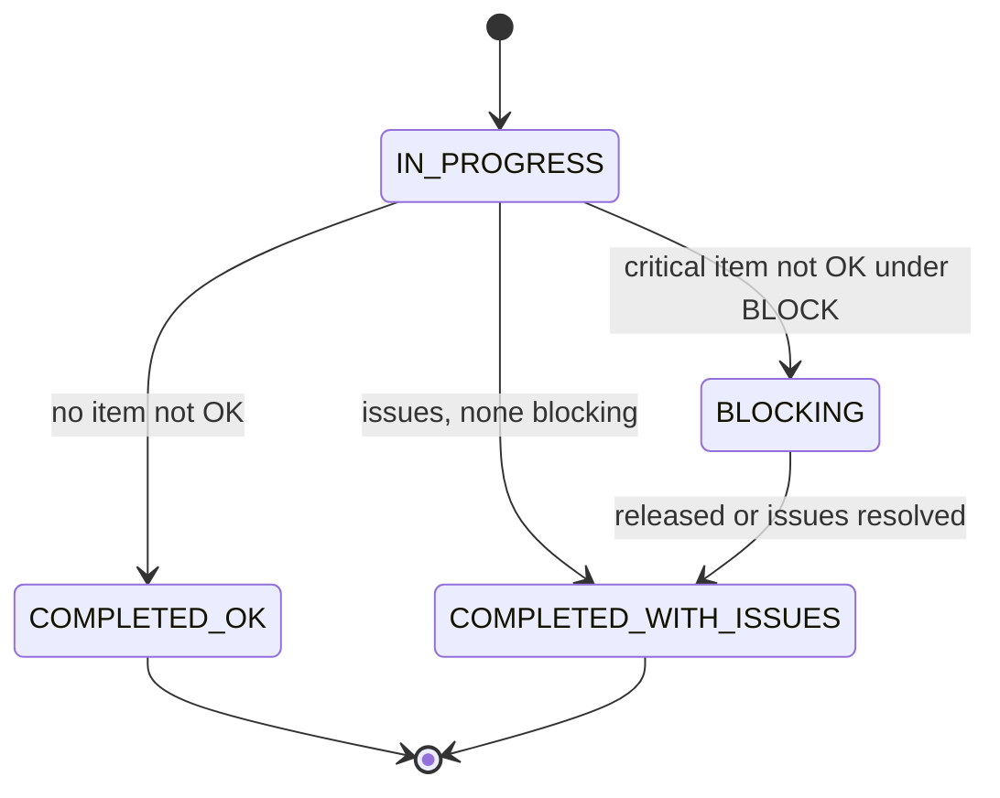
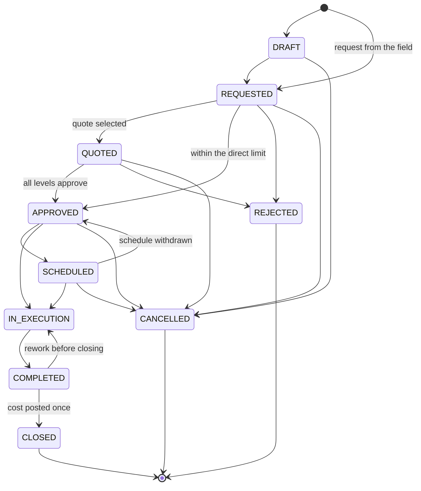

# Maintenance, checklists and incidents

Status: **PLANNED**, 2026-11-10. Module codes `CHECK` and `MAINT`. Tasks: `EMP-CHECK-001…004` and `EMP-MAINT-001…012` in [backlog/ep11-maintenance](../backlog/ep11-maintenance.md).

Evidence. The repository has no organization checklist, incident, damage, maintenance plan, supplier or work-order code; everything specified here is `PROPOSED`. Two personal features touch the same subject and are not reused as storage, because both are keyed by one account and one personal vehicle: the individual driver suite stores a reminder schedule with the bases `ODOMETER`, `DATE` and `ODOMETER_OR_DATE` and no hour basis, work order or supplier (`backend/internal/modules/driver/domain/maintenance.go`, migration `backend/db/migrations/000135_driver_cost_maintenance.sql`; `PARTIAL`, the suite is disabled by flag and has no Android transport, [01-diagnosis](../01-diagnosis.md) §3.2), and the personal ledger has a `maintenance` expense category (`backend/internal/modules/ledger/domain/ledger.go`, `IMPLEMENTED`). The photo upload ingress and its verification job (`backend/internal/modules/evidence/`, `IMPLEMENTED`) are a pattern only: every copy is deleted within 24 hours, which does not fit checklist and incident photos. The job queue with schedules (`backend/internal/platform/jobs/`, `IMPLEMENTED`) is what the due computation runs on. New code lives in `backend/internal/modules/maintenance/` (proposed) and `com.anpfuel.*.enterprise.maintenance` (proposed), as listed in [09-architecture](../09-architecture.md) §2.

## 1. Purpose

Before an asset is used, three questions need an answer: is it fit to go, is something already known to be wrong with it, and is a service or a document about to lapse. In the organizations this suite targets ([02-product-vision](../02-product-vision.md) §3) the answers are on paper, in chat messages or in someone's memory.

- **Drivers and field staff** get a short checklist at departure and at return, and a way to report a damage or an incident in seconds, without signal.
- **Fleet managers and supervisors** get a queue of what was reported, preventive plans that become due by date, distance or hours, and work orders that go from request to quote, approval, execution and cost.
- **Finance** gets each maintenance cost exactly once, with its supplier, document and approval.

Expected result: an asset known to be unsafe does not start a trip unnoticed; a service or an expiry does not lapse unnoticed; maintenance cost and unavailable time per asset are recorded facts.

## 2. Scope

- **Checklists and incidents (F4, code `CHECK`).** Checklist templates per asset category; departure and return runs filled offline; the critical-item policy that can block a trip start; damage and incident reports with photos; treatment of what was reported; panel views.
- **Maintenance (F6, code `MAINT`).** Preventive plans by date, kilometres and hours, whichever comes first; corrective requests; work orders with supplier, quote, approval, parts and services, execution, attachments and cost; unavailability and return to operation; tracked expiries of asset documents and, optionally, driving licences; alerts.
- **Modular evolution (F6, off by default).** Insurance policies and claim records (priority P2); tyres and component history (P3); parts stock (P3). Their rules are specified at a lighter level in §4 and their place in the roadmap is justified in §12.
- **Out of scope.** A time clock for mechanics (EDR-028 applies here too); issuing fiscal documents; purchase orders beyond a quote; fault codes from telematics hardware (a later integration, [imports-notifications-integrations](imports-notifications-integrations.md)); looking up fines or licensing status at public bodies; filing claims with insurers; statements about which documents the law requires for an asset.

## 3. Entities and ownership

Every entity belongs to one organization (BR-TEN-001). Suppliers are owned by [fleet](fleet.md); documents and photos by [documents](documents.md); the expense of a work order by [expenses-finance](expenses-finance.md).

| Entity | Owner | Content | Invariants |
|---|---|---|---|
| Checklist template | Organization | Name, context (`DEPARTURE`, `RETURN`, `AD_HOC`), asset categories or assets it applies to, ordered items (label, critical flag, optional flag, photo required when not OK), critical-item policy (`BLOCK` or `WARN`), run validity, lifecycle `ACTIVE` or `ARCHIVED` | A published version is immutable; at most 40 items. |
| Checklist run | Organization | Template version, policy revision, asset, context, trip (return runs; departure runs are named by the trip start), author, start and completion instants, one answer per item with an optional note, photos, outcome | Answers do not change after completion; one answer per item. |
| Damage | Organization | Asset, what and where on the asset, `blocks_use`, source (checklist item, incident, direct report), photos, treatment, state | Belongs to one asset; never deleted. |
| Incident | Organization | Kind (`BREAKDOWN`, `ACCIDENT`, `THEFT`, `FINE_NOTICE`, `OTHER`), asset, trip (optional), occurred instant, place as text (optional), description, `blocks_use`, police report or notice number (optional), linked damages, documents, state | No health field and no third-party identity field (BR-CHECK-015, BR-MAINT-042). |
| Maintenance plan | Organization | Asset, name, task list, triggers (distance in metres, time in months or days, hours in seconds), lead per trigger, rebase rule (`ACTUAL` or `SCHEDULED`), blocking flag, lifecycle `ACTIVE` or `ARCHIVED` | At least one trigger; a usage trigger needs the matching meter. |
| Plan occurrence | Organization | Plan, sequence, baseline (day and meter values), due values per trigger, state, the reading revision of the last evaluation, linked work order, done values | Exactly one open occurrence per `ACTIVE` plan. |
| Work order | Organization | Number, asset, kind (`PREVENTIVE`, `CORRECTIVE`), origin links, supplier or in-house, quotes, selected quote and approved total, schedule, execution instants, lines, paid total, discount, `after_the_fact` flag, state, revision | One asset; number unique per organization; at most one expense. |
| Work-order line | Organization | Kind (`PART`, `SERVICE`), description, unit, quantity, unit price, line total, optional component or stock item | Line total in centavos is authoritative. |
| Maintenance hold | Organization | Asset, work order, start instant, end instant, return reading | Holds of one work order do not overlap; an open hold has no end. |
| Compliance item | Organization | Subject (asset, or employee when licence control is on), kind, expiry day, warning window, blocking flag, reference to the asset document or driver profile, state | One open item per (subject, kind). |
| Insurance policy and claim record (evolution) | Organization | Policy: insurer, policy number, covered assets, coverage period, deductible. Claim: incident, policy, claim number, opening and settlement days, amounts | A claim links one incident to one policy. |
| Component and parts stock item (evolution) | Organization | Component: identifier, kind, installations with positions and asset usage. Stock item: part, place, quantity, book value | A component is installed in at most one position at a time. |

## 4. Business rules

Checklists, damages and incidents (`CHECK`):

- **BR-CHECK-001 — Templates are versioned.** A published template version is immutable; a change publishes a new version, and every run names the version it used.
- **BR-CHECK-002 — Applicable template.** For an asset and a context, the applicable template is the `ACTIVE` one that names the asset, else the one that names its category, else the organization default; when none exists, no checklist is required.
- **BR-CHECK-003 — Three answers.** Each item is answered `OK`, `NOT_OK` or `NOT_APPLICABLE`; `NOT_APPLICABLE` is accepted only on items marked optional; a run completes only when every item has an answer.
- **BR-CHECK-004 — The outcome is computed, not chosen.** A run is `COMPLETED_OK` when no answer is `NOT_OK`, `BLOCKING` when at least one critical item is `NOT_OK` and the policy is `BLOCK`, and `COMPLETED_WITH_ISSUES` otherwise.
- **BR-CHECK-005 — Critical-item policy.** The organization sets `BLOCK` (default) or `WARN` per template. Under `BLOCK` a critical item answered `NOT_OK` prevents the trip start; under `WARN` the driver confirms having seen the issues and may start.
- **BR-CHECK-006 — Decided on the device from the cached policy.** The app computes the outcome without a connection from the cached template version and policy revision, names both in the run and applies the block at once ([10-offline-sync](../10-offline-sync.md) §10.3).
- **BR-CHECK-007 — Rechecked on the server.** On receipt the server recomputes the outcome from the answers, the named template version and the policy in force at the declared completion time according to its own history; when the two differ, the server's outcome is stored and the author is told.
- **BR-CHECK-008 — A disagreement discards nothing.** When the server's outcome is `BLOCKING` and a trip already started on that run, the run is accepted and the trip start is kept for review with `CHECKLIST_BLOCKING`; neither is refused (BR-OFFL-006).
- **BR-CHECK-009 — Each issue is a damage.** Every `NOT_OK` answer of an accepted run creates one damage in `REPORTED` linked to the run and the item, unless the author marked it as an open damage already known for that asset, in which case it is linked to that damage.
- **BR-CHECK-010 — A block belongs to the asset.** While a run of an asset is `BLOCKING`, or an open damage or incident of the asset has `blocks_use = true`, the asset's availability is `BLOCKED` for every member, not only for the author ([fleet](fleet.md)).
- **BR-CHECK-011 — Release is explicit and made by someone else.** A `BLOCKING` run becomes `COMPLETED_WITH_ISSUES`, and `blocks_use` is cleared, only when every blocking damage is `RESOLVED` or `DISMISSED` or when a member with `check.incident.manage` releases it with a reason; the releaser is never the author of the run or report (`SELF_APPROVAL`).
- **BR-CHECK-012 — A run is evidence of one moment.** A departure run gates one trip start within its validity (default 12 hours, configurable 1 to 72); a run still `IN_PROGRESS` after its validity cannot be completed (`CHECKLIST_EXPIRED`) and a new one is started.
- **BR-CHECK-013 — A return run never holds a trip open.** A return run records the asset's condition after the trip; it cannot prevent finishing the trip, and a `BLOCKING` return run blocks the next use of the asset.
- **BR-CHECK-014 — Reports never wait.** A member with `check.incident.report` records a damage or an incident offline at any time, inside or outside a trip; inside a trip the report also appears as an incident event in the logbook ([trips](trips.md)).
- **BR-CHECK-015 — Descriptions are bounded and guided.** An item note has at most 140 characters and a report description at most 1 000; the entry field shows "Descreva o que aconteceu com o veículo ou a carga. Não informe dados de saúde de pessoas."; no field exists for injuries, health or medical information (BR-PRIV-007, LV-10).
- **BR-CHECK-016 — Photos are organization documents.** Checklist and incident photos are stored by [documents](documents.md), opened only with `doc.document.view_content`, audited at each opening (BR-AUD-003) and kept by the organization's retention schedule, not by the 24-hour rule of community photos.
- **BR-CHECK-017 — Treatment ends in a recorded outcome.** `IN_TREATMENT` needs a linked work order or a stated action; `RESOLVED` needs a resolution note; `DISMISSED` needs a reason; a duplicate is dismissed with a link to the report it repeats; nothing is deleted.
- **BR-CHECK-018 — An incident carries no cost.** A fine, a deductible, a tow or a repair is recorded as an expense or as a work order and linked to the incident; the incident never adds to costs ([expenses-finance](expenses-finance.md)).

Preventive maintenance (`MAINT`):

- **BR-MAINT-001 — Three triggers, whichever comes first.** A plan has at least one of a distance interval in metres, a time interval in calendar months or days, and an hour interval in seconds; its occurrence is evaluated on every trigger it has and the earliest one decides.
- **BR-MAINT-002 — A trigger needs its meter.** A distance trigger needs an odometer on the asset and an hour trigger needs an hour meter; a plan with a trigger the asset cannot measure is refused with `METER_REQUIRED`.
- **BR-MAINT-003 — Usage comes from the meter history.** Distance and hours since the baseline are the cumulative usage between the baseline instant and now, taken from the usage query of [fleet](fleet.md), never the subtraction of two raw readings, so a replaced or reset meter does not break a plan.
- **BR-MAINT-004 — The occurrence state is computed.** An occurrence is `UPCOMING` while every trigger has more remaining than its lead, `DUE` when a trigger's remaining is within its lead (the due value included), and `OVERDUE` when a trigger passed its due value.
- **BR-MAINT-005 — Time triggers use local calendar days.** The due day is the baseline day plus the interval in the time zone of the asset's unit; adding months keeps the day of the month and clamps to the last day of a shorter month; `OVERDUE` starts on the day after the due day (BR-TIME-004).
- **BR-MAINT-006 — One open occurrence per plan.** An `ACTIVE` plan has exactly one occurrence in `UPCOMING`, `DUE` or `OVERDUE`; `DONE` and `SKIPPED` occurrences are history.
- **BR-MAINT-007 — Recomputed when readings change.** A new reading, a corrected or voided reading and a meter replacement each cause the asset's open occurrences to be recomputed; the result depends only on the readings that are valid now, never on the order in which events arrived.
- **BR-MAINT-008 — A correction moves states both ways.** A recomputation may take an occurrence from `OVERDUE` or `DUE` back to an earlier state; the alert is withdrawn, the change records the reading revision that caused it, and a work order already created from the occurrence is kept and flagged, never cancelled automatically.
- **BR-MAINT-009 — Unknown usage is not zero.** A usage trigger with no valid reading after the baseline is `INSUFFICIENT_DATA` and the other triggers decide; an asset with a usage trigger and no reading for 30 days (default, configurable 7 to 90) raises a missing-reading alert (BR-TRUTH-003).
- **BR-MAINT-010 — Completion closes the occurrence.** An occurrence becomes `DONE` when its work order is `COMPLETED`, or when a manager records a service done elsewhere, with the completion day and meter values; the next occurrence starts from those actual values (`ACTUAL`, default) or from the previous due values (`SCHEDULED`), as the plan states.
- **BR-MAINT-011 — Skipping is explicit.** `SKIPPED` needs a reason and `maint.plan.manage`; the next occurrence starts from the values at the moment of the skip.
- **BR-MAINT-012 — A projection is an estimate.** The projected due day of a usage trigger is the latest reading day plus the remaining usage divided by the average daily usage of the 30 days before that reading, rounded up; it is always labelled as an estimate, and with fewer than two valid readings at least 7 days apart in that window no projection is shown (BR-TRUTH-004).
- **BR-MAINT-013 — Overdue alerts; it blocks only by choice.** An `OVERDUE` occurrence raises an alert and blocks nothing by default; when the organization marks the plan as blocking, the asset is `BLOCKED` while the occurrence is `OVERDUE`.

Corrective maintenance and work orders:

- **BR-MAINT-014 — Anyone who uses the asset can ask.** A member with `maint.request.create` creates a corrective work order in `REQUESTED`, offline, naming the asset and what is wrong.
- **BR-MAINT-015 — Origins are linked, not copied.** A work order references what caused it (plan occurrence, damage, incident, checklist item or request); starting it moves the linked damages and incidents to `IN_TREATMENT`, and completing it proposes their resolution to the handler.
- **BR-MAINT-016 — One work order per open defect.** A request about a damage that already has a work order outside a terminal state is attached to that work order instead of creating another.
- **BR-MAINT-017 — The term is reserved.** "Work order" (ordem de serviço) names only a maintenance job on one asset; operational work is a mission ([03-glossary](../03-glossary.md) §4 and §6).
- **BR-MAINT-018 — Identity.** A work order has one asset, one kind (`PREVENTIVE` or `CORRECTIVE`) and a number that is sequential per organization and never reused.
- **BR-MAINT-019 — Supplier or in-house.** An external work order names a supplier from the organization's registry ([fleet](fleet.md)); an in-house one names none; a workshop is never created in the public station catalog (BR-SRC-004).
- **BR-MAINT-020 — Lines are parts and services with exact values.** Each line has a kind (`PART` or `SERVICE`), a quantity in milli-units of its unit (labour time in seconds), a unit price in milli-BRL and a line total in centavos; the line total as invoiced is authoritative and the arithmetic check of BR-MONEY-005 only warns.
- **BR-MAINT-021 — Quotes are kept.** A work order may hold several quotes, each with supplier, lines or a lump total, and a validity day; exactly one is selected for approval and the others stay as history.
- **BR-MAINT-022 — Approval runs on the shared engine.** The selected quote is decided by members with `maint.workorder.review` through the review engine and the approval policy of [expenses-finance](expenses-finance.md) (EDR-012); the reviewer is never the member who asked for the work or selected the quote (BR-REV-003), and each decision names the revision it judged (BR-REV-007).
- **BR-MAINT-023 — Direct approval below a limit.** When the estimated total is at or below the organization's direct limit (default 0 centavos, which disables it), a member with `maint.workorder.manage` may take a work order from `REQUESTED` to `APPROVED` without a quote; the limit in force and the actor are recorded.
- **BR-MAINT-024 — No execution without approval.** `IN_EXECUTION` is reached only from `APPROVED` or `SCHEDULED`.
- **BR-MAINT-025 — Emergency repairs are recorded after the fact.** A repair already done is entered through the same transitions with its real past times, is flagged `after_the_fact` in every list, and its approval judges the actual invoice.
- **BR-MAINT-026 — Completion and closing need evidence.** `COMPLETED` needs the completion instant, the executed lines and, when the asset has a meter, a reading at completion; `CLOSED` needs the paid total and, when the organization's policy asks for it, the supplier's invoice attached (`INVOICE_REQUIRED`).
- **BR-MAINT-027 — Overruns are approved.** Closing is refused with `OVERRUN_NOT_APPROVED` when the paid total exceeds the approved total by more than the tolerance (default 10 %, configurable 0 to 30 %) and no supplementary approval of the difference exists.
- **BR-MAINT-028 — The cost is posted exactly once.** Closing posts one expense whose origin is the work order and whose amount is the paid total; at most one expense exists per work order; payments, reimbursements and card statements settle it and never add a cost (EDR-013).
- **BR-MAINT-029 — No cost before closing.** A work order that is not `CLOSED` adds nothing to approved costs; a view that includes completed work orders not yet closed says "includes pending" on the figure (BR-REV-009).
- **BR-MAINT-030 — The cost day.** The expense belongs to the local day of the completion instant in the time zone of the asset's unit and carries the unit and cost centre the asset had on that day (BR-TIME-004, BR-AUTH-005).
- **BR-MAINT-031 — After closing, corrections are amendments.** A change to a `CLOSED` work order is an amendment that amends the same expense; voiding the work order voids its expense; a second expense is never created (BR-AMD-001, BR-AMD-003, BR-AMD-004).

Unavailability and return to operation:

- **BR-MAINT-032 — In maintenance means unavailable.** From the start of a maintenance hold until the return to operation the asset's availability is `IN_MAINTENANCE`; it cannot be reserved for that period or start a trip ([08-state-model](../08-state-model.md) §3, [fleet](fleet.md)).
- **BR-MAINT-033 — When a hold starts.** A hold starts when the work order enters `IN_EXECUTION`, or earlier when a manager hands the asset over; one work order may have several holds when the asset is released while a part is awaited.
- **BR-MAINT-034 — Return to operation is explicit.** A hold ends only by the return command of a member with `maint.workorder.manage`, with the instant and, when the asset has a meter, a reading; completing the work order does not end the hold, and a work order with an open hold cannot be closed (`HOLD_OPEN`).
- **BR-MAINT-035 — Unavailable time is measured.** Unavailability of an asset in a period is the sum of its hold durations in seconds inside the period; holds that overlap count once.
- **BR-MAINT-036 — Field facts on a held asset are kept.** A trip or fueling recorded offline for an asset in a hold is accepted for review with `ASSET_UNAVAILABLE` and never dropped ([10-offline-sync](../10-offline-sync.md) §10.2).
- **BR-MAINT-037 — Scheduling shows commitments.** Scheduling a work order over a confirmed reservation or a planned trip of the asset shows the conflict and needs confirmation; nothing is cancelled automatically.

Expiries, documents and insurance:

- **BR-MAINT-038 — Expiries use the occurrence vocabulary.** A tracked expiry is `UPCOMING` until its warning window opens (default 30 days before the expiry day, configurable 1 to 180), `DUE` inside the window up to the expiry day, `OVERDUE` after it, `DONE` when a successor with a later expiry day is recorded, and `SKIPPED` with a reason when it stops applying.
- **BR-MAINT-039 — The organization chooses what to track.** Kinds of asset documents, their warning windows and whether an expired kind blocks the asset are configuration; an expired item alerts and blocks nothing by default; the suite ships example kinds and states no legal requirement.
- **BR-MAINT-040 — Licence expiry control is optional and off by default.** Only when the organization enables it does the module read the licence category and expiry day from the driver profile ([identity](identity.md)); it stores no licence number or image, alerts only the employee and members with `maint.plan.manage` in scope, and creates no item while the control is off (BR-PRIV-005, LV-09).
- **BR-MAINT-041 — Insurance is a tracked expiry with a policy.** An insurance policy records insurer, policy number, covered assets, coverage period and deductible in centavos, and expires like any tracked item; a claim record links one incident to one policy with claim number and opening and settlement days.
- **BR-MAINT-042 — Money and people stay where they belong.** Premiums, deductibles and indemnities are recorded in [expenses-finance](expenses-finance.md), never as costs here; identifying details of third parties stay only inside attached documents, which need `doc.document.view_content`.

Modular evolution (lighter level):

- **BR-MAINT-043 — Components are tracked by identifier.** A tyre or major component has an identifier unique per organization, a kind and at most one installed position on one asset at a time; installing, moving, retreading and retiring are lines of a work order that name the component.
- **BR-MAINT-044 — Component usage follows the asset.** A component's usage is the sum, over its installations, of the asset's usage between installation and removal taken from [fleet](fleet.md); no separate meter is kept, and a missing reading gives `INSUFFICIENT_DATA`, not zero.
- **BR-MAINT-045 — Parts stock counts each part once.** A part received into stock is inventory, not an expense; a part issued to a work order enters its lines at the moving weighted average cost and is counted once, in that work order's expense, with the same valuation model as [fuel-stock](fuel-stock.md) (EDR-029).
- **BR-MAINT-046 — Evolutions are capabilities.** Tyres, component history, parts stock and insurance are per-organization capabilities, off by default; with them off, a tyre or a part is an ordinary `PART` line and nothing else changes.

## 5. Use cases

**UC-CHECK-01 — Run a departure checklist.** Actor: member with `check.checklist.execute` on the asset. Preconditions: reference data cached (template version, policy revision, known open damages). Main flow: pick the asset → the app shows the applicable template → answer each item; for `NOT_OK` add a note and photos or mark an already known damage → complete → the app computes the outcome and shows it → on `COMPLETED_OK` or `COMPLETED_WITH_ISSUES` the trip start is available → the run is queued as one operation and the photos as attachments. Alternatives: outcome `BLOCKING` → the trip start is disabled with the reason, the items that block and who can release; policy `WARN` → the driver ticks "Estou ciente das pendências" first; no template applies → the trip starts without a run; the app is closed midway → answers are kept and the run resumes while valid; validity passed → `CHECKLIST_EXPIRED`, a new run starts. Result: one run with its outcome, delivered once (UC-OFFL-01).

**UC-CHECK-02 — Run a return checklist.** Actor: the driver finishing the trip. Main flow: finish the trip → the app offers the return template → answer the items → new issues become damages → the run is linked to the trip. Alternatives: outcome `BLOCKING` → the trip still finishes and the asset is blocked for the next use (BR-CHECK-013); the driver skips a required return run → the trip finish is delivered and the missing run is shown to the reviewer by the trip gate of [trips](trips.md). Result: the asset's condition after the trip is recorded.

**UC-CHECK-03 — Report a damage or an incident.** Actor: member with `check.incident.report`. Main flow: open "Relatar problema" → choose damage or incident and its kind → asset, when it happened, description under the privacy hint, photos → answer "O veículo pode continuar em uso?" → save offline. Alternatives: inside a trip → an incident event is added to the logbook; "no" → `blocks_use = true` and the asset is blocked on the device at once and on the server at receipt; the membership ended before delivery → the report follows the intake window of BR-OFFL-011. Result: a damage or an incident in `REPORTED`, visible in the panel queue.

**UC-CHECK-04 — Handle a report.** Actor: member with `check.incident.manage`. Main flow: open the queue → acknowledge → decide: open a work order (UC-MAINT-03), record an action, resolve with a note, or dismiss with a reason. Alternatives: duplicate → dismiss with a link to the original; opened by two handlers at once → the second receives `CONFLICT` and sees the current state. Result: every report reaches `RESOLVED` or `DISMISSED` with a recorded outcome.

**UC-CHECK-05 — Release a blocked asset.** Actor: member with `check.incident.manage` who is not the author. Preconditions: a `BLOCKING` run or an open report with `blocks_use = true`. Main flow: review the items and photos → release with a reason → the run becomes `COMPLETED_WITH_ISSUES`, the damages stay open with `blocks_use = false`, the asset is no longer `BLOCKED`. Alternatives: the actor is the author → `SELF_APPROVAL`; a work order of the asset is in a hold → the asset stays `IN_MAINTENANCE`. Result: the release, its author and its reason are in the audit trail (BR-AUD-001).

**UC-CHECK-06 — Maintain templates and the policy.** Actor: member with `check.template.manage`. Main flow: create or edit a template → mark critical and optional items → choose `BLOCK` or `WARN` and the run validity → publish → the new version reaches devices with the next reference refresh (UC-OFFL-08). Alternatives: a device still holding the previous version completes a run → accepted and flagged `TEMPLATE_SUPERSEDED`; archive → no run is required for that context from then on. Result: one `ACTIVE` version per template.

**UC-MAINT-01 — Create a preventive plan.** Actor: member with `maint.plan.manage`. Main flow: choose the asset → name and task list → set one or more triggers and their leads → state the last service (day and meter values) as the baseline → save → the first occurrence is computed. Alternatives: a trigger without its meter → `METER_REQUIRED`; no known last service → the baseline is today and the current readings, and the plan says so; copy a plan to other assets of the same category → one plan per asset, each with its own baseline. Result: an `ACTIVE` plan with one open occurrence.

**UC-MAINT-02 — Evaluate what is due (system).** Actor: scheduled job and reading events. Main flow: once a day per time zone, and whenever a reading of the asset changes, recompute the open occurrences of the affected assets → store the new state and the reading revision used → emit an event on each state change → alerts go to members with `maint.plan.manage` in scope. Alternatives: the job did not run → the state is also computed when the occurrence is read ([08-state-model](../08-state-model.md) §4 rule 6); a usage trigger has no reading → `INSUFFICIENT_DATA` for that trigger. Result: lists and alerts match the readings valid now.

**UC-MAINT-03 — Ask for maintenance.** Actor: member with `maint.request.create`; or a handler from a report (UC-CHECK-04). Main flow: choose the asset → describe the problem or pick the damage or incident → save offline → the server creates a corrective work order in `REQUESTED` linked to its origin. Alternatives: an open work order already covers that damage → the request is attached to it (BR-MAINT-016); the asset is disposed → kept for review with `ASSET_UNAVAILABLE`. Result: the manager sees the request with its evidence.

**UC-MAINT-04 — Quote and approve.** Actor: member with `maint.workorder.manage`, then reviewers with `maint.workorder.review`. Main flow: record one or more quotes with supplier, lines or lump total and validity → select one → the work order becomes `QUOTED` and enters review → every required level approves → `APPROVED`. Alternatives: returned with a reason → the manager revises the quote, which creates a new revision, and resubmits; rejected → `REJECTED` with the reason; estimate within the direct limit → `APPROVED` without a quote (BR-MAINT-023); quote validity passed before the decision → `QUOTE_EXPIRED`, a new quote is needed; reviewer is the requester or the selector → `SELF_APPROVAL`; decision on a stale revision → `CONFLICT`. Result: an approved total that execution and closing are measured against.

**UC-MAINT-05 — Execute, complete and close.** Actor: member with `maint.workorder.manage`. Main flow: schedule the date → start execution, which opens a hold → record executed lines and attach photos → complete with the instant and the meter reading → return the asset to operation (UC-MAINT-06) → enter the paid total and discount, attach the invoice → close → one expense is posted and the linked occurrence, damages and incidents are updated. Alternatives: paid total above the approved total plus tolerance → `OVERRUN_NOT_APPROVED` until a supplementary approval exists; rework found before closing → back to `IN_EXECUTION` with a reason; hold still open → `HOLD_OPEN`; the completion day falls in a locked period → `PERIOD_LOCKED`, handled as BR-AMD-004 states; the same close command sent twice → the first result is returned and no second expense exists. Result: a `CLOSED` work order with one expense.

**UC-MAINT-06 — Return an asset to operation.** Actor: member with `maint.workorder.manage`. Preconditions: an open hold. Main flow: confirm the asset is back → instant and meter reading → the hold ends → availability is derived again by [fleet](fleet.md). Alternatives: the organization requires a return checklist after maintenance → the app or panel asks for an `AD_HOC` run and a `BLOCKING` outcome keeps the asset `BLOCKED`; the asset leaves while a part is awaited → the hold ends, the work order stays `IN_EXECUTION`, and a new hold opens when it comes back. Result: unavailable time is the measured duration of the holds.

**UC-MAINT-07 — Recompute after a reading correction (system).** Actor: handler of the reading-corrected event of [fleet](fleet.md). Main flow: find the open occurrences and the baselines that used the superseded reading → recompute with the valid readings → store the state, the reading revision and the previous state → withdraw or raise alerts. Alternatives: the occurrence is already `DONE` → its done values follow the superseding reading and the next occurrence's baseline is recomputed; a work order was created from the earlier state → kept and flagged "ocorrência recalculada". Result: due values never depend on a reading that is no longer valid.

**UC-MAINT-08 — Track and renew an expiry.** Actor: member with `maint.plan.manage`; scheduled job. Main flow: the expiry day comes from the asset document registered in [fleet](fleet.md) → the job moves the item to `DUE` when the window opens and to `OVERDUE` after the expiry day → alerts are sent → the manager registers the renewed document with its new expiry day → the old item becomes `DONE` and a new one starts. Alternatives: licence control is off → no employee item exists and a request to track one answers `CONTROL_DISABLED`; licence control is on → the employee is alerted too; the asset is disposed → the item is `SKIPPED` with that reason. Result: no tracked document expires without an alert.

**UC-MAINT-09 — Record an insurance policy and a claim (evolution).** Actor: member with `maint.plan.manage`; claims by a member with `check.incident.manage`. Main flow: register the policy and the assets it covers → it expires like any tracked item → after an incident, open a claim record with the claim number → record the settlement day when it ends. Alternatives: the incident's asset is not covered by the policy on that day → `VALIDATION_FAILED`. Result: each incident shows whether a claim exists and how it ended; amounts are in [expenses-finance](expenses-finance.md).

**UC-MAINT-10 — Record a component or a stock part on a work order (evolution).** Actor: member with `maint.workorder.manage`, with the capability on. Main flow: on a work-order line choose the component and the position, or the stock item and quantity → on completion the component's installation is opened or closed with the asset's reading, or the part leaves stock at its average cost. Alternatives: the component is installed elsewhere → `CONFLICT`; stock quantity insufficient → `VALIDATION_FAILED`, the line can be entered as a purchased part instead. Result: component history and stock follow from work orders, with no separate entry.

## 6. States and transitions

State names are the ones in [08-state-model](../08-state-model.md) §3. Every transition is a command with an audit event (BR-AUD-001) and names the expected current state or revision; the loser of a race receives `CONFLICT`.

**Checklist run** (operational). Interface: `IN_PROGRESS` "Em andamento", `COMPLETED_OK` "Concluído sem pendências", `COMPLETED_WITH_ISSUES` "Concluído com pendências", `BLOCKING` "Bloqueando o uso".

| From | To | Actor | Validation | Effect | Reversal |
|---|---|---|---|---|---|
| — | `IN_PROGRESS` | Author, on the device | Template applies; `check.checklist.execute` | Answers saved locally as given | Discard before completion |
| `IN_PROGRESS` | `COMPLETED_OK` | Author | All items answered; none `NOT_OK`; within validity | Trip start available | None; a new run records a new moment |
| `IN_PROGRESS` | `COMPLETED_WITH_ISSUES` | Author | An item is `NOT_OK`; none critical under `BLOCK` | Damages created; under `WARN` the driver confirms | None |
| `IN_PROGRESS` | `BLOCKING` | Author; or the server at receipt (BR-CHECK-007) | A critical item is `NOT_OK` and the policy is `BLOCK` | Trip start disabled; asset `BLOCKED`; handlers alerted | Release (next row) |
| `BLOCKING` | `COMPLETED_WITH_ISSUES` | Member with `check.incident.manage`, or the system when every blocking damage is `RESOLVED` or `DISMISSED` | Not the author; reason | Asset no longer blocked by this run | A new run or report blocks again |



**Incident and damage** (operational, same names for both). Interface: `REPORTED` "Registrada", `ACKNOWLEDGED` "Ciente", `IN_TREATMENT` "Em tratamento", `RESOLVED` "Resolvida", `DISMISSED` "Descartada".

| From | To | Actor | Validation | Effect | Reversal |
|---|---|---|---|---|---|
| — | `REPORTED` | Reporter; or the system from a `NOT_OK` answer or a logbook incident event | `check.incident.report`; asset of the organization | Appears in the queue; blocks the asset when `blocks_use = true` | Dismiss |
| `REPORTED` | `ACKNOWLEDGED` | Handler with `check.incident.manage` | — | Reporter is told | None needed |
| `REPORTED`, `ACKNOWLEDGED` | `IN_TREATMENT` | Handler; or the system when a linked work order starts | Linked work order or stated action | Shown as being treated | Dismiss, or resolve |
| `REPORTED`, `ACKNOWLEDGED`, `IN_TREATMENT` | `RESOLVED` | Handler | Resolution note | Block ends; reporter is told | A recurrence is a new report linked to this one |
| `REPORTED`, `ACKNOWLEDGED`, `IN_TREATMENT` | `DISMISSED` | Handler | Reason; for a duplicate, the original | Block ends; excluded from open counts | A new report |

**Maintenance plan occurrence** (operational; also used by compliance items, BR-MAINT-038). Interface: `UPCOMING` "Programada", `DUE` "A vencer", `OVERDUE` "Vencida", `DONE` "Realizada", `SKIPPED` "Dispensada".

| From | To | Actor | Validation | Effect | Reversal |
|---|---|---|---|---|---|
| — | `UPCOMING` | System, when a plan is created or the previous occurrence ends | Baseline known | Due values stored | Archive the plan |
| `UPCOMING` | `DUE` | System | A trigger's remaining is within its lead | Alert; "create work order" offered | Recomputation (BR-MAINT-008) |
| `UPCOMING`, `DUE` | `OVERDUE` | System | A trigger passed its due value | Alert; blocks the asset only if the plan is blocking | Recomputation |
| `DUE`, `OVERDUE` | `UPCOMING`, `DUE` | System, after a reading correction | The valid readings give an earlier state | Alert withdrawn; cause recorded | A later reading moves it forward again |
| `UPCOMING`, `DUE`, `OVERDUE` | `DONE` | System when the work order is `COMPLETED`; or member with `maint.plan.manage` for a service done elsewhere | Completion day and meter values | Next occurrence created | Amend the done values (BR-AMD-001) |
| `UPCOMING`, `DUE`, `OVERDUE` | `SKIPPED` | Member with `maint.plan.manage` | Reason | Next occurrence created | None; the next occurrence can be done early |

**Work order** (operational). Interface: `DRAFT` "Rascunho", `REQUESTED` "Solicitada", `QUOTED` "Orçada", `APPROVED` "Aprovada", `SCHEDULED` "Agendada", `IN_EXECUTION` "Em execução", `COMPLETED` "Concluída", `CLOSED` "Encerrada", `REJECTED` "Recusada", `CANCELLED` "Cancelada".

| From | To | Actor | Validation | Effect | Reversal |
|---|---|---|---|---|---|
| — | `DRAFT` | Member with `maint.workorder.manage` | Asset of the organization | Number assigned | Cancel |
| —, `DRAFT` | `REQUESTED` | Member with `maint.request.create` (from the field) or the manager | Asset and description | Appears in the manager's queue | Cancel, or reject with a reason |
| `REQUESTED` | `QUOTED` | Member with `maint.workorder.manage` | One valid quote selected (`QUOTE_REQUIRED`) | Review case opened | Reviewer returns it: stays `QUOTED` with the reason until the quote is revised |
| `REQUESTED` | `APPROVED` | Member with `maint.workorder.manage` | Estimate within the direct limit (BR-MAINT-023) | Approved total set | Cancel |
| `QUOTED` | `APPROVED` | Reviewers with `maint.workorder.review` | All required levels; not the requester or selector; current revision; quote still valid | Approved total set | Cancel before execution |
| `REQUESTED`, `QUOTED` | `REJECTED` | Manager (request) or reviewer (quote) | Reason | Terminal; linked reports go back to the queue | A new work order |
| `APPROVED` | `SCHEDULED` | Member with `maint.workorder.manage` | Planned start; conflicts confirmed (BR-MAINT-037) | Shown on the calendar | Back to `APPROVED` |
| `APPROVED`, `SCHEDULED` | `IN_EXECUTION` | Member with `maint.workorder.manage` | Start instant | Hold opens; asset `IN_MAINTENANCE`; linked reports `IN_TREATMENT` | Complete with the lines actually executed |
| `IN_EXECUTION` | `COMPLETED` | Member with `maint.workorder.manage` | Completion instant, lines, reading (BR-MAINT-026) | Linked occurrence `DONE`; resolution of reports proposed | Back to `IN_EXECUTION` with a reason, before closing |
| `COMPLETED` | `CLOSED` | Member with `maint.workorder.manage` | Paid total; no open hold; overrun approved; invoice if required; period open | One expense posted | Amendment or void (BR-MAINT-031) |
| `DRAFT`, `REQUESTED`, `QUOTED`, `APPROVED`, `SCHEDULED` | `CANCELLED` | Member with `maint.workorder.manage` | Reason | Terminal; an open hold ends | A new work order |



Work started and abandoned is completed with the lines actually executed, possibly none, so that a cost already incurred is not lost; `IN_EXECUTION` has no cancel. The asset's `IN_MAINTENANCE` and `BLOCKED` are derived by [fleet](fleet.md) from the holds and blocks this module supplies; they are not stored here as states. Templates, plans and policies have the configuration lifecycle `ACTIVE`, `ARCHIVED`.

## 7. Roles and permissions

Keys are the ones in [07-permissions](../07-permissions.md) §7.2. Where §7.3 of that file has a row, it is the authority; where it has none, the roles below are this module's proposal for the row.

| Permission | Used for | Roles |
|---|---|---|
| `check.checklist.execute` | Fill a run (UC-CHECK-01, 02) | §7.3: `OWNER`, `ADMIN`, `FLEET_MANAGER`, `SUPERVISOR`, `DRIVER`, `OPERATIONS_STAFF`, own records and assigned assets |
| `check.incident.report` | Report a damage or an incident (UC-CHECK-03) | §7.3: same roles and scope |
| `check.incident.manage` | Handle reports, release a block, open claim records | Proposal: `OWNER`, `ADMIN`, `FLEET_MANAGER`, `SUPERVISOR` in scope |
| `check.template.manage` | Templates and the critical-item policy | Proposal: `OWNER`, `ADMIN`, `FLEET_MANAGER` |
| `maint.request.create` | Ask for maintenance | §7.3: `FLEET_MANAGER` and `SUPERVISOR` in scope; `OWNER`, `ADMIN`, `DRIVER`, `OPERATIONS_STAFF` for assigned assets |
| `maint.workorder.manage` | Quotes, scheduling, execution, holds, closing | §7.3: `OWNER`, `ADMIN`, `FLEET_MANAGER` |
| `maint.workorder.review` | Approve, return or reject a quote or an overrun | Proposal: `OWNER`, `ADMIN`, `FINANCE`, `APPROVER` in scope |
| `maint.plan.manage` | Plans, skips, tracked expiries, insurance policies | Proposal: `OWNER`, `ADMIN`, `FLEET_MANAGER` |
| `fleet.supplier.manage`, `meter.reading.record`, `doc.document.attach`, `doc.document.view_content` | Workshops, completion readings, attachments, opening photos | As in §7.3 |

Scope: every record carries the asset and the unit and cost centre the asset had when the record was created, so `ASSET`, `UNIT`, `COST_CENTRE` and `ORG` assignments cover it (BR-AUTH-004, BR-AUTH-005). No read-only key exists in the registry for runs, reports, plans or work orders: reading them follows `fleet.asset.read` on the asset, authors read their own, and amounts on a work order are shown only with `exp.expense.read`, `maint.workorder.manage` or `maint.workorder.review`. Opening a photo or an invoice always needs `doc.document.view_content` (BR-AUTH-011). Separation of duties is per record: BR-REV-003 for approvals and BR-CHECK-011 for releases.

## 8. Offline, concurrency, idempotency and corrections

- **Offline.** Checklist runs, damage and incident reports and maintenance requests are created, changed and completed offline ([10-offline-sync](../10-offline-sync.md) §10.3). The app keeps, in the reference snapshot, the template versions, the policy revision, the asset's open damages and its restrictions (hold, block, due and overdue items), each with the time it was confirmed (BR-OFFL-016). Quotes, approvals, scheduling, execution, closing, plans and expiries are panel actions and need the server (BR-OFFL-017).
- **Operations.** `check.run.complete` carries the answers, notes and attachment declarations of one run; `check.damage.report`, `check.incident.report` and `maint.request.create` carry one record each. A trip start names the run that gated it; a report made from a run depends on the run's operation (BR-OFFL-007). Photos follow BR-OFFL-015.
- **Server recheck.** The intake recomputes the outcome (BR-CHECK-007). A trip start on an asset with a blocking run or report is accepted for review with `CHECKLIST_BLOCKING`; one without a required valid run with `CHECKLIST_REQUIRED`; one on an asset in a hold with `ASSET_UNAVAILABLE`. The gate itself is specified in [trips](trips.md); this module supplies the run, its outcome and the codes.
- **Concurrency.** Work-order commands lock the work order and name its revision. Two members starting the same work order: the first succeeds, the second receives `CONFLICT`. Occurrence recomputation locks the plan; a recomputation and a completion racing end in the completion, because it reads the readings inside the same transaction. Closing takes the lock on the work order and creates the expense in the same transaction.
- **Idempotency.** Every command carries an operation identifier; a repeat returns the first result (BR-OFFL-004). The expense of a work order is unique per (organization, work order), so a repeated or raced closing cannot post twice. Recomputation is keyed by (occurrence, reading revision) and is safe to re-run.
- **Corrections.** A run is never edited; a wrong run is superseded by a new one, and a wrong block is released (UC-CHECK-05). A report in `REPORTED` may be edited by its author; later it is changed by the handler with a reason. A work order before `CLOSED` is edited with revision history (BR-AMD-006); after `CLOSED` it is amended or voided (BR-MAINT-031). A corrected reading never edits an occurrence by hand: it triggers UC-MAINT-07.

## 9. Events, notifications and integrations

Produced: `check.template.published`, `check.run.completed`, `check.run.blocked`, `check.run.released`, `check.damage.reported`, `check.incident.reported`, `check.report.acknowledged`, `check.report.resolved`, `check.report.dismissed`; `maint.plan.created`, `maint.occurrence.became_due`, `maint.occurrence.became_overdue`, `maint.occurrence.recalculated`, `maint.occurrence.completed`, `maint.occurrence.skipped`, `maint.workorder.requested`, `maint.workorder.quoted`, `maint.workorder.approved`, `maint.workorder.rejected`, `maint.workorder.scheduled`, `maint.workorder.started`, `maint.workorder.completed`, `maint.workorder.closed`, `maint.workorder.cancelled`, `maint.hold.started`, `maint.hold.ended`, `maint.compliance.became_due`, `maint.compliance.expired`, `maint.compliance.renewed`. Events carry identifiers only, never descriptions or photos (BR-PRIV-008).

Consumed (names are defined by the owning modules): reading recorded, corrected and voided, meter replaced, asset disposed or moved, and asset document registered, from [fleet](fleet.md); trip started and finished and logbook incident event, from [trips](trips.md); review decision on a work-order case, expense amended or voided, and period locked, from [expenses-finance](expenses-finance.md); driver profile changed and membership ended, from [identity](identity.md).

Notifications, through [imports-notifications-integrations](imports-notifications-integrations.md): handlers when a run blocks or a report arrives; the reporter when a report is acknowledged, resolved or dismissed; members with `maint.plan.manage` when an occurrence or expiry becomes `DUE` or `OVERDUE`, as one digest per day rather than one notice per item; reviewers when a quote awaits them; the employee for an own licence expiry when the control is on.

Integration points kept for later modules: holds and blocks feed availability and reservations ([fleet](fleet.md)); the trip gate reads run outcomes ([trips](trips.md)); closing posts the expense and its allocations ([expenses-finance](expenses-finance.md)); invoices and quotes are documents with allocation to that expense ([documents](documents.md)); maintenance cost, unavailable time and overdue counts feed indicators ([intelligence](intelligence.md)); parts stock shares the valuation model of [fuel-stock](fuel-stock.md).

## 10. Data, formulas and examples

Inputs and validations:

| Input | Type and unit | Validation |
|---|---|---|
| Distance interval and lead | Integer metres | `0 < lead ≤ interval ≤ 10¹²` (BR-MONEY-010) |
| Hour interval and lead | Integer seconds | `0 < lead ≤ interval` |
| Time interval | Integer months (1 to 120) or days (1 to 3 650); lead in days | `lead < interval` |
| Baseline | Local day plus meter values at that instant | Not in the future; readings must exist or be recorded with it |
| Line quantity | Milli-units of the line's unit; labour in seconds | `> 0`, at most 10⁹ |
| Unit price, hourly rate | Milli-BRL per unit or per hour | `≥ 0`, at most 10⁶ (BR-MONEY-010) |
| Line total, discount, paid total, approved total | Integer centavos | `≥ 0`; `paid_cents + discount_cents = Σ line totals`, else warning `ARITHMETIC_MISMATCH` |
| Note, description, reason | Text | 140, 1 000 and 500 characters at most (BR-CHECK-015) |

Formulas (integer arithmetic; `round_half_up` as in BR-MONEY-005):

```text
used            = usage(meter, baseline_instant, now)            # BR-MAINT-003
remaining       = interval − used
state(trigger)  = OVERDUE if used > interval; DUE if remaining ≤ lead; else UPCOMING
due_day         = add_interval(baseline_day, interval);  DUE from due_day − lead_days;  OVERDUE from due_day + 1
state           = the most advanced state among the plan's triggers
projected_day   = latest_reading_day + ceil(remaining / avg_daily_usage)          # estimate, BR-MAINT-012
line_expected   = round_half_up(quantity_milli × unit_price_milli / 10 000)       # parts, priced services
labour_expected = round_half_up(duration_s × hourly_rate_milli / 36 000)          # labour by time
overrun_ceiling = approved_cents + floor(approved_cents × tolerance_percent / 100)
unavailable_s   = Σ duration of the asset's holds in the period, overlaps counted once
```

Error codes added by this module (shared codes are in [09-architecture](../09-architecture.md) §6 and [10-offline-sync](../10-offline-sync.md) §10.2):

| Code | Where | Meaning |
|---|---|---|
| `CHECKLIST_REQUIRED` | Intake, accepted for review | A trip started without a required, valid departure run |
| `CHECKLIST_BLOCKING` | Intake, accepted for review; 409 online | A trip started on an asset with a `BLOCKING` run or a blocking report |
| `CHECKLIST_EXPIRED` | 409 | The run is older than its validity |
| `TEMPLATE_SUPERSEDED` | Flag on an accepted run | The run used a version that was no longer the active one |
| `METER_REQUIRED` | 422 | The plan has a trigger the asset cannot measure |
| `QUOTE_REQUIRED`, `QUOTE_EXPIRED` | 409 | No selected quote, or its validity day passed |
| `OVERRUN_NOT_APPROVED` | 409 | The paid total exceeds the approved total plus tolerance |
| `HOLD_OPEN` | 409 | The asset was not returned to operation |
| `INVOICE_REQUIRED` | 409 | The policy requires the supplier's invoice before closing |
| `CONTROL_DISABLED` | 409 | Licence expiry control is off for the organization |

**Example 1 — "every 10 000 km or 6 months, whichever comes first".** Truck C-12 (synthetic). Last service on 2026-05-10 at 120 000 km. Plan: `interval_m = 10 000 000`, `lead_m = 1 000 000`, interval 6 months, lead 15 days. Due values: `120 000 000 + 10 000 000 = 130 000 000 m`; due day 2026-05-10 + 6 months = 2026-11-10. By distance the occurrence is `DUE` from `used ≥ 9 000 000 m` and `OVERDUE` from `used > 10 000 000 m`; by date it is `DUE` from 2026-10-26 (2026-11-10 − 15 days) and `OVERDUE` from 2026-11-11.

| Evaluated on | Odometer (m) | Used (m) | Remaining (m) | Days to due day | State | Deciding trigger |
|---|---|---|---|---|---|---|
| 2026-08-25 | 125 950 000 | 5 950 000 | 4 050 000 | 77 | `UPCOMING` | None within its lead |
| 2026-09-16 | 128 600 000 | 8 600 000 | 1 400 000 | 55 | `UPCOMING` | 1 400 000 > 1 000 000 |
| 2026-09-21 | 129 200 000 | 9 200 000 | 800 000 | 50 | `DUE` | Distance: 800 000 ≤ 1 000 000 |
| 2026-09-24 | 130 050 000 | 10 050 000 | −50 000 | 47 | `OVERDUE` | Distance: 10 050 000 > 10 000 000 |

The same plan on a truck that runs little: on 2026-10-25, at 124 300 000 m (`used = 4 300 000`), 16 days remain and the state is `UPCOMING`; on 2026-10-26 it is `DUE` by date; on 2026-11-10 it is still `DUE`; on 2026-11-11 it is `OVERDUE`, with 5 700 000 m still remaining by distance. The date came first.

**Example 2 — an hour-based plan.** Harvester H-03 (synthetic), hours only: every 250 hours, lead 25 hours. `interval_s = 250 × 3 600 = 900 000`; `lead_s = 25 × 3 600 = 90 000`. Last service on 2026-08-03 at 1 480 h = 5 328 000 s. Due value: `5 328 000 + 900 000 = 6 228 000 s` (1 730 h). `DUE` from `6 228 000 − 90 000 = 6 138 000 s` (1 705 h).

| Reading day | Hour meter | Seconds | Used (s) | Remaining (s) | State |
|---|---|---|---|---|---|
| 2026-09-14 | 1 702 h 30 min | 6 129 000 | 801 000 | 99 000 (27 h 30 min) | `UPCOMING` |
| 2026-09-16 | 1 712 h | 6 163 200 | 835 200 | 64 800 (18 h) | `DUE` |
| 2026-09-25 | 1 731 h 15 min | 6 232 500 | 904 500 | −4 500 (1 h 15 min past) | `OVERDUE` |

The service is done on 2026-09-27 at 1 733 h = 6 238 800 s: the occurrence is `DONE`. With rebase `ACTUAL` the next due value is `6 238 800 + 900 000 = 7 138 800 s` (1 983 h); with `SCHEDULED` it is `6 228 000 + 900 000 = 7 128 000 s` (1 980 h). The plan has no time trigger, so no due day exists and none is invented.

**Example 3 — a work order with two parts and one service, posted once.** Work order 42 for truck C-12 at the supplier "Oficina Exemplo" (synthetic). Approved quote: R$ 880.00 = 88 000 centavos. Executed lines:

| Line | Kind | Quantity | Unit price | Check | Line total |
|---|---|---|---|---|---|
| Engine oil | `PART` | 18 L = 18 000 milli-litres | R$ 32.90 = 32 900 milli-BRL per litre | `18 000 × 32 900 / 10 000 = 59 220` | 59 220 centavos |
| Oil filter | `PART` | 1 unit = 1 000 milli-units | R$ 89.90 = 89 900 milli-BRL | `1 000 × 89 900 / 10 000 = 8 990` | 8 990 centavos |
| Labour | `SERVICE` | 1 h 30 min = 5 400 s | R$ 120.00 = 120 000 milli-BRL per hour | `5 400 × 120 000 / 36 000 = 18 000` | 18 000 centavos |

Sum of lines: `59 220 + 8 990 + 18 000 = 86 210` centavos. The invoice shows a discount of R$ 12.10 and R$ 850.00 paid: `85 000 + 1 210 = 86 210`, consistent. Overrun ceiling: `88 000 + floor(88 000 × 10 / 100) = 96 800`; `85 000 ≤ 96 800`, so closing is allowed. Closing posts **one** expense of 85 000 centavos (R$ 850.00) with origin work order 42, on the completion day, for the unit and cost centre of C-12. When the supplier is later paid, a payment of R$ 850.00 settles that expense; the maintenance cost of C-12 for the month stays R$ 850.00, not R$ 1 700.00. Sending the close command again returns the first result.

**Example 4 — a reading correction that moves a due date.** In example 1 the reading of 2026-09-24 was mistyped: the odometer showed 129 550 000 m, not 130 050 000 m. With the wrong reading the occurrence was `OVERDUE` since 2026-09-24. On 2026-09-26 a fleet manager corrects the reading in [fleet](fleet.md): a new reading of 129 550 000 m supersedes the wrong one, which stays as evidence. UC-MAINT-07 recomputes: `used = 129 550 000 − 120 000 000 = 9 550 000`; `remaining = 450 000 ≤ 1 000 000`, so the state goes back to `DUE` and the overdue alert is withdrawn. Projection: the first valid reading in the 30 days before 2026-09-24 is 125 950 000 m on 2026-08-25, so `avg_daily_usage = (129 550 000 − 125 950 000) / 30 = 120 000 m`; `ceil(450 000 / 120 000) = ceil(3.75) = 4` days; the estimated due day is 2026-09-28, earlier than the date trigger's 2026-11-10. The due date moved from "passed on 2026-09-24" to "estimated 2026-09-28", and the occurrence records the reading revision that caused the change.

## 11. Screens

| ID | Surface | Objective | Actor | Data | Actions | Rules and permissions | Validations and states |
|---|---|---|---|---|---|---|---|
| SCR-CHECK-01 | APP | Fill a departure or return checklist | `check.checklist.execute` | Asset, template items with critical marks, known open damages, progress | Answer OK, not OK or not applicable; add note and photo; mark as known damage; complete | BR-CHECK-003, 004, 006, 012, 015 | Large targets, one item per row, usable with one hand; answers survive closing the app. Empty: "Nenhum checklist exigido para este veículo". Offline is the normal state and shows no error. Expired run: offers to start again. |
| SCR-CHECK-02 | APP | Show the outcome and what it means for the trip | Author | Outcome, issues, items that block, who can release, sync state | Start the trip, confirm awareness under `WARN`, call or message a handler, open the report | BR-CHECK-005, 008, 010, BR-OFFL-010 | `BLOCKING` is stated in text and icon, not colour alone; the start button is disabled with the reason. Shows when the server's outcome differed from the device's. |
| SCR-CHECK-03 | APP | Report a damage or an incident | `check.incident.report` | Kind, asset, when, description with the privacy hint, photos, "pode continuar em uso?" | Save, add photo, attach to the current trip | BR-CHECK-014, 015, 016 | Character counter; the hint is always visible, not a placeholder that disappears. Photo missing on the device at upload: asks for a new capture. |
| SCR-CHECK-04 | PANEL | See checklist runs and their issues | `fleet.asset.read` in scope | Runs by asset, day, author, outcome, template version, flags | Filter, open a run, open a photo | BR-CHECK-007, 016, BR-AUTH-011 | Photos open only with `doc.document.view_content`; without it the row shows that a photo exists. Empty: "Nenhum checklist no período". |
| SCR-CHECK-05 | PANEL | Handle reports and release blocked assets | `check.incident.manage` | Queue of damages and incidents with state, asset, age, blocking mark, linked run, trip and work order | Acknowledge, open work order, record action, resolve, dismiss, release | BR-CHECK-011, 017, 018 | Release by the author is refused with `SELF_APPROVAL`. Two handlers at once: the second sees "já atualizado". Empty: "Nenhuma ocorrência aguardando tratamento". |
| SCR-CHECK-06 | PANEL | Maintain templates and the critical-item policy | `check.template.manage` | Templates, versions, items, critical and optional marks, policy, validity, where each applies | Create, edit as a new version, publish, archive, preview as the app shows it | BR-CHECK-001, 002, 005 | Publishing says that devices receive the version at their next refresh. More than 40 items refused. |
| SCR-MAINT-01 | PANEL | See what is due, overdue and scheduled | `fleet.asset.read` in scope | Calendar and list of occurrences, tracked expiries and scheduled work orders, with remaining distance, hours and days and the estimate label | Filter, create work order from an occurrence, record done elsewhere, skip with reason | BR-MAINT-004, 009, 012, 013 | `INSUFFICIENT_DATA` is shown as "sem leitura suficiente", never as zero remaining. Empty: "Nenhum plano cadastrado" with the create action. |
| SCR-MAINT-02 | PANEL | Create and edit a preventive plan | `maint.plan.manage` | Asset, task list, triggers and leads, baseline, rebase rule, blocking flag | Save, copy to other assets, archive | BR-MAINT-001, 002, 005, 010 | A trigger without its meter is refused next to the field with `METER_REQUIRED`. Shows the computed due values before saving. |
| SCR-MAINT-03 | PANEL | Follow work orders by state | `fleet.asset.read` in scope; amounts with `exp.expense.read` or a `maint.workorder` key | Board or list by state, asset, kind, supplier, age, `after_the_fact` flag, pending approval | Filter, open, create | BR-MAINT-018, 025, 029 | Amount columns are hidden, not zeroed, without the permission. Empty: "Nenhuma ordem de serviço". |
| SCR-MAINT-04 | PANEL | Run one work order from request to closing | `maint.workorder.manage`; decisions with `maint.workorder.review` | Origin and evidence, quotes, approval history, schedule, lines, holds, attachments, totals, expense link | Add and select quote, submit, approve, return, reject, schedule, start, complete, return to operation, close, cancel, amend | BR-MAINT-020 to 028, 031, 034 | Each refusal is shown next to its cause: `QUOTE_EXPIRED`, `OVERRUN_NOT_APPROVED`, `HOLD_OPEN`, `INVOICE_REQUIRED`, `SELF_APPROVAL`, `PERIOD_LOCKED`. Stale revision: reload prompt with nothing lost from the form. |
| SCR-MAINT-05 | PANEL | Track expiries of asset documents and, when enabled, licences | `maint.plan.manage` | Items by subject, kind, expiry day, state, document link | Register renewal, change window, skip with reason, enable or disable licence control | BR-MAINT-038, 039, 040 | With licence control off, no employee appears and the screen says so. Unavailable until the expiry tracking capability exists. |
| SCR-MAINT-06 | APP | Ask for maintenance | `maint.request.create` | Asset, description with the privacy hint, photos, existing open requests of the asset | Save offline, attach to an existing request | BR-MAINT-014, 016, BR-CHECK-015 | Shows open requests first so that a known problem is not asked twice. |
| SCR-MAINT-07 | APP | See an asset's restrictions before using it | `fleet.asset.read` on assigned assets | In maintenance, blocked and why, open damages, due and overdue items, time the data was confirmed | Open the report, start a checklist | BR-MAINT-032, 036, BR-CHECK-010, BR-OFFL-016 | Stale reference data is labelled with its age. A held or blocked asset cannot be picked for a trip and the reason is shown. |
| SCR-MAINT-08 | PANEL | Insurance policies and claim records (evolution) | `maint.plan.manage`; claims with `check.incident.manage` | Policies, covered assets, expiry, claims per incident | Register policy, renew, open and settle a claim record | BR-MAINT-041, 042 | Unavailable while the capability is off. No amount is entered here; the screen links to the expense. |
| SCR-MAINT-09 | PANEL | Tyres, components and parts stock (evolution) | `maint.workorder.manage` | Components with position and usage, stock items with quantity and average cost | Register component, see history, receive and count parts | BR-MAINT-043 to 046 | Unavailable while the capability is off. Usage without readings shows "sem leitura suficiente". |

## 12. Acceptance, dependencies, risks, phase and microtasks

Acceptance criteria:

1. A departure run with a critical item answered `NOT_OK` under `BLOCK`, filled with no connection, disables the trip start on the device at once; after delivery the asset is `BLOCKED` for a second member's device.
2. The same answers under `WARN` give `COMPLETED_WITH_ISSUES`, and the trip starts only after the driver confirms awareness.
3. A run computed on a device holding a stale `WARN` policy while the server's policy at that time was `BLOCK` is stored as `BLOCKING`, and the trip started on it is in the review queue with `CHECKLIST_BLOCKING`; neither was refused.
4. A release by the author of the run is refused with `SELF_APPROVAL`; a release by another member with `check.incident.manage` unblocks the asset and is in the audit trail with its reason.
5. The incident entry field shows the health-data hint, and neither the schema nor the contract has a field for injuries or health.
6. Examples 1 and 2 of §10 produce exactly the listed states at each listed reading and day, in Go and in Kotlin from the same vectors.
7. Example 4 holds: correcting the reading moves the occurrence from `OVERDUE` to `DUE`, withdraws the alert, records the reading revision, and gives the estimated due day 2026-09-28.
8. A plan on an asset whose odometer was replaced between baseline and now reports the same remaining distance as the cumulative usage of [fleet](fleet.md).
9. Example 3 holds: closing posts one expense of 85 000 centavos; closing again, a payment and a reimbursement add no cost; the maintenance total of the asset is 85 000 centavos.
10. A work order cannot reach `IN_EXECUTION` before `APPROVED`; a reviewer who asked for the work or selected the quote receives `SELF_APPROVAL`.
11. From the start of a hold until the return command the asset is `IN_MAINTENANCE`; a trip recorded offline for it in that interval arrives in review with `ASSET_UNAVAILABLE`; the unavailable time equals the hold's duration in seconds.
12. With licence expiry control off, no employee compliance item exists and the job reads no driver profile; turning it on creates items only from the expiry day and category.
13. Every list, read and command of this module called with another organization's identifiers answers not-found with no data (BR-TEN-006).

Dependencies: [fleet](fleet.md) (assets, meters and the usage query, suppliers, availability, asset documents); [trips](trips.md) (trip gate, logbook incident events); [documents](documents.md) (photos, quotes, invoices, allocation); [expenses-finance](expenses-finance.md) (review engine, approval policy, expense port, period lock); [identity](identity.md) (driver profile, only with the control on); [imports-notifications-integrations](imports-notifications-integrations.md) (alerts); [10-offline-sync](../10-offline-sync.md) (queue, intake, reference snapshot). Legal validation: LV-09 and LV-10 before any pilot with real data.

Risks: checklists answered mechanically (short templates, critical items few and explicit, photo required on a not-OK critical item); assets blocked by mistake far from a manager (release path with a named handler shown on the blocked screen, `WARN` available per template); missing readings making usage plans silent (BR-MAINT-009 alert and the date trigger as a second line); sensitive details typed into free text (hint, length limits, restricted photo access, LV-10); overrun tolerance used to split work (overruns are listed per supplier in the work-order view and need a named approver); stale reference data on the device (age shown, server recheck).

Phase and justification:

| Part | Phase | Priority | Why there |
|---|---|---|---|
| Checklists, damages, incidents | F4 | P1 | They gate and annotate trips, and F4 is where trips become complete (missions, planned trips, pause, handover). They need the document module (F3) for photos and the offline queue (F1). They are cheap for the driver, protect people and assets, and produce the corrective inputs that maintenance uses later. The basic trip of cut C1 stays deliberately without them. |
| Preventive plans, work orders, unavailability, cost, expiries | F6 | P1 | A work order needs suppliers, approval policies and expenses (F3), the usage query of meters (F3) and derived availability (F4). Maintenance control adds value only after operations and costs are recorded reliably; before F6 a repair is still recorded, as an ordinary expense with its receipt. |
| Insurance policies and claim records | F6 | P2 | Small, built on tracked expiries and incidents; useful to most fleets but not needed to run maintenance. |
| Tyres and component history | F6 | P3 | The first organizations run 5 to 100 vehicles and seldom control tyres one by one (AS-01); the value appears for heavy vehicles, where tyres are a large cost. It needs work orders first and is a capability, off by default. |
| Parts stock | F6 | P3 | Target organizations mostly use outside workshops, so parts arrive on the supplier's invoice. Own stock matters to farms and fleets with a workshop; it reuses the valuation model of [fuel-stock](fuel-stock.md) and is a capability, off by default. |

Microtasks: EMP-CHECK-001 to EMP-CHECK-004 (F4) and EMP-MAINT-001 to EMP-MAINT-012 (F6) in [backlog/ep11-maintenance](../backlog/ep11-maintenance.md). Screens SCR-MAINT-08 and SCR-MAINT-09 belong to the evolution tasks EMP-MAINT-010 to EMP-MAINT-012.
