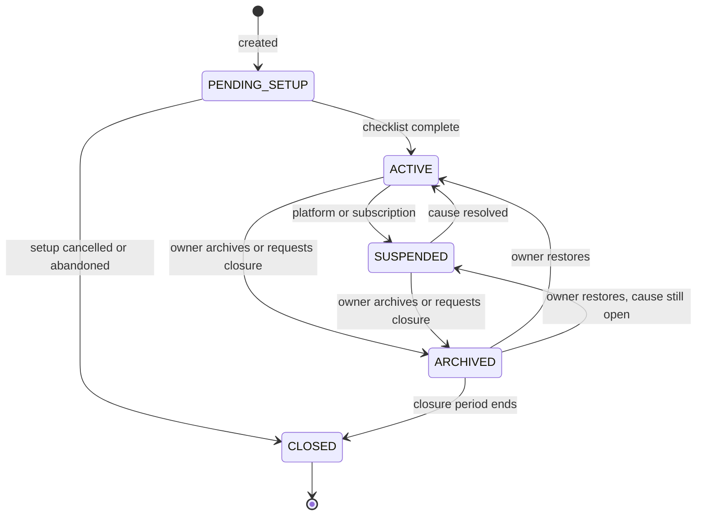

# Organizations

Status: **EMP-ORG-001/002 LOCAL_DONE / INTEGRATION_PENDING**, 2026-11-11; remaining module features PLANNED. Module code `ORG`. Tasks: `EMP-ORG-001…015` in [backlog/ep02-organizations](../backlog/ep02-organizations.md).

Evidence. EMP-ORG-001 implements the pure scoped aggregate and lifecycle under `backend/internal/modules/organization/domain/`; see [domain evidence](../evidence/f1-org001-organization-domain.md). EMP-ORG-002 adds the permanent forced-RLS root, scoped repository/CAS and additive populated-upgrade recovery; see [persistence evidence](../evidence/f1-org002-organization-persistence.md). Existing private IDs remain metadata-pending anchors without fabricated lifecycle, ownership or consent. Onboarding routes, atomic owner/unit creation and actual closure remain planned. The F0 [diagnosis](../01-diagnosis.md) is a historical pre-implementation snapshot. Three existing pieces are reused. The validated value type `kernel.CNPJ` in `backend/internal/modules/kernel/cnpj.go` already accepts the alphanumeric format and computes both check digits, and `backend/internal/modules/kernel/kernel_test.go` contains the official test value: `IMPLEMENTED`. The station catalog keeps one CNPJ per station (`backend/internal/modules/directory/`): `IMPLEMENTED`; this module only references it. The signed-declaration proof of the station profile (`backend/internal/modules/stationprofile/domain/proof.go`) is `PARTIAL` (intake disabled) and is the pattern proposed for verification evidence. No CPF value type exists in `backend/internal/modules/kernel/` (only a CPF-shaped token filter in `station_name.go`), so CPF validation is `PROPOSED`. EMP-GOV-001 and [ADR-025](../../adr/025-private-abastevo-empresas-organization-boundary.md) resolve the historical CX-01 conflict for private Empresas data only.

## 1. Purpose

A company needs one place that is "the company" inside Abastevo: the thing that owns its employees, vehicles, trips, receipts and costs, and that nobody outside it can see. That place is the **organization**. This module lets a person create an organization, describe how the company is really arranged (legal entities, head office and branches, operating units, teams, cost centres), set the defaults every other module reads (time zone, units of measure, approval defaults, substitutes), and take the organization through its whole life: setup, activation, suspension, archiving, change of owner and closure.

Users: the person who signs the company up, organization owners and administrators, and platform operators for suspension and verification. Expected result: every enterprise record has exactly one owner organization; company structure is described without ever being confused with access; and an organization can always leave with its data.

## 2. Scope

- **Basic (F1; tasks marked C1 are in the first cut):** create an organization with its first unit and its owner; activation checklist; operating units with time zones; settings and policy defaults; panel onboarding and settings screens. Also in F1, outside the cut: declared legal entities with CNPJ and CPF validation, cost centres, teams, suspension and reactivation semantics, ownership transfer.
- **Next (F6):** organization groups through consolidation grants. Justification: consolidated reading needs the indicator read models of [intelligence](intelligence.md) and the fine scopes of [07-permissions](../07-permissions.md), which do not exist before F6.
- **Next (F7):** verification of legal entities. Justification: only station claims and agreements need a verified legal entity, and the review queue it uses is built with the back office in F7 ([back-office](back-office.md)).
- **Later (F8):** archive and closure with full export and retention. Justification: closure depends on the full organization export and on the retention job, which are F6 deliverables; until F8 an organization that wants to stop is suspended by a platform operator and keeps its data.
- **Customer kinds supported from F1:** delivery companies, carriers, service providers, farms (including a rural producer who is a natural person identified by CPF), and operations with own, rented or third-party vehicles. The kind changes onboarding defaults only (§10.3); how a vehicle is held is recorded per asset in [fleet](fleet.md).
- **Out of scope:** a public directory of organizations; any lookup of an organization by CNPJ, name or code; automatic creation of groups from registry data; corporate registry consultation (no source for partners or representatives was found, [18-references](../18-references.md) §4); hierarchical cost centres; tax or accounting configuration.

## 3. Entities and ownership

| Entity | Owner | Content | Invariants |
|---|---|---|---|
| Organization | The organization itself | Identifier, display name, kind tags, state, default time zone, revision, creator | The isolation boundary (EDR-001). Never merged with or split from another organization. At least one active owner (BR-AUTH-006). |
| Organization settings | Organization | Versioned document of typed keys (§10.2): time zone, units of measure, approval defaults, substitutes, and keys owned by other modules | One revision in force at a time; previous revisions kept. |
| Legal entity | Organization | Kind (`COMPANY` or `NATURAL_PERSON`), legal name, CNPJ root or CPF, state, verification record (what was checked, by whom, when, valid until) | One identifier appears once per organization. Never unique across organizations. |
| Establishment | Organization (inside a legal entity) | Full 14-character CNPJ, declared role (`HEAD_OFFICE`, `BRANCH`, `NOT_INFORMED`), trade name, municipality reference | Root equals the legal entity's root. A `NATURAL_PERSON` legal entity has no establishment unless the person also declares a CNPJ. |
| Operating unit | Organization | Name, code, IANA time zone, optional establishment, optional municipality reference, state | At least one `ACTIVE` unit per organization. The establishment, when set, belongs to the same organization. |
| Team | Organization | Name, optional unit, employee links, state | Employees and unit belong to the same organization. Membership of a team grants nothing by itself. |
| Cost centre | Organization | Code, name, state | Code unique per organization for ever, including archived ones. |
| Consolidation grant | Both organizations | Grantor organization, reader organization, dataset families, period, state, who proposed and who accepted | Exactly two distinct organizations. Read-only. Never implied by any registry fact. |
| Ownership transfer | Organization | From owner, to member, step-down choice, expiry, outcome | At most one open transfer per organization. |
| Substitute designation | Organization (inside settings) | Responsibility, primary member, substitute member | Both are active members; carries no permission. |

Relations: an organization declares zero or more legal entities; a legal entity has one or more establishments when it is a company; an organization has one or more units, and zero or more teams and cost centres; a unit points to at most one establishment. Employees, memberships and devices are owned by [identity](identity.md); role assignments by [07-permissions](../07-permissions.md). The diagram is in [06-domain-model](../06-domain-model.md) §4.1.

**Which entity is the boundary.** The organization, and only the organization, is the tenant (EDR-001). A CNPJ identifies a registered establishment. A unit is a place or division where work happens. A tenant is the set of records one customer owns. They coincide for a one-person company with one address and differ for almost everyone else: one organization may hold several CNPJs, one CNPJ root may appear in several organizations, and a unit may have no CNPJ at all (a yard, a farm outpost, a field crew).

## 4. Business rules

Structure and boundary:

- **BR-ORG-001 — The organization is the boundary.** Every legal entity, establishment, unit, team, cost centre, employee, asset and operational record belongs to exactly one organization, and isolation, plans, settings and audit are evaluated per organization (EDR-001, BR-TEN-001).
- **BR-ORG-002 — A CNPJ, a unit and an organization are three things.** An organization has zero or more legal entities; a unit links to at most one establishment or to none; no rule derives a unit from a CNPJ, an organization from a CNPJ root, or access from either.
- **BR-ORG-003 — Structure never grants access.** Declaring a legal entity, or sharing a CNPJ root, partners, an address or an e-mail domain with another organization, creates no relation, no visibility and no hint between the two organizations (BR-TEN-002).
- **BR-ORG-004 — Customer kind is descriptive.** Kind tags (`DELIVERY`, `CARRIER`, `SERVICES`, `FARM`, `OTHER`) only choose onboarding defaults; they never change a rule, a permission, a limit or a price.
- **BR-ORG-005 — Names prove nothing.** The display name is free text and is not unique across organizations; wherever a person outside the organization sees it (invitation, grant proposal, agreement), it is shown together with whether the organization has a verified legal entity.
- **BR-ORG-006 — At least one unit.** From creation onward an organization has at least one `ACTIVE` unit; archiving the last one is refused with `LAST_UNIT`.
- **BR-ORG-007 — Names and codes are unique inside the organization.** Unit names, unit codes and team names are unique among `ACTIVE` items of one organization, compared trimmed and case-insensitive; cost-centre codes are unique for ever, so an old export never shows one code with two meanings.
- **BR-ORG-008 — Archive, never delete.** Units, teams and cost centres are archived, not deleted; an archived item accepts no new record or assignment, stays on every historical record and filter, and can be restored.
- **BR-ORG-009 — Archiving needs an empty present.** A unit, team or cost centre cannot be archived while active assets, active employees, open budgets or operations in progress point to it; the refusal is `STRUCTURE_IN_USE` with counts per category and no record data.
- **BR-ORG-010 — Each unit has a time zone.** A unit carries an IANA time zone, defaulting to the organization's; it decides the reporting day of the unit's records (BR-TIME-004). Changing it affects records created afterwards; existing records keep the zone stored on them (BR-TIME-001).
- **BR-ORG-011 — Team membership is not access.** Adding an employee to a team changes no permission; a team matters to authorization only when a role assignment names it as scope (BR-AUTH-004).
- **BR-ORG-012 — History survives structure changes.** Renaming or archiving a unit, team or cost centre, or renaming the organization, never rewrites a record; records keep the identifiers they were created with (BR-AUTH-005) and screens show the current name with "(arquivada)" when it applies.

Legal entities:

- **BR-ORG-013 — Two kinds of legal entity.** A legal entity is a `COMPANY` identified by CNPJ or a `NATURAL_PERSON` identified by CPF; the natural-person kind exists for rural producers and is never required of anyone.
- **BR-ORG-014 — A CNPJ is validated text.** A CNPJ is 14 characters: the first 12 are digits or uppercase letters, the last two are numeric check digits computed as in §10.1. It is parsed with the existing kernel type, stored as text, never coerced to a number, and letters are never converted to digits.
- **BR-ORG-015 — "0001" proves nothing.** Whether an establishment is the head office (`matriz`) or a branch (`filial`) is an attribute the organization declares; it is never inferred from the order digits ([18-references](../18-references.md) §4).
- **BR-ORG-016 — Declared is not verified.** A legal entity in `DECLARED` passed format validation only. The interface labels it "Declarado pela empresa", no screen, export or public surface presents it as verified, and no feature that needs verification accepts it (BR-TRUTH-001).
- **BR-ORG-017 — Declaring is not exclusive and leaks nothing.** Several organizations may declare the same CNPJ or CPF. The answer to a declaration never reveals whether another organization declared or verified the same identifier.
- **BR-ORG-018 — Verification says what was checked.** `VERIFIED` stores the evidence kind, the reviewer, the source consulted, the decision time and a validity end; it is shown as "Verificado em <date>: <what was checked>". It becomes `LAPSED` at the validity end and can be `REVOKED` with a reason.
- **BR-ORG-019 — Verification gates named features only.** Submitting a station claim for the organization and taking part in an agreement need a `VERIFIED` legal entity ([station-claims](station-claims.md), [station-commerce](station-commerce.md)); without it they answer `LEGAL_ENTITY_NOT_VERIFIED`. Fleet operation never needs it.
- **BR-ORG-020 — A CPF is personal data.** The CPF of a natural-person legal entity is collected only to identify the party in verification and agreements (BR-PRIV-005), is shown masked except to members with `org.legal_entity.manage`, and never appears in logs, events or default exports (BR-PRIV-008).

Groups:

- **BR-ORG-021 — Consolidation needs two consents.** A consolidation grant exists only after one organization proposed it and the other accepted it, each through a member with `org.group.manage` and fresh authentication. The platform never proposes or creates one from registry data.
- **BR-ORG-022 — Consolidation is read-only and field-limited.** A grant lists the dataset families the reader may see (period totals of indicators and costs by unit and cost centre). It never covers document content, tracks, live positions, employee personal data, the audit trail or any write (BR-TEN-005).
- **BR-ORG-023 — Either side ends it at once.** Either organization ends a grant without the other's consent, effective on the next request; while either organization is `SUSPENDED` the grant gives nothing, and archiving or closing either one ends it.
- **BR-ORG-024 — Consolidated figures name their source.** Every consolidated figure shows the organization it came from and the grant that allowed it, and is never stored among the reader's own records.

Lifecycle:

- **BR-ORG-025 — Creation makes an owner.** Creating an organization writes, in one transaction, the organization in `PENDING_SETUP`, its first unit, the creator's employee record and an `ACTIVE` membership with role `OWNER` over scope `ORG`.
- **BR-ORG-026 — Owners can recover their own access.** A managed account (EDR-031) cannot create an organization, receive an ownership transfer or hold `OWNER`; the attempt is refused with `OWNER_REQUIRES_PERSONAL_ACCOUNT`.
- **BR-ORG-027 — Activation checklist.** `PENDING_SETUP` becomes `ACTIVE` only with a name, a valid time zone, at least one `ACTIVE` unit, at least one active owner and the recorded acceptance of the data-processing terms (LV-02). Until then only configuration commands are accepted; operational commands answer `ORG_SETUP_INCOMPLETE`.
- **BR-ORG-028 — Abandoned setups are closed.** An organization still in `PENDING_SETUP` after 90 days with no operational record is closed by the system, with a notice to its owners 14 days earlier; one account may hold at most 3 organizations in `PENDING_SETUP`.
- **BR-ORG-029 — Suspension is a platform action with a reason.** Only a platform operator or a subscription state change suspends or reactivates an organization; each change records a reason category (`BILLING`, `TERMS`, `SECURITY`, `LEGAL`, `OWNER_REQUEST`), writes an audit event and notifies the owners. An organization does not suspend itself; it archives.
- **BR-ORG-030 — Suspension blocks new work, not reading.** In `SUSPENDED`, commands that create or change organization records are refused with `ORG_SUSPENDED`; members keep reading within their permissions and members with `rpt.export.run` keep exporting. For this module "permissions denied while suspended" in [07-permissions](../07-permissions.md) §6 means write permissions.
- **BR-ORG-031 — Suspension never strands field work.** Work opened before the suspension can be finished, and operations declared before it and received inside the grace period are kept for review; nothing recorded in the field is discarded because of the suspension ([10-offline-sync](../10-offline-sync.md) §10.2, BR-OFFL-006).
- **BR-ORG-032 — Access-reducing actions always work.** In `SUSPENDED` and `ARCHIVED` these stay available to the roles that hold them: suspending or ending memberships, revoking devices, invitations and activation codes, legal holds and data-subject requests ([11-privacy-security](../11-privacy-security.md)), and reading and regularising the plan.
- **BR-ORG-033 — Archiving is read-only by choice.** An owner archives the organization when nothing is in progress (§5, UC-ORG-11). In `ARCHIVED` no command that creates or changes records is accepted (`ORG_ARCHIVED`), reading and exporting continue, and an owner can restore it.
- **BR-ORG-034 — Ownership transfer needs two people.** A transfer is started by an `OWNER` with fresh authentication, names an `ACTIVE` member with a personal account, expires in 7 days and takes effect only when that member accepts with fresh authentication. The organization has an owner at every instant (BR-AUTH-006).
- **BR-ORG-035 — An ownerless organization is recovered by evidence, not by claim.** When the only owner cannot act, a new owner is assigned only through the audited back-office procedure in [back-office](back-office.md), on evidence that the requester acts for a verified legal entity of the organization. Knowing the CNPJ is not evidence.
- **BR-ORG-036 — Closure is announced, exportable and final.** A closure request archives the organization and starts the closure period (default 30 days, range 7 to 90), during which owners can export and cancel. At its end the organization becomes `CLOSED`: every membership ends and all access stops. Deletion then follows BR-PRIV-012 and the schedule in [11-privacy-security](../11-privacy-security.md) §10.1; this module sets no retention period of its own.
- **BR-ORG-037 — Closed is terminal.** A `CLOSED` organization is never reopened; coming back is a new organization with a new identifier and no inherited data.

Settings:

- **BR-ORG-038 — Settings are versioned.** Each change creates a new revision with author, time and reason; a record is judged by the revision in force when the server received it (BR-TIME-003); earlier revisions stay readable.
- **BR-ORG-039 — Units of measure are display only.** The organization chooses how consumption is displayed; stored values and arithmetic stay in the base units of BR-MONEY-002 and are never converted in storage.
- **BR-ORG-040 — Policy defaults start safe.** A new organization starts with review required for trips, fuelings and expenses, one approval level and reviewers falling back to the organization's administrators; the policies themselves are specified in [expenses-finance](expenses-finance.md).
- **BR-ORG-041 — Substitutes route work; they gain no right.** Naming a substitute for a responsibility only redirects notifications and queues when the primary is unavailable; the authority to act still comes from a role assignment or a delegation (BR-AUTH-008).

## 5. Use cases

**UC-ORG-01 — Create an organization.** Actor: a signed-in person with a personal account. Preconditions: fewer than 3 organizations of this account in `PENDING_SETUP`; fresh session. Main flow: the person enters the company name, kind, time zone and the name of the first unit and accepts the data-processing terms → the server creates the organization, the unit, the employee record and the owner membership in one transaction (BR-ORG-025) → the panel opens the setup checklist. Alternatives: managed account → `OWNER_REQUIRES_PERSONAL_ACCOUNT`; invalid time zone → `VALIDATION_FAILED`; fourth pending setup → `RATE_LIMITED`; same `operation_id` sent again → the first result. Result: organization in `PENDING_SETUP` with one owner and one unit.

**UC-ORG-02 — Configure and activate.** Actor: member with `org.settings.manage`. Preconditions: organization in `PENDING_SETUP`. Main flow: review name, time zone and units → optionally add cost centres, teams, employees and legal entities → choose "Concluir configuração" → the server checks BR-ORG-027 → state becomes `ACTIVE`. Alternatives: checklist incomplete → `ORG_SETUP_INCOMPLETE` with the missing items in `details`; setup abandoned → BR-ORG-028. Result: operational commands are accepted.

**UC-ORG-03 — Maintain units, cost centres and teams.** Actor: member with `org.structure.manage`. Main flow: create, rename, change code or time zone, link a unit to an establishment, add or remove team members, archive or restore. Alternatives: duplicate name or code → `VALIDATION_FAILED` with `DUPLICATE` on the field; item in use → `STRUCTURE_IN_USE`; last active unit → `LAST_UNIT`; stale revision → `CONFLICT`; employee or establishment of another organization → `NOT_FOUND`. Result: structure changed; past records untouched (BR-ORG-012).

**UC-ORG-04 — Declare a legal entity and its establishments.** Actor: member with `org.legal_entity.manage`. Main flow: choose the kind → type the CNPJ or CPF → the server validates format and check digits → for a company, add establishments and declare each as head office, branch or not informed → state `DECLARED`. Alternatives: invalid identifier → `VALIDATION_FAILED` with `INVALID_CNPJ` or `INVALID_CPF`; already declared in this organization → `VALIDATION_FAILED` with `DUPLICATE`; declared elsewhere → no difference in the answer (BR-ORG-017); declared by mistake → withdraw it (§8). Result: legal entity listed as "Declarado pela empresa".

**UC-ORG-05 — Request and decide verification (F7).** Actors: member with `org.legal_entity.manage`; platform reviewer. Preconditions: legal entity in `DECLARED`, `REFUSED` or `LAPSED`; fresh authentication. Main flow: the member attaches the evidence the form asks for and submits → state `VERIFICATION_REQUESTED` → the request appears in the back-office queue → the reviewer compares the evidence with the declaration, records what was checked and decides → `VERIFIED` with a validity end, or `REFUSED` with a reason → owners are notified. Alternatives: member cancels → back to `DECLARED`; another organization already verified for the same identifier → the reviewer sees it inside the back office only, and decides each request on its own evidence; validity end reached → `LAPSED`; evidence withdrawn or contested → `REVOKED`. Result: features of BR-ORG-019 are available while `VERIFIED`.

**UC-ORG-06 — Change settings and policy defaults.** Actor: member with `org.settings.manage`. Main flow: open settings → change time zone, consumption display, review defaults or a key owned by another module, with a reason → new revision in force for operations received from then on. Alternatives: value outside its range → `VALIDATION_FAILED` showing the range; stale revision → `CONFLICT`. Result: new revision; previous one kept (BR-ORG-038).

**UC-ORG-07 — Name substitute responsibles.** Actor: member with `org.settings.manage`. Main flow: for each responsibility (review fallback, platform notices, data-protection contact, billing contact) choose a primary and a substitute among active members → saved in settings. Alternatives: the chosen member's membership is later suspended or ended → the designation is cleared and administrators are notified; the substitute lacks the permission the work needs → the screen says so and offers a delegation ([07-permissions](../07-permissions.md), UC-AUTH-03). Result: notifications and queues reach the substitute when the primary is unavailable (BR-ORG-041).

**UC-ORG-08 — Suspend and reactivate.** Actor: platform operator through the back office, or the subscription lifecycle ([subscriptions](subscriptions.md)). Main flow: choose the organization and a reason category → state `SUSPENDED` → owners notified; every member sees the suspension notice at the next request or sync. Reactivation: the cause is resolved → state `ACTIVE` → operations held during the suspension wait in the review queue for a decision. Alternatives: organization already archived → the suspension cause is recorded and applies if the organization is restored. Result: BR-ORG-030 to BR-ORG-032 apply while suspended.

**UC-ORG-09 — Transfer ownership.** Actor: an `OWNER` with `org.ownership.transfer`. Preconditions: fresh authentication; no open transfer; organization `ACTIVE`. Main flow: choose an active member and whether to step down to `ADMIN` afterwards → the member is notified → the member accepts with fresh authentication → in one transaction the member receives `OWNER` and, when chosen, the former owner's `OWNER` assignment ends. Alternatives: member has a managed account → `OWNER_REQUIRES_PERSONAL_ACCOUNT`; 7 days pass, the member declines or the owner cancels → nothing changes; the member's membership ends meanwhile → the transfer is cancelled; open transfer exists → `TRANSFER_PENDING`; only owner unreachable → BR-ORG-035. Result: the organization has at least one owner before, during and after.

**UC-ORG-10 — Propose, accept and end a consolidation grant (F6).** Actors: a member with `org.group.manage` in each organization. Main flow: the proposer chooses the direction (whose figures are read by whom), the dataset families and the period → the server issues a single-use proposal code valid for 7 days → the proposer hands it to the other organization outside the system → a member there enters the code, reads exactly what would be shared and accepts with fresh authentication → state `ACTIVE`. Alternatives: declined, withdrawn or expired → `DECLINED`; either side ends → `ENDED` at once; either organization suspended → nothing is served while it lasts. Result: the reader sees the listed consolidated figures, each labelled with its source (BR-ORG-024).

**UC-ORG-11 — Archive and restore (F8).** Actor: an `OWNER` with `org.lifecycle.manage`. Preconditions: fresh authentication. Main flow: request archive → the server builds the open-items report (trips in progress or paused, records awaiting review, held operations, open payables, active agreements and station authorities, active grants) → trips in progress and active agreements block the archive; the other items are listed and stay as they are, frozen and exportable → the owner confirms → state `ARCHIVED`; pending invitations, activation codes and transfers are revoked. Restore: the owner asks to restore → state `ACTIVE`, or `SUSPENDED` when a suspension cause is still open. Alternatives: blocking items → `ORG_HAS_OPEN_OPERATIONS` with counts. Result: read-only organization (BR-ORG-033).

**UC-ORG-12 — Close the organization (F8).** Actor: an `OWNER` with `org.lifecycle.manage`. Preconditions: fresh authentication; the owner types the organization name. Main flow: request closure → same checks as UC-ORG-11 → state `ARCHIVED` with a closure date → owners are reminded to export ([intelligence](intelligence.md)) → at the closure date the state becomes `CLOSED`, memberships end, devices are revoked and grants end → deletion follows BR-PRIV-012. Alternatives: cancel before the date → stays `ARCHIVED`; a legal hold exists → access still ends, and deletion of the held scope waits for the hold ([11-privacy-security](../11-privacy-security.md), UC-PRIV-04). Result: the organization no longer exists for any caller; every request answers `NOT_FOUND`.

## 6. States and transitions

State names are those of [08-state-model](../08-state-model.md) §3. Organization:

| From | To | Actor | Validation | Effect | Reversal |
|---|---|---|---|---|---|
| — | `PENDING_SETUP` | Signed-in personal account | BR-ORG-026, BR-ORG-028; name, time zone, first unit, terms accepted | BR-ORG-025; audit event | Cancel setup |
| `PENDING_SETUP` | `ACTIVE` | `org.settings.manage` | BR-ORG-027 | Operational commands accepted | None; suspend or archive |
| `PENDING_SETUP` | `CLOSED` | `org.lifecycle.manage`, or time (90 days) | No operational record exists | Access ends; configuration deleted per BR-PRIV-012 | None |
| `ACTIVE` | `SUSPENDED` | Platform operator or subscription lifecycle | Reason category recorded | BR-ORG-030 to BR-ORG-032; owners notified | Reactivate |
| `SUSPENDED` | `ACTIVE` | Platform operator or subscription lifecycle | Cause resolved | Writes resume; held operations wait for review | Suspend again |
| `ACTIVE`, `SUSPENDED` | `ARCHIVED` | `org.lifecycle.manage`, fresh authentication | No blocking open item (UC-ORG-11) | BR-ORG-033; pending invitations, codes and transfers revoked | Restore |
| `ARCHIVED` | `ACTIVE` or `SUSPENDED` | `org.lifecycle.manage`, fresh authentication | No closure date pending | Writes resume unless a suspension cause is open | Archive again |
| `ARCHIVED` | `CLOSED` | Time, at the closure date set by UC-ORG-12 | Closure not cancelled | Memberships end; devices revoked; grants end; deletion per BR-PRIV-012 | None; terminal |

Legal entity:

| From | To | Actor | Validation | Effect | Reversal |
|---|---|---|---|---|---|
| — | `DECLARED` | `org.legal_entity.manage` | Identifier valid; not already declared in this organization | Listed as declared | Withdraw (§8) |
| `DECLARED`, `REFUSED`, `LAPSED` | `VERIFICATION_REQUESTED` | `org.legal_entity.manage`, fresh authentication | Evidence attached; no open request | Enters the back-office queue | Cancel → `DECLARED` |
| `VERIFICATION_REQUESTED` | `VERIFIED` | Platform reviewer | Evidence matches the declaration; what was checked is recorded | BR-ORG-019 features available; validity end set (default 12 months, hypothesis) | Revoke |
| `VERIFICATION_REQUESTED` | `REFUSED` | Platform reviewer | Reason required | None | New request with new evidence |
| `VERIFIED` | `LAPSED` | Time | Validity end reached without renewal | New uses of BR-ORG-019 features refused; existing authorities and agreements follow their own modules | Renew by a new request |
| `VERIFIED`, `DECLARED`, `REFUSED`, `LAPSED` | `REVOKED` | Platform operator with a reason, or the organization withdrawing | Reason recorded | As lapsed, immediately; owners notified | None; declare again as a new record |

Unit, team and cost centre: `ACTIVE` → `ARCHIVED` by `org.structure.manage` under BR-ORG-009, and back by the same permission when the name or code is still free.

Consolidation grant:

| From | To | Actor | Validation | Effect | Reversal |
|---|---|---|---|---|---|
| — | `PROPOSED` | `org.group.manage` of the proposer, fresh authentication | Both organizations `ACTIVE`; dataset families from the allowed list | Proposal code issued | Withdraw → `DECLINED` |
| `PROPOSED` | `ACTIVE` | `org.group.manage` of the other organization, fresh authentication | Code valid and unused; organizations distinct | Consolidated reads served | End |
| `PROPOSED` | `DECLINED` | Other organization, proposer, or time (7 days) | — | Nothing shared | New proposal |
| `ACTIVE` | `ENDED` | Either organization, the period end, or archive or closure of either | — | Reads stop on the next request | New proposal |

## 7. Roles and permissions

Keys are those of [07-permissions](../07-permissions.md) §7.2. All `org.*` permissions take effect only in a role assignment with scope `ORG`.

| Permission | Used for | Roles |
|---|---|---|
| `org.settings.read` | Read settings, policies and the structure lists in the panel | `OWNER`, `ADMIN`, `FLEET_MANAGER`, `SUPERVISOR`, `FINANCE`, `APPROVER`, `AUDITOR` (proposed; no row in §7.3) |
| `org.settings.manage` | UC-ORG-02, UC-ORG-06, UC-ORG-07 | `OWNER`, `ADMIN` (§7.3) |
| `org.structure.manage` | UC-ORG-03 | `OWNER`, `ADMIN` (§7.3) |
| `org.legal_entity.manage` | UC-ORG-04, UC-ORG-05 | `OWNER`, `ADMIN` (§7.3, org-permissions-v2; EDR-037) |
| `org.ownership.transfer` | UC-ORG-09 | `OWNER` (§7.3) |
| `org.lifecycle.manage` | UC-ORG-11, UC-ORG-12 | `OWNER` (proposed; no row in §7.3) |
| `org.group.manage` | UC-ORG-10 | `OWNER` (proposed; no row in §7.3) |

Members without `org.settings.read` (drivers, operations staff) receive the units, teams and cost centres inside their own scopes through the reference data of [10-offline-sync](../10-offline-sync.md) UC-OFFL-08, never the settings document. Creating an organization needs no permission, only a personal account. Suspension, reactivation, verification decisions and owner recovery are platform operator actions ([back-office](back-office.md)); no organization role performs them. Ownership transfer, archive, closure, verification requests and grant acceptance require fresh authentication (BR-AUTH-010).

## 8. Offline, concurrency, idempotency and corrections

- **Offline:** every command of this module is online ([10-offline-sync](../10-offline-sync.md) §10.3, panel row). The app holds the organization name, state, units, teams and cost centres as reference data with its confirmation time (BR-OFFL-016). What happens to operations already in the field when the organization is suspended is decided by the intake table in [10-offline-sync](../10-offline-sync.md) §10.2 and illustrated in §10.5.
- **Concurrency:** the organization, its settings and each structural item carry a revision; a command on a stale revision fails with `CONFLICT` and changes nothing. Ownership transfer acceptance, removal of an owner and archive take a row lock on the organization, so two concurrent commands cannot leave it without an owner or half archived. Two creations of the same unit name race on the unique constraint; the loser receives `VALIDATION_FAILED` with `DUPLICATE`.
- **Idempotency:** every command carries an `operation_id`; the same identifier and body returns the first result, a different body returns `OPERATION_ID_REUSED`. Creating an organization twice with the same identifier yields one organization.
- **Corrections:** a CNPJ or CPF is immutable once declared. A declaration made by mistake is withdrawn: when it has no verification history and nothing references it, it is removed and only the audit event remains; otherwise it moves to `REVOKED` with origin "withdrawn by the organization", because the state catalog has no separate withdrawn state. A wrong time zone or setting is corrected by a new revision; records already received keep the values they were judged with, and any re-bucketing of reporting days is an explicit recalculation in the owning module (BR-AMD-005).

## 9. Events, notifications and integrations

Produced: `org.organization.created`, `org.organization.activated`, `org.organization.suspended`, `org.organization.reactivated`, `org.organization.archived`, `org.organization.restored`, `org.organization.closed`, `org.settings.changed`, `org.unit.created`, `org.unit.changed`, `org.unit.archived`, `org.team.changed`, `org.cost_centre.changed`, `org.legal_entity.declared`, `org.legal_entity.verified`, `org.legal_entity.refused`, `org.legal_entity.lapsed`, `org.legal_entity.revoked`, `org.ownership.transferred`, `org.grant.accepted`, `org.grant.ended`.

Consumed: `idn.membership.suspended` and `idn.membership.ended` (clear substitute designations, cancel an open ownership transfer to that member, remove team links); `subs.subscription.state_changed` (suspension and reactivation for billing reasons, F8); the existing account-deletion event, through [identity](identity.md), which ends the membership first.

Notifications, in-app first (EDR-032): owners and administrators on suspension, reactivation, verification decisions, lapse 30 days ahead, transfer requests and outcomes, closure reminders 14 and 3 days before the closure date; every member sees a banner while the organization is suspended or archived.

Integrations: none. No registry is consulted automatically; the ANP register names no partners or representatives ([18-references](../18-references.md) §4), so verification rests on reviewed evidence.

## 10. Data, formulas and examples

### 10.1 Identifiers

CNPJ ([18-references](../18-references.md) §4; implemented in `backend/internal/modules/kernel/cnpj.go`): 14 characters `RRRRRRRR OOOO DD` — root (8), order (4), check digits (2). Formatting characters (dot, slash, hyphen, space) are removed and letters uppercased on input. Each character is valued as its ASCII code minus 48 (`0`–`9` → 0–9, `A`–`Z` → 17–42). First digit: multiply the 12 base characters by the weights 5,4,3,2,9,8,7,6,5,4,3,2, sum, take the remainder modulo 11; the digit is 0 when the remainder is 0 or 1, otherwise 11 minus the remainder. Second digit: the same with the weights 6,5,4,3,2,9,8,7,6,5,4,3,2 over the 12 base characters followed by the first digit.

Official test value `12.ABC.345/01DE-35`: values 1,2,17,18,19,3,4,5,0,1,20,21. First sum `5+8+51+36+171+24+28+30+0+4+60+42 = 459`; `459 mod 11 = 8`; digit `11 − 8 = 3`. Second sum `6+10+68+54+38+27+32+35+0+5+80+63+(3×2) = 424`; `424 mod 11 = 6`; digit `11 − 6 = 5`. Check digits `35`.

Synthetic value used below, base `EXEMPL010001`: values 21,40,21,29,32,28,0,1,0,0,0,1. First sum `105+160+63+58+288+224+0+6+0+0+0+2 = 906`; `906 mod 11 = 4`; digit `7`. Second sum `126+200+84+87+64+252+0+7+0+0+0+3+(7×2) = 837`; `837 mod 11 = 1`; digit `0`. Result `EX.EMP.L01/0001-70`.

CPF: 11 digits with two modulo-11 check digits. The algorithm is not among the facts recorded in [18-references](../18-references.md); EMP-ORG-004 records its source there before implementing it. No CPF value, real or synthetic, is written in this plan; test fixtures generate them.

### 10.2 Settings owned by this module

| Key | Default | Allowed values | Read by |
|---|---|---|---|
| `time_zone` | Chosen at creation | Any IANA zone known to the server | Units without their own zone; BR-TIME-004 |
| `consumption_display` | `KM_PER_L` | `KM_PER_L`, `L_PER_100KM` | Screens and reports of [fuelings](fuelings.md); machines measured in hours always show litres per hour |
| `review_required` | trips, fuelings, expenses: yes | yes or no per record type | [expenses-finance](expenses-finance.md) approval engine |
| `approval_levels_default` | 1 | 1 to 3 | Same |
| `review_fallback` | Members with `ADMIN` or `OWNER` | A primary and a substitute member | Review routing when no reviewer covers a record's scope |
| `contacts` | The creator | Primary and substitute for platform notices, data protection and billing | Notifications |
| `ownership_transfer_validity` | 7 days | fixed | UC-ORG-09 |
| `closure_period` | 30 days | 7 to 90 days | UC-ORG-12 |

The settings document also holds keys specified elsewhere, which this module stores and versions but does not define: the intake window and clock-skew limit ([10-offline-sync](../10-offline-sync.md) BR-OFFL-011, BR-TIME-006), the delegation maximum (BR-AUTH-008), retention choices ([11-privacy-security](../11-privacy-security.md) §10.1) and invitation and activation validity ([identity](identity.md)).

Display example for `consumption_display`. An interval of 412 000 m with 51 500 mL: `412.000 km ÷ 51.500 L = 8.0 km/L`; the same interval as `51.500 L ÷ 4.12 hundred km = 12.5 L/100 km`. Both are computed from the stored integers; nothing is stored in the display unit.

### 10.3 Onboarding defaults by kind

| Kind | Suggested at setup (all can be changed) |
|---|---|
| `DELIVERY` | One unit per base; teams by shift; odometer in kilometres |
| `CARRIER` | Cost centres per contract or route; one unit per branch |
| `SERVICES` | Teams by service crew; cost centres per client contract |
| `FARM` | Legal entity of kind `NATURAL_PERSON` offered first; units per farm or outpost; hour meters for machines |
| `OTHER` | One unit, no cost centres |

### 10.4 Error codes added by this module

| Code | HTTP | Meaning |
|---|---|---|
| `ORG_SETUP_INCOMPLETE` | 409 | Activation checklist not met, or an operational command while `PENDING_SETUP` |
| `ORG_HAS_OPEN_OPERATIONS` | 409 | Archive or closure blocked; `details` carries counts per category |
| `STRUCTURE_IN_USE` | 409 | Unit, team or cost centre still referenced by active items |
| `LAST_UNIT` | 409 | The organization would have no active unit |
| `LEGAL_ENTITY_NOT_VERIFIED` | 409 | The feature needs a `VERIFIED` legal entity |
| `OWNER_REQUIRES_PERSONAL_ACCOUNT` | 409 | A managed account cannot create an organization or be its owner |
| `TRANSFER_PENDING` | 409 | Another ownership transfer is open |

Field codes inside `VALIDATION_FAILED`: `INVALID_CNPJ`, `INVALID_CPF`, `DUPLICATE`, `UNKNOWN_TIME_ZONE`, `OUT_OF_RANGE`. Shared codes are in [09-architecture](../09-architecture.md) §6.

### 10.5 Worked examples

**A company with two CNPJs and three units.** Transportes Exemplo creates one organization. It declares two legal entities: the carrier, root `EXEMPL01`, with establishment `EX.EMP.L01/0001-70` declared as head office; and a rental company of the same partners that holds the trucks, root `EXEMPL02`, with establishment `EX.EMP.L02/0001-14` (first sum 912, remainder 10, digit 1; second sum 832, remainder 7, digit 4). It creates three units: "Matriz", linked to the first establishment; "Pátio Norte", a yard with no establishment; and "Locadora", linked to the second. Result: one tenant, two legal entities, three units. A supervisor scoped to "Pátio Norte" sees that unit's records and nothing of "Locadora"; that is a permission scope inside one organization, not isolation between tenants.

**A farm run by a natural person.** A rural producer creates the organization "Fazenda Exemplo" with kind `FARM` and time zone `America/Cuiaba`, and activates it with two units, "Sede" and "Retiro", without declaring any legal entity: the checklist of BR-ORG-027 does not ask for one. Later the producer declares a `NATURAL_PERSON` legal entity with a CPF; it is shown masked to everyone except the owner and administrators (BR-ORG-020). Tractors are registered with hour meters in [fleet](fleet.md). If the farm later wants an agreement with a station, that legal entity must first be verified (BR-ORG-019).

**Two unrelated franchises sharing a CNPJ root.** Organization "Franquia Sul" declares establishment `EX.EMP.L03/0004-01` (sums 924 and 846, remainders 0 and 10, digits 0 and 1) and organization "Franquia Norte" declares `EX.EMP.L03/0009-16` (sums 934 and 863, remainders 10 and 5, digits 1 and 6). Both share the root `EXEMPL03` and neither order is `0001`. Each declaration succeeds with the same answer; neither organization learns that the other exists (BR-ORG-017). A manager of "Franquia Sul" who sends a request with the identifier of "Franquia Norte" receives `NOT_FOUND` (BR-TEN-006). If the franchisor's own organization wants consolidated costs, it proposes a grant to each franchise and each one decides separately (UC-ORG-10); accepting it shares the listed totals only.

**Suspension and work in the field.** The organization is suspended at `2026-11-10T12:00:00Z`. The grace period is 7 days = 604 800 s and ends at `2026-11-17T12:00:00Z`. Following [10-offline-sync](../10-offline-sync.md) §10.2: (1) a trip started at 09:10 that day is finished at 15:30 → `ACCEPTED_FOR_REVIEW` with `ORG_SUSPENDED_GRACE`, because the trip was opened before the suspension; (2) a fueling declared at `2026-11-10T11:40:00Z` reaches the server at `2026-11-13T09:00:00Z`, 248 400 s after the suspension and inside the grace period → `ACCEPTED_FOR_REVIEW` with `ORG_SUSPENDED_GRACE`; (3) a new trip declared at `2026-11-11T08:00:00Z` → `REJECTED` with `ORG_SUSPENDED`, and the driver's phone shows "Não aceito" with the reason. In the panel a manager who tries to register a vehicle receives `ORG_SUSPENDED`; the same manager still opens last month's fuelings and runs an export.

**Unit time zone and reporting day.** A fueling occurs at `2026-11-11T03:30:00Z`. In a unit with zone `America/Sao_Paulo` (UTC−3) the local time is 00:30 on 11 November, so the reporting day is 2026-11-11. In a unit with zone `America/Cuiaba` (UTC−4) the local time is 23:30 on 10 November, so the reporting day is 2026-11-10 (BR-TIME-004).

## 11. Screens

| ID | Surface | Objective | Actor | Data | Actions | Rules and permissions | Validations and states |
|---|---|---|---|---|---|---|---|
| SCR-ORG-01 | PANEL | Create the organization and finish setup | Signed-in personal account; then `org.settings.manage` | Name, kind, time zone, first unit, terms; checklist with what is missing | Create, add units, conclude setup | BR-ORG-025 to BR-ORG-028 | Managed account: explains that an owner needs a personal account. Checklist items show done or missing as text, not colour only. Error on conclude lists missing items. |
| SCR-ORG-02 | PANEL | See and change organization settings | `org.settings.read`; changes need `org.settings.manage` | Name, state, time zone, consumption display, review defaults, substitutes, revision history | Edit with reason, open history | BR-ORG-038 to BR-ORG-041 | Read-only for readers. Out-of-range values show the allowed range. Stale revision: reload prompt. Suspended or archived: fields disabled with the reason. |
| SCR-ORG-03 | PANEL | Maintain units | `org.structure.manage` | Name, code, time zone, linked establishment, state, counts of assets and employees | Create, edit, archive, restore | BR-ORG-006 to BR-ORG-010 | Empty state not possible (at least one unit). Archive blocked: shows counts per category. Changing the time zone warns that existing records keep theirs. |
| SCR-ORG-04 | PANEL | Maintain cost centres | `org.structure.manage` | Code, name, state | Create, rename, archive, restore | BR-ORG-007 to BR-ORG-009 | Empty: explains what a cost centre is for and that it is optional. Duplicate code shown on the field. |
| SCR-ORG-05 | PANEL | Maintain teams and their members | `org.structure.manage` | Name, unit, members, state | Create, rename, add and remove members, archive | BR-ORG-011 | Empty: optional feature notice. States that a team gives no access by itself. |
| SCR-ORG-06 | PANEL | Declare legal entities and establishments and see their status | `org.legal_entity.manage` | Kind, legal name, CNPJ or masked CPF, establishments with declared role, state label, validity end | Declare, add establishment, withdraw, request verification | BR-ORG-013 to BR-ORG-020 | Empty: explains that declaring is optional for fleet use. Status labels use the fixed wording "Declarado pela empresa" and "Verificado em …". Invalid identifier shown on the field without echoing it to logs. |
| SCR-ORG-07 | PANEL | Request verification of a legal entity | `org.legal_entity.manage` | What will be checked, evidence upload, request state, refusal reason | Submit, cancel | BR-ORG-018, BR-ORG-019, BR-AUTH-010 | Unavailable before F7: hidden. Asks for fresh authentication. Refused: shows the reason and allows a new request. |
| SCR-ORG-08 | ADMIN | Decide a verification request | Platform reviewer | Declaration, evidence, other organizations verified for the same identifier (back office only), history | Verify with what was checked and validity, refuse with reason, revoke | BR-ORG-017, BR-ORG-018 | Decision needs the "what was checked" field. Never shown to organizations. |
| SCR-ORG-09 | PANEL | Transfer ownership | `org.ownership.transfer`; the invited member | Owners, eligible members, step-down choice, expiry | Start, cancel, accept, decline | BR-ORG-034, BR-ORG-026, BR-AUTH-006, BR-AUTH-010 | Members with managed accounts are listed as not eligible with the reason. Open transfer shows its expiry. |
| SCR-ORG-10 | PANEL | Manage consolidation grants | `org.group.manage` | Grants by direction, dataset families, period, state; proposal code shown once | Propose, enter a code, accept, decline, end | BR-ORG-021 to BR-ORG-024 | Unavailable before F6: hidden. Acceptance screen lists exactly what will be shared and what never is. Empty: explains that sharing a CNPJ root creates no group. |
| SCR-ORG-11 | PANEL | Archive, restore or close the organization | `org.lifecycle.manage` | Open-items report with counts, export status, closure date | Archive, restore, request closure, cancel closure | BR-ORG-033, BR-ORG-036, BR-ORG-037 | Unavailable before F8: hidden. Closure asks for the typed organization name and fresh authentication. Blocking items listed by category with links. |
| SCR-ORG-12 | APP, PANEL | Tell members the organization is suspended, archived or closing | Any member | State, reason category in plain words, what still works, who to contact | Open pending records (app), open export (panel, when permitted) | BR-ORG-030 to BR-ORG-033 | Persistent banner, not a blocking dialog. Offline: shows the last confirmed state and its time. |

## 12. Acceptance, dependencies, risks, phase and microtasks

Acceptance criteria:

1. Creating an organization yields, in one transaction, the organization in `PENDING_SETUP`, one unit, one employee record and one `ACTIVE` owner membership; repeating the same `operation_id` creates nothing new.
2. A managed account that tries to create an organization or accept an ownership transfer receives `OWNER_REQUIRES_PERSONAL_ACCOUNT`.
3. An organization in `PENDING_SETUP` refuses an operational command with `ORG_SETUP_INCOMPLETE` and accepts it after activation.
4. In a two-organization fixture where both declared establishments with the same CNPJ root, every read, list, write and export of one organization attempted with the other's identity answers `NOT_FOUND` with no data, and the declaration responses of the two are indistinguishable.
5. The official test value and the synthetic values of §10.1 and §10.5 validate; the same values with one check digit changed or with 13 characters are refused; lowercase input is stored uppercased and a letter is never stored as a digit.
6. An establishment with order `0001` and declared role `BRANCH` is stored and shown as a branch.
7. A feature gated by BR-ORG-019 refuses a `DECLARED`, `REFUSED`, `LAPSED` or `REVOKED` legal entity and accepts a `VERIFIED` one.
8. The last active unit cannot be archived; a unit with active assets cannot be archived; an archived unit still appears on its past records.
9. While `SUSPENDED`: a write command from the panel receives `ORG_SUSPENDED`; reads and exports succeed for the same member; the three field cases of §10.5 produce the stated results.
10. Offboarding a member and revoking a device succeed while the organization is `SUSPENDED` and while it is `ARCHIVED`.
11. Under concurrent ownership transfer acceptance and removal of the previous owner, the organization has at least one owner after both commands, and one of them receives `CONFLICT` or `LAST_OWNER`.
12. A consolidation grant in `ACTIVE` serves only the listed dataset families; a request for a document, a track or an employee of the grantor through the reader answers `NOT_FOUND`; ending the grant stops reads on the next request.
13. Archive is refused with `ORG_HAS_OPEN_OPERATIONS` while a trip is in progress and succeeds afterwards; an archived organization refuses writes with `ORG_ARCHIVED` and still exports.
14. At the closure date every membership is `ENDED`, every later request for the organization answers `NOT_FOUND`, and cancelling one second before the date leaves the organization `ARCHIVED`.
15. A settings change creates a new revision; an operation received before the change is judged with the earlier revision.

Dependencies: EMP-GOV-001 (tenancy decision, CX-01); [09-architecture](../09-architecture.md) (tenancy kernel, API conventions, audit, time kernel); [identity](identity.md) (employee records and memberships created with the organization); [07-permissions](../07-permissions.md) (owner role, last-owner rule, scopes); [back-office](back-office.md) (suspension commands, review queue, owner recovery); [intelligence](intelligence.md) (full export before closure); [11-privacy-security](../11-privacy-security.md) (retention and legal hold); [subscriptions](subscriptions.md) (billing-driven suspension).

Risks: treating a CNPJ as identity and leaking the existence of another organization (BR-ORG-017 and criterion 4); managers reading "declared" as "verified" (fixed wording, BR-ORG-016); an organization left without a reachable owner (BR-ORG-026, BR-ORG-035); suspension surprising drivers in the field (banner, grace period, review instead of discard); verification workload exceeding reviewer capacity (verification gates only F7 features; AS-11); closure deleting data a customer still needs (closure period, export reminders, cancellation, legal hold); consolidation used as a back door to another company's records (field list, read-only, two consents).

Phase: F1 for creation, activation, units, settings, declared legal entities, cost centres, teams, suspension and ownership transfer; F6 for groups; F7 for verification; F8 for archive and closure. The later phases are justified in §2. Microtasks: EMP-ORG-001 to EMP-ORG-015.
