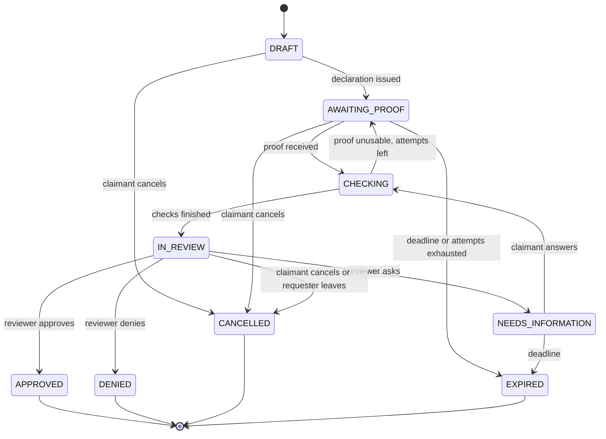
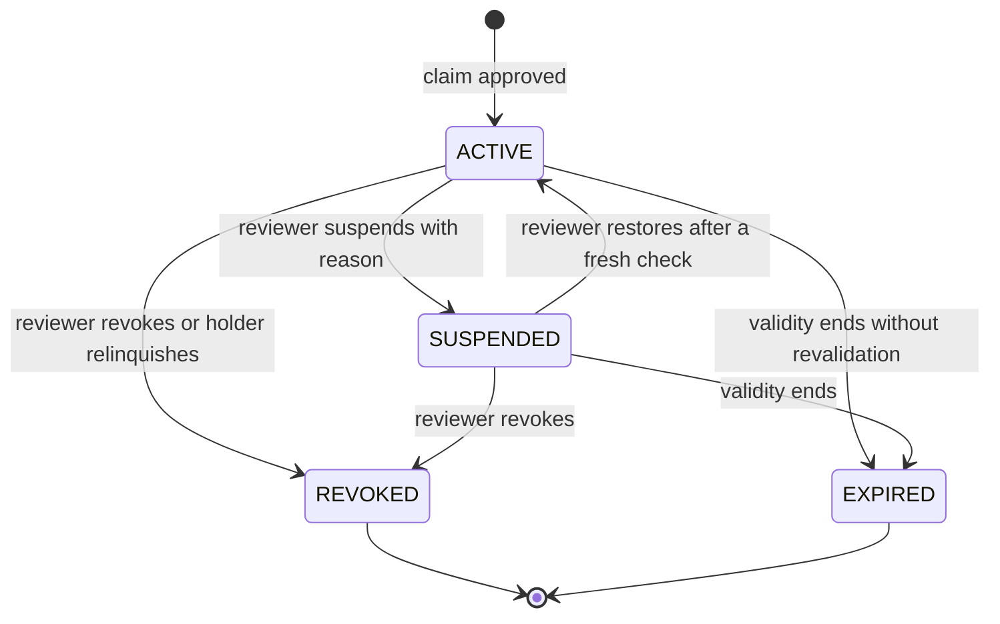

# Station claims and representation

Status: **PLANNED**, 2026-11-10. Module code `CLAIM`. Tasks: `EMP-CLAIM-001…013` in [backlog/ep14-station-claims](../backlog/ep14-station-claims.md).

Evidence. The representation design exists and is frozen: [STATION_PROFILE_REPRESENTATION](../../product/STATION_PROFILE_REPRESENTATION.md) (B-BR-P01–P16, BUC-P01–P10) and [STATION_PROFILE_CONTRACT_FREEZE](../../product/STATION_PROFILE_CONTRACT_FREEZE.md) (`DOCUMENTED`). Code exists in `backend/internal/modules/stationprofile/` with migrations `backend/db/migrations/000036_station_profiles.sql` to `000039_claim_decisions_grants.sql` (`PARTIAL`). The public read `GET /v1/stations/{station_id}/profile` is served (`IMPLEMENTED`). The claim, proof and management routes are registered behind `privateProfileUnavailable` in `backend/cmd/api/profile_containment.go`, which always answers 503 `profile.integration-pending` and has no flag; proof storage is not wired (`Bytes: nil` in `backend/cmd/api/main.go`). `ReviewClaim` in `backend/internal/modules/stationprofile/application/review.go` is called only by tests, and no query changes `representation_grants.status` after the insert, so suspension, revocation and expiry are `DOCUMENTED` only. A grant belongs to one account (unique index on `(account_id, station_id)` for active rows). The reviewer procedure is [profile-review](../../operator/profile-review.md) (`DOCUMENTED`); the staff role `station_reviewer` is listed in `contracts/admin/staff-roles-v2.json` and grants nothing yet (`PARTIAL`). The catalog has suggestion and correction intake (`backend/internal/modules/directory/adapters/intake/`, `backend/internal/modules/directory/adapters/correction/`, `IMPLEMENTED`) and no merge operation. Android claim screens exist in `app/src/main/kotlin/com/anpfuel/app/ui/stationprofile/` with no navigation to them (`PARTIAL`). Organization-held authority, station teams, contest cases, lifecycle jobs and review tooling are `PROPOSED`. Implementation is held by Stage D ([FUTURE_EVIDENCE_BUSINESS_PLAN](../../planning/FUTURE_EVIDENCE_BUSINESS_PLAN.md), CX-05).

## 1. Purpose

A company that operates a fuel station wants to manage the station's business data, answer reviews as the business and serve fleets. Before any of that, the platform must know that this company really represents this establishment, and must keep knowing it as people, owners and registrations change.

This module lets an organization find its station in the existing catalog, ask to administer it, identify who is asking, give the proof that the case needs and receive a reviewed decision. The result is a **station authority**: a narrow, revocable right over one station, held by the organization and exercised by a station team. Platform reviewers get a queue and commands to decide, suspend, revoke and hear contests. The public gets a badge with one precise meaning.

Users: organization owners and administrators (claim), station administrators (team), platform reviewers (decisions), drivers and the community (badge).

## 2. Scope

**Base kept unchanged.** This module extends `stationprofile`; it does not replace it. B-BR-P01–P16 and the contract freeze remain the rules: one claim per station and operator revision, the bound declaration ceremony (256-bit challenge, 30-minute declaration, at most 5 proof attempts), PDF proof with original bytes preserved, human decision, the wire-frozen claim and grant states, the scopes `profile.edit`, `reply.official`, `invite.propose`, `revoke.request`, the retention periods and the rule that representation gives no community power.

**What this plan adds.** Each item needs EMP-CLAIM-001 before it exists:

| Addition | Why | Changes to the existing text |
|---|---|---|
| Organization-held station authority (EDR-021, CX-11) | Authority must survive a person leaving and serve networks | The grant gains a holder kind: account (today) or organization. It stays station-scoped; it is not an organization-wide role. |
| Station teams as role assignments with `STATION` scope (`STATION_ADMIN`, `STATION_MANAGER`, `STATION_ATTENDANT`, BR-AUTH-015) | Several representatives, managers and attendants limited to named stations | `administrator` and `manager` map to `STATION_ADMIN` and `STATION_MANAGER`; `STATION_ATTENDANT` is new. For organization holders a role assignment replaces the 7-day invitation, because the member already accepted the organization's invitation. |
| Contest cases | Appeals, impersonation reports, competing claims and catalog events need a record and a decision | New entity with states `OPEN`, `UNDER_REVIEW`, `UPHELD`, `DISMISSED`. The frozen rule "an appeal opens a linked new claim" is kept: an upheld appeal opens that claim. |
| Revocation, expiry and revalidation | Today nothing changes a grant's status | Commands and jobs for the frozen grant states; a validity period on every authority. |
| Review tooling for platform staff | The review use case has no production caller ([01-diagnosis](../01-diagnosis.md) §3.6) | Queue and decision commands in the back office ([back-office](back-office.md)), on the admin suite of ADR-023 (CX-08, EDR-020). The `ops` CLI stays as the repair path. |
| One live holder per station | Concurrent holders would make the badge and the team ambiguous | New invariant; the unique index changes from per account to per station. |
| Organization claim limit and batches | A network has more than three stations | The frozen limit of 3 open claims per account stays for account holders; organizations get their own limit. |
| Web portal as claim surface | Station staff work at a desk | In the browser, fresh authentication of the web session replaces the contributor-key proof required by the freeze for sensitive writes. |

**Phasing.** Basic (F7): everything above. Later: automated triage of signature and registry checks once the open verifier decisions of the freeze (`[OPEN/P31-T01]`, `[OPEN/P31-T02]`) are closed. Out of scope: automatic approval, any paid shortcut in review, a second claim system, editing the catalog, and ownership or property claims.

**Gates.** Nothing here is built while the Stage D hold stands. The hold is lifted for this scope only by the recorded override (EMP-GOV-015, OPT-D00, OQ-07). Legal-entity verification of the organization ([organizations](organizations.md), phase F7) comes before an organization claim.

## 3. Entities and ownership

Five things are kept apart. Each has its own record, owner and lifecycle; none is inferred from another.

| Thing | What it is | Record and owner | It is not |
|---|---|---|---|
| Canonical station | The establishment in the public catalog: one UUID, identifiers, reviewed location, current operator revision | `directory_stations`, `station_operator_revisions`; owned by catalog governance | A profile, a customer or a tenant |
| Responsible organization | The customer organization that asks to administer the station, acting through one of its verified legal entities | Organization and legal entity ([organizations](organizations.md)); owned by the organization | The station's operator by assumption: the relation is declared and proved |
| Human representative | The member who asks, signs and later acts | Account and membership ([identity](identity.md)); the claim stores the requesting membership | The holder of the authority |
| Evidence of representation | Signed declaration, powers evidence, supporting facts and verification outcomes | Claim proof (private storage) and outcomes; controlled by the platform for review | A public document, or a document the organization can read back |
| Authorisation over the establishment | The reviewed, narrow, revocable right to manage the station's business data | Station authority (existing `representation_grants`, extended); granted and withdrawn only by platform decision | Ownership, a plan, or an organization-wide role |

Entities of this module:

| Entity | Owner | Content | Invariants |
|---|---|---|---|
| Claim (existing `profile_claims`, extended) | Claimant (account or organization); decided by the platform | Station, operator revision, holder kind and holder, requesting membership, named legal entity, declared relation, role, scopes, policy version, state, batch | One non-terminal claim per (holder, station). Terminal states never reopen. |
| Declaration (existing) | Platform | Versioned challenge and exact text, expiry, attempts | One active version per claim; one successful proof binding. |
| Claim proof (existing) | Platform, private | Hash, size, kind (`authorization`, `mandate`, `scan`), status, expiry | Immutable; bytes only in private storage. |
| Supporting fact | Platform, private | Source (ANP register, CNPJ registry), what was consulted, result, time consulted | Never sufficient alone; shows when it was consulted. |
| Decision (existing `claim_decisions`, extended) | Platform | Reviewer, outcome, reason category and text, policy and proof versions, scopes | Append-only; a correction is a new decision. |
| Station authority (existing grant, extended) | Granted by the platform to the holder | Holder kind and holder, station, operator revision, state, version, validity, granting decision | One `ACTIVE` or `SUSPENDED` authority per station. |
| Station role assignment | Holder organization ([07-permissions](../07-permissions.md)) | Membership, station role, the authority as scope target, period | At least one `STATION_ADMIN` while the team is managed. |
| Contest case | Opened by a party or the system; decided by the platform | Kind, target (claim, decision or authority), opener, statement, state, outcome | One open case per (opener, target). Closed cases stay closed. |
| Claim batch | Claimant organization | Claims that share powers evidence | Each claim is still decided alone. |

Three lifecycles run independently. A change in one never rewrites the history of another.

| Lifecycle | States | Owner | Effect on the others |
|---|---|---|---|
| Representation (station authority) | `ACTIVE`, `SUSPENDED`, `REVOKED`, `EXPIRED` | This module | Station permissions and the badge depend on it. |
| Commercial subscription | States of [subscriptions](subscriptions.md) | Subscriptions | Enables or disables paid capabilities. Never changes a claim, a decision, an authority or the badge. |
| Public record | Station status, operator revisions, merges | Catalog governance | A change can make an authority not applicable and starts a review. Never caused by a claim or a plan. |

## 4. Business rules

Base and separation:

- **BR-CLAIM-001 — Existing rules are the base.** B-BR-P01–P16 and the contract freeze apply to every claim; where this module is silent they decide, and every change this plan makes to them is listed in §2 and takes effect only when EMP-CLAIM-001 is accepted.
- **BR-CLAIM-002 — Five records, never inferred.** The canonical station, the holder organization, the human representative, the evidence and the station authority are separate records; holding one never creates or changes another.
- **BR-CLAIM-003 — A claim targets an existing station.** A claim references one catalog station UUID and the operator revision current at intake; it never creates, renames, moves, closes or merges a catalog record (BR-SRC-004).
- **BR-CLAIM-004 — Knowledge and payment prove nothing.** Knowing or typing a CNPJ, holding a company certificate without powers, sharing a CNPJ root, brand or e-mail domain, and having any plan, subscription or agreement do not prove representation and never change a review outcome (BR-TEN-002, BR-SRC-002).
- **BR-CLAIM-005 — Verified legal entity first.** An organization claim is accepted only when it names a legal entity of that organization in state `VERIFIED` and declares its relation to the station's operating CNPJ: same establishment, another establishment of the same legal entity, or mandate from the operator.
- **BR-CLAIM-006 — Bound to the requesting member.** An organization claim records the member who opened it; that member signs the declaration, is the person linked to the powers evidence and receives the first `STATION_ADMIN` assignment on approval; when that membership ends before the decision the claim becomes `CANCELLED`.

Intake:

- **BR-CLAIM-007 — One open claim per holder and station.** At most one non-terminal claim exists per (holder, station); a retry with the same idempotency key returns it, and any other attempt fails with `CLAIM_DUPLICATE_OPEN`.
- **BR-CLAIM-008 — Open-claim limits.** Account holders keep the frozen limit of 3 open claims; an organization may have 10 open claims by default, a limit that platform staff may raise per organization up to 200; beyond the limit intake fails with `CLAIM_LIMIT_REACHED`.
- **BR-CLAIM-009 — One live holder per station.** A station has at most one authority in `ACTIVE` or `SUSPENDED`, whatever the holder kind; delegated grants of the account-held model count as part of their administrator's authority.
- **BR-CLAIM-010 — Proportional evidence.** The evidence asked is the minimum set for the declared relation in §10.2; a reviewer asks for more only by recording which doubt the extra item resolves; private keys, passwords, certificate bundles and bank data are never requested.
- **BR-CLAIM-011 — Supporting sources are not authority.** The ANP register of authorised retailers, the public CNPJ registry, access to a phone or e-mail, photos and business cards may confirm facts about the establishment; none names a representative and none is sufficient for approval.
- **BR-CLAIM-012 — Evidence stays private.** Evidence content is readable only by platform reviewers while a claim or contest is under review; the claimant sees kind, size, time received and outcome; no public response, log, event, job payload or export carries evidence content, a CPF or the signer's identity (BR-PRIV-008).

Decision:

- **BR-CLAIM-013 — Human decision.** Every approval, denial, suspension, restoration and revocation is decided by a platform reviewer holding the staff role `station_reviewer`; automation checks and triages and never grants, transfers or removes access.
- **BR-CLAIM-014 — Reviewer independence.** A reviewer never decides a claim or contest in which the reviewer's account is the requester, a member of the claimant organization or the contesting party (`SELF_REVIEW`), and an appeal is decided by a reviewer other than the one who made the appealed decision.
- **BR-CLAIM-015 — Atomic approval.** Approval writes the decision, the station authority, the claim state `APPROVED` and the first `STATION_ADMIN` assignment in one transaction, and fails with `CONFLICT` when the claim, proof, operator revision, legal-entity state or requesting membership changed since the reviewer's snapshot.
- **BR-CLAIM-016 — Concurrent claims.** Open claims for the same station are reviewed as one set; being first gives nothing; approving one decides every other claim of the set in the same command, so at most one ends `APPROVED`; no claimant learns who the others are.
- **BR-CLAIM-017 — Information requests.** `NEEDS_INFORMATION` states what is missing in a bounded text, has a response deadline (default 15 days, range 7 to 30), extends no proof or photo deadline, and the claim becomes `EXPIRED` when the deadline passes unanswered.
- **BR-CLAIM-018 — Denial has a reason and one appeal.** `DENIED` carries a reason category and a bounded text shown to the claimant; the claimant may open one appeal within 30 days; the denied claim never reopens.

Contest, suspension and loss of authority:

- **BR-CLAIM-019 — A contest transfers nothing by itself.** A contest case, a competing claim or any number of reports neither removes the current holder nor gives the contesting party access; only a reviewer decision changes an authority.
- **BR-CLAIM-020 — Suspension is a reasoned decision.** An authority becomes `SUSPENDED` only by a reviewer decision that records a substantiated risk; the holder is told the reason category and how to contest; restoration needs a fresh check and a new decision.
- **BR-CLAIM-021 — Applicability is checked at every use.** An authority applies only while its stored state is `ACTIVE`, the station's current operator revision is the one it was granted for, the station is open in the catalog, the holder organization is `ACTIVE` and the named legal entity is `VERIFIED`; otherwise station permissions fail with `AUTHORITY_NOT_APPLICABLE`, the badge is not shown and a review task is opened (BR-AUTH-015).
- **BR-CLAIM-022 — Every authority has a validity.** An authority is granted for a period (default 12 months, range 6 to 24) and becomes `EXPIRED` at its end unless revalidated; expiry is evaluated when the authority is read as well as by the job.
- **BR-CLAIM-023 — Revalidation is a new decision.** Revalidation is a linked claim with a fresh declaration and the evidence that changed; its approval extends the same authority with a new version and decision; no job replay, cache or old client command extends or restores an authority.
- **BR-CLAIM-024 — Revoked and expired are final.** `REVOKED` and `EXPIRED` are terminal; regaining authority needs a new claim; decisions, history and the at-time attribution of past official replies are kept.
- **BR-CLAIM-025 — No transfer by a click.** Moving an authority to another holder, including from an account to an organization, is a new claim by the receiving holder with the current holder's recorded consent or an upheld contest, and one decision that revokes the old authority and grants the new one.

Separate cycles:

- **BR-CLAIM-026 — The commercial cycle is separate.** Plan, subscription, trial, payment and agreement states never write to claims, decisions, authorities or the badge; a lapsed or cancelled plan leaves the authority, its validity, its team and its history unchanged (BR-AUTH-009, BR-SRC-002).
- **BR-CLAIM-027 — The public-record cycle is separate.** Closure, operator succession, CNPJ change and merge of catalog records are decided by catalog governance; this module reacts to them as §6.4 states and never causes them.

Teams and networks:

- **BR-CLAIM-028 — Station permissions come only from station roles.** A member acts on a station only through a `STATION_ADMIN`, `STATION_MANAGER` or `STATION_ATTENDANT` assignment scoped to that station's authority; organization `OWNER` and `ADMIN` have no station permission by their role (BR-AUTH-015).
- **BR-CLAIM-029 — The team is inside the organization.** A station role is assigned only to an active member of the holder organization, one station per assignment, never wider than the assigner's own station permissions; an "all stations" action creates one assignment per current station and does not cover stations claimed later (BR-AUTH-007).
- **BR-CLAIM-030 — Delegations are bounded.** A temporary station role has a mandatory end of at most 90 days, cannot exceed the delegator's station permissions, ends when the delegator's assignment ends and is recorded on every action taken under it (BR-AUTH-008, BR-AUD-005).
- **BR-CLAIM-031 — Last station administrator.** Role management cannot end the last `STATION_ADMIN` assignment of a station (`LAST_STATION_ADMIN`); when that member's membership ends or the account is deleted, the authority stays with the organization, no remaining role is widened and a reviewed recovery names a new administrator.
- **BR-CLAIM-032 — Departure keeps the authority.** Ending a representative's membership ends that person's station assignments on the next request; the authority, the profile, published prices and past replies stay with the organization (BR-TEN-009, BR-AUTH-014).
- **BR-CLAIM-033 — Networks are claimed station by station.** Each station of a network has its own claim, declaration, decision and authority; powers evidence may be shared by the claims of one batch only when it names every branch CNPJ it covers; a brand, a franchise name or a CNPJ root never extends an authority to another station.

Public meaning, catalog and governance:

- **BR-CLAIM-034 — Badge meaning.** The badge text is "Representante da empresa verificado"; it is shown only while an authority is `ACTIVE` and applicable, means that representation was reviewed and nothing else, is identical for every plan, and never states or suggests fuel quality, a price guarantee, ANP endorsement or property title.
- **BR-CLAIM-035 — Catalog corrections go through catalog governance.** A representative asks for name, address, location, operator or duplicate corrections through the directory suggestion and correction intake; an authority gives no power to overwrite official sources, edit other people's contributions or remove criticism (BR-SRC-002).
- **BR-CLAIM-036 — Retention follows the freeze.** Claim evidence keeps the periods of the contract freeze listed in §10.5, with the holder mapped to the organization; a member's departure neither shortens nor extends them (LV-12).
- **BR-CLAIM-037 — Contained until the override.** No claim, proof, management or review route is enabled and no migration of this module is applied before the scoped Stage D override is recorded (EMP-GOV-015) and EMP-CLAIM-001 is accepted; the hard-wired containment is removed by a reviewed change to the API composition, never by a flag (CX-05).
- **BR-CLAIM-038 — Every transition is audited.** Each claim, decision, authority, contest and team change writes an audit event with actor, target and reason category; claim submission, proof upload, relinquishment and team changes need fresh authentication (BR-AUD-001, BR-AUTH-010).

## 5. Use cases

**UC-CLAIM-01 — Find the station and open a claim.** Actor: member with `claim.claim.submit`. Preconditions: organization `ACTIVE`; a legal entity `VERIFIED`; fresh authentication. Main flow: search the catalog by CNPJ, name, address or map → pick the station → the server shows the station's public data and whether it already shows a badge → choose the legal entity and the relation → the server creates the claim in `DRAFT` bound to the member and to the current operator revision. Alternatives: station not in the catalog → the member is sent to the directory suggestion intake and no claim is created; two catalog records look like the same place → the member reports the duplicate through the correction intake and claims the record that carries the operating CNPJ; the organization already holds a live authority there → `AUTHORITY_ALREADY_HELD`; another holder has a live authority → the claim is accepted and marked as competing, with no information about the holder; no verified legal entity → `LEGAL_ENTITY_NOT_VERIFIED`. Result: one draft claim, or a clear reason why none exists.

**UC-CLAIM-02 — Submit proportional evidence.** Actor: the requesting member. Main flow: the server lists the evidence required for the declared relation (§10.2) → the member requests the declaration (claim becomes `AWAITING_PROOF`) → signs it outside the product and uploads the signed PDF and, when required, the powers evidence → the server stores the exact bytes, runs the bounded checks (`CHECKING`) and moves the claim to `IN_REVIEW` with the outcomes. Alternatives: altered, reused, wrong-station or wrong-account proof → attempt counted, claim stays `AWAITING_PROOF`; fifth failed attempt → claim `EXPIRED` with `PROOF_ATTEMPTS_EXHAUSTED`; verifier unavailable → the claim goes to review with outcome "indeterminate", never approved by default. Result: claim in the review queue with private evidence.

**UC-CLAIM-03 — Answer an information request.** Actor: the requesting member, or another member with `claim.claim.submit`. Main flow: the claim shows what is missing and the deadline → the member uploads the item or writes the bounded answer → the claim returns to `CHECKING`, then `IN_REVIEW`. Alternatives: deadline passes → `EXPIRED`; the answer needs a new signature → a new declaration version is issued and earlier unused ones are invalidated. Result: the reviewer has what was asked.

**UC-CLAIM-04 — Review and decide a claim.** Actor: platform reviewer (`station_reviewer`). Preconditions: claim `IN_REVIEW`; reviewer independent (BR-CLAIM-014). Main flow: open the claim → see station, operator revision, legal entity, relation, signature and authority outcomes, supporting facts with the time each was consulted → follow the checklist of [profile-review](../../operator/profile-review.md) → approve, deny with reason, or ask for information. Alternatives: operator revision changed during review → `CONFLICT`, the reviewer reloads; requesting membership ended → claim already `CANCELLED`; other open claims on the station → UC-CLAIM-05. Result: one decision; on approval one authority `ACTIVE` and the requester is `STATION_ADMIN`.

**UC-CLAIM-05 — Decide concurrent claims.** Actor: platform reviewer. Main flow: the queue groups the open claims of one station → the reviewer compares each claimant's evidence against the current operator revision → one command records one outcome per claim. Alternatives: no claim is sufficient → all denied or asked for information; a live authority exists and a competing claim is sufficient → the reviewer opens or decides the contest case, revokes the old authority and grants the new one in one transaction (BR-CLAIM-025); two reviewers act at once → the second receives `CONFLICT`. Result: at most one holder.

**UC-CLAIM-06 — Contest or appeal.** Actor: the claimant (appeal of a denial, suspension or revocation), the current holder, or any account that states it represents the station (impersonation report). Main flow: open a case naming the target and the grounds in a bounded text, with optional evidence under the same privacy rules → `OPEN` → a reviewer other than the original one takes it (`UNDER_REVIEW`) → `UPHELD` or `DISMISSED` with a reason. Alternatives: appeal after 30 days or second appeal of the same decision → `CONTEST_NOT_ADMISSIBLE`; upheld appeal of a denial → a linked new claim is opened with the earlier evidence still inside its retention period; upheld impersonation report → the authority is revoked by decision and the reporter must still claim to gain anything. Result: a recorded outcome; no automatic transfer.

**UC-CLAIM-07 — Suspend, restore or revoke an authority.** Actor: platform reviewer. Main flow: choose the authority → choose the action and a reason category → the server writes the decision and the new state → station permissions follow on the next request → holder notified with the contest path. Alternatives: restore without a fresh check recorded → refused; revoke an authority with open agreements → allowed, and [station-commerce](station-commerce.md) stops redemptions. Result: state changed by an audited decision.

**UC-CLAIM-08 — Revalidate before expiry.** Actor: `STATION_ADMIN`, or a member with `claim.claim.submit`. Main flow: reminders 60, 30 and 7 days before the end → open the revalidation → confirm that operator and legal entity are unchanged → sign a fresh declaration → reviewer approves → validity extended with a new authority version. Alternatives: something changed → the changed evidence is asked; not done in time → `EXPIRED`, and a new claim is needed. Result: authority valid for a new period.

**UC-CLAIM-09 — Manage the station team.** Actor: member with `stn.team.manage` on the station. Main flow: pick an active member of the organization → pick `STATION_ADMIN`, `STATION_MANAGER` or `STATION_ATTENDANT`, the station and an optional end date → the assignment takes effect on the member's next request. Alternatives: person is not a member → the organization invites them first ([identity](identity.md)); removing the last administrator → `LAST_STATION_ADMIN`; authority not applicable → `AUTHORITY_NOT_APPLICABLE`; temporary substitute → end date required (BR-CLAIM-030). Result: team changed and audited.

**UC-CLAIM-10 — Claim a network in a batch.** Actor: member with `claim.claim.submit`. Main flow: select several stations → the server creates one claim per station inside one batch → the member uploads the powers evidence once and signs one declaration per station → the reviewer decides each claim. Alternatives: the evidence does not name one of the branches → that claim gets an information request and the others proceed; a station belongs to a franchisee with another CNPJ → that claim is denied and the franchisee claims with its own organization. Result: one authority per approved station; a batch can end partly approved.

**UC-CLAIM-11 — A representative leaves; recover the last administrator.** Actor: organization `OWNER` or `ADMIN` (offboarding), then a member with `claim.claim.submit`. Main flow: the membership ends → station assignments end → if another `STATION_ADMIN` exists nothing else happens. Alternatives: the person was the last administrator → the station shows "sem administrador", managers and attendants keep exactly their roles, team management is unavailable → the organization opens a recovery claim naming the new administrator, with a declaration signed by a person with powers → the reviewer approves → the new member becomes `STATION_ADMIN`. Result: the authority never left the organization and no role was widened without review.

**UC-CLAIM-12 — React to a change in the public record.** Actor: system, then platform reviewer. Main flow: catalog governance records an operator succession, a CNPJ change, a closure or a merge → the affected authority stops applying at once where §6.4 says so → a review task is opened → the reviewer confirms the outcome. Result: no stale authority keeps acting; history stays truthful.

**UC-CLAIM-13 — Relinquish an authority.** Actor: member with `claim.claim.submit`, with fresh authentication. Main flow: confirm the station and the consequences → the authority becomes `REVOKED` with reason "relinquished by the holder" → station assignments become ineffective. Result: the organization no longer represents the station; a later return needs a new claim.

**UC-CLAIM-14 — Read the badge.** Actor: anyone. Main flow: open a station → the profile shows the badge only when BR-CLAIM-034 holds, with an explanation of what it means and does not mean. Result: no private person, proof or decision detail is shown.

## 6. States and transitions

State names are the wire-frozen ones ([08-state-model](../08-state-model.md) §3). The stored wire values are the lowercase forms used today.

### 6.1 Claim

| From | To | Actor | Validation | Effect | Reversal |
|---|---|---|---|---|---|
| — | `DRAFT` | Member with `claim.claim.submit` | BR-CLAIM-003, 005, 007, 008; fresh authentication | Claim bound to member, station and operator revision | Cancel |
| `DRAFT` | `AWAITING_PROOF` | Requesting member | Relation and legal entity set | Declaration version issued (30 minutes; reissue allowed) | Cancel |
| `AWAITING_PROOF` | `CHECKING` | Requesting member | PDF bounds; declaration active; attempt limit | Exact bytes stored privately; checks queued | — |
| `CHECKING` | `AWAITING_PROOF` | System | Proof altered, reused or bound to another claim; attempts left | Attempt counted; claimant told the category | New proof |
| `CHECKING` | `IN_REVIEW` | System | Checks finished with any outcome, including indeterminate | Enters the review queue | — |
| `IN_REVIEW` | `NEEDS_INFORMATION` | Reviewer | Bounded text; deadline set | Claimant notified | Answer |
| `NEEDS_INFORMATION` | `CHECKING` | Claimant | Item or answer received before the deadline | Checks rerun | — |
| `IN_REVIEW` | `APPROVED` | Reviewer | BR-CLAIM-013 to 016; signature valid; authority sufficient | Decision, authority `ACTIVE`, first `STATION_ADMIN` | Contest, suspension or revocation of the authority; the claim stays approved |
| `IN_REVIEW` (any open state when deciding a concurrent set) | `DENIED` | Reviewer | Reason required | Nothing granted; appeal window opens | Appeal (new linked claim when upheld) |
| any open state | `CANCELLED` | Claimant; system when the requesting membership ends | Not already decided | Declarations invalidated | New claim |
| `DRAFT`, `AWAITING_PROOF`, `NEEDS_INFORMATION` | `EXPIRED` | System | 30 days without progress, response deadline passed, or 5 failed proof attempts | Declarations invalidated | New claim |

### 6.2 Station authority

| From | To | Actor | Validation | Effect | Reversal |
|---|---|---|---|---|---|
| — | `ACTIVE` | Reviewer (approval) | BR-CLAIM-009, 015 | Station roles can be assigned; badge shown while applicable | Suspend, revoke |
| `ACTIVE` | `SUSPENDED` | Reviewer | Substantiated risk recorded (BR-CLAIM-020) | Station permissions denied; badge hidden; published prices follow [station-commerce](station-commerce.md) | Restore by a new decision |
| `SUSPENDED` | `ACTIVE` | Reviewer | Fresh check of operator, legal entity and evidence | Permissions return on the next request | Suspend again |
| `ACTIVE`, `SUSPENDED` | `REVOKED` | Reviewer; holder (relinquishment); system on organization closure or account deletion | Reason category | Final; assignments ineffective; evidence retention clock starts | New claim |
| `ACTIVE`, `SUSPENDED` | `EXPIRED` | Time | `valid_to` reached with no approved revalidation | Final; same effects as revoked | New claim |
| `ACTIVE` | `ACTIVE` (new version) | Reviewer (revalidation) | BR-CLAIM-023 | `valid_to` extended; version incremented | — |

"Not applicable" (BR-CLAIM-021) is a derived condition evaluated at each use, not a stored state. It corresponds to `INEFFECTIVE` for the station role assignments in [07-permissions](../07-permissions.md) §6.

### 6.3 Contest case

| From | To | Actor | Validation | Effect | Reversal |
|---|---|---|---|---|---|
| — | `OPEN` | Claimant, holder, another account, or the system | Admissible: inside the window, one open case per opener and target | Reviewers notified; nothing changes for the holder | Opener withdraws |
| `OPEN` | `UNDER_REVIEW` | Reviewer other than the original decider | BR-CLAIM-014 | Both sides may be asked for evidence privately | — |
| `OPEN`, `UNDER_REVIEW` | `DISMISSED` | Reviewer; opener (withdrawal) | Reason | Nothing changes; a suspension applied because of the case is reviewed for restoration | New facts open a new case |
| `UNDER_REVIEW` | `UPHELD` | Reviewer | Reason; follow-up decision named | Appeal of a denial: linked new claim. Impersonation: authority revoked. Suspension or revocation appealed: restoration decision or linked new claim. | New facts open a new case |

### 6.4 Reactions to the public record and to the holder

| Event (decided elsewhere) | Immediate effect | Reviewed outcome |
|---|---|---|
| Operator succession: a new operator revision with another CNPJ (change of owner of the establishment) | Authority not applicable; badge hidden; holder notified | Reviewer confirms and revokes with reason "succession". The new operator claims with its own organization. Past replies keep their at-time attribution. |
| CNPJ change of the same company | Same immediate effect | The holder verifies the new legal entity and opens a linked claim; one decision grants the new authority, revokes the old one and carries over the assignments of members still active. |
| Station closed in the catalog | Authority not applicable while closed | Reopened within 90 days with the same operator: applies again with no new claim. Still closed after 90 days: revoked with reason "closure". |
| Merge of duplicate catalog records into a survivor | Open claims and authorities on the absorbed record are flagged | Authority only on the absorbed record and same operating CNPJ on the survivor: rebound to the survivor by a decision. Authorities on both with the same holder: the survivor's stays, the other is revoked with reason "merged" and missing assignments are added. Authorities on both with different holders: the system opens a contest case; both stay as they are until one decision leaves a single holder (BR-CLAIM-009). Open claims move to the survivor when the operator matches; otherwise they are cancelled with the reason. |
| Holder organization suspended | Authority not applicable while suspended | None; applies again when the organization is `ACTIVE`. |
| Holder organization closed; account deleted (account holder) | Authority `REVOKED` in the same transaction | None. |
| Named legal entity leaves `VERIFIED` | Authority not applicable | Verified again within 30 days: applies again. Otherwise revoked with reason "legal entity". |
| Plan or subscription lapses | None | None (BR-CLAIM-026). |

### 6.5 Request vocabulary, deciders, evidence, privacy and allowed actions

| Request word | State | Who moves it | Evidence in use | Private to | Actions allowed |
|---|---|---|---|---|---|
| Rascunho | Claim `DRAFT` | Claimant | None yet | Claimant organization | Edit relation, request declaration, cancel |
| Enviado | Claim `AWAITING_PROOF`, `CHECKING` | Claimant, then system | Signed declaration; powers evidence; automatic outcomes | Content: reviewers. Metadata: claimant | Upload proof, reissue declaration, cancel |
| Em análise | Claim `IN_REVIEW` | Reviewer | All of §10.2 plus supporting facts | Same | Reviewer: approve, deny, ask. Claimant: cancel |
| Pendente de informação | Claim `NEEDS_INFORMATION` | Claimant | The missing item | Same | Answer, cancel |
| Aprovado | Claim `APPROVED`, authority `ACTIVE` | Reviewer | Decision record | Decision detail: reviewers. Outcome: claimant | Assign team, manage the station, revalidate, relinquish |
| Rejeitado | Claim `DENIED` | Reviewer | Decision record | Reason shown to the claimant only | Appeal once within 30 days; open a new claim with new facts |
| Contestado | Contest case `OPEN`, `UNDER_REVIEW` on a claim, decision or authority | Opener, then reviewer | Statements and evidence of each side, never shown to the other | Each side sees its own | Holder keeps acting unless suspended; opener may withdraw |
| Suspenso | Authority `SUSPENDED` | Reviewer | Risk evidence | Reason category shown to the holder | Read history, contest; no station write |
| Expirado | Claim `EXPIRED` or authority `EXPIRED` | Time | — | — | New claim |
| Revogado | Authority `REVOKED` | Reviewer, holder, system | Decision record | Reason category shown to the holder | Read history, contest within 30 days, new claim |
| (cancelado) | Claim `CANCELLED` | Claimant or system | — | — | New claim |

## 7. Roles and permissions

Organization side (keys from [07-permissions](../07-permissions.md) §7.2):

| Action | Key | Roles | Notes |
|---|---|---|---|
| Open, follow, answer and cancel claims; open a batch; appeal; relinquish | `claim.claim.submit` | `OWNER`, `ADMIN` | Fresh authentication. No dedicated key exists for contest or relinquishment; this key is the closest. |
| Manage the legal entity named in the claim | `org.legal_entity.manage` | `OWNER`, `ADMIN` | Verification is in [organizations](organizations.md). |
| Assign and end station roles, including temporary ones | `stn.team.manage` | `STATION_ADMIN` | Scope `STATION`; no escalation (BR-AUTH-007). |
| Revalidate | `stn.team.manage` or `claim.claim.submit` | `STATION_ADMIN`; `OWNER`, `ADMIN` | Either may start; the signer must have powers. |
| Read the authority state and the team of a station | any station role on it | `STATION_ADMIN`, `STATION_MANAGER`, `STATION_ATTENDANT` | Evidence content is never readable. |
| Read the audit trail of claims and team changes | `audit.event.read` | `OWNER`, `ADMIN`, `AUDITOR` | BR-AUD-006. |

Mapping of the frozen wire scopes: `profile.edit` → `stn.profile.edit`; `reply.official` → `stn.reply.official`; `invite.propose` and `revoke.request` → `stn.team.manage`. The other station keys (`stn.price.publish`, `stn.metrics.read`, `agree.agreement.manage`, `agree.redemption.confirm`) are new scopes specified in [station-commerce](station-commerce.md).

Platform side: decisions need the staff role `station_reviewer` in the back office ([back-office](back-office.md)). A reviewer has no organization role and reads no other organization content (BR-TEN-008). Opening an impersonation report needs only an authenticated account. Reading the badge needs nothing.

## 8. Offline, concurrency, idempotency and corrections

- **Offline:** none. Claim, proof, team and review actions need the server ([10-offline-sync](../10-offline-sync.md) §10.3: station portal is online only). The public badge is readable from the cached public profile, and a cached badge never authorizes anything.
- **Concurrency:** approval locks the station row and checks BR-CLAIM-009 inside the transaction; two approvals for one station end in one authority and one `CONFLICT`. A cancellation racing an approval: the first to commit wins and the other receives `CONFLICT`. Team changes act on a version of the station's assignment set.
- **Idempotency:** every command carries an operation identifier; a repeat returns the first result; the same identifier with another payload returns `OPERATION_ID_REUSED`. Proof upload is idempotent on (declaration, SHA-256).
- **Corrections:** decisions are append-only. A wrong decision is corrected by a new decision or a contest outcome that names the earlier one; the earlier record is never edited.

## 9. Events, notifications and integrations

Produced: `claim.claim.submitted`, `claim.claim.information_requested`, `claim.claim.approved`, `claim.claim.denied`, `claim.claim.cancelled`, `claim.claim.expired`, `claim.authority.granted`, `claim.authority.suspended`, `claim.authority.restored`, `claim.authority.revoked`, `claim.authority.expired`, `claim.authority.revalidated`, `claim.contest.opened`, `claim.contest.decided`. Payloads carry identifiers and reason categories only (BR-AUD-004).

Consumed: `idn.membership.ended` (BR-CLAIM-006, 031, 032), `org.organization.suspended`, `org.organization.closed`, legal-entity state changes from [organizations](organizations.md), and operator-revision, station-status and merge changes from the catalog through a port (the catalog emits no events today).

Notifications (in-app first, EDR-032): claimant on each claim transition; holder on suspension, revocation, expiry reminders and contest opening (without the opener's identity); reviewers on queue changes as a digest.

Integrations: signature and authority verification stay behind the ports of the existing module and depend on the open items of the freeze. The ANP register is consulted as a supporting fact (§10.3). Jobs: claim expiry, authority expiry and reminders, applicability re-check after catalog changes, evidence purge; each is safe to re-run and keyed by the record and the due instant.

## 10. Data, formulas and examples

### 10.1 Claim fields added by this plan

| Field | Values | Purpose |
|---|---|---|
| `holder_kind` | `ACCOUNT`, `ORGANIZATION` | Who will hold the authority |
| `org_id`, `requesting_membership_id` | identifiers | Organization claim binding (BR-CLAIM-006) |
| `legal_entity_id` | identifier | The verified legal entity the organization acts through |
| `relation` | `SAME_ESTABLISHMENT`, `SAME_LEGAL_ENTITY`, `MANDATE` | Selects the evidence of §10.2 |
| `requester_name`, `requester_position` | bounded text | Lets the reviewer match the requester to the signature and the powers evidence; shown to reviewers only |
| `kind` | `INITIAL`, `REVALIDATION`, `RECOVERY`, `TRANSFER` | What the approval does |
| `linked_claim_id`, `batch_id`, `contest_case_id` | identifiers | History |

No CPF field is typed by the requester; the signer's identity is read from the signature during verification and kept only as a verification outcome.

### 10.2 Proportional evidence

| Declared relation | Requester is | Required | Not required |
|---|---|---|---|
| `SAME_ESTABLISHMENT`: the verified legal entity's establishment is the station's operating CNPJ | A partner or administrator with powers | Signed declaration; independent check of the registry of partners and administrators | Any further document |
| `SAME_ESTABLISHMENT` | An employee or manager | Signed declaration; mandate signed by a person with powers, naming the station and the scopes | Corporate acts beyond what shows the signer's powers |
| `SAME_LEGAL_ENTITY`: another establishment of the same legal entity (head office claiming a branch) | Either | The above, plus evidence that the powers cover that branch CNPJ | Evidence about other branches |
| `MANDATE`: a different legal entity that manages the station | Either | Signed declaration; mandate or contract excerpt signed by the operator's representative naming the station, the scopes and the period; check of that representative's powers | The full contract |

Risk raises the requirement, with the doubt recorded (BR-CLAIM-010): a live authority held by someone else, an operator revision newer than 90 days, an earlier denial for the same station, or an open contest.

### 10.3 The ANP register as supporting evidence

Source: the ANP open-data page for "revendedores varejistas de combustíveis automotivos" (gov.br/anp), read 2026-11-10 ([18-references](../18-references.md) §4). ANP publishes a daily register of authorised fuel retailers with authorisation number, legal name, CNPJ, address and brand.

| It supports | It does not show |
|---|---|
| That a CNPJ holds a retail authorisation, at an address, under a brand, on the day consulted | Who the partners, administrators or representatives are |
| That the station's operating CNPJ in the catalog matches the authorised CNPJ | That the requester acts for that CNPJ |
| That the establishment was authorised when consulted | That it is still authorised later, or that it is open |

The reviewer records the result as "consulted on <date>" (BR-TRUTH-001). The only licence statement found on the ANP site is a site-wide Creative Commons Attribution-NoDerivatives 3.0 notice, and the freeze keeps automated consultation rights open (`[OPEN/P31-T02]`); until that is settled the consultation is manual and the register is not copied into the claim.

### 10.4 Timers (defaults)

| Timer | Default | Range or source |
|---|---|---|
| Declaration validity | 30 minutes | Frozen |
| Proof attempts per claim | 5 | Frozen |
| Claim without progress | 30 days | 15 to 60 |
| Information response | 15 days | 7 to 30 |
| Appeal and contest-of-decision window | 30 days | fixed |
| Authority validity | 12 months | 6 to 24 |
| Revalidation reminders | 60, 30 and 7 days before the end | fixed |
| Closed station before revocation | 90 days | fixed |
| Legal entity not verified before revocation | 30 days | fixed |
| Public badge freshness | at most 60 seconds (current shared-cache lifetime of the public profile) | measured in tests |

Worked dates. An authority granted on 2026-11-10 for 12 months ends on 2027-11-10; reminders are due on 2027-09-11 (60 days), 2027-10-11 (30 days) and 2027-11-03 (7 days). An information request made on 2026-11-12 with 15 days ends on 2026-11-27. A claim denied on 2026-12-01 can be appealed until 2026-12-31.

### 10.5 Retention (existing freeze; [11-privacy-security](../11-privacy-security.md) §10.1)

| Item | Period | Example |
|---|---|---|
| Signed authorization of a granted claim | While the authority is active, plus 2 years | Authority revoked on 2027-03-01: deleted by 2029-03-01 |
| Evidence of denied, withdrawn or appeal-superseded claims | 90 days | Denied on 2026-12-01: deleted by 2027-03-01 |
| Expired unused challenges | 24 hours | — |
| Photos and scans embedded as proof | 24 hours, every copy | Packaging as PDF does not extend it |
| Decisions and audit events | Bounded audit, without document content | — |

The periods are unchanged. For an organization holder the "owner" of the evidence is the organization, and the requesting member's departure does not start any clock. This mapping and the 2-year audit period are legal validation points (LV-12; the freeze marks the period `[CALIBRATE: legal review]`).

### 10.6 Visibility

| Data | Public | Claimant organization | Station team | Reviewers | Other claimants or contesting parties |
|---|---|---|---|---|---|
| Badge state | Yes | Yes | Yes | Yes | Yes (public) |
| Claim state, deadlines, reason shown to claimant | No | `claim.claim.submit` | No | Yes | No |
| Evidence metadata (kind, size, received, outcome) | No | `claim.claim.submit` | No | Yes | No |
| Evidence content, signer identity | No | No | No | Yes, during review | No |
| Authority state, validity, reason category | No | Yes | Yes | Yes | No |
| Existence of a competing claim or contest | No | Only "under contest" on its own item | No | Yes | No |
| Reviewer identity | No | No | No | Yes | No |

### 10.7 Error codes added

Shared codes are in [09-architecture](../09-architecture.md) §6. New: `LEGAL_ENTITY_NOT_VERIFIED`, `CLAIM_DUPLICATE_OPEN`, `CLAIM_LIMIT_REACHED`, `AUTHORITY_ALREADY_HELD`, `DECLARATION_EXPIRED`, `PROOF_REJECTED`, `PROOF_ATTEMPTS_EXHAUSTED`, `SELF_REVIEW`, `AUTHORITY_NOT_APPLICABLE`, `LAST_STATION_ADMIN`, `CONTEST_NOT_ADMISSIBLE`. While the containment stands every private route answers `UNAVAILABLE` (today's `profile.integration-pending`).

## 11. Screens

| ID | Surface | Objective | Actor | Data | Actions | Rules and permissions | Validations and states |
|---|---|---|---|---|---|---|---|
| SCR-CLAIM-01 | PORTAL | Find the station in the catalog and start a claim | `claim.claim.submit` | Search by CNPJ, name, address, map; public station data; whether a badge is shown | Select station, suggest a missing station, report a duplicate | BR-CLAIM-003, 007, 008 | Empty: "Posto não encontrado" with the suggestion path. Unavailable: explains that representation is not open yet (containment). |
| SCR-CLAIM-02 | PORTAL | Declare the relation and submit the evidence | Requesting member | Legal entities and their state, relation choices, required evidence list, declaration, upload status, attempts left | Choose, download declaration, upload, cancel | BR-CLAIM-005, 006, 010, 012 | Errors beside the field: legal entity not verified, declaration expired, proof rejected with category. Never asks for keys or passwords, and says so. |
| SCR-CLAIM-03 | PORTAL | Follow a claim and answer an information request | `claim.claim.submit` | State in plain words, deadline, what is missing, evidence metadata, decision reason | Answer, upload, cancel, appeal | BR-CLAIM-017, 018 | Denied: shows the reason and the last day to appeal. Expired: offers a new claim. |
| SCR-CLAIM-04 | PORTAL | See every station of the organization and its representation state | `claim.claim.submit`; station roles see their stations | Stations, claim or authority state, validity, days to expiry, "sem administrador", "não aplicável" with the cause | Open claim, revalidate, relinquish, open a batch | BR-CLAIM-021, 022, 033 | Empty: "Nenhum posto reivindicado". Not applicable is shown with its cause, never as an error. |
| SCR-CLAIM-05 | PORTAL | Manage the station team | `stn.team.manage` | Members, station roles, end dates, delegations | Assign, end, set temporary role | BR-CLAIM-028 to 031 | `LAST_STATION_ADMIN` beside the action. Forbidden: shared pattern (SCR-AUTH-06). |
| SCR-CLAIM-06 | PORTAL | Contest a decision or report impersonation | Claimant, holder, or any signed-in account for a report | Target, grounds, own evidence metadata, case state and outcome | Open, add evidence, withdraw | BR-CLAIM-018, 019 | Not admissible: says why (window passed, already appealed). Never shows the other side. |
| SCR-CLAIM-07 | ADMIN | Work the review queue | `station_reviewer` | Claims grouped by station, age, flags (competing, impersonation, revalidation, recovery) | Open, take, filter | BR-CLAIM-013, 016 | Empty: "Nenhuma reivindicação aguardando análise". Oldest and flagged first. |
| SCR-CLAIM-08 | ADMIN | Decide a claim or a concurrent set | `station_reviewer` | Station and operator revision, legal entity, relation, signature and authority outcomes, supporting facts with consultation time, evidence viewer, checklist | Approve, deny, ask for information, decide the set | BR-CLAIM-012 to 017 | `SELF_REVIEW` blocks the screen. `CONFLICT`: reload. Evidence viewer is audited and never downloadable to the claimant side. |
| SCR-CLAIM-09 | ADMIN | Act on authorities and contest cases | `station_reviewer` | Authority history, applicability causes, catalog events, contest cases with both sides | Suspend, restore, revoke, take and decide a case | BR-CLAIM-019 to 025, 027 | Reason category required. Restore needs the fresh check recorded. |
| SCR-CLAIM-10 | APP | Show what the badge means on the public station profile | Anyone | Badge "Representante da empresa verificado" and the explanation: "A Abastevo analisou documentos que indicam que esta empresa representa o posto. O selo não avalia a qualidade do combustível, não garante preços e não é um aval da ANP." | Open explanation | BR-CLAIM-034 | No badge is a normal state with no warning. Unknown badge state from a newer server shows no badge. |

## 12. Acceptance, dependencies, risks, phase and microtasks

Acceptance criteria:

1. With the containment in place every private route answers `UNAVAILABLE`, and a test fails if a claim, proof, management or review route is reachable without the recorded override.
2. A claim by an organization without a `VERIFIED` legal entity is refused; typing the station's CNPJ, or having any plan, changes nothing in any outcome.
3. Two claims for one station decided concurrently end with at most one `APPROVED` and one authority; neither claimant can read anything about the other.
4. Approval creates the decision, the authority and the first `STATION_ADMIN` assignment together, or nothing.
5. Suspending, revoking or expiring an authority denies the next station request of every team member, with no session change, and hides the badge within the freshness bound.
6. With the expiry job stopped, an authority past its `valid_to` is treated as `EXPIRED` when read.
7. Cancelling a subscription changes no row of claims, decisions or authorities, and the badge stays.
8. Ending the membership of the last `STATION_ADMIN` leaves the authority with the organization, widens no role, and only an approved recovery claim creates a new administrator.
9. A new operator revision with another CNPJ makes the authority not applicable on the next request.
10. In a two-organization fixture, no member of organization B reads or changes a claim, evidence metadata, authority or team of organization A, and evidence content is unreadable by both.
11. A contest case alone changes no authority; an upheld appeal of a denial produces a linked new claim and leaves the denied claim `DENIED`.
12. Evidence past its retention period is unreadable even with the purge job stopped, and a restore does not bring it back.
13. The worked dates in §10.4 and §10.5 pass as written.

Dependencies: EMP-GOV-015 (Stage D override); EMP-CLAIM-001 (decision); [organizations](organizations.md) legal-entity verification; [07-permissions](../07-permissions.md) station scope; [back-office](back-office.md) review queues; the directory suggestion and correction intake; the open verifier and registry items of the contract freeze; legal validation of retention (LV-12).

Risks: review capacity is unproven (AS-11; the freeze keeps staffing evidence open), so F7 opens for named stations first; verifier and registry access are undecided, which keeps checks manual; impersonation attempts target the first claims on valuable stations (human decision, independence, contest path); networks with many branches press for shortcuts (per-station decisions stay mandatory); a catalog merge operation does not exist yet, so its reactions are built against a port and tested with simulated events.

Phase: F7. It is late because it needs the Stage D override, verified legal entities and staffed review queues, none of which the first operational cut requires. Microtasks: EMP-CLAIM-001 to EMP-CLAIM-013.
