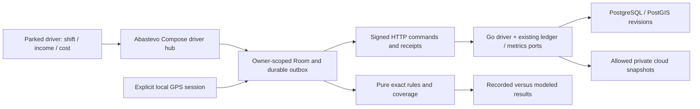

# Driver suite — full Android execution plan

Date: 2026-10-26. Execution: DRV-00–07 LOCAL_DONE / INTEGRATION_PENDING; DRV-08–35 PLANNED.
Batch quality: inherited global domain coverage gate remains below 90%; see [DRV-03–07 acceptance](../backend/evidence/driver-suite/DRV-03-07_ACCEPTANCE.md). No merge/readiness certification.
36 bounded phases; 108 uniquely identified implementation tasks. Execution status is recorded per phase below; unstarted tasks remain PLANNED.
Canonical behavior: [driver contract](../product/DRIVER_SUITE_CONTRACT.md).
User decision: complete professional suite stays Premium. The original planning commit did not implement runtime behavior. Later scoped foundation implementation is recorded below; it does not deliver the complete suite or authorize sale/deploy/publication.

## 1. Baseline and actual gap

Inspected versioned source: `f1e1d0db623975ff64c1b7f86690286856b44ad1` from the maintained dev source clone on 2026-10-26. Other MAP-24 work and the primary checkout were dirty/occupied and were not copied or modified. Reconcile current main/dev again at DRV-00; this SHA is evidence provenance, never a reset target.

Reuse existing ledger/metrics and Kotlin PremiumConsumption, LedgerEntriesScreen/ViewModel, MonthlyIndicatorsUseCases/Screen, Room, owner proof, private cloud datasets, entitlement, maps and WorkManager. Existing MEX-09/10/11/12/13 and EE financial methods are implementation/evidence inputs, not acceptance of this new suite. Full-to-full consumption and purchase-cost arithmetic exist. Shift earnings, cash reconciliation, work-distance classification and the complete driver journey are new planned scope.

Two source defects found before this plan must be reproduced and repaired first: the current km-labeled odometer parser stores an unscaled integer into odometerMetres and edits metres back into a km field; monthly cost UI prints a rational centavos/km field directly. The source locations are `app/.../ui/ledger/LedgerEntriesViewModel.kt` and `app/.../ui/monthly/MonthlyIndicatorsScreen.kt`. A recent pure Go metrics package test passed, which does not cover these UI conversion defects. Do not claim this planning work fixed them.

The new selected contract expands earlier exclusions only for the named individual earnings/results and explicit work-session distance scope. Legacy financial-v1, public/free behaviors and raw-GPS cloud exclusions remain. No platform scraping, passenger data, fleet tenancy or tax service is part of this plan.

## 2. Architecture and real mobile journey

UI entry: existing vehicle/profile navigation → Driver hub → Shift / Earnings / Refuel and charge / Expenses / Results / Maintenance / Imports and data. Do not replace Explorar/Comunidade/Mapa/Perfil. Representative journey: configure vehicle → manual shift or separate GPS opt-in → durable km/time checkpoints → earnings/refuel/cost → close and reconcile → day/week/month result → private export/sync/restore.

Backend-first is required for the new hosted feature. The early odometer/presentation repair is a regression fix in existing accepted functionality, not a placeholder new UI. Local-only domain and oracle work does not require provider credentials. No new hosted financial feature ships before DRIVER_BACKEND_GATE. Existing product modules are extended rather than rewritten; a proposed driver boundary owns only new private work-session data. No new official API path is asserted by this plan; freeze actual OpenAPI at DRV-11.

## 3. Financial meaning and independent examples

Actual paid purchases, estimated inventory consumption, earned money, payouts, recorded expenses and economic assumptions remain distinct. A cost/km uses exactly its documented eligible window and denominator. Buying a tank today is not proof that all of it was consumed on today's shift. A platform payout of prior earnings is not another earning. Shared usage and multi-app time are reconciled, never automatically added.

Synthetic review vectors live in [planned-financial-v1.json](../../contracts/testdata/driver-suite/planned-financial-v1.json); these are independent planning oracles, not proof that runtime consumes them. They extend rather than replace the existing financial-v1 corpus. They include km/metres, discounted full-to-full purchases, exact earnings, payout non-duplication, cash/estimated views, weighted ratios, app-time union, incomplete periods, GNV and PHEV distinctions.

Freeze input ceilings, rounding, typed signed adjustments, allocation residual and coverage rules before behavior at DRV-00–06. Use actual prior bounds and measured representative volumes. No market rate, depreciation percentage, tax, platform commission, productivity quota or battery threshold is invented as a universal default.

## 4. Task protocol, dependencies and evidence

Read AGENTS/FAST_EXECUTION/current PROGRESS, selected plan task, DELIVERY_WORKFLOW and relevant contracts/code/tests. ADR-020 maintained dev wins over historical per-phase branches. One bounded task at a time; isolate occupied work, inspect status/diff including new files and preserve other efforts. New modules/paths below are proposed destinations until DRV-00 verifies ownership.

Each task requires B-BR/BUC examples before behavior, domain RED → GREEN → REFACTOR, meaningful changed-risk tests, affected consumers/build/format/static, diff/secret review and atomic useful commits. A task acceptance clause is mandatory alongside its phase tests. Money/auth/privacy/SQL/jobs require immediate negatives, race/replay/cancellation and actual disposable PostGIS/Room upgrade evidence. Do not weaken asserts, skip failures or swap actual native/HTTP behavior for mocks.

Each phase depends on the previous local source checkpoint unless a prerequisite below says more. Each T02 follows T01, and T03 follows T02. Dependent runtime work stops at a failed mandatory gate; independent contract work may continue with honest scope. DRV-35 may consume DRV-34's completed local protocol/disposition while actual external field acceptance stays OWED; that is source integration, never full product/field acceptance. Optional platform API approval in DRV-26 is nonblocking for manual/CSV acceptance.

Each phase evidence goes to `docs/backend/evidence/driver-suite/DRV-XX.md` with tested tree/commit/artifact hashes, exact commands, environment, assertions, real result/skips, recovery and obligations. A LOCAL_DONE declaration needs all mandatory local tests; absent real device/provider/staging proof stays individually OWED. No task starts an unbounded scheduler or implicit recorder. Read/export/correction/deletion of held data cannot be held hostage to payment or network.

## 5. Ordered microphases

### DRV-00 — Reconcile the baseline and freeze driver boundaries

Status: LOCAL_DONE / INTEGRATION_PENDING. Evidence: [DRV-00](../backend/evidence/driver-suite/DRV-00.md). Dependency: Current audited source and selected planning request. Risk: docs/contract.

Owners/targets to verify: `docs/product; docs/planning; existing ledger/metrics/cloudsync/subscription`. Rules: B-BR-DRV-01, B-BR-DRV-20, B-BR-DRV-21.

- **DRV-00-T01 — Inventory actual code and acceptance.** Delivery and mandatory acceptance: Map current dev/main, dirty work, legacy records and MEX/PRM/EE/MAP ownership; preserve other efforts.
- **DRV-00-T02 — Freeze business and privacy decisions.** Delivery and mandatory acceptance: Confirm Premium, earned/received meanings, manual/GPS consent, owner boundaries and enumerated decisions before behavior.
- **DRV-00-T03 — Pin contracts, scenarios and workload.** Delivery and mandatory acceptance: Record representative owned/leased/EV/GNV/multi-app cases, prior schemas and measurable limits without invented provider access.

Exit: All three task acceptance clauses pass with appropriate immediate risk checks, actual storage/HTTP/native execution where affected, and documented recovery. No compile-only closure.

Evidence: `docs/backend/evidence/driver-suite/DRV-00.md`. A later relevant change invalidates affected evidence.
### DRV-01 — Repair odometer units and financial display

Status: LOCAL_DONE / INTEGRATION_PENDING. Evidence: [DRV-01](../backend/evidence/driver-suite/DRV-01.md). Dependency: DRV-00 validated local checkpoint. Risk: critical money/privacy/lifecycle; apply changed-risk tests.

Owners/targets to verify: `app ledger/monthly; domain exact conversion; existing tests`. Rules: B-BR-DRV-02, B-BR-DRV-03, B-BR-DRV-11.

- **DRV-01-T01 — Convert localized kilometre input exactly.** Delivery and mandatory acceptance: RED/GREEN: km-to-metres, comma decimal, bounds, blank and invalid input; 10000 km persists 10000000 metres.
- **DRV-01-T02 — Round-trip edit and format ratios.** Delivery and mandatory acceptance: Stored 12345600 metres edits as 12345.6 km; 52 centavos/km renders BRL 0.52/km with locale and method.
- **DRV-01-T03 — Reproduce the complete financial regression.** Delivery and mandatory acceptance: Two full anchors 10000/10500 km, 40 L and BRL 260 yield 500 km, 12.5 km/L and 0.52 BRL/km.

Exit: All three task acceptance clauses pass with appropriate immediate risk checks, actual storage/HTTP/native execution where affected, and documented recovery. No compile-only closure.

Evidence: `docs/backend/evidence/driver-suite/DRV-01.md`. A later relevant change invalidates affected evidence.
### DRV-02 — Review legacy units and freeze the financial oracle

Status: LOCAL_DONE / INTEGRATION_PENDING. Evidence: [DRV-02](../backend/evidence/driver-suite/DRV-02.md). Dependency: DRV-01 validated local checkpoint. Risk: critical money/privacy/lifecycle; apply changed-risk tests.

Owners/targets to verify: `existing ledger/metrics; versioned fixtures; repair specification`. Rules: B-BR-DRV-02, B-BR-DRV-03, B-BR-DRV-21.

- **DRV-02-T01 — Classify legacy provenance safely.** Delivery and mandatory acceptance: Separate proven metres, proven UI-km error and ambiguous rows; preserve originals and block misleading derived results.
- **DRV-02-T02 — Design an owner-reviewed repair.** Delivery and mandatory acceptance: Preview/dry-run, reversible versioned correction, exact retry, cancellation and concurrent edits; no blanket multiplication.
- **DRV-02-T03 — Freeze cross-language worked examples.** Delivery and mandatory acceptance: Execute unchanged financial-v1 plus new independent unit/earnings/time vectors; no rewritten golden to hide a defect. Current unit/consumption vectors use real runtime consumers; future earnings/time vectors use explicitly test-only manual references in Go and Kotlin until their implementation phases.

Exit: All three task acceptance clauses pass with appropriate immediate risk checks, actual storage/HTTP/native execution where affected, and documented recovery. No compile-only closure.

Evidence: `docs/backend/evidence/driver-suite/DRV-02.md`. A later relevant change invalidates affected evidence.

Gate: **DRIVER_FOUNDATION_GATE**; apply the scope/disposition rules in section 6. Local result: PASS on 2026-10-26 (LOCAL_DONE / INTEGRATION_PENDING); not production or full-suite acceptance.
### DRV-03 — Implement exact earnings and result rules

Status: LOCAL_DONE / INTEGRATION_PENDING. Evidence: [DRV-03](../backend/evidence/driver-suite/DRV-03.md). Dependency: DRV-02 validated local checkpoint. Risk: critical money/privacy/lifecycle; apply changed-risk tests.

Owners/targets to verify: `domain driver; backend metrics pure rules`. Rules: B-BR-DRV-02, B-BR-DRV-04, B-BR-DRV-05, B-BR-DRV-12, B-BR-DRV-15.

- **DRV-03-T01 — Model detailed and net-only earnings.** Delivery and mandatory acceptance: Gross/fees/tips/bonus/refund versus inclusive net-only bases; missing components remain unknown and signed adjustments are typed.
- **DRV-03-T02 — Separate cash, earned and modeled results.** Delivery and mandatory acceptance: Payout transfer never creates earnings; recorded result and reserve/depreciation scenario have separate numerators and coverage.
- **DRV-03-T03 — Test exact arithmetic and ratio eligibility.** Delivery and mandatory acceptance: Weighted sums, overflow, zero/unknown denominators and matched windows; independent BRL 450 minus 200 equals 250.

Exit: All three task acceptance clauses pass with appropriate immediate risk checks, actual storage/HTTP/native execution where affected, and documented recovery. No compile-only closure.

Evidence: `docs/backend/evidence/driver-suite/DRV-03.md`. A later relevant change invalidates affected evidence.
### DRV-04 — Model shifts, clocks and overlapping online time

Status: LOCAL_DONE / INTEGRATION_PENDING. Evidence: [DRV-04](../backend/evidence/driver-suite/DRV-04.md). Dependency: DRV-03 validated local checkpoint. Risk: critical money/privacy/lifecycle; apply changed-risk tests.

Owners/targets to verify: `domain/application driver session ports`. Rules: B-BR-DRV-06, B-BR-DRV-07.

- **DRV-04-T01 — Freeze shift and break transitions.** Delivery and mandatory acceptance: Start/pause/resume/end are idempotent; impossible transitions and overlapping active local shifts are refused explicitly.
- **DRV-04-T02 — Handle monotonic time and recovery.** Delivery and mandatory acceptance: Clock rollback, reboot and missing checkpoints require a gap review; never infer continuous work from wall time.
- **DRV-04-T03 — Union platform time without duplication.** Delivery and mandatory acceptance: Uber 6 h plus another app 5 h with 4 h overlap equals 7 h union, not 11 h.

Exit: All three task acceptance clauses pass with appropriate immediate risk checks, actual storage/HTTP/native execution where affected, and documented recovery. No compile-only closure.

Evidence: `docs/backend/evidence/driver-suite/DRV-04.md`. A later relevant change invalidates affected evidence.
### DRV-05 — Model distance observations and quality

Status: LOCAL_DONE / INTEGRATION_PENDING. Evidence: [DRV-05](../backend/evidence/driver-suite/DRV-05.md). Dependency: DRV-04 validated local checkpoint. Risk: critical money/privacy/lifecycle; apply changed-risk tests.

Owners/targets to verify: `domain distance rules; MAP location port contract`. Rules: B-BR-DRV-08, B-BR-DRV-09, B-BR-DRV-10.

- **DRV-05-T01 — Separate distance sources and windows.** Delivery and mandatory acceptance: Odometer/GPS/paid/route prediction retain basis; select one denominator, reject reversed readings and segment crossings.
- **DRV-05-T02 — Define paid, empty and personal partitions.** Delivery and mandatory acceptance: Partitions need explicit evidence; 120 paid of 200 work km yields 60% only when classification is complete.
- **DRV-05-T03 — Test synthetic GPS quality boundaries.** Delivery and mandatory acceptance: Deterministic traces cover stationary drift, jumps, stale fixes, tunnels, reorder and gaps without inventing missing distance.

Exit: All three task acceptance clauses pass with appropriate immediate risk checks, actual storage/HTTP/native execution where affected, and documented recovery. No compile-only closure.

Evidence: `docs/backend/evidence/driver-suite/DRV-05.md`. A later relevant change invalidates affected evidence.
### DRV-06 — Model vehicle cost profiles and allocation

Status: LOCAL_DONE / INTEGRATION_PENDING. Evidence: [DRV-06](../backend/evidence/driver-suite/DRV-06.md). Dependency: DRV-05 validated local checkpoint. Risk: critical money/privacy/lifecycle; apply changed-risk tests.

Owners/targets to verify: `existing vehicle/expense ports; domain driver`. Rules: B-BR-DRV-13, B-BR-DRV-14.

- **DRV-06-T01 — Configure owned, leased and financed vehicles.** Delivery and mandatory acceptance: No duplicate depreciation/lease or principal/interest classification; actual versus estimated fields retain dates and provenance.
- **DRV-06-T02 — Allocate recurring and shared expenses exactly.** Delivery and mandatory acceptance: Freeze day/km/time/private-use allocation and centavo residual; allocated sum cannot exceed the source expense.
- **DRV-06-T03 — Reconcile reserves and realized service costs.** Delivery and mandatory acceptance: Reserve is modeled, not a second expense; simulate replacement, correction and missing assumptions without double subtraction.

Exit: All three task acceptance clauses pass with appropriate immediate risk checks, actual storage/HTTP/native execution where affected, and documented recovery. No compile-only closure.

Evidence: `docs/backend/evidence/driver-suite/DRV-06.md`. A later relevant change invalidates affected evidence.
### DRV-07 — Persist private earnings and import identities

Status: LOCAL_DONE / INTEGRATION_PENDING. Evidence: [DRV-07](../backend/evidence/driver-suite/DRV-07.md). Dependency: DRV-06 validated local checkpoint. Risk: critical money/privacy/lifecycle; apply changed-risk tests.

Owners/targets to verify: `proposed backend driver module; append-only SQL; sqlc`. Rules: B-BR-DRV-04, B-BR-DRV-05, B-BR-DRV-17.

- **DRV-07-T01 — Add compatible private earnings schema.** Delivery and mandatory acceptance: Append-only migration from actual prior schema, exact money and constraints; account/vehicle ownership enforced transactionally.
- **DRV-07-T02 — Persist source coverage and adjustments.** Delivery and mandatory acceptance: Detailed/summary periods, source ID, inclusive basis and linked adjustments survive restart without raw passenger data.
- **DRV-07-T03 — Prove migration and duplicate races.** Delivery and mandatory acceptance: Real PostGIS empty/upgrade/recovery; identical concurrent source records converge, foreign ownership and overlap are explicit.

Exit: All three task acceptance clauses pass with appropriate immediate risk checks, actual storage/HTTP/native execution where affected, and documented recovery. No compile-only closure.

Evidence: `docs/backend/evidence/driver-suite/DRV-07.md`. A later relevant change invalidates affected evidence.
### DRV-08 — Persist shifts and distance histories

Status: LOCAL_DONE / INTEGRATION_PENDING. Evidence: [DRV-08](../backend/evidence/driver-suite/DRV-08.md). Dependency: DRV-07 validated local checkpoint. Risk: critical money/privacy/lifecycle; apply changed-risk tests.

Owners/targets to verify: `backend driver storage; vehicle read port; PostgreSQL`. Rules: B-BR-DRV-06, B-BR-DRV-07, B-BR-DRV-08, B-BR-DRV-17.

- **DRV-08-T01 — Store shift state and recovery checkpoints.** Delivery and mandatory acceptance: Atomic start/pause/end with version, boot/time evidence and no unbounded location stream in the server schema.
- **DRV-08-T02 — Store scoped distance observations.** Delivery and mandatory acceptance: Basis/quality/segment/coverage and chosen odometer endpoints persist; overlapping observations do not duplicate reports.
- **DRV-08-T03 — Fence concurrent devices and obsolete commands.** Delivery and mandatory acceptance: Real DB two-device start, stale pause/end, lost response, rollback and owner switch preserve explicit conflicts.

Exit: All three task acceptance clauses pass with appropriate immediate risk checks, actual storage/HTTP/native execution where affected, and documented recovery. No compile-only closure.

Evidence: `docs/backend/evidence/driver-suite/DRV-08.md`. A later relevant change invalidates affected evidence.
### DRV-09 — Persist cost profiles, maintenance and links

Status: LOCAL_DONE / INTEGRATION_PENDING. Evidence: [DRV-09](../backend/evidence/driver-suite/DRV-09.md). Dependency: DRV-08 validated local checkpoint. Risk: critical money/privacy/lifecycle; apply changed-risk tests.

Owners/targets to verify: `backend driver; existing ledger port; dataset registry`. Rules: B-BR-DRV-13, B-BR-DRV-14, B-BR-DRV-18.

- **DRV-09-T01 — Version cost assumptions and schedules.** Delivery and mandatory acceptance: Effective periods and methods survive edits; schedule odometer resets and zero/unknown values remain distinguishable.
- **DRV-09-T02 — Link existing ledger costs atomically.** Delivery and mandatory acceptance: Shift allocation references the original expense revision; no duplicate refuel/expense writer or cross-module SQL shortcut.
- **DRV-09-T03 — Register backup, export and erasure ownership.** Delivery and mandatory acceptance: Every new dataset has owner/retention/tombstone behavior, tested in real DB before any reader claims full coverage.

Exit: All three task acceptance clauses pass with appropriate immediate risk checks, actual storage/HTTP/native execution where affected, and documented recovery. No compile-only closure.

Evidence: `docs/backend/evidence/driver-suite/DRV-09.md`. A later relevant change invalidates affected evidence.
### DRV-10 — Implement signed commands and reconciliation

Status: LOCAL_DONE / INTEGRATION_PENDING. Evidence: [DRV-10](../backend/evidence/driver-suite/DRV-10.md). Dependency: DRV-09 validated local checkpoint. Risk: critical money/privacy/lifecycle; apply changed-risk tests.

Owners/targets to verify: `backend driver application; existing auth/replay/subscription ports`. Rules: B-BR-DRV-01, B-BR-DRV-05, B-BR-DRV-17.

- **DRV-10-T01 — Enforce write capability and owner proof.** Delivery and mandatory acceptance: Negative signed auth, IDOR, lapse, revoked account, origin and vehicle mismatch; retained-data exits remain available.
- **DRV-10-T02 — Converge retries and source overlaps.** Delivery and mandatory acceptance: Stable operation/body/revision receipts; summary/detail and payout/earnings overlaps require a versioned owner decision.
- **DRV-10-T03 — Prove cancellation and failure atomicity.** Delivery and mandatory acceptance: Real DB lock/barrier tests for duplicate saves, rejected correction, cancellation and stale restore leave no partial result.

Exit: All three task acceptance clauses pass with appropriate immediate risk checks, actual storage/HTTP/native execution where affected, and documented recovery. No compile-only closure.

Evidence: `docs/backend/evidence/driver-suite/DRV-10.md`. A later relevant change invalidates affected evidence.
### DRV-11 — Expose versioned reports and private HTTP

Status: LOCAL_DONE / INTEGRATION_PENDING. Evidence: [DRV-11](../backend/evidence/driver-suite/DRV-11.md). Dependency: DRV-10 validated local checkpoint. Risk: critical money/privacy/lifecycle; apply changed-risk tests.

Owners/targets to verify: `backend metrics/driver/http; OpenAPI; API composition`. Rules: B-BR-DRV-12, B-BR-DRV-15, B-BR-DRV-17.

- **DRV-11-T01 — Build revision-aware projections.** Delivery and mandatory acceptance: Recompute day/week/month/custom windows, timezone and allocations after late edits; refuse truncation and stale snapshots.
- **DRV-11-T02 — Freeze and implement actual HTTP contracts.** Delivery and mandatory acceptance: Use current route conventions, bounded pagination, no-store and owner-bound cursors; contract fixtures preserve exact units.
- **DRV-11-T03 — Wire API, worker and kill switches.** Delivery and mandatory acceptance: Production composition uses real ports and isolated existing job slots; disabled feature keeps prior ledger and app functioning.

Exit: All three task acceptance clauses pass with appropriate immediate risk checks, actual storage/HTTP/native execution where affected, and documented recovery. No compile-only closure.

Evidence: `docs/backend/evidence/driver-suite/DRV-11.md`. A later relevant change invalidates affected evidence.
### DRV-12 — Accept the real backend chain

Status: LOCAL_DONE / INTEGRATION_PENDING. Evidence: [DRV-12](../backend/evidence/driver-suite/DRV-12.md). Dependency: DRV-11 validated local checkpoint. Risk: critical money/privacy/lifecycle; apply changed-risk tests.

Owners/targets to verify: `Go process/HTTP/PostGIS; cross-language fixtures`. Rules: B-BR-DRV-01, B-BR-DRV-17, B-BR-DRV-18, B-BR-DRV-21.

- **DRV-12-T01 — Exercise the signed private journey.** Delivery and mandatory acceptance: Actual HTTP register owned shift/earnings/cost, compute report, correct and erase; foreign/replayed requests fail correctly.
- **DRV-12-T02 — Prove restore, lapse and outage recovery.** Delivery and mandatory acceptance: Two-owner and two-device fixtures, DB outage/restart, revoked entitlement, tombstone replay and no-store under error.
- **DRV-12-T03 — Close the backend evidence checkpoint.** Delivery and mandatory acceptance: Affected race/vet/static/sqlc/contracts pass on disposable DB; no synthetic grant counted as provider verification.

Exit: All three task acceptance clauses pass with appropriate immediate risk checks, actual storage/HTTP/native execution where affected, and documented recovery. No compile-only closure.

Evidence: `docs/backend/evidence/driver-suite/DRV-12.md`. A later relevant change invalidates affected evidence.

Gate: **DRIVER_BACKEND_GATE**; apply the scope/disposition rules in section 6.
### DRV-13 — Add durable Android state and migrations

Status: PLANNED. Dependency: DRV-12 validated local checkpoint. Risk: critical money/privacy/lifecycle; apply changed-risk tests.

Owners/targets to verify: `data Room/preferences; domain repositories; Hilt`. Rules: B-BR-DRV-02, B-BR-DRV-03, B-BR-DRV-18.

- **DRV-13-T01 — Extend owner-scoped local storage.** Delivery and mandatory acceptance: Room stores new records and revisions atomically without deleting current ledger, maps or held vehicle history.
- **DRV-13-T02 — Upgrade prior real schemas and repair previews.** Delivery and mandatory acceptance: Empty/install, supported released upgrades and restart preserve rows; ambiguous km repairs remain explicit and idempotent.
- **DRV-13-T03 — Rehydrate drafts and owner sessions.** Delivery and mandatory acceptance: Process death and A/B/guest changes cannot expose foreign state or reactivate GPS; saved input round-trips units.

Exit: All three task acceptance clauses pass with appropriate immediate risk checks, actual storage/HTTP/native execution where affected, and documented recovery. No compile-only closure.

Evidence: `docs/backend/evidence/driver-suite/DRV-13.md`. A later relevant change invalidates affected evidence.
### DRV-14 — Implement durable commands and honest local state

Status: PLANNED. Dependency: DRV-13 validated local checkpoint. Risk: critical money/privacy/lifecycle; apply changed-risk tests.

Owners/targets to verify: `application driver use cases; data command store/WorkManager`. Rules: B-BR-DRV-01, B-BR-DRV-17.

- **DRV-14-T01 — Persist intent before success.** Delivery and mandatory acceptance: Atomic draft/outbox transaction with LOCAL/PENDING/SYNCED/CONFLICT; forced crash never loses an acknowledged local save.
- **DRV-14-T02 — Bound retries, cancellation and owner fencing.** Delivery and mandatory acceptance: Backoff, storage-full, offline lease expiry and account/origin changes preserve queued work and refuse wrong-owner dispatch.
- **DRV-14-T03 — Prove actual Go-to-Kotlin wire behavior.** Delivery and mandatory acceptance: Real local HTTP bytes drive codecs/outbox acknowledgments including unknown fields, exact values, 409 and auth failure.

Exit: All three task acceptance clauses pass with appropriate immediate risk checks, actual storage/HTTP/native execution where affected, and documented recovery. No compile-only closure.

Evidence: `docs/backend/evidence/driver-suite/DRV-14.md`. A later relevant change invalidates affected evidence.
### DRV-15 — Complete sync, conflict and private restoration

Status: PLANNED. Dependency: DRV-14 validated local checkpoint. Risk: critical money/privacy/lifecycle; apply changed-risk tests.

Owners/targets to verify: `existing cloudsync/backup/free-exit; Android data/UI`. Rules: B-BR-DRV-17, B-BR-DRV-18.

- **DRV-15-T01 — Register and sync driver datasets.** Delivery and mandatory acceptance: Explicit cloud opt-in, allowed derived-distance fields and acknowledged snapshots; raw GPS/credentials are excluded.
- **DRV-15-T02 — Resolve cross-device edits safely.** Delivery and mandatory acceptance: Real conditional conflicts, old cursors, guest adoption preview and duplicate imports do not overwrite held records.
- **DRV-15-T03 — Restore and erase through two installations.** Delivery and mandatory acceptance: Two owned installations prove same-owner restore, foreign refusal, erasure epoch and lapse data exit without resurrection.

Exit: All three task acceptance clauses pass with appropriate immediate risk checks, actual storage/HTTP/native execution where affected, and documented recovery. No compile-only closure.

Evidence: `docs/backend/evidence/driver-suite/DRV-15.md`. A later relevant change invalidates affected evidence.

Gate: **DRIVER_SYNC_GATE**; apply the scope/disposition rules in section 6.
### DRV-16 — Build the mobile driver entry and Premium states

Status: PLANNED. Dependency: DRV-15 validated local checkpoint. Risk: critical money/privacy/lifecycle; apply changed-risk tests.

Owners/targets to verify: `app navigation/profile/vehicle; existing design system`. Rules: B-BR-DRV-01, B-BR-DRV-20.

- **DRV-16-T01 — Add the driver hub within current navigation.** Delivery and mandatory acceptance: Profile/vehicle entry opens real hub; four-tab map shell and existing deep links/back behavior remain intact.
- **DRV-16-T02 — Explain capability and retained-data access.** Delivery and mandatory acceptance: Verified/offline/lapsed/unavailable states preserve held reads/export/correction; no fabricated checkout or trust privilege.
- **DRV-16-T03 — Render substantive first-use and failures.** Delivery and mandatory acceptance: No-record guidance leads to real vehicle/shift/entry forms; loading/error/no-network states are actionable, not placeholders.

Exit: All three task acceptance clauses pass with appropriate immediate risk checks, actual storage/HTTP/native execution where affected, and documented recovery. No compile-only closure.

Evidence: `docs/backend/evidence/driver-suite/DRV-16.md`. A later relevant change invalidates affected evidence.
### DRV-17 — Complete refuel and energy entry journeys

Status: PLANNED. Dependency: DRV-16 validated local checkpoint. Risk: critical money/privacy/lifecycle; apply changed-risk tests.

Owners/targets to verify: `existing app ledger/charge forms; monthly/domain ports`. Rules: B-BR-DRV-02, B-BR-DRV-11.

- **DRV-17-T01 — Make quick refuel entry exact and resumable.** Delivery and mandatory acceptance: PT-BR quantity/paid total/km/full/partial inputs, edit/restart and duplicate tap preserve exact original money and units.
- **DRV-17-T02 — Show measured versus incomplete consumption.** Delivery and mandatory acceptance: Full-partial-full chain works; gaps/mixed fuels/GNV/unknown anchors explain unavailable ratios without hiding purchases.
- **DRV-17-T03 — Support BEV/PHEV costs honestly.** Delivery and mandatory acceptance: Actual energy, fees and measurement basis stay separate; shared PHEV distance never invents per-motor efficiency.

Exit: All three task acceptance clauses pass with appropriate immediate risk checks, actual storage/HTTP/native execution where affected, and documented recovery. No compile-only closure.

Evidence: `docs/backend/evidence/driver-suite/DRV-17.md`. A later relevant change invalidates affected evidence.
### DRV-18 — Deliver manual shift control and recovery

Status: PLANNED. Dependency: DRV-17 validated local checkpoint. Risk: critical money/privacy/lifecycle; apply changed-risk tests.

Owners/targets to verify: `app driver session/viewmodel; application clock/state ports`. Rules: B-BR-DRV-06, B-BR-DRV-07, B-BR-DRV-08, B-BR-DRV-20.

- **DRV-18-T01 — Start, pause and close a real shift.** Delivery and mandatory acceptance: Vehicle, initial/final odometer and breaks feed real durable state; parked-first controls work with no GPS permission.
- **DRV-18-T02 — Restore interrupted work explicitly.** Delivery and mandatory acceptance: Rotate/background/kill/reboot cases show checkpoint/gap review; no duplicate timer or automatic GPS restart.
- **DRV-18-T03 — Prove a complete manual workday.** Delivery and mandatory acceptance: Two shifts, break, overnight timezone and personal-use correction yield exact eligible duration and km after restart.

Exit: All three task acceptance clauses pass with appropriate immediate risk checks, actual storage/HTTP/native execution where affected, and documented recovery. No compile-only closure.

Evidence: `docs/backend/evidence/driver-suite/DRV-18.md`. A later relevant change invalidates affected evidence.
### DRV-19 — Deliver earnings and payout entry

Status: PLANNED. Dependency: DRV-18 validated local checkpoint. Risk: critical money/privacy/lifecycle; apply changed-risk tests.

Owners/targets to verify: `app driver earnings; application reconciliation`. Rules: B-BR-DRV-04, B-BR-DRV-05.

- **DRV-19-T01 — Enter platform earnings in either basis.** Delivery and mandatory acceptance: Detailed fare/fees/tips/bonus or inclusive net-only summary, with date/coverage and clear source, persists offline.
- **DRV-19-T02 — Separate cash collection and payout movements.** Delivery and mandatory acceptance: Cash fare, app wallet, reimbursement and payout views do not increase earned income twice; adjustment has explicit linkage.
- **DRV-19-T03 — Resolve overlapping summaries and details.** Delivery and mandatory acceptance: Import plus daily summary plus individual record preview shows conflict; owner choice rebuilds exact totals after edits.

Exit: All three task acceptance clauses pass with appropriate immediate risk checks, actual storage/HTTP/native execution where affected, and documented recovery. No compile-only closure.

Evidence: `docs/backend/evidence/driver-suite/DRV-19.md`. A later relevant change invalidates affected evidence.
### DRV-20 — Deliver expenses and vehicle cost setup

Status: PLANNED. Dependency: DRV-19 validated local checkpoint. Risk: critical money/privacy/lifecycle; apply changed-risk tests.

Owners/targets to verify: `app vehicle/ledger/driver; domain allocations`. Rules: B-BR-DRV-13, B-BR-DRV-14.

- **DRV-20-T01 — Record work costs without duplicate ledger rows.** Delivery and mandatory acceptance: Fuel/charge/parking/toll/cleaning/maintenance links and recurring expense inputs preserve the original authoritative amount.
- **DRV-20-T02 — Configure lease, finance and private allocation.** Delivery and mandatory acceptance: Owned/rental/finance presets require owner values, dates and work share; no guessed market cost or tax rate.
- **DRV-20-T03 — Explain recorded and modeled deductions.** Delivery and mandatory acceptance: Preview shows what enters cash versus modeled reserve/depreciation; edits/tombstones rebuild with centavo-sum preservation.

Exit: All three task acceptance clauses pass with appropriate immediate risk checks, actual storage/HTTP/native execution where affected, and documented recovery. No compile-only closure.

Evidence: `docs/backend/evidence/driver-suite/DRV-20.md`. A later relevant change invalidates affected evidence.
### DRV-21 — Deliver explicit GPS distance as an optional mode

Status: PLANNED. Dependency: DRV-20 validated local checkpoint. Risk: critical money/privacy/lifecycle; apply changed-risk tests.

Owners/targets to verify: `Android platform FGS/location; shared MAP lifecycle ports`. Rules: B-BR-DRV-09, B-BR-DRV-10, B-BR-DRV-20.

- **DRV-21-T01 — Admit the permission and store-policy design.** Delivery and mandatory acceptance: Pin current target/API requirements and disclosures before adding collection; manual mode remains fully useful without permission.
- **DRV-21-T02 — Implement visible recording with bounded storage.** Delivery and mandatory acceptance: Explicit start/pause/stop, notification and owner-scoped checkpoints; no SDK auto-recorder, boot start or unbounded trace retention.
- **DRV-21-T03 — Prove coexistence, failure and battery behavior.** Delivery and mandatory acceptance: Owned replay tests GPS loss/account/permission/notification/process failures and concurrent MAP guidance without doubled km or leaked listeners.

Exit: All three task acceptance clauses pass with appropriate immediate risk checks, actual storage/HTTP/native execution where affected, and documented recovery. No compile-only closure.

Evidence: `docs/backend/evidence/driver-suite/DRV-21.md`. A later relevant change invalidates affected evidence.

Gate: **DRIVER_LOCATION_GATE**; apply the scope/disposition rules in section 6.
### DRV-22 — Deliver distance reconciliation and financial coverage

Status: PLANNED. Dependency: DRV-21 validated local checkpoint. Risk: critical money/privacy/lifecycle; apply changed-risk tests.

Owners/targets to verify: `app distance review; metrics/ledger observed windows`. Rules: B-BR-DRV-08, B-BR-DRV-11, B-BR-DRV-12, B-BR-DRV-15.

- **DRV-22-T01 — Review odometer versus GPS discrepancies.** Delivery and mandatory acceptance: 200 odometer km and 190 GPS km remain separate, never 390; owner chooses basis with quality and uncovered gap.
- **DRV-22-T02 — Attribute paid and empty work distance.** Delivery and mandatory acceptance: Manual/imported paid km partition only within compatible windows; excess/overlap is refused rather than silently clipped.
- **DRV-22-T03 — Close matched-window cost eligibility.** Delivery and mandatory acceptance: Fuel-purchase estimate, expenses and energy retain method; partial-month totals cannot masquerade as full-month cost/km.

Exit: All three task acceptance clauses pass with appropriate immediate risk checks, actual storage/HTTP/native execution where affected, and documented recovery. No compile-only closure.

Evidence: `docs/backend/evidence/driver-suite/DRV-22.md`. A later relevant change invalidates affected evidence.
### DRV-23 — Deliver the driver result dashboard

Status: PLANNED. Dependency: DRV-22 validated local checkpoint. Risk: critical money/privacy/lifecycle; apply changed-risk tests.

Owners/targets to verify: `app driver reports; application exact presentation`. Rules: B-BR-DRV-12, B-BR-DRV-15.

- **DRV-23-T01 — Display useful day and shift indicators.** Delivery and mandatory acceptance: Show earned/received/spent, eligible ride count/average ticket, work/paid/empty km, time and R$/km/hour with explicit coverage.
- **DRV-23-T02 — Separate recorded and estimated result screens.** Delivery and mandatory acceptance: BRL 450 earned minus 200 matched costs gives 250; adding 100 modeled costs yields a separate 150 scenario.
- **DRV-23-T03 — Render unknowns, corrections and multi-app totals.** Delivery and mandatory acceptance: Missing mandatory cost/time/distance shows partial/unknown, not zero; correction and payout import cannot inflate income.

Exit: All three task acceptance clauses pass with appropriate immediate risk checks, actual storage/HTTP/native execution where affected, and documented recovery. No compile-only closure.

Evidence: `docs/backend/evidence/driver-suite/DRV-23.md`. A later relevant change invalidates affected evidence.

Gate: **DRIVER_FINANCIAL_GATE**; apply the scope/disposition rules in section 6.
### DRV-24 — Deliver goals, budgets and break-even scenarios

Status: PLANNED. Dependency: DRV-23 validated local checkpoint. Risk: critical money/privacy/lifecycle; apply changed-risk tests.

Owners/targets to verify: `domain/application goals; app local alerts`. Rules: B-BR-DRV-15, B-BR-DRV-16.

- **DRV-24-T01 — Set explicit daily and weekly targets.** Delivery and mandatory acceptance: Choose earned/recorded/modeled basis and time/km target; progress uses matching accepted data and survives restart.
- **DRV-24-T02 — Calculate break-even and manual trip scenarios.** Delivery and mandatory acceptance: Manual offer uses pickup/paid/empty-return km, duration and declared fees/cost basis; missing inputs stay unknown, nonpositive contribution refuses break-even.
- **DRV-24-T03 — Add bounded opt-in local reminders.** Delivery and mandatory acceptance: Quiet-hours/dedup/cancel/permission tests; no driving-time editing pressure, provider push dependency or promised income.

Exit: All three task acceptance clauses pass with appropriate immediate risk checks, actual storage/HTTP/native execution where affected, and documented recovery. No compile-only closure.

Evidence: `docs/backend/evidence/driver-suite/DRV-24.md`. A later relevant change invalidates affected evidence.
### DRV-25 — Deliver maintenance and vehicle continuity

Status: PLANNED. Dependency: DRV-24 validated local checkpoint. Risk: critical money/privacy/lifecycle; apply changed-risk tests.

Owners/targets to verify: `driver maintenance; existing expenses/vehicle segments`. Rules: B-BR-DRV-13, B-BR-DRV-14, B-BR-DRV-16.

- **DRV-25-T01 — Track manual maintenance by date and mileage.** Delivery and mandatory acceptance: Owner intervals/cost entries and due/overdue status respect explicit km versus date bases; no invented manufacturer schedule.
- **DRV-25-T02 — Reconcile service expense and reserve.** Delivery and mandatory acceptance: Service completion links one existing expense and reconciles reserve scenario; refund/correction cannot double-subtract.
- **DRV-25-T03 — Handle vehicle changes and odometer resets.** Delivery and mandatory acceptance: Archive/lease change/reset preserves prior reports and IDs; new segment starts unknown until compatible observations exist.

Exit: All three task acceptance clauses pass with appropriate immediate risk checks, actual storage/HTTP/native execution where affected, and documented recovery. No compile-only closure.

Evidence: `docs/backend/evidence/driver-suite/DRV-25.md`. A later relevant change invalidates affected evidence.
### DRV-26 — Deliver safe local import and reconciliation

Status: PLANNED. Dependency: DRV-25 validated local checkpoint. Risk: critical money/privacy/lifecycle; apply changed-risk tests.

Owners/targets to verify: `SAF local CSV parser; driver import batches; optional adapter registry`. Rules: B-BR-DRV-05, B-BR-DRV-19.

- **DRV-26-T01 — Define the user-controlled import format.** Delivery and mandatory acceptance: Versioned generic CSV with explicit units/timezones/earned-versus-paid basis; provider-specific mapping needs an actual admitted sample.
- **DRV-26-T02 — Preview and transact bounded import batches.** Delivery and mandatory acceptance: Malformed encoding/decimal/date, duplicate IDs, overlapping summary/detail, oversized rows and cancellation cannot partially publish.
- **DRV-26-T03 — Gate optional official platform adapters.** Delivery and mandatory acceptance: Record actual access/scopes/terms and sandbox proof if available; otherwise EXTERNAL_PENDING, with manual/CSV journey fully usable.

Exit: All three task acceptance clauses pass with appropriate immediate risk checks, actual storage/HTTP/native execution where affected, and documented recovery. No compile-only closure.

Evidence: `docs/backend/evidence/driver-suite/DRV-26.md`. A later relevant change invalidates affected evidence.
### DRV-27 — Deliver comparative reports and safe sharing

Status: PLANNED. Dependency: DRV-26 validated local checkpoint. Risk: critical money/privacy/lifecycle; apply changed-risk tests.

Owners/targets to verify: `app reports/SAF/Android print; private backend projections`. Rules: B-BR-DRV-01, B-BR-DRV-15, B-BR-DRV-19.

- **DRV-27-T01 — Explore periods, platforms and vehicles.** Delivery and mandatory acceptance: Day/week/month/custom views use explicit timezone, coverage and weighted compatible ratios; noncomparable methods explain refusal.
- **DRV-27-T02 — Export exact and readable owner reports.** Delivery and mandatory acceptance: CSV is formula-safe with units/method/version; local PDF/print, if admitted, matches visible totals and uses scoped sharing.
- **DRV-27-T03 — Preserve free exit and snapshot provenance.** Delivery and mandatory acceptance: Lapsed owner exports held records without new paid report generation; revisions/source coverage remain auditable after correction.

Exit: All three task acceptance clauses pass with appropriate immediate risk checks, actual storage/HTTP/native execution where affected, and documented recovery. No compile-only closure.

Evidence: `docs/backend/evidence/driver-suite/DRV-27.md`. A later relevant change invalidates affected evidence.
### DRV-28 — Accept privacy, erasure and account boundaries

Status: PLANNED. Dependency: DRV-27 validated local checkpoint. Risk: critical money/privacy/lifecycle; apply changed-risk tests.

Owners/targets to verify: `all driver datasets; security/privacy/backup boundaries`. Rules: B-BR-DRV-09, B-BR-DRV-18, B-BR-DRV-21.

- **DRV-28-T01 — Inventory data and minimize sensitive fields.** Delivery and mandatory acceptance: No passenger identifiers, raw location in cloud/logs, provider secrets, shared financial caches or sensitive lockscreen content.
- **DRV-28-T02 — Exercise lapse, logout and full erasure.** Delivery and mandatory acceptance: A/B/guest, origin switch, auth revocation and record/account delete remove derived/private state while preserving allowed data exit.
- **DRV-28-T03 — Prove stale backup and trace deletion safety.** Delivery and mandatory acceptance: Deletion epochs/tombstones before restore; explicitly local trace export/delete is tested and never silently backed up.

Exit: All three task acceptance clauses pass with appropriate immediate risk checks, actual storage/HTTP/native execution where affected, and documented recovery. No compile-only closure.

Evidence: `docs/backend/evidence/driver-suite/DRV-28.md`. A later relevant change invalidates affected evidence.

Gate: **DRIVER_PRIVACY_GATE**; apply the scope/disposition rules in section 6.
### DRV-29 — Accept mobile usability and accessibility

Status: PLANNED. Dependency: DRV-28 validated local checkpoint. Risk: critical money/privacy/lifecycle; apply changed-risk tests.

Owners/targets to verify: `app driver/ledger/report screens; resources/localization`. Rules: B-BR-DRV-20, B-BR-DRV-21.

- **DRV-29-T01 — Render full journeys across display states.** Delivery and mandatory acceptance: Small screen, font 200%, dark/light, keyboard/insets, eight existing locales and exact Portuguese decimals remain usable.
- **DRV-29-T02 — Prove accessible and parked-first controls.** Delivery and mandatory acceptance: TalkBack, 48 dp, focus order and start/pause/stop notification actions; financial editing is not encouraged while driving.
- **DRV-29-T03 — Observe a representative comprehension protocol.** Delivery and mandatory acceptance: Real authorized driver sessions distinguish earned/received/estimated/unknown; absent participants remain UX_PROOF_OWED.

Exit: All three task acceptance clauses pass with appropriate immediate risk checks, actual storage/HTTP/native execution where affected, and documented recovery. No compile-only closure.

Evidence: `docs/backend/evidence/driver-suite/DRV-29.md`. A later relevant change invalidates affected evidence.
### DRV-30 — Accept the complete offline mobile workday

Status: PLANNED. Dependency: DRV-29 validated local checkpoint. Risk: critical money/privacy/lifecycle; apply changed-risk tests.

Owners/targets to verify: `owned Android installations; actual Go/Kotlin chain`. Rules: B-BR-DRV-11, B-BR-DRV-17, B-BR-DRV-21.

- **DRV-30-T01 — Run five representative workday scenarios.** Delivery and mandatory acceptance: Owned ICE, rented multi-app, GNV, BEV/PHEV and incomplete-data journeys use real core/storage/UI without mocks as sole proof.
- **DRV-30-T02 — Prove airplane restart, crash and reconciliation.** Delivery and mandatory acceptance: Save/start/earn/refuel/report, kill and offline restart, then sync two owned installations; no lost or duplicated money/km.
- **DRV-30-T03 — Prove no regressions in the rest of Abastevo.** Delivery and mandatory acceptance: Map guidance/offline, profile, public ANP/community, free participation and existing PAY/ESP interfaces keep their accepted contracts.

Exit: All three task acceptance clauses pass with appropriate immediate risk checks, actual storage/HTTP/native execution where affected, and documented recovery. No compile-only closure.

Evidence: `docs/backend/evidence/driver-suite/DRV-30.md`. A later relevant change invalidates affected evidence.

Gate: **DRIVER_MOBILE_GATE**; apply the scope/disposition rules in section 6.
### DRV-31 — Measure battery, speed and operational limits

Status: PLANNED. Dependency: DRV-30 validated local checkpoint. Risk: critical money/privacy/lifecycle; apply changed-risk tests.

Owners/targets to verify: `Android profiling; DB query plans; bounded workers`. Rules: B-BR-DRV-10, B-BR-DRV-17, B-BR-DRV-21.

- **DRV-31-T01 — Freeze workloads and acceptance budgets first.** Delivery and mandatory acceptance: Record representative multi-year local/hosted history, import sizes and concurrency; thresholds precede acceptance and are justified.
- **DRV-31-T02 — Measure UI, storage, sync and report cost.** Delivery and mandatory acceptance: Cold/warm entry, report latency, query plans, bounded memory/import/backpressure and offline growth recorded on exact artifacts.
- **DRV-31-T03 — Measure real device location lifecycle.** Delivery and mandatory acceptance: Declared manual versus GPS versus navigation-combined runs record duration/battery/network; emulator does not certify physical battery.

Exit: All three task acceptance clauses pass with appropriate immediate risk checks, actual storage/HTTP/native execution where affected, and documented recovery. No compile-only closure.

Evidence: `docs/backend/evidence/driver-suite/DRV-31.md`. A later relevant change invalidates affected evidence.

Gate: **DRIVER_PERFORMANCE_GATE**; apply the scope/disposition rules in section 6.
### DRV-32 — Run financial, migration and security reacceptance

Status: PLANNED. Dependency: DRV-31 validated local checkpoint. Risk: critical money/privacy/lifecycle; apply changed-risk tests.

Owners/targets to verify: `Go/Kotlin/Room/PostGIS; dependency/secret/security review`. Rules: B-BR-DRV-02, B-BR-DRV-03, B-BR-DRV-17, B-BR-DRV-18, B-BR-DRV-21.

- **DRV-32-T01 — Review corrections and cross-language arithmetic.** Delivery and mandatory acceptance: Independent vectors cover all money/time/distance methods and legacy repair; domain unknowns survive HTTP and actual UI presentation.
- **DRV-32-T02 — Exercise failure and concurrency union.** Delivery and mandatory acceptance: Real DB and Room upgrades, two-writer/replay, process failure, partial import, erasure and backup restoration pass without weakened asserts.
- **DRV-32-T03 — Audit dependencies and sensitive artifacts.** Delivery and mandatory acceptance: Pinned license/security/source review, release secrets/privacy and APK/ABI/16KB/size guards retain established thresholds.

Exit: All three task acceptance clauses pass with appropriate immediate risk checks, actual storage/HTTP/native execution where affected, and documented recovery. No compile-only closure.

Evidence: `docs/backend/evidence/driver-suite/DRV-32.md`. A later relevant change invalidates affected evidence.
### DRV-33 — Prepare scoped staging and rollback acceptance

Status: PLANNED. Dependency: DRV-32 validated local checkpoint. Risk: critical money/privacy/lifecycle; apply changed-risk tests.

Owners/targets to verify: `operations runbook; teste.abastevo.com.br; feature flags`. Rules: B-BR-DRV-18, B-BR-DRV-21.

- **DRV-33-T01 — Prepare immutable candidate and compatibility manifest.** Delivery and mandatory acceptance: Exact app/API/schema/dataset/method/config hashes, migration order, defaults and disable strategy are reviewable before mutation.
- **DRV-33-T02 — Rehearse restore and non-destructive rollback.** Delivery and mandatory acceptance: Disposable backup/restore includes driver erasure rules; flag-off/last-good app behavior preserves held financial history.
- **DRV-33-T03 — Execute only authorized bounded staging smoke.** Delivery and mandatory acceptance: Current origin/access verified; synthetic owner-only fixture and bounded requests, no live provider/campaign or fabricated production acceptance.

Exit: All three task acceptance clauses pass with appropriate immediate risk checks, actual storage/HTTP/native execution where affected, and documented recovery. No compile-only closure.

Evidence: `docs/backend/evidence/driver-suite/DRV-33.md`. A later relevant change invalidates affected evidence.
### DRV-34 — Prepare and execute the authorized driver pilot

Status: PLANNED. Dependency: DRV-33 validated local checkpoint. Risk: critical money/privacy/lifecycle; apply changed-risk tests.

Owners/targets to verify: `owned devices/participants; privacy/runbook; release evidence`. Rules: B-BR-DRV-20, B-BR-DRV-21.

- **DRV-34-T01 — Define a consented field protocol.** Delivery and mandatory acceptance: Recruitment/consent, route-independent synthetic or owner-private data, stop rules and metrics are frozen before execution.
- **DRV-34-T02 — Validate real daily use without public data collection.** Delivery and mandatory acceptance: Authorized users check parked entry, fatigue/stop behavior, odometer/receipt reconciliation and recovery across actual workdays.
- **DRV-34-T03 — Record acceptance and remediate observed defects.** Delivery and mandatory acceptance: Every mandatory field result has device/build/method and actual observation; missing access/participants remain individually pending.

Exit: All three task acceptance clauses pass with appropriate immediate risk checks, actual storage/HTTP/native execution where affected, and documented recovery. No compile-only closure.

Evidence: `docs/backend/evidence/driver-suite/DRV-34.md`. A later relevant change invalidates affected evidence.

Gate: **DRIVER_FIELD_GATE**; apply the scope/disposition rules in section 6.
### DRV-35 — Deliver the protected source batch and obligations

Status: PLANNED. Dependency: DRV-34 validated local checkpoint. Risk: critical money/privacy/lifecycle; apply changed-risk tests.

Owners/targets to verify: `maintained dev/main; git-flow; CI; allowlisted wiki`. Rules: B-BR-DRV-21.

- **DRV-35-T01 — Freeze the source and gate matrix.** Delivery and mandatory acceptance: Reconcile current main normally, exact tested inputs and all local required tasks; separate field/provider/production obligations.
- **DRV-35-T02 — Deliver through exact-head protected CI.** Delivery and mandatory acceptance: With delivery authorization, dev→main PR, required Quick verification/all applicable checks/reviews, guarded finish; no CI polling in construction.
- **DRV-35-T03 — Verify integration and publish owned documentation.** Delivery and mandatory acceptance: Prove ancestry, retain dev, mirror allowed wiki once if authorized; distinguish INTEGRATED/WIKI_PENDING and RELEASE_CERTIFIED.

Exit: All three task acceptance clauses pass with appropriate immediate risk checks, actual storage/HTTP/native execution where affected, and documented recovery. No compile-only closure.

Evidence: `docs/backend/evidence/driver-suite/DRV-35.md`. A later relevant change invalidates affected evidence.

Gate: **DRIVER_DELIVERY_GATE**; apply the scope/disposition rules in section 6.

## 6. Gate acceptance and external boundaries

- **DRIVER_FOUNDATION_GATE, DRV-02:** observed unit/display bugs reproduced and fixed, legacy repair safely specified, old financial-v1 plus new independent exact vectors pass. No historical blanket conversion.
- **DRIVER_BACKEND_GATE, DRV-12:** actual private API → migrations → PostGIS → projection/recovery/export/erasure chain, auth/owner/race/replay, exact schema/contract fixtures. No provider activation required or falsely proved.
- **DRIVER_SYNC_GATE, DRV-15:** durable Android/outbox and two owned installations demonstrate acknowledgments/conflicts/restore/tombstones; no raw GPS in cloud. Source tests alone do not prove cross-installation restoration.
- **DRIVER_LOCATION_GATE, DRV-21:** explicit session and real lifecycle/permission/native coexistence proofs. Store-distribution approval and physical battery measurement are separate cells. Failure does not remove the manual path; GPS cannot be advertised accepted without its proofs.
- **DRIVER_FINANCIAL_GATE, DRV-23:** pure and Go→Kotlin→real-UI cases agree on money/units/coverage; earned/payout/recorded/estimated are distinct and correction invalidation works.
- **DRIVER_PRIVACY_GATE, DRV-28:** all datasets prove A/B/guest/origin/erasure/restore/log/retained-data boundaries including new reports and local traces.
- **DRIVER_MOBILE_GATE, DRV-30:** real complete manual and optional-GPS journeys on authorized owned execution surfaces, offline restart and recovery, representative energy/vehicle cases and existing-app regressions. State the exact device/OS/build/ABI and which mode passed.
- **DRIVER_PERFORMANCE_GATE, DRV-31:** declared budgets, actual history/import/query/load measurements and physical GPS/battery cases where required. Emulator evidence does not substitute for physical field measurements.
- **DRIVER_FIELD_GATE, DRV-34:** actual authorized participant/device observations and remediation, not an invented number of drivers or days. Missing participants/device remains FIELD_PROOF_OWED and prevents full commercial acceptance, not independent local work.
- **DRIVER_DELIVERY_GATE, DRV-35:** explicit delivery authorization, exact-head/base checks and guarded protected merge; ancestry verified, maintained dev retained, wiki SYNCED or WIKI_PENDING. This does not certify G24/G09, public pilot, platform API or store release.

Optional external provider approval is not a dependency of the manual suite. Android policy and data-rights review remain prerequisites of shipping the affected optional feature; never ship an unaccepted collector under a generic manual acceptance label. Manual-only and complete-with-GPS acceptances are distinct and named.

## 7. Final verification matrix and evidence cadence

Immediately test every changed money/identity/privacy/SQL/job boundary: invalid signatures and IDOR; replay body conflicts; owner/origin/guest changes; null/zero/overflow/rounding; shifts/timezone/DST/leap/reboot; unit repair preview/rollback; summary/detail duplication; paid cash versus payouts; allocation residual; gaps/reset/mixed units; GPS drift/loss/coexistence; parallel writes; stale corrections/cursors/snapshots; erasure/restore; corrupt import and formula injection; offline restart/disk full; capability lapse/retained exit.

Use actual current commands/modules/pins from TEST_STRATEGY, backend README and Gradle. Families include targeted Go unit/race/integration/vet/static/sqlc, existing financial-v1 and DRV vectors, Kotlin domain/application/data/app tests, Room migration instrumentation, real Go HTTP to Kotlin, app debug/release lint/build, ABI/minSdk/16KB/size, secrets and dependency checks. Critical SQL runs on disposable real PostGIS, never a shared/staging database. iOS is excluded. Phone execution requires explicit scope/serial; owned emulator execution does not authorize using another attached device.

Run focused checks per task, phase-specific acceptance at checkpoint, and one appropriate cumulative final union. Reuse expensive evidence only for unchanged relevant artifacts/config/data and record why. Do not poll CI/sleep during construction, rerun a full backend release campaign for a docs edit, count skips/zero cases as pass or repeatedly rerun flakes until green. At final source delivery, use configured required `Quick verification` and all applicable signals/reviews on the actual head/base. Invoke current helper with actual PR and explicit required name only when actionable; CI_PENDING is a truthful result, not a bypass. Keep dev; no force/admin/no-verify/direct-main development.

Full certification requires the immutable selected commercial/production candidate and its separately scoped operations/device/security/privacy matrix. A source merge, plan or local quick run is not that certification.

## 8. Staging, rollback and field execution

Known staging origin: `https://teste.abastevo.com.br`; verify authorization and actual current state before any mutation. Prepare configs/defaults/candidate hashes/migration order/backup/restore/kill-switch/smoke first. Do not reuse an obsolete PR150 image, expose credentials, enable payments or publish enterprise data to test this suite. Use bounded synthetic private owners and do not stress shared infrastructure without a specific workload scope.

App/API feature flags disable new driver work while preserving raw held data and existing ledger. Expand/contract migrations are append-only. Public map generations and driver-private restore remain separate. Local repair has preview/idempotent correction receipts, not a destructive down migration. A server restore reapplies deletion epochs before reads. Store detailed logs privately with sensitive content redacted.

An authorized field protocol fixes participants' consent, actual devices/candidate, scenarios and stop rules before execution. No interaction-heavy financial editing while driving; collect no passenger data. Missing infrastructure, access, driver participants or store/provider review remains specifically OWED with responsible party and next verifiable step.

## 9. Planning deliverables and implementation handoff

This document plus product contract, planned numeric fixtures and planning validation are the canonical English sources. The Portuguese package is a generated reading/handoff aid, not a second runtime authority. Track precise task IDs and evidence per phase rather than creating 108 remote issues during a planning-only request. Do not import unrelated MAP dirty work or close PRM/PAY/ESP obligations.

Initial implementation authorization covered DRV-00–02. The subsequent owner-selected batch DRV-03–07 is implemented locally and targets the isolated driver PR #152. Stop at this checkpoint; DRV-08–35 require another request. Reconfirm source/base and unresolved gates before continuation; the plan does not authorize all remaining tasks.
