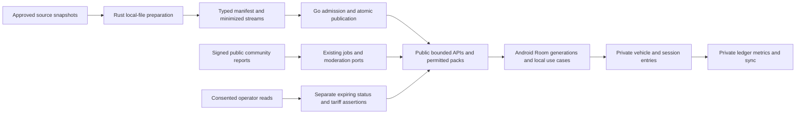

# Full EV support — researched extension to mobile expansion

Date: 2026-10-20. Status: PLANNING_LOCAL_DONE / IMPLEMENTATION_PLANNED.
Scope: EE-00–EE-31, 32 sequential execution units, integrated into existing
[MEX](MOBILE_EXPANSION_EXECUTION_PLAN.md), not a separate replacement project.
Authority: requested deep source research and complete EV/hybrid data-support plan.
This request does not run implementation, publication, provider enrollment or
activation. [Research](EV_SOURCE_RESEARCH.md), [product rules](../product/EV_SUPPORT_CONTRACT.md),
[financial method](../product/EV_FINANCIAL_METHOD.md),
[validation](EV_SUPPORT_PLAN_VALIDATION.md), [starting prompt](EV_SUPPORT_EXECUTION_PROMPT.md).

## 1. Full support and acceptance boundaries

Complete support means every declared core journey works for BEV, PHEV and
non-plug-in hybrids: appropriate vehicle profile/reference, compatible charging
discovery/details, public community prices/experience, actual multi-component
tariffs or explicit unknown, local public data, private charging records and
valid costs/month comparisons/Premium sync. Preserve ICE/ANP behavior and IDs.

It does not mean every physical charger/model has been observed, every network
has licensed a live feed, every reported price is currently valid or every private
charging standard is supported. Track geographical/source/equipment/variant and
tariff/status coverage separately. Unknown is a supported truthful state; it
cannot conceal a missing required implementation or falsely count as verified.

No OCPP control server, remote start/stop, reservation, payment processor,
vehicle telemetry/OBD tracking, OEM-account connection, home-bill/receipt intake,
private-proof/business portal, iOS or route-feasibility guarantee is part of this
data/cost scope. Future D hold remains intact. Data-reader partnerships are source
adapters, not a covert early business portal. No contacts/purchases/accounts or
operator data access are authorized merely by this research plan.

One free vehicle, Premium additional vehicles within the existing ceiling and
the previous professional/cloud capability matrix apply equally to EVs. PHEV
counts once. Preserve legacy/expired-owner read/export/correction/delete rights;
do not introduce pay-to-contribute or paid trust/removal.

## 2. Verified source strategy and inspected local architecture

The [source register](EV_SOURCE_RESEARCH.md) qualifies 25 source/data classes;
23 are external families/protocols and two are first-party. Public documentation
and selected PDF content were researched, not every raw file/hash/API contract.
Initial qualification priorities are Inmetro PBE, exact manufacturer supplements,
OCM open-licensed Brazilian records, community observations and private sessions.
OSM/Geofabrik requires explicit ODbL boundary admission. Commercial feeds are
conditional; do not buy or implement every possible provider to finish the core.
Retain rights/attribution/schema/version/freshness/coverage per assertion.

Important findings: OCM has mixed per-provider rights and an experimental Brazil
bulk export path; Google Places storage restrictions prevent assuming it is an
offline seed. PlugShare requests commercial access. TomTom's inspected matrix
marks Brazil static EV data but not dynamic. PBE URL/page/PDF dates require
independent version/byte inspection. ANEEL distributor tariffs are not final
charger/home-user prices, and their dataset metadata also declares ODbL.

Planning base: codex/mobile-expansion-plan at 47fded8c. Vehicle currently requires
TankCapacity/FuelProduct; existing FuelProduct is liquid/gas/LPG-specific, with
no EV energy unit. station-prep uses local-file/no-network/no-DB deterministic
Rust parsers and versioned artifacts. Room version is 16 in this inspected head;
actual next migration must use the current implementation head, never hardcode
this historical number. Go cloudsync/ledger/metrics and Android PRM09-T01 exist.
This inspection is not runtime acceptance. Occupied dev/primary work is untouched.

## 3. Module/data flow and local processing

Private ledger records do not feed public community data automatically. Operator
reads require actual access; this diagram does not enable a provider.

Recommended ownership, finalized in EE-02 before schema:

- Rust station-prep: pure source-specific vehicle-reference and charging-location
  readers, canonical minimized records, deterministic artifacts/census. No network,
  database or forced native Rust integration in the APK. Proposed artifact names
  charging-prepared-v1 and vehicle-energy-reference-v1 are frozen only in EE-03.
- Existing Go fetch/jobs/platform: verified HTTPS/approved bulk source acquisition,
  leases, private temporary files, bounded source discovery and admission.
- Logical charging module inside the Go monolith: provider assertions, location →
  equipment → connector identities, tariff/status projections and public reads.
  Directory links are optional explicit ports, not CNPJ/coordinate auto-merges.
- Existing community module: signed typed EV tariff/access/experience observations,
  quotas/helpfulness/moderation/privacy via explicit charging-target ports. Do not
  force electricity into liquid-price rows with fake fuel/unit values.
- Existing ledger/metrics/cloudsync: private vehicle energy fields, charging
  sessions, exact methods, revisioned reports and consented sync. No public raw
  private session copy or generic Room replication.
- Android domain/application/data/app: compatible typed values, pure local
  calculations, Room, durable outbox and existing Compose/WorkManager patterns.

Batch flow: approved source snapshot → bounded Rust preparation → typed manifest
and source streams → strict Go integrity/rights/census admission → atomic immutable
publication/projection → bounded API/manifest/pages → Android validated Room
generation → local search/filter/detail/calculation. Community writes instead use
the existing proof/intake/jobs pattern with EV scope and independent evidence.
Authorized live partner status is a separate bounded feed with expiry, not a
per-search Rust process or a static catalog field labelled live forever.

Android public data may be selected-city/region/favorite snapshots/pages under
recorded storage limits; whole-country offline support requires a measured pack
budget, not automatic multi-GB PBF download. Bind origin, schema, source/license,
revision vector and filters. Delta bases/tombstones are validated; unknown base
requires resumable full resnapshot preserving local private records. Hashes check
integrity, not authority; use approved authenticated source/HTTPS roots and the
existing server trust model. Restricted provider rows are excluded from offline
packs unless their specific license permits them.

## 4. Splicing into MEX without cycles or duplicate work

The [machine-readable dependency map](EV_MEX_DEPENDENCIES.json) is planning
metadata, not runtime configuration. It contains 78 nodes: 77 execution units
(including conditional EE-17) and the aggregate MEX-20 gate. Its acyclic order
was checked as documentation. At execution revalidate real accepted checkpoints;
an ID being listed does not mean its dependency is complete. Select one ready
unit at a time; external-access absence does not gate the required core on EE-17.

Do not run the old MEX plan to completion before adding EV fields. Keep task IDs.
At the current execution head record which entries are reused/repaired/new.

1. MEX-00/01/02/03 inventory/contracts/baseline, then EE-00/01/02/03 contracts.
   These EE gates precede dependent vehicle/ledger/sync schema and Android forms.
2. MEX-04–06 place-search work stays reusable; EE-04–09 source/catalog/backend
   proceeds after its accepted contracts. No new mobile API consumer before its
   owning backend contract/integration.
3. MEX-07 hosted slot gate remains canonical. EE-10 extends hosted vehicle energy
   data after MEX-07; EE-19 precedes/reconciles MEX-08 local admission/model so
   legacy migration is tested together. The slot policy still has one owner.
4. MEX-09 exact financial parity plus EE-11 cost method precede MEX-10 and EE-15/16
   private ledger/report extensions. EE-12/13/14 public community/tariff backend
   can follow accepted charging contracts independently of paid provider access.
5. MEX-11 private Room/outbox plus EE-18/19 local public/vehicle data precede
   MEX-12/13 and EE-20–23 Android journeys. Reconcile shared migrations into one
   append-only current chain; never create competing same-version migrations.
6. MEX-14/15 and EE-24 sync/restore extension complete together before cloud
   acceptance. MEX-16/PRM real billing gates remain unchanged. EE-17's optional
   live provider integration is recorded separately if access is unavailable.
7. MEX-28–31 master query contracts gain EE-25 before final discovery acceptance.
   MEX-32/OPT-A and EE-26 share one refresh/cache/concise-copy implementation.
8. MEX-33/34 consume EE-27 actual acceptance; MEX-35 consumes EE-28 benchmarks;
   MEX-36 consumes EE-29 regression. MEX-37 runs the combined union once after
   those gates. EE-30 prepares the shared operational manifest before MEX-38;
   it does not require completed MEX-38. EE-31 follows MEX-37/38 and EE-30;
   MEX-39 requires EE-31. This is a dependency DAG, not mutual acceptance.
   Remote publication requires separately valid explicit authority.

This order permits independent work when external access is missing. It never
permits declaring a dependent local API/UI accepted with absent required code.
Do not overwrite work already completed by another agent; integrate its history
and rerun only checks invalidated by actual source/config changes.

## 5. Microtask execution contract

Apply AGENTS, FAST_EXECUTION, DELIVERY_WORKFLOW and MEX's per-task protocol.
Read current PROGRESS, selected task and relevant code/tests; no archive dump.
One bounded unit: documented B-BR/BUC/risk → RED/GREEN/REFACTOR → actual targeted
tests/critical real DB concurrency/failure checks → affected format/build/static/
wire/secret/diff review → evidence → atomic English commit → next dependency.
No per-task CI polling/PR/merge or redundant aggregate suites. Failures are fixed
before dependent work; tests are never weakened or replaced with zero selectors.

Evidence: docs/backend/evidence/ev-support/EE-NN.md, with exact tested input/head,
source/config/policy, counts, commands/results and rollback/remaining gates.
Record source access/rights/device/provider gaps accurately. LOCAL_DONE and PASS
mean completed declared local acceptance only; INTEGRATED, DEPLOYED and
RELEASE_CERTIFIED need their actual independent evidence. Split an oversized
implementation into suffixed bounded children before coding, never to bypass a
critical check. Reuse valid existing work rather than bookkeeping-only commits.

### EE-00 — Reconcile EV source and MEX implementation inventory
- Depends: MEX-00. Rules: B-BR-EV-01/24; journeys BUC-EV-01/12. Risk: source integrity.
- Deliver: actual current vehicle/carrier/unit/schema/PRM/FQ/community/Rust/Room
  map and EE/MEX ownership/dependencies, preserving foreign dirty work.
- Acceptance: resolve tested/committed facts; identify pending work, exact tool
  commands and supported versus unimplemented states, without runtime mutation.
- Recovery/commit: preserve all worktrees; scoped inventory/evidence commit.

### EE-01 — Qualify sources, rights and reproducible Brazilian samples
- Depends: EE-00. Rules: EV-03/05–09/15; journeys EV-02/03/08/12. Risk: rights/PII.
- Deliver: source admission records for initial sources, licensing/offline/display
  boundaries, actual Brazilian sample formats/IDs/clocks and provider access gaps.
  Source register roles are not blanket implementation approval.
- Acceptance: verify actual resource bytes/profile/source metadata, rights and
  minimization; distinguish DOCS_ONLY, SAMPLE_VERIFIED, RIGHTS_PENDING and
  ACCESS_PENDING; no user/contact/raw-private data in Git/logs.
- Recovery/commit: skip an unqualified optional source, not license safeguards.

### EE-02 — Freeze propulsion, entities and cross-language numeric contract
- Depends: MEX-01/02, EE-00. Rules: EV-01–07/10–12/16–22; journeys EV-01–12.
  Risk: compatibility/exact money/privacy.
- Deliver: pure values/ports/wire examples for energy-capable vehicles, variant
  references, place/EVSE/connector, tariff components, status, reports and private
  sessions. Freeze typed method/unknown enums, input scales/ceilings and source
  policy using recorded evidence; no invented trust weights or liquid defaults.
- Acceptance: reviewed worked vectors, enum evolution, legacy IDs/fuel values,
  private/public boundaries and capability matrix; no database implementation yet.
- Recovery/commit: amend unpublished contract; no silent schema decisions later.

### EE-03 — Freeze versioned preparation and census manifests
- Depends: EE-01/02. Rules: EV-07/08/23; journeys EV-02/03/09/12. Risk: ingestion.
- Deliver: source-specific pinned profiles, artifact schemas, stable IDs/field
  provenance/rights/clocks and stream-level census. Define deterministic bytes,
  forward compatibility and no-partial fatal failure. Data transport is not trust.
- Acceptance: hand-checked fixtures for nested places/equipment/connector counts,
  duplicates/aliases/unknown metadata, tamper, truncated input and changed license.
- Recovery/commit: old source profiles remain readable; new import stays disabled.

### EE-04 — Rust charging-location preparation
- Depends: EE-03 and admitted OCM Brazilian source snapshot path.
  Rules: EV-05–09; journeys EV-03/09/12. Risk: untrusted parsing/license/PII.
- Deliver: local-file deterministic OCM/reference-data profile, canonical source
  hierarchy/identity, exact numeric units, license/field minimization and full
  independent source-record reconciliation; reuse station-prep architecture.
- Acceptance: actual approved whole-Brazil snapshot under frozen budgets, missing
  lookups/unknown enums/conflicting children/depth/byte/time bounds, repeat
  determinism and Rust unit/fmt/clippy; no API key/network/DB inside preparer.
- Recovery/commit: refuse unknown/corrupt/unlicensed required data, preserve old output.

### EE-05 — Rust vehicle-reference preparation
- Depends: EE-01/03. Rules: EV-02–04/07/08; journeys EV-01/02/12. Risk: source math.
- Deliver: actual PBE profile and approved exact-version manufacturer supplement
  path. Prefer actual available structured bytes; for PDF-only use a reviewed
  bounded extraction adapter then strict native profile, not guessed CSV columns.
  Any new PDF/parser dependency needs need/license/security evidence first.
- Acceptance: independent actual whole-source row/unit/header/footnote oracle,
  broken page/merged header, MJ/km versus equivalent km/L, unknown capacities,
  corrections and hashes; lab references never become personal measurements.
- Recovery/commit: quarantine unsupported reference revisions, retain manual entry.

### EE-06 — Strict Go prepared bridge
- Depends: EE-04/05. Rules: EV-07/08/23; journeys EV-02/03/09/12. Risk: critical boundary.
- Deliver: versioned manifest/integrity/census/rights/ID admission through module
  ports, bounded typed streams and no synthetic source adapter bypass.
- Acceptance: actual Rust→Go parity plus late corruption/cancel/close/duplicate/
  changed-reference/license/oversize failure returns no partially admitted batch;
  finite resource/descriptor cleanup and affected race/build/static checks.
- Recovery/commit: leave runtime producers off until storage/publication gates pass.

### EE-07 — Append-only charging/reference storage
- Depends: EE-06. Rules: EV-02/03/05–09; journeys EV-01–03/09/12. Risk: SQL/migration.
- Deliver: source-owned immutable revisions/assertions and typed hierarchy with
  same-revision constraints, staging/atomic census and optional reviewed Directory
  links. No CNPJ unique-per-site assumption or cross-module generated SQL.
- Acceptance: real PostGIS upgrade/replay preserves existing source/vehicle data,
  invalid units/references, multiwriter/staging locks/rollback and query plans;
  deterministic sqlc generation before compilation.
- Recovery/commit: forward repair, new producer disabled; no old migration edits.

### EE-08 — Verified ingestion jobs and conservative reconciliation
- Depends: EE-07. Rules: EV-05–09/23; journeys EV-03/09/12. Risk: jobs/identity/SSRF.
- Deliver: bounded approved HTTPS/source discovery, trusted CLI/private files,
  leases, cleanup-before-publication, immutable correction/replay, merge/split
  review and source coverage. OSM adapter is a separate suffixed task only after
  rights/need admission; do not implement every commercial candidate by default.
- Acceptance: real preparer→Go→PostGIS whole-source replay/correction/census,
  retry/ack-loss/cleanup, source missing/partial snapshot, conflicting duplicates,
  never-auto-close/never-auto-bind, nonroot image/CI wiring and dead-budget bounds.
- Recovery/commit: imports/schedules default-off; retain last accepted public state.

### EE-09 — Public charging/reference APIs and bounded queries
- Depends: EE-08. Rules: EV-03/05/09/10/15/22/23; journeys EV-02/03/08/09/12.
  Risk: public SQL/wire/freshness.
- Deliver: filters/pages/detail/reference lookup, equipment hierarchy, coverage,
  explicit compatible/unknown and source/time/rights metadata. Cursors/ETags bind
  full filters/revision vector; no ingestion/provider fan-out in requests.
- Acceptance: real HTTP/OpenAPI/PostGIS complete traversal, new query EXPLAIN and
  bounded round trips, unknown connectors/no-price/no-coordinate/access, correction,
  cancellation/kill switch and no private-field exposure.
- Recovery/commit: disable new read surface, preserve fuel/ANP/Directory routes.

### EE-10 — Hosted vehicle energy-capability migration
- Depends: MEX-07, EE-02/09. Rules: EV-01–04/21; journeys EV-01/02/10/12.
  Risk: auth/compatibility/SQL.
- Deliver: extend existing vehicle ports/cloud DTOs with explicit propulsion and
  optional battery/tank/capabilities; keep IDs and current slot ownership. Handle
  older clients without silently erasing newer fields on partial updates.
- Acceptance: real owner/auth/concurrent update/import/restore/upgrade and legacy
  premium-fuel enum tests; BEV without tank, PHEV once, HEV without external charge,
  unknown version/model and no invented battery backfill.
- Recovery/commit: disable new energy edits, retain all existing vehicles/history.

### EE-11 — Exact tariff and energy cost engine
- Depends: MEX-09, EE-02. Rules: EV-04/11/12/17–19; journeys EV-04/06/07/11.
  Risk: critical money/math.
- Deliver: pure Go/Kotlin exact billing/scenario calculation and shared Rust wire
  parity for supplied components; source eligibility/steps/grace/tax/min/max and
  actual paid amount remain distinct. Unsupported mandatory components are UNKNOWN.
- Acceptance: all financial-method vectors plus boundary/overflow/rounding,
  member/standard, free-with-parking, changed tariff, timezones and partial windows.
- Recovery/commit: disable incomplete estimate/ranking, retain raw rates/actual totals.

### EE-12 — Signed community EV observation commands
- Depends: EE-09/11. Rules: EV-11/13/14/16/22; journeys EV-04–06/12.
  Risk: critical auth/privacy/replay/SQL.
- Deliver: typed charging-target ports, per-condition/component dated observations,
  signed free-account intake, owner correction/withdrawal/replay, bounded quotas
  and durable existing jobs/moderation integration. No GPS or document requirement.
- Acceptance: actual signed HTTP→DB/jobs with cross-owner/forged/body-replay,
  retired/wrong equipment, unknown tariffs, simultaneous submissions, rollback,
  erasure and no private-session/home-address publication.
- Recovery/commit: close new intake only, keep held owner data and safe public reads.

### EE-13 — EV community projection, conflicts and moderation
- Depends: EE-12; accepted existing community/trust/moderation source.
  Rules: EV-11/13–15/22; journeys EV-04/05/08/12. Risk: public claim integrity/jobs.
- Deliver: source-separated dated price/access/experience projections, typed
  helpfulness/report/operator-review lifecycle, duplicate/dependent evidence
  accounting and correction/expiry invalidation. Calibrate EV promotion/freshness
  with actual evidence; keep reported-only until that gate is accepted.
- Acceptance: API→worker→read real PostGIS, conflict/hidden/deleted/self support,
  repeated-source lineage, stale job/version, expiry without write, rollback and
  no payment weight/automatic hardware certification or live-occupancy claim.
- Recovery/commit: dated claims only or disable projection, never fake verified price.

### EE-14 — Tariff/public observation reads and comparable ranking
- Depends: EE-09/11/13. Rules: EV-09/11–15/22/23; journeys EV-03–05/08/11.
  Risk: public pricing/freshness/SQL.
- Deliver: exact source/condition/scope tariff and community history, contextual
  energy-rate or scenario-total ranking, missing components and freshness states.
  Do not flatten time/session/parking into an invented universal BRL/kWh.
- Acceptance: real wire/OpenAPI/SQL complete filtered pages, stable ties, ETag/
  cursor full scope, source correction/expiry/unknown price, not-free defaults,
  indexed plans and no cross-operator member discount leakage.
- Recovery/commit: remove comparison capability, retain labelled source facts.

### EE-15 — Private electric session backend
- Depends: MEX-10, EE-10/11. Rules: EV-04/16–19/21; journeys EV-06/07/10.
  Risk: critical money/privacy/SQL.
- Deliver: extend ledger with owner-vehicle sessions, measurement basis, actual
  energy/total, optional SOC/odometer, fees/tariff snapshot and explicit event
  clocks, corrections/deletion/segments. No document/utility scraping.
- Acceptance: real signed CRUD/expected-revision/idempotency, PHEV/fuel coexistence,
  null measurements, month/reset/gap, foreign owner, concurrent edit, upgrade/
  rollback, privacy erasure and no automatic public observation.
- Recovery/commit: disable new session writes, retain raw records/data exit.

### EE-16 — Electric/hybrid reports and correction invalidation
- Depends: EE-15; extends existing PRM06/metrics rather than a parallel report service.
  Rules: EV-03/04/17–19/21; journeys EV-02/06/07/10. Risk: money/SQL/jobs.
- Deliver: bought versus measured/reference energy metrics, compatible monetary
  cost/km, month/category/vehicle comparison and unknown reasons. Fix PHEV distance
  basis; no all-distance-to-each-carrier ratio or wallet/session double count.
- Acceptance: actual ledger→report HTTP/SQL with golden parity, unequal weights,
  crossing months/timezones, late corrections, SOC change/reset/gaps and erasure.
- Recovery/commit: keep totals, suppress invalid ratio; bounded projection rebuild.

### EE-17 — Optional licensed operator read adapter and access handoff
- Depends: EE-01/09/14. Rules: EV-07/09/11/15/23/24; journeys EV-04/08/12.
  Risk: external access/security/freshness.
- Deliver: when authorized access exists, pin partner OCPI/version/modules or
  documented API and implement bounded status/tariff reads with secret rotation,
  expiry and scope. Without access, document ACCESS_PENDING plus executable port
  contract/failure tests; do not invent a feed or claim live proof.
- Acceptance: authorized real sample and provider fault tests when available;
  wrong scope/replay/old timestamp/outage/quota/cancel/revoke, unknown instead of
  available. No arbitrary endpoints, scraping, payments or charging commands.
- Recovery/commit: turn adapter OFF, catalogue/dated community remain functional.

### EE-18 — Android typed public snapshot and Room import
- Depends: EE-09/14; coordinate public persistence with OPT-A/MEX-25/32.
  Rules: EV-07/20/22/23; journeys EV-03/04/08/09/12. Risk: local SQL/integrity.
- Deliver: strict transport DTOs and bounded pages/optional regional packs with
  source/profile/license/revision metadata, atomic Room generations and resumable
  validated deltas. Existing accepted fuel/history/private data survives migration.
- Acceptance: actual SQLite upgrade/reopen/interrupted download, corrupt hash/
  wrong base/source/origin/schema, tombstone/resnapshot, disk bounds, no-store and
  restricted-provider exclusion; off-main decoding and current Android regression.
- Recovery/commit: discard only uncommitted public generation; never wipe user DB.

### EE-19 — Android energy-capable vehicle model and configuration
- Depends: EE-10/18; coordinate MEX-08 and PRM09, no duplicate slot gate.
  Rules: EV-01–04/10/21; journeys EV-01/02/10/12. Risk: retained identity/migration.
- Deliver: pure values/Room/UI for BEV/PHEV/HEV/MHEV and reference/manual unknown
  capabilities, optional capacities and connectors using existing vehicle UX.
- Acceptance: actual migration and legacy edit/restore, one free PHEV/BEV,
  verified extra slot/offline lapse, BEV no tank, HEV no charge fields, exact variant
  selection, account switch, localized units and enum compatibility.
- Recovery/commit: preserve all IDs/data, disable only new capability editing.

### EE-20 — Private charging Android entry and durable recovery
- Depends: MEX-11/12, EE-15/19. Rules: EV-04/16–21; journeys EV-06/07/10.
  Risk: private persistence/input/money.
- Deliver: session forms/list/correction, home/work/public context, actual/unknown
  values, tariff simulation versus actual total, drafts/outbox and clear local/
  pending states. No private home location/photo required or public auto-post.
- Acceptance: pt-BR energy/rate/SOC inputs, absent measurement, process death,
  double-save, account switch, late correction, SQLite rollback/JVM/lint/APKs.
- Recovery/commit: retain raw entries/drafts/read/export and no invented consumption.

### EE-21 — Compatible charging discovery Android
- Depends: MEX-06, EE-14/18/19. Rules: EV-05/09–12/15/20/22; journeys EV-03/04/08/09.
  Risk: compatibility/public meaning/performance.
- Deliver: existing Explore filter/list/detail with compatible/unknown connector,
  AC/DC, access/hours/operator and scoped tariff/status/source age. Offline cached
  listing cannot show a live available or guaranteed fast-charge assertion.
- Acceptance: actual client contract, unknown/source conflicts, equipment versus
  connector count, mixed-location links, no-price/offline/filter change, stale
  cursor, lazy page window and large-font/accessibility/locales.
- Recovery/commit: hide EV-specific filter, preserve existing fuel discovery.

### EE-22 — Community electric price/experience Android journeys
- Depends: MEX-32, EE-12/13/18/21. Rules: EV-11/13–16/20/22; journeys EV-04–06/09.
  Risk: signed writes/privacy/lifecycle.
- Deliver: free-account component/condition-aware price, access and experience
  forms, durable signed outbox/receipt/status, owner edit/withdrawal, helpfulness
  and report controls. Dated claim is distinct from operator live data.
- Acceptance: actual wire target/body proof, offline retry/process restart,
  forged/rejected/replayed/stale target, no mandatory GPS, no hidden private data,
  provider conflict, moderation-state presentation and locale/accessibility.
- Recovery/commit: disable EV intake only; preserve queued/held owner data safely.

### EE-23 — Android energy/cost/monthly comparisons
- Depends: MEX-13, EE-11/16/20. Rules: EV-03/04/17–19; journeys EV-02/06/07/11.
  Risk: financial presentation.
- Deliver: exact local pure calculations and server-compatible reports showing
  purchased/measured/reference basis, coverage, PHEV carrier separation and actual
  combined monetary cost, with unknown reasons and safe held-data export.
- Acceptance: Go/Kotlin golden parity, unit conversion/equivalent-km-L refusal,
  partial windows/SOC/month corrections, zero/missing values, weighted comparison,
  export safety and meaningful Android module checks.
- Recovery/commit: keep raw totals, hide invalid estimates/ratios; never change history.

### EE-24 — Extend Premium sync/backup/privacy for EV data
- Depends: MEX-14/15, EE-15/16/19/20. Rules: EV-02/16/18/21; journeys EV-01/06/07/10.
  Risk: critical owner/conflict/restore/privacy.
- Deliver: explicit allowlist/schema/partial-update compatibility for energy
  vehicle fields and eligible sessions/reports; public packs/source keys and
  home/route/secret data excluded. Reuse receipts/deletion epochs/restore preview.
- Acceptance: two-device actual client/SQL conflict, older client field survival,
  owner/origin switch, lapse/revoke, retry/lost ack, deletion after restored backup,
  migration and zero cross-owner/public leakage.
- Recovery/commit: uploads OFF, pending local data and free exit preserved.

### EE-25 — Electric master questions, filters and contextual rankings
- Depends: MEX-28/29/30 contracts, EE-14/21/23. Rules: EV-10–12/15/22/23;
  journeys EV-03/04/07/08/11. Risk: query/price meaning/SQL.
- Deliver: typed intents for compatible places, reported energy price and complete
  scenario cost; visible source/conditions/coverage and unknown fees. Keep liquid
  ANP price metrics separate; no global cheapest for unlike memberships/time/fees.
- Acceptance: deterministic query vectors, ambiguous cheapest/fastest, free with
  parking, missing component, actual indexed server filter before page and local
  late-response cancellation; supported results never depend on phone-only subset.
- Recovery/commit: structured filters remain if question interpretation is disabled.

### EE-26 — Shared refresh, stale status and performance policy
- Depends: MEX-32/OPT-A accepted work, EE-18/21/22/25.
  Rules: EV-09/15/20/23; journeys EV-03–05/08/09/11/12. Risk: freshness/load.
- Deliver: one bounded lifecycle/event/manual refresh policy per data class,
  cache/ETag full scope, source-specific expiry and status aging, no offscreen/
  offline provider polling or restart of an active equivalent slow request.
- Acceptance: burst convergence, stale tariff/status without DB write, reconnect,
  offscreen/offline stop, provider outage, loaded pagination retained and no fixed
  15-second promise across affected locales. Measure bytes and DB work separately.
- Recovery/commit: event/manual-only refresh with honest last-checked state.

### EE-27 — Actual source/community/private end-to-end acceptance
- Depends: EE-04–16/18–26 and accepted MEX private/source contracts and fixtures,
  not the final MEX-33/34 gates; optional EE-17 separate.
  Rules: EV-01–24; journeys EV-01–12. Risk: cumulative critical correctness.
- Deliver: independently pinned raw-source→Rust→Go→publication→Android data-import
  plus signed community→job→read and private ledger→report→sync acceptance.
- Acceptance: actual admitted complete source census/pages/hierarchy/lineage,
  privacy/tamper/replay/late correction, no-partial failure, source alias/deletion,
  unmatched/unknown field handling and meaningful test selectors; no mocks-only
  real-source/live-provider claim or copy of actual customer traces.
- Recovery/commit: fix source/transaction errors before dependent final acceptance.

### EE-28 — Bounded resource, coverage and failure benchmarks
- Depends: MEX-03 baselines, EE-27; extends MEX-35 without duplicated release runs.
  Rules: EV-08/20/23/24; journeys EV-03/09/11/12. Risk: resource/capacity.
- Deliver: measured prep duration/RSS/bytes, source/entity coverage, local search/
  first-content/scroll, backend SQL/latency, cache/disk and combined jobs budgets.
- Acceptance: cold/warm, dense connectors, whole admitted country source, rapid
  typing/filtering, interrupted regional download, disk/network/DB failures and
  contention without starving existing safety loops; no load against third parties.
- Recovery/commit: use simpler indexed/region-bounded strategy, document native proof OWED.

### EE-29 — Retained fuel/free/upgrade and privacy regression
- Depends: EE-24/27/28; extends MEX-36/37 selected inputs.
  Rules: EV-01/02/07/16/21/22/24; journeys EV-01/05/06/09/10/12. Risk: privacy/upgrade.
- Deliver: append-only PostgreSQL/Room chain, legacy fuel/ANP/catalog/private data,
  free account/community/vehicle behavior and source-license/public-private audits.
- Acceptance: actual old→new schema/restore, old client enum/field behavior,
  cross-owner/source cache, free held-data export/delete/correction after lapse,
  all-copy erasure fences and no EV license data silently relicensed MIT.
- Recovery/commit: scoped new-capability OFF with zero held-data loss.

### EE-30 — Provider/device/operational manifest and external gates
- Depends: EE-27–29 and existing operational contracts/runbooks, not completed
  MEX-38; both share candidate-manifest inputs. Rules: EV-07/15/23/24;
  journeys EV-08/09/12. Risk: false readiness/release.
- Deliver: immutable source/policy/capability/config/schema/license/rights/census
  manifest, rollback/repair and exact pending real partner/native/staging/billing
  proofs. No purchased access, source activation or deployment by implication.
- Acceptance: scoped local rehearsal/source evidence; authorized provider sample
  separately recorded, native/device checks prepared or run only under current
  permission/gates. Missing Brazilian dynamic coverage is explicit, not simulated.
- Recovery/commit: disabled unavailable provider, core dated data stays useful.

### EE-31 — Combined MEX/EV acceptance and delivery overview
- Depends: all required EE local gates plus applicable MEX-33–38 final matrix.
  Rules: EV-24; journeys EV-01–12. Risk: process/history integrity.
- Deliver: Portuguese task/commit/feature/test/measurement overview, complete
  declared-journey map and external dependency states. MEX-39 owns final delivery.
- Acceptance: one reconciled combined local union, no known deferred local
  failures, source/access/coverage counters honest and all other fronts preserved.
  No global 100%-of-chargers or unsupported live-network promise.
- Recovery/commit: stop at truthful INTEGRATION_PENDING by default; remote guarded
  dev→main integration/wiki only if separately explicitly authorized, never force,
  admin bypass, per-task polling or direct development push to main.

## 6. Test and command families

Use exact affected selectors/tools from backend/README and current MEX evidence.
Build/export any new trusted preparer alongside the existing required binaries,
and update CI/image smoke only when actually introduced. Rust unit/fmt/clippy,
shared numeric goldens, Go race/real PostGIS, query plans, sqlc deterministic
generation, OpenAPI/actual wire, real SQLite upgrades/reopen/concurrency and
affected JVM/lint/APKs are immediate task checks when affected. No zero-test
selector, feature-flag-disabled test path or compile-only behavioral acceptance.

Disposable database only; never point destructive tests to VPS/customer data.
PDF/PBF/archive and source retrieval tests use pinned private minimized fixtures
or approved raw snapshots, not a live national provider load campaign. Phone
permission/network/account/device state is not changed by this planning task.
Native/device and paid-provider gates obey existing explicit deferrals/authority.
Run secret/PII review and git diff --check per task; a raw hash is not proof of
legal permission or a trustworthy current price.

## 7. Exit gates and status vocabulary

- G-EV-CONTRACT: EE-00–03 frozen, source-specific boundaries and MEX splice known.
- G-EV-DATA: EE-04–10 complete, actual admitted source census and public contracts.
- G-EV-COMMUNITY: EE-11–14 plus EE-22 actual signed report→job→public journey.
- G-EV-PERSONAL: EE-15/16/19/20/23/24 and owning MEX private/cloud gates complete.
- G-EV-LOCAL: EE-18/21/25/26/27–29 and applicable MEX matrix complete.
- G-EV-EXTERNAL: actual licensed partner/native/runtime proofs scoped separately;
  ACCESS_PENDING/RIGHTS_PENDING/PROOF_OWED are never translated to PASS.
- G-EV-CORE: all required local declared journeys pass on pinned combined inputs,
  with external capability/data-coverage limits disclosed. No source/deployment/
  commercial/release certification follows automatically.

The implementation agent continues independent units when a commercial/optional
provider is inaccessible, retaining explicit unknown states. A required PBE/OCM
source/rights/actual-file gap is a real G-EV-DATA dependency, not permission to
replace actual data acceptance with a synthetic example and call it complete.
