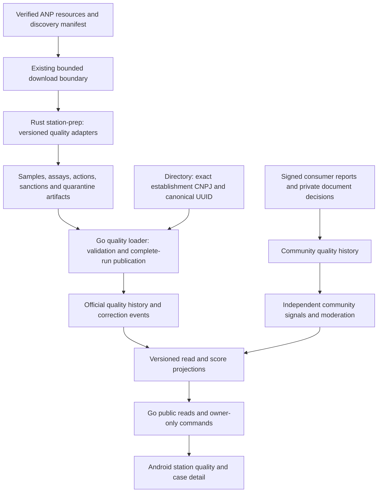

# Fuel quality evidence and station reliability implementation plan

**2026-10-14 D deferral — adopted maintainer restriction:** [Future D](FUTURE_EVIDENCE_BUSINESS_PLAN.md) supersedes earlier timing for FQ-10 and document attachment in FQ-15. They are DEFERRED_FUTURE until the app is extremely consolidated and has thousands of real clients, unless the maintainer explicitly requests earlier named D scope. FQ-00–08 source evidence remains intact; official history/non-document reporting need not wait. The dependency slices below prevent deferred proof work from blocking selected document-free delivery or being implemented under another label.

Status: PLANNING_LOCAL_DONE / IMPLEMENTATION_PLANNED.
Date: 2026-10-14. Scope: requested Abastevo quality feature, Android/backend.
Owning task namespace: FQ-00–FQ-17. Actual source acceptance is recorded in current PROGRESS and linked task evidence; unstarted target scope is PLANNED except the explicitly DEFERRED_FUTURE D overlap.

This is a local planning deliverable. It does not implement a parser, schema,
API, score, national backfill or mobile flow; it does not publish issues, a PR,
wiki, deployment or a release. The [target product rules](../product/FUEL_QUALITY_TARGET_CONTRACT.md)
own proposed behavior; the [continuation prompt](FUEL_QUALITY_EXECUTION_PROMPT.md)
bounds future implementation. Existing B-BR, BUC, phase IDs and acceptance
obligations retain their meanings.

## 1. Intended product and delivery boundary

Give every canonical station an auditable quality profile: official laboratory
samples and assays by fuel; enforcement and sanction history with their actual
procedural status; separately identified consumer experiences; and an explainable,
versioned reliability score when evidence supports publication. A station with
insufficient evidence still has a profile and an explicit unavailable score.

First useful increment: official PMQC timeline with sample/assay detail, source
links, dates and coverage. Subsequent increments add enforcement/sanctions,
structured consumer reports and documentation, then calibrated scoring and
complete Android journeys. There is no laboratory procurement, paid trust,
automatic regulator complaint submission, new tenant model, iOS resumption,
machine-learning classifier or new always-on service in this scope.

Interpretation of the request to let users validate "100% of official cases":
make every safely matched published case reachable through complete pagination,
with its source/revision, and let authenticated users request a linkage review
or attach a related experience. User activity cannot certify chemical quality,
overrule a laboratory result, conclude a legal proceeding or establish that all
national stations have been sampled. These are explicit product boundaries,
not claims of already available coverage.

Execution follows [ADR-019](../adr/019-android-vps-integration-first.md),
[ADR-020](../adr/020-maintained-dev-main-delivery.md) and the
[delivery workflow](DELIVERY_WORKFLOW.md). Complete/reconcile the affected
app-first checkpoints and active safety/privacy work before selecting dependent
quality implementation. This overlay does not silently reorder P34–P38,
P25–P33 or their pending obligations. Catalog ingestion has already advanced:
reuse its verified implementation rather than repeating an old plan.

One bounded FQ task at a time on maintained dev synchronized with main. Isolate
an occupied checkout, preserve its edits and reconcile the planning patch into
dev before implementation. Backend contracts and immediate critical tests
precede app consumers. Local checkpoints can advance authorized construction;
protected dev → main integration, current required Quick verification and owned
wiki publication belong to authorized batch closure. G24/G09/P10 and native
acceptance remain separate. No elapsed-time estimate is a delivery commitment.

## 2. Inspected baseline and reuse

Planning base: local dev `757c09ae9a30d211d89e6f0f9a25e02dc9634cd3`.
Locally recorded main `a349d7c` is its ancestor; remote refs/checks were not
refreshed. The primary checkout was detached at `e22824db` with an unrelated
Evidence Store edit. Planning is isolated in the attached fuel-quality-plan
worktree; no primary checkout file or occupied dev branch was changed.

- [Rust station preparation](RUST_STATION_INGESTION_PLAN.md) and
  [PMQC parser](../../tools/station-prep/src/pmqc.rs) already exist. The current
  five-column PMQC extract creates coordinate candidates; it does not preserve
  assays, measured results, units or conformity. Its sample-level deduplication
  must not be reused to discard separate assays. Preserve its output contract
  and add a distinct versioned quality stream.
- [Go prepared loader](../../backend/internal/modules/directory/adapters/registry/prepared.go)
  and Directory own catalog writes and canonical identity. Rust prepares bounded
  artifacts; Go validates and publishes through explicitly owned modules.
  There is no Rust write access to canonical/shared tables.
- [Station reliability audit](../backend/STATION_RELIABILITY_AUDIT_20261013.md)
  records source-adapter corrections and separately authorized staging national
  registry activation on 2026-10-13. This is identity/location evidence, not
  fuel-quality ingestion or newly verified live readiness.
- [Domain model](../backend/DOMAIN_MODEL.md),
  [data model](../backend/DATA_MODEL.md), existing Account/Identity, Evidence,
  Moderation, Privacy and Jobs are the integration boundaries. Contributor trust,
  price confidence, social agreement and business-profile badges are distinct
  from a station quality score.
- [Fuel feedback](../product/STATION_FUEL_FEEDBACK.md) already defines personal
  1–5 ratings and bounded comments. Preserve those rules. A new quality incident
  is a structured report, not another rating denominator.
- Private operational media keeps the existing 24-hour ceiling. Receipt,
  workshop or laboratory documents need explicit admissibility and minimization;
  the separate training consent never authorizes retaining quality documents.

These are inspected code boundaries and linked historical evidence. No runtime
test, fresh production audit, live receipt verification or quality import was
performed during planning.

## 3. Official source register, checked 2026-10-14

### S-FQ-01 — PMQC laboratory monitoring

The [official PMQC page](https://www.gov.br/anp/pt-br/centrais-de-conteudo/dados-abertos/pmqc-programa-de-monitoramento-da-qualidade-dos-combustiveis)
lists 2016–2025 annual resources and January–September 2026 resources, published
on 2026-10-13. It describes ZIP packages containing CSV/JSON and assay-level
conformity. PMQC is monitoring, not an enforcement action.

Plan historical discovery from 2016 through the latest verified edition; do not
hardcode the last year/month or assume complete annual coverage. The current
page sends both February and July links to the same resource: inventory resolved
URLs, byte hashes and internal period values and retain the discrepancy. A link
label alone cannot prove a missing month's data is present.

The supplied field list is a candidate mapping, not a frozen raw schema.
FQ-00 must verify actual sample identifiers, headers/types, assay/result/unit/
conformity vocabulary and sample grouping from metadata and bounded real input.
[Metadata](https://www.gov.br/anp/pt-br/centrais-de-conteudo/dados-abertos/arquivos/pmqc/pmqc-metadados.pdf)
and [analysis guidance](https://www.gov.br/anp/pt-br/centrais-de-conteudo/dados-abertos/arquivos/pmqc/orientacoes-analises-pmqc.pdf)
were linked, but this planning browser could not extract them: both responses
advertised DOCX despite PDF suffixes. Do not declare their contents revalidated.
Validate media type and magic bytes; freeze the parser after examining them.

### S-FQ-02 — Enforcement actions

The [official enforcement page](https://www.gov.br/anp/pt-br/centrais-de-conteudo/dados-abertos/acoes-de-fiscalizacao)
describes monthly updates with approximately two months of publication delay.
Its visible resource labels are 1998–2018 and 2019–2025, the latter updated
2026-09-21. Actual contained coverage and identifier/linkage fields still need
FQ-00 inspection; the page date does not establish 2026 record coverage.

Keep action, notice/infraction, interdiction and proceeding references distinct
when actually supplied. An action is not automatically about fuel chemistry.
The ANP warns that an infraction is established only after definitive judgment;
preserve allegations, outcomes and unknown/finality status separately.

### S-FQ-03 — Fines and proceeding snapshots

The [official fines page](https://www.gov.br/anp/pt-br/centrais-de-conteudo/dados-abertos/multas-aplicadas-com-vencimento-a-partir-de-2016)
describes annual extraction snapshots; visible editions extend through 2025.
They provide proceeding/infraction references, agent data, amounts and status
as of extraction. A fine or paid amount alone is not independent evidence of a
definitive fuel-quality finding. Do not infer appeal exhaustion or current status.

The [metadata](https://www.gov.br/anp/pt-br/centrais-de-conteudo/dados-abertos/arquivos/mav/metadados-multas-aplicadas-2016a2019.pdf)
declares annual updates and CC BY reuse. Verify attribution, schema and scope
for each source/edition; dataset licensing is distinct from repository MIT.
No real fine payment, billing or collection functionality is introduced.

### S-FQ-04 — Identity and official complaint channel

The [current retailer registry](https://www.gov.br/anp/pt-br/centrais-de-conteudo/dados-abertos/dados-cadastrais-dos-revendedores-varejistas-de-combustiveis-automotivos)
was updated 2026-10-14. Reuse Directory full-establishment CNPJ/UUID resolution.
Current registry membership does not prove historical identity or sampling of
every station; absent historical CNPJs remain unresolved instead of disappearing.

The [ANP complaint guidance](https://www.gov.br/anp/pt-br/canais_atendimento/ouvidoria)
links the channel for regulated agents. Mobile opens the official guidance;
the user chooses whether to submit. An optional claimed protocol remains private,
unverified and separate from imported ANP events.

## 4. Architecture and ownership



Add a proposed `quality` bounded context inside the existing Go modular monolith,
with domain/application/adapters and sqlc-owned SQL. Its official and community
records have separate types, commands and projections. Promote this architecture
from proposal only after FQ-01 records ownership and any necessary ADR.

Ports: Directory identity reader; quality source/batch repository; public
timeline reader; private report repository; existing caller/account proof,
Evidence document decision, Moderation, Privacy and transactional Jobs ports.
Share a unit of work for writes plus outbox jobs; no cross-module nested commits
or direct writes to Directory/Profile/price/trust tables.

Reuse existing scheduler, leases, fencing, dedupe, quotas and guarded download.
Quality discovery gets its own source/edition budget and disabled-by-default
activation control. Do not replace the active registry schedule or use a
coordinate loader to publish quality. New archive/encoding dependencies require
measured need, lockfile, license/security review and bounded adversarial tests.

### Proposed records, not applied migrations

- `quality_import_runs` and `quality_source_revisions`: source/edition/URLs,
  source extraction time, fetch time, raw hash/size, parser/schema versions,
  counts, coverage, completeness, predecessor and publication state.
- `quality_samples`, `quality_assays`: source-native sample reference, full
  source CNPJ, collection date, original product, canonical fuel or unmapped
  reason, assay reference/name, original result text, exact parsed value when
  meaningful, unit and source conformity. Non-numeric results remain text.
- `quality_station_links`: reviewed/automatic exact binding, effective dates,
  station UUID, source record/revision, reason and superseding correction.
  Unresolved/ambiguous records have no public station association.
- `quality_enforcement_events`, `quality_sanction_revisions`: typed native
  action/infraction/proceeding references, category, dates and extraction-time
  status. Links require exact documented keys; unrelated sanctions stay outside
  the fuel-quality score and clearly categorized in the timeline.
- `quality_consumer_reports`, report decisions and document-verification
  decisions: owner reference, stable command ID, station/fuel, claimed purchase
  date, structured symptom, bounded text, optional official-event revision and
  private evidence references. Claims and independently checked facts differ.
- `quality_projection_inputs`, `quality_current`, `quality_score_revisions`:
  published input revision/cutoff, policy/hash, as-of/expiry, explainable counts,
  current flags, nullable score and unavailability reasons.

Names are proposed; assign migration numbers at execution from the actual head.
Use FKs, unique semantic keys, exact decimal numeric values, UTC server instants
and date-only source dates without invented midnight time precision. Add
station/fuel/date/id keyset indexes and source/natural-key lookup indexes.
Do not add partitions/materialized-service infrastructure without measured need.

Business corrections append a new revision/supersession or withdrawal marker.
A corrected linkage removes a wrong station's active association and rebuilds
both projections without erasing audit history. Personal data remains subject
to deletion/minimization and restore replay; append-only is not perpetual PII
retention. Public official history cannot be overwritten by user commands.

### Loss accounting and publication

For each raw resource: input = accepted + exact duplicates + quarantined.
For accepted logical records: accepted = matched + unmatched + ambiguous +
out-of-scope. Report rows, assays, samples and independently collected visits
with different denominators; one sample with ten assays is not ten samples.

A frozen manifest binds all streams/hashes and their counts. Reject truncated,
wrong-edition, unknown-schema or mismatched artifacts before publication.
Stage bounded chunks and atomically publish one complete source revision with
its required projections/visibility watermark. Failure leaves the previous
published revision usable. Concurrent/replayed imports converge; no partial run
changes the public score. Duplicate resources/views are not independent evidence.

Matching uses validated full CNPJ, source chronology and explicitly reviewed
succession. Name, address, brand or proximity alone never assigns a negative
event to a station. Unknown CNPJ, duplicate active binding, incompatible dates
or unresolved succession goes to review with a reason and replayable source.
Quality import never creates a station or approves its coordinates implicitly.

## 5. Reliability score proposal and publication gate

A score is in scope, but an arbitrary weighted mix is not an implementation
specification. FQ-12 must freeze the following candidate against actual data
before FQ-13 implements it; the target contract remains a proposal until then.

1. Compute by canonical station + fuel + explicit historical window W using
   eligible, distinct official sample units. Preserve assays beneath each
   sample. Follow verified ANP aggregation guidance; incomplete/unknown samples
   are disclosed and excluded rather than classified conforming.
2. Baseline candidate: `score_bp = floor(10000 * C / (C + NC))`, where C/NC
   count eligible conforming/nonconforming sample units. Expose a 0–100 display
   index with frozen rounding. This describes the observed historical samples;
   it is not a probability that today's fuel is safe.
3. Keep evidence sufficiency separate: eligible/excluded counts, distinct visits,
   date span, latest collection, publication lag and fuel coverage. Publication
   requires frozen W, minimum sample/visit thresholds and freshness limit.
   Zero eligible samples or failed thresholds produce null and reason codes,
   never a manufactured 0, 50 or 100.
4. Initially exclude community volume, ratings, complaint votes, payment, brand,
   profile badges and pending/non-quality enforcement from the numeric formula.
   Show relevant official actions and community signals independently. A future
   composite requires a new documented/calibrated policy and acceptance suite.
5. A station-wide summary exposes per-fuel scores and coverage. Do not average
   sampled gasoline into a score for unsampled diesel. A single station-wide
   numeric score remains unavailable until a separately frozen aggregation/
   coverage policy passes FQ-12; every station still returns a score-state object.
6. Show dated nonconformities even when a later score is high. New conforming
   samples can change the current calculation without deleting prior findings.
   Reimporting the same sample, repeating assays or republishing annual/monthly
   files cannot increase support.

Calibration compares the simple baseline with a dimensions-only display and
alternative conservative summaries, using time-separated, station-grouped
evaluation. Measure sample selection bias, sparse coverage, publication delay,
corrections, outliers and stability across geography/fuel. Document parameters,
excluded sources, sensitivity, sample denominator and known limits. Do not claim
national predictive validity from targeted monitoring data.

Publication gates: reviewed methodology and wording; reproducible golden cases;
null/sparse/stale behavior; deterministic correction/rebuild; bounded query
latency; visible source/as-of/version/explanation; default-OFF score feature.
If calibration cannot justify a numeric index, ship the timeline/dimensions and
retain FQ-13 numeric publication as BLOCKED with the missing decision/evidence.

## 6. Consumer reports, verification and complete case access

A signed-in free account can report a structured experience or request review
of a source/station association. Anonymous users can inspect public official
records. Canonical station UUID and catalog fuel are server-validated; there is
no normal manual station-ID entry or body-supplied authoritative owner.

Symptom candidates: engine failure, starting difficulty, power loss, changed
consumption, appearance/odor, requested station test, pump discrepancy, other.
A pump-volume complaint is not a chemical nonconformity. Keep structured values
and bounded normalized text compatible with existing 280-scalar comment rules.

Evidence levels: USER_REPORTED; DOCUMENT_SUPPLIED; PURCHASE_CHECKED only through
an independently verifiable method with a recorded policy/verifier decision.
A receipt image, OCR success, plausible NFC-e key, matching CNPJ or user protocol
does not alone verify a genuine purchase. Extra workshop/lab documentation is
labelled by its actually checked provenance, not promoted to ANP evidence.

FQ-10 freezes accepted document formats, issuer/CNPJ/date/fuel linkage, duplicate
receipt reuse, authoritative verification availability and failure states.
No external tax authority API, legal basis, availability or laboratory chain of
custody is assumed. Unsupported independent verification yields UNVERIFIED or
REVIEW_REQUIRED. Documents remain private; account deletion/export, appeals,
expired-proof downgrade and minimized decision retention are explicit.

Related official cases are attached by immutable event revision + station/fuel
compatibility. "I checked the source" is a user claim. A community symptom before
or after a PMQC sample is temporal correlation, not proof of the same tank/batch
or causation. Users can flag wrong linkage without suppressing the source record.

Community clusters are observation signals only. FQ-11 freezes time windows,
minimum independently attributable purchases and abuse handling from evidence;
the attachment's illustrative "3 buyers/14 days" is not an adopted rule.
One account across keys contributes once, duplicate receipts do not multiply
support and distinct accounts do not prove distinct people. Account farms,
coordinated abuse and unverified independence keep the signal under review.
No raw public accusation counter or automatic score penalty in v1.

"100%" acceptance is bounded and measurable: all records in each selected
complete published dataset reconcile to the manifest, and all matched eligible
public events are reachable exactly once across pagination at a frozen watermark.
Unmatched/quarantined records and upstream missing periods are visible coverage
gaps, not fabricated matches. The denominator is published with its edition.

## 7. Sequential implementation tasks

Each task records Inputs, B-BR/BUC, risk, scoped checks, tested revision, actual
result and recovery in its own evidence file when implementation starts.
Effort labels S/M indicate relative scope, not calendar estimates. Split M tasks
into letter-suffixed checkpoints before coding if they exceed one coherent
change. All dependencies below are source checkpoints unless explicitly live.

### FQ-00 — Reconcile current code and official source inventory (S)

- Depends: selection after affected app-first/safety checkpoints. Inputs: this
  plan, current PROGRESS, RST/audit evidence and official metadata/resources.
- Deliver: actual source headers/types/licenses, resource/period/hash inventory,
  native identifiers, scope exclusions, source availability and gap report.
- Tests/acceptance: bounded verified-TLS metadata/sample inspection; demonstrate
  the PMQC coordinate/assay difference; identify missing/duplicated period links.
  No bulk fetch or current live readiness claim. Docs/link/diff/secret checks.
- Recovery: retain inventory/hash evidence; unavailable resource blocks its
  adapter contract, not unrelated plan work.

### FQ-01 — Freeze product, module and batch contracts (M)

- Depends: FQ-00. B-BR-FQ-01–16; BUC-FQ-01–09.
- Deliver: adopted product rules, source-version mapping, semantic identifiers,
  sample/assay grouping, fuel vocabulary, ownership, manifest and golden fixture
  schemas; record an ADR only for a new durable architecture/policy decision.
- Tests/acceptance: synthetic contract cases cover every verified column,
  unknown fuels/status, repeated assays, same-day separate samples, correction,
  collision and missing identifiers. Numeric score policy remains for FQ-12.
- Recovery: revise unpublished contracts; preserve existing PMQC/location stream.

### FQ-02 — Extend Rust with lossless PMQC quality preparation (M)

- Depends: FQ-01. BUC-FQ-01. Area: existing station-prep plus shared fixtures.
- Deliver: separate sample/assay JSONL, native/raw values, source revisions,
  bounded parsing/sorting, exact duplicates, quarantine and manifest hashes.
- Tests/acceptance: RED→GREEN repeated/distinct assays, quoted fields, decimal
  comma/comparators/text, BOM/observed encoding, malformed/duplicate headers,
  unknown unit/conformity, reordered input, limits/truncation and deterministic
  outputs. Existing coordinate outputs/registry tests stay compatible.
- Recovery: disable new adapter/output; no change to existing loader artifacts.

Native historical source clocks: [FQ-02C](../backend/evidence/fuel-quality/FQ02C_SOURCE_CLOCKS.md), LOCAL_DONE / INTEGRATION_PENDING. The versioned native contract preserves verified original unzoned clocks and derives calendar days without truncating source provenance.

### FQ-03 — Identity resolution and review policy (S)

- Depends: FQ-01; Directory audit reconciled. BUC-FQ-02.
- Deliver: read-only full-CNPJ resolution and reasoned unmatched/ambiguous/
  succession review; explicit link revision contract and independent clocks.
- Tests/acceptance: numeric/alphanumeric/leading-zero CNPJ, two active matches,
  wrong branch, historical replacement, renamed station and same address with
  different CNPJs. No fuzzy negative-event assignment or implicit station write.
- Recovery: remove proposed binding from publication; quarantine for review.

### FQ-04 — Go quality ledger, migrations and atomic publication (M)

- Depends: FQ-02/FQ-03. BUC-FQ-01/02/03. Critical SQL/jobs.
- Deliver: owned staging/history/links, immutable corrections, unique keys,
  complete-run watermark and transactional recomputation jobs.
- Tests/acceptance: immediate real PostGIS empty/upgrade/checksum/recovery,
  identical/divergent replay, concurrent loaders, crash before/after publish,
  bad manifest and partial stream; old published history/score remains usable.
- Recovery: disable quality publication and retain previous watermark; forward
  migration fixes and replay staged inputs, no destructive down/reset.

### FQ-05 — Historical backfill and incremental discovery (M)

Prepared bridge: [FQ-05C](../backend/evidence/fuel-quality/FQ05C_PREPARED_BRIDGE.md), LOCAL_DONE / INTEGRATION_PENDING. Monthly provenance/current-pointer prerequisite: [FQ-05W1](../backend/evidence/fuel-quality/FQ05W1_MEMBER_PROVENANCE.md), LOCAL_DONE. [Native worker composition FQ-05W5](../backend/evidence/fuel-quality/FQ05W5_WORKER_COMPOSITION.md) is LOCAL_DONE with imports default-off, after archive, Directory and file-job checkpoints. [Durable Directory revalidation FQ-05W6](../backend/evidence/fuel-quality/FQ05W6_DIRECTORY_REVALIDATION.md) closes the completed-job refresh prerequisite, [bounded live discovery FQ-05W7](../backend/evidence/fuel-quality/FQ05W7_LIVE_DISCOVERY.md) walks the verified official listing one archive per run, and [static worker image/schedules FQ-05W8](../backend/evidence/fuel-quality/FQ05W8_IMAGE_SCHEDULING.md) ships the pinned preparer in the distroless worker with explicit default-off schedules. FQ-06/07 live Go streams remain OWED. Local composition does not certify deployed imports; see the [remaining-work handoff](FUEL_QUALITY_REMAINING_HANDOFF.md).

- Depends: FQ-04. BUC-FQ-01/03. Critical download/jobs.
- Deliver: explicit dry-run/verify/load stages, edition registry, bounded fetch/
  archive handling, resume/retry and per-source budgets on existing worker.
- Tests/acceptance: synthetic ZIP traversal/bomb/CRC/truncation, redirects,
  changed bytes under same URL, duplicate period resources, overlap annual/
  monthly files, 429/outage, concurrent/restarted jobs and withheld withdrawals.
  No partial national publication; measured rows/bytes/RSS/runtime before scale.
- Recovery: stop quality discovery only; preserve registry schedule/history.
  Actual bounded staging backfill requires separately authorized execution.

### FQ-06 — Enforcement adapter and legally accurate events (M)

Rust adapter contract: [FQ-06](../backend/evidence/fuel-quality/FQ06_ENFORCEMENT_ADAPTER.md), LOCAL_DONE / INTEGRATION_PENDING. Runtime reconciliation (FQ-05W8): no live Go source stream exists — no prepare CLI, no composed import/discovery handler, no verified live resource inventory. Go typed publication is proven separately with real PostGIS.

- Depends: FQ-04; verified S-FQ-02 contract. BUC-FQ-01/04.
- Deliver: separate Rust adapter and Go typed publication for actions/infractions,
  exact station links, category/date and source-provided proceeding references.
- Tests/acceptance: duplicated actions, multiple infractions, non-quality cases,
  non-retail agents, missing CNPJ/status and exact-key conflicts; immediate SQL
  tests and honest allegation/finality labels. No proceeding inferred by name.
- Recovery: disable this stream and rebuild affected timeline projection.

### FQ-07 — Sanction snapshots, corrections and case correlation (M)

[Official SICOM fine preparer FQ-07R1](../backend/evidence/fuel-quality/FQ07R1_OFFICIAL_FINE_PREPARER.md) is LOCAL_DONE / INTEGRATION_PENDING with exact2025 source reconciliation and CPF minimization. It uses a separate native observation contract: due date is not decision date, extraction month is not an invented day, content observation identity is not a fine number. [Typed native Go boundary FQ-07R2](../backend/evidence/fuel-quality/FQ07R2_VERIFIED_FINE_BRIDGE.md) is LOCAL_DONE with real Rust→Go2025 reconciliation; [Native storage prerequisite FQ-07R3A](../backend/evidence/fuel-quality/FQ07R3A_NATIVE_FINE_STORAGE.md) is LOCAL_DONE with actual105→106/clock/money/transaction guards; [Native publication and clock read contracts FQ-07R3B](../backend/evidence/fuel-quality/FQ07R3B_NATIVE_FINE_PUBLICATION.md) are LOCAL_DONE with empty/correction/history/actual-wire acceptance; [Native file/process/job boundary FQ-07R4A](../backend/evidence/fuel-quality/FQ07R4A_NATIVE_FINE_FILE_IMPORT.md) is LOCAL_DONE with actual Rust→PostGIS recovery; [Native fine worker/discovery/image FQ-07R4B](../backend/evidence/fuel-quality/FQ07R4B_NATIVE_FINE_WORKER.md) is LOCAL_DONE with imports/schedule off and real2025 reconciliation; [Historical native fine profiles FQ-07R5A](../backend/evidence/fuel-quality/FQ07R5A_HISTORICAL_FINE_PREPARER.md) are LOCAL_DONE with complete independent native reconciliation; [Verified historical Rust→Go boundary FQ-07R5B](../backend/evidence/fuel-quality/FQ07R5B_HISTORICAL_FINE_BRIDGE.md) is LOCAL_DONE; [Compatible historical storage FQ-07R5C](../backend/evidence/fuel-quality/FQ07R5C_HISTORICAL_FINE_STORAGE.md) is LOCAL_DONE with real107→108/negative/concurrency acceptance; [Historical atomic publication/public contracts FQ-07R5D](../backend/evidence/fuel-quality/FQ07R5D_HISTORICAL_FINE_PUBLICATION.md) are LOCAL_DONE with complete seven-resource Rust→Go→PostGIS/all-page acceptance; history worker/image activation, complete runtime/station history and safe station links remain OWED.

Rust adapter contract: [FQ-07](../backend/evidence/fuel-quality/FQ07_SANCTION_SNAPSHOTS.md), LOCAL_DONE / INTEGRATION_PENDING. Historical runtime reconciliation (FQ-05W8): adapter fixtures alone did not certify runtime history. Native2025 fine CLI/typed Go/worker/discovery/image are now LOCAL_DONE through FQ-07R4B; historical variants and safe station links remain OWED.

- Depends: FQ-06; verified S-FQ-03 contract. BUC-FQ-03/04.
- Deliver: extraction-time status revisions, exact case linkage, monetary source
  values kept exact and separately categorized relevance.
- Tests/acceptance: appeal/unknown/final states only when source proves them;
  paid/partially paid/null values never imply guilt/finality; multiple annual
  snapshots do not multiply one sanction. Real SQL concurrency/recovery.
- Recovery: quarantine uncertain linkage; keep action and sanction independently
  visible with their proven scope, no false joined legal outcome.

### FQ-08 — Official read API, timeline and coverage (M)

Historical completion: [FQ-08H evidence](../backend/evidence/fuel-quality/FQ08H_HISTORICAL_READS.md), LOCAL_DONE / INTEGRATION_PENDING. Explicit source-bound revision selection and live catalog preserve complete reachable edition/correction history; no runtime import or deployment is implied.

- Depends: FQ-04/FQ-06/FQ-07. BUC-FQ-04/09.
- Deliver: additive OpenAPI schemas, bounded station/fuel summary, keyset event
  pages, sample/assay detail and source/edition/coverage/explanation fields.
  Route names are frozen here; this plan creates no successful endpoint.
- Tests/acceptance: anonymous public reads, unknown UUID/fuel, bounded filters,
  ties/cursor tampering, concurrent revisions/watermark, no sensitive fields,
  stale/cache/source-down distinction and complete frozen-edition traversal.
  Real SQL EXPLAIN/load before any denormalization.
- Recovery: turn quality reads off; existing station/price/community reads work.

### FQ-09 — Signed structured reports and case-link review requests (M)

- Depends: FQ-08 and current account/moderation/privacy contracts. BUC-FQ-05/08.
- Deliver: pure report rules, owner-only commands/status, stable idempotency,
  related official revision, moderation/review and transactional job intent.
- Tests/acceptance: account proof/rotation/revocation, guest denial, IDOR,
  forged owner/station/event/fuel, stale event revision, invalid dates/text,
  duplicate/replayed/parallel commands and rollback. Immediate real PostGIS.
- Recovery: stop new report intake; retain owner recovery/status and review audit.

### FQ-10 — Private documents and purchase verification decisions (M)

State amendment: **DEFERRED_FUTURE / D_GATE_REQUIRED**. No implementation or intake before the future D gate or an explicit earlier named maintainer request. The original target acceptance below remains for that future scope.

- Depends: FQ-09; existing media retention/provider prerequisites. BUC-FQ-06/08.
- Deliver: minimized document policy, verifier port, typed checked/unverified/
  failed/review-required outcomes, private binding and expiry/rights handling.
- Tests/acceptance: fake/mismatched/reused receipt, OCR-only evidence, foreign
  owner/media, verifier outage/revocation, forged claimed protocol, expiry,
  concurrent attachment/erasure, every-copy cleanup and restore non-resurrection.
  Real disposable SQL/S3 now; actual provider/24h proofs remain named live gates.
- Recovery: refuse new attachments/checked status when prerequisites fail;
  do not extend TTL or retain documents through training consent.

### FQ-11 — Community signal and moderation policy (M)

Document-free review slice: LOCAL_DONE / INTEGRATION_PENDING; [actual evidence](../backend/evidence/fuel-quality/FQ11_DOCUMENT_FREE_REVIEW.md). Purchase-supported independence, receipts and public promotion remain D-held; this is not full future acceptance.

- Depends: FQ-09 for an explicitly frozen document-free review/signal slice; purchase-checked/document-supported clustering additionally requires FQ-10 and the D gate. BUC-FQ-07/08. Never label unverified reports as checked independent purchases; retain incomplete future acceptance.
- Deliver: independently supported signal policy, review/appeal reasons,
  source-separated aggregation and abuse/resource ceilings.
- Tests/acceptance: linked keys, self support, account farms, repeated receipts,
  coordinated timing, negative/positive official history, erased/hidden reports
  and concurrent moderation/recompute. Official facts/numeric v1 score unchanged.
- Recovery: suppress public community signal and retain controlled review intake.

### FQ-12 — Calibrate and freeze score methodology (M)

Frozen judgment methodology and independent oracle: [FQ-12](../backend/evidence/fuel-quality/FQ12_METHODOLOGY.md), LOCAL_DONE / INTEGRATION_PENDING. Eligible sample semantics, Aspecto exceptions, replica/unknown conservatism and dimensions-only `UNSCORED` states are frozen; numeric weights and sufficiency thresholds remain deliberately unfrozen, so no numeric score is published.

- Depends: FQ-05/FQ-08 and reviewed representative evidence. BUC-FQ-09.
- Deliver: versioned methodology, eligible sample semantics, W/minimum counts/
  visits/freshness, fuel/station coverage, rounding, reason codes and bias report.
- Tests/acceptance: hand-calculated independent oracle, sparse/stale/missing fuel,
  many assays in one sample, repeat editions, recent adverse finding despite high
  history, time-separated evaluation and correction/recovery examples.
  No invented thresholds, paid inputs or national predictive promise.
- Recovery: keep dimensions-only display; unresolved calibration blocks numeric
  publication. New statistical dependencies require recorded review.

### FQ-13 — Deterministic score engine and projections (M)

Engine and fenced recomputation: [FQ-13](../backend/evidence/fuel-quality/FQ13_PROJECTIONS.md), LOCAL_DONE / INTEGRATION_PENDING. Versioned per-station/fuel dimension rows bound to the frozen basis and input digest; stale bases can never overwrite newer ones and no numeric score exists before calibration.

- Depends: accepted FQ-12 methodology; FQ-04 jobs. BUC-FQ-03/09.
- Deliver: pure versioned calculator, reproducible input snapshot, nullable
  per-fuel score/coverage, as-of/expiry and existing-worker recomputation.
- Tests/acceptance: RED→GREEN policy vectors, order invariance, no duplicate
  support, exact rounding/overflow, time boundary, correction/moderation/privacy
  invalidation, lease fencing and concurrent publication on real PostGIS.
  Stale/unknown outputs refused even if worker is down.
- Recovery: disable score display/revert policy projection; retain official
  history and separate community signal. Never silently rewrite old policy IDs.

### FQ-14 — Android official quality and score journeys (M)

- Depends: FQ-08/FQ-13, canonical station/fuel navigation and shared origin.
  A timeline-only increment can consume FQ-08 before score publication.
- Deliver: station quality entry, fuel selectors, dated summary, sample assays,
  action/sanction details, complete paginated history and score explanation.
- Tests/acceptance: guest path, no samples, unavailable score, latest nonconformity,
  unknown enums, wrong station/late response, cancellation, source refresh/stale
  cache, disabled flags; affected JVM/contract/lint/APK immediately.
- Recovery: disable the quality entry/score flag separately. Preserve modules,
  com.anpfuel, local catalog, price screens and existing feedback meanings.

### FQ-15 — Android report, document and official case response (M)

Document-free source slices [signed owner client](../backend/evidence/fuel-quality/FQ15A_SIGNED_OWNER_CLIENT.md) and [Android form/recovery](../backend/evidence/fuel-quality/FQ15B_ANDROID_OWNER_REPORTS.md) are LOCAL_DONE / INTEGRATION_PENDING. Durable offline intent remains FQ-16; native execution OWED. Document attachment/verification remains D-held.

Scope amendment: document-free reporting/case response can be selected separately. Private document attachment/verification is **DEFERRED_FUTURE / D_GATE_REQUIRED**. Record accepted versus deferred slices; do not claim full original FQ-15 acceptance from the document-free slice.

- Depends: FQ-09/FQ-14 and any displayed accepted document-free FQ-11 slice; private-document features additionally require FQ-10 and the D gate.
- Deliver: free-login gated form, own report/status, optional private documents,
  linkage-review request and official ANP guidance link with deliberate handoff.
- Tests/acceptance: plain-language evidence levels, no auto-reporting, expired/
  rejected/unverified evidence, document minimization, replay/double tap, origin/
  account switch, logout/erasure and accessible confirmation/error recovery.
- Recovery: disable new report/document actions while retaining owner recovery.

### FQ-16 — Offline, privacy and end-to-end compatibility (M)

Local source slices [public offline cache](../backend/evidence/fuel-quality/FQ16A_PUBLIC_OFFLINE_CACHE.md), [encrypted intent journal](../backend/evidence/fuel-quality/FQ16B1_ENCRYPTED_JOURNAL.md) and [durable dispatch/erasure](../backend/evidence/fuel-quality/FQ16B2_DURABLE_DISPATCH.md) are LOCAL_DONE / INTEGRATION_PENDING. Actual SQLite/JVM acceptance and APK/lint compilation pass; deferred native execution and full live-source end-to-end acceptance remain OWED. Neither this status nor queued commands certify server receipt or complete FQ-17.

- Depends: FQ-14 and the selected accepted FQ-15 slice plus affected existing offline/privacy checkpoints; unselected D document features do not block document-free acceptance.
- Deliver: bounded public history cache and owner-scoped stable command outbox
  only where backend deadlines permit; stale labels, migration/expiry/erase.
- Tests/acceptance: offline before/after cache, process death/restart, clock
  rollback, expired proof, reconnect backlog quotas, foreign owner/origin,
  revoked account, restore deletion replay and no media retention extension.
  An offline request is queued, not an acknowledged official validation.
- Recovery: disable dispatch/cache feature; purge only owned expired/private
  material through the tested lifecycle, never reset another user's database.

### FQ-17 — Scoped acceptance, staged rollout and delivery (M)

- Depends: selected preceding task acceptances; unresolved obligations listed.
- Deliver: exact source/app/backend/policy/config/dataset manifest, all-record
  traversal reconciliation, measured cost/capacity, rollback rehearsal, bounded
  staging E2E and end native/accessibility evidence when authorized/due.
- Tests/acceptance: zero-user official value, known adverse case and later
  recovery, unmatched historical station, complete timeline, document outage,
  correction/rebuild, minority fuel/no score, privacy erasure and import failure.
  Each 100% assertion names its denominator and immutable tested watermark.
- Recovery: independently disable imports, reports, signals or scores; preserve
  public factual history and recovery jobs where safe. Final required current
  Quick verification/reviews and guarded delivery never certify G09 by themselves.

## 8. Validation command and evidence contract

Planning-only checks: all changed/new Markdown links and anchors, task/BUC/B-BR
cross-references, states/dependencies, whitespace and scoped secret/PII review.
No runtime aggregate suite is needed for these documentation changes.

For implementation, choose only affected commands from the existing
[backend workspace](../../backend/README.md) and
[test strategy](../backend/TEST_STRATEGY.md). Existing building blocks:

```sh
cargo +1.99.0 fmt --manifest-path tools/station-prep/Cargo.toml --check
cargo +1.99.0 clippy --locked --manifest-path tools/station-prep/Cargo.toml --all-targets -- -D warnings
cargo +1.99.0 test --locked --manifest-path tools/station-prep/Cargo.toml
./gradlew :domain:test :application:test :data:testDebugUnitTest :app:testDebugUnitTest :app:lintDebug :app:assembleDebug
git diff --check
```

Run Go module tests/vet, sqlc generation/vet and real-PostGIS tests for each changed
critical area. FQ-01/04/08/09/13 must add exact package/test/contract invocations
to their task evidence when those packages/tests exist. Do not present commands
against a nonexistent quality package as runnable acceptance today.

Use disposable, explicitly selected PostGIS/S3 following backend/README; never
use destructive integration fixtures on staging or a shared dev database.
Existing full isolated acceptance is
`bash scripts/tests/test-local-backend.sh`; reserve it for the scoped union at
batch closure when justified by the changed surfaces. No repeated aggregate
run for record-only edits or waiting for PRs.

Each task evidence names behavior revision, commands, actual test counts,
environment, failures and recovery. Source acceptance is LOCAL_DONE /
INTEGRATION_PENDING; native/provider/24h/production evidence can remain OWED
only where explicitly deferred, and blocks its associated live gate.

## 9. Risk register and rollout decisions

- Wrong-station allegation: full-CNPJ/date binding and quarantine; correction
  withdraws the association and rebuilds both stations with restricted audit.
- Source gaps/schema drift: resource inventory, native keys, hash revisions,
  unknown vocabulary, complete-run visibility and explicit coverage states.
- Misleading score/selection bias: sample-level denominators, sufficiency gate,
  per-fuel scope, chronology, methodology version and no predictive claims.
- Procedural/legal mislabeling: exact source status and extraction date; alleged,
  pending and proven outcomes remain distinct; no inference from payment.
- Coordinated consumer abuse: provenance/duplicate controls, conservative
  independence, moderation/appeals and no automatic official-score penalty.
- Private documents: private S3, minimization, bounded retention, owner proof,
  every-copy cleanup, erasure/restore replay and no training-purpose crossover.
- VPS overload/backfill costs: measure bytes/records/RSS/disk/index/WAL/runtime,
  HTTP latency and worker queue lag; source-scoped budgets, checkpoints and
  pause on declared resource limits. No new service or hardware promise.
- Operational misclaim: historical ingestion/device evidence does not accept
  this feature; record actual rollout/head/base/checks and remaining blockers.

Rollout sequence: offline synthetic contracts → disposable SQL/S3 source checks
→ authorized small staging official import and reads → bounded historical scale
→ report/document controls → score shadow evaluation → limited score publication
→ Android acceptance → protected authorized delivery/release gates.

First implementation action is FQ-00 after current-head/dependency selection.
Public numeric scoring, official dataset coverage and purchase verification
remain unavailable until their own acceptance is demonstrated.

## 10. Local planning acceptance

Planning validation: PASS, 2026-10-14, isolated dev-derived base 757c09ae.
The scoped Python document inspection checked 43 added/new local links,
19 target anchors, FQ-00–17 order, required task dependency/delivery/acceptance/
recovery fields and all 16 B-BR / 9 BUC definitions. New-file whitespace and
high-confidence secret patterns passed; git diff --check and the repository
tracked-secret scan passed. Changed prose was reviewed for private records,
credentials, precise contributor GPS and production media; none was added.

Only ROADMAP, current PROGRESS, the Rust plan cross-reference and these three
quality documents changed. No runtime suite, official raw dataset import,
score-calibration run, backend/Android build or remote check is claimed.
Actual raw schemas, statistical thresholds, verification providers and live/
native/production gates remain for the explicitly named implementation tasks.
This accepts the local plan, not FQ-00–17 functionality or source integration.
